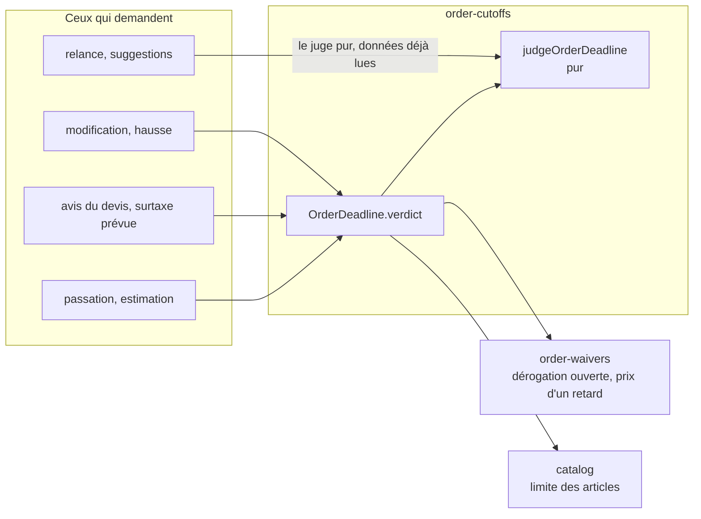

# Le verdict de l'heure limite

> ✅ **État, bâti le 2026-11-19** (commits `01016cec0` à `bc9ff3f8a`, puis le
> retrait de l'ancien jugement). « Trop tard ? » a une seule réponse, rendue par
> le délai de commande (`lafoliecoffee/order-cutoffs`). Le plan qui l'a bâti
> est retiré ; ses deux contradictions par `vitruve` sont dans l'historique
> git. Les pistes qui restent (les lignes bloquantes et leurs gestes, l'arrêt du
> plan dans le verdict) sont à la fin, **non bâties**.

## 1. En deux mots

Une commande demande une journée. Trois limites peuvent la refuser : la
**règle générale** du commerce (« la veille à 23 h », avec un rattrapage), la
**limite propre d'un article** (« 2 jours avant, 12 h », sans rattrapage), et,
pendant le rattrapage, l'absence de **dérogation**.

Tout cela se juge à **un seul endroit**. Celui qui a besoin de savoir pose une
question ; le délai de commande rend un **verdict** :



Le verdict est **ouvert** (jusqu'à telle heure), **en rattrapage** (jusqu'à
telle heure, avec la dérogation qui ferait passer et ce qu'elle coûte), ou
**fermé**. Il garde la limite retenue dans les trois états, dit ce qui l'a
retenue, et juge chaque ligne.

Celui qui demande **applique** : la passation laisse passer, passe sur une
dérogation qu'elle dépense dans sa transaction, ou refuse.

## 2. La technique

### 2.1 Le juge pur

`judgeOrderDeadline` (`apps/lfd-api/src/lafoliecoffee/order-cutoffs/domain/deadline/judge-order-deadline.ts`) :
sans port, sans horloge. Il reçoit la règle en vigueur, la limite de chaque
article, la journée, l'instant et la dérogation ouverte, déjà lus.

- **La plus stricte gagne toujours** (Hugo, 2026-10-21) : chaque ligne est
  jugée par la plus fermée entre la règle générale et sa propre limite ; le
  panier, par la plus fermée de ses lignes. Égalités : en rattrapage, la fin
  la plus proche ; ouvert, la limite la plus proche ; sinon la première
  retenue, c'est-à-dire la règle générale.
- **Seule la règle générale a un rattrapage** : une limite d'article ferme
  sèchement, même si une grâce est encore rangée sur l'article.
- **Un panier vide, aucune limite : tout passe.**
- **Une dérogation n'ouvre que le rattrapage** : le type du verdict ne porte la
  dérogation que sur la variante `grace`. La règle n'est pas vérifiée, elle
  est inexprimable.
- Les trois états et leurs bornes (incluses) vivent dans `decideOrderLimit`
  (`packages/contracts/src/order-cutoff.ts`), partagé avec les écrans.

`priceLateness` ajoute la surtaxe à un verdict en rattrapage qui a une
dérogation, si un réglage existe. `generalRuleStatus` dit la règle générale
seule, rattrapage compris.

### 2.2 La question

`OrderDeadline` (`order-cutoffs/application/deadline/order-deadline.ts`), publié
par la porte du contexte (`lafoliecoffee/order-cutoffs/index.ts`) :

- `verdict({ skus, serviceDay, at, asker })`, où `asker` dit la clientèle des
  limites d'article (`pro` aujourd'hui, partout), la société (pour sa
  dérogation) et si la dérogation est **considérée** (passation, estimation,
  surtaxe prévue) ou **ignorée** (avis, modification, hausse) ;
- `generalRuleStatuses(days, at)` : la règle générale de plusieurs journées,
  lue une fois — la question de la relance.

`JudgingOrderDeadline` lit en parallèle ce que la question demande, et
seulement cela. Ses sources, une par capacité
(`order-cutoffs/domain/deadline/ports/deadline-sources.ts`) :

| Port                                        | Implémenté par                                                      |
| ------------------------------------------- | ------------------------------------------------------------------- |
| la règle en vigueur (`OrderCutoffsInForce`) | `order-cutoffs` lui-même                                            |
| `ItemOrderLimitsReader`                     | `CatalogItemOrderLimitsReader`, sur la lecture publiée du catalogue |
| `OpenWaiverReader`                          | `order-waivers` (`PrismaOpenWaiverReader`)                          |
| `LateFeeSettingReader`                      | `order-waivers` (`RepositoryLateFeeSettingReader`)                  |

Le service vit dans `OrderCutoffsModule`, qui importe `CatalogModule` et
`OrderWaiversModule`. Pas dans `OrderCutoffsInForceModule` : le catalogue
l'importe, et y lire le catalogue fermerait un cycle.

### 2.3 Ceux qui appliquent

| Lecteur                                                                                                 | Question                                             | Ce qu'il en fait                                                                                                                                                         |
| ------------------------------------------------------------------------------------------------------- | ---------------------------------------------------- | ------------------------------------------------------------------------------------------------------------------------------------------------------------------------ |
| passation client, invité, boutique, saisie et estimation de l'équipe (`OrderDrafting.ensureNotTooLate`) | dérogation considérée, à l'horloge                   | `admitWithinDeadline` : passer, passer sur la dérogation (dépensée dans la transaction de la commande, avec sa surtaxe), ou `orders.cutoff.grace` / `orders.cutoff.past` |
| avis du devis et de l'estimation (`OrderCutoffNotice`)                                                  | ignorée                                              | ouvert → la limite ; rattrapage → sa fin ; fermé → rien                                                                                                                  |
| surtaxe prévue du devis d'une société (`ForeseenLateFee`)                                               | considérée, rien de dépensé                          | la surtaxe du verdict ; rien sur stock                                                                                                                                   |
| modification du client (`OrderRevising.ensureBeforeCutoff`)                                             | ignorée, à l'instant du geste                        | `admitWithinDeadline`, ancienne et nouvelle journée ; l'équipe n'y est pas soumise                                                                                       |
| révisabilité                                                                                            | ignorée                                              | ouverte jusqu'à la limite ; sinon `past_cutoff` nommant la limite franchie                                                                                               |
| hausse carte                                                                                            | ignorée                                              | la limite la plus proche des deux journées, quel que soit l'état                                                                                                         |
| relance de règlement                                                                                    | `generalRuleStatuses`                                | sonne dès que la règle générale n'est plus ouverte                                                                                                                       |
| suggestions (`keepOrderable`)                                                                           | le juge pur, avec la limite du candidat déjà chargée | garde ce qui est ouvert                                                                                                                                                  |

La dépense d'une dérogation est **exclusive** : `consume` lit le compte et
refuse une dérogation déjà servie (`orders.cutoff.waiver_spent`), dans la
transaction de la commande — commande, clé d'intention et lien de règlement
sont annulés avec elle.

### 2.4 Ce qui reste ailleurs, et pourquoi

- **La vitrine, les journées proposées, le fournil** lisent la règle pour
  l'**annoncer** (`shownItemOrderLimit`, `nextFulfillmentDay`,
  `announcedOrderUntil`, l'arrêt automatique du plan) : ils ne jugent pas de
  panier. La boutique ne reçoit aucune règle, seulement les heures annoncées,
  rattrapage non compris.
- **La fenêtre d'une opération datée** (`order-operation-guard.ts`) : une autre
  règle, sans dérogation.
- **Le plan arrêté et le « jour même »** : gardes de la passation
  (`ensureDayOpen`), voir la piste P2.

### 2.5 La porte

`lint:order-deadline-door` (`dev-toolbox/gates/order-deadline-door.mjs`) :
hors du juge, personne n'importe une fonction de décision du contrat
(`decideOrderCutoff`, `decideOrderLimit`) ni l'ancien jugement. Dette vide.

## 3. Ce qui reste

- Les pistes P1 et P2 ci-dessous : à inventorier sur ce code avant d'en faire
  un plan (Hugo, 2026-11-19 : « bâtir d'abord, puis faire l'inventaire des
  capacités »).
- Le dépassement d'une limite de produit par la commerciale
  ([`plan-passer-outre-la-limite-produit.md`](plan-passer-outre-la-limite-produit.md)) :
  à réécrire sur le verdict, où il devient une donnée de `asker` et une
  propriété de la limite d'un article.
- **Le « jour même » dans le verdict** ? « Trop tôt » plutôt que « trop tard ».
- **Fusionner `order-waivers` dans `order-cutoffs`** ? La dérogation et la
  surtaxe n'existent que par l'heure limite ; les fusionner déménage des tables
  et des droits (`b2b_order_waivers`, `b2b_late_fee`).
- **La fenêtre d'une opération datée dans le verdict**, par une raison de plus.

## Pistes, non bâties

Écrites et contredites le 2026-11-19, avant le bâti. Elles décrivent une
intention, pas le code.

### P1. Ce qui bloque, et les gestes de réponse

Demandé par Hugo le 2026-11-19 : « il faut savoir quelle ligne du panier est
bloquante pour pouvoir avoir les gestes de réponse ». Un refus qui ne dit pas
**quoi** fait chercher ; un refus qui le dit propose **quoi faire**.

**Aujourd'hui**, personne côté serveur ne sait quelle ligne ferme : la garde
rend une décision agrégée (§ 2.3), et l'avis (`OrderQuoteCutoffView`,
`packages/contracts/src/order.ts:1600`) n'a que `status` et `until`. La
boutique le recalcule **elle-même**, à partir des limites que la vitrine lui
sert (`decideDayNotice`, entrée `cartLimits`,
`apps/lfc-ecommerce-frontend/src/app/client/shop/service-day-notice.rules.ts`) :
« Un article de votre panier : trop tard pour jeudi, possible à partir de
samedi » (`limites-produit.md` § 6). C'est une quatrième copie du jugement,
en navigateur.

**Le verdict le dit, ligne par ligne.** `LineVerdict` gagne :

```ts
interface LineVerdict {
  readonly status: OrderCutoffStatus;
  /** La limite qui juge CETTE ligne (jamais `plan_closed` : la journée se lit sur le panier). */
  readonly source: "general_rule" | "item_limit" | "none";
  readonly limit: Instant | null;
  /**
   * Les limites que cette ligne a FRANCHIES, la plus fermée d'abord — vide si
   * elle passe. Les deux à la fois quand l'article et la règle générale sont
   * passés tous les deux.
   */
  readonly crossed: readonly CrossedLimit[];
  /** La première journée où CETTE ligne passerait, dans l'horizon ; `null` sinon. */
  readonly firstOpenDay: string | null;
}

/** Une limite franchie, de quoi la dire telle qu'elle a été réglée. */
interface CrossedLimit {
  readonly source: "general_rule" | "item_limit" | "plan_closed";
  /**
   * La règle telle qu'elle JUGE : pour une limite d'article, rattrapage à 0
   * (`withoutGrace`), jamais la grâce rangée sur l'article. `null` pour un plan
   * arrêté. : « 2 jours avant, 12 h », rattrapage compris. */
  readonly rule: OrderLimitSpec | null;
  /** L'instant où elle est tombée pour cette journée ; `null` pour un plan arrêté. */
  readonly limit: Instant | null;
  /** La fin du rattrapage ; égale à `limit` pour une limite d'article. */
  readonly graceEnd: Instant | null;
  /** `grace` : encore rattrapable ; `closed` : plus du tout. */
  readonly status: "grace" | "closed";
}
```

Demandé par Hugo le 2026-11-19 : « et quelle limite a été franchie par
ligne ». C'est ce qui permet de **dire** le refus (« Le pain au levain se
commande 2 jours avant, 12 h : c'était hier midi ») et de **choisir** le
geste : une limite d'article franchie se lève par le retrait de la ligne ou
le dépassement ; la règle générale franchie, par la dérogation ou une autre
journée.

Et le verdict d'un panier fermé ou en rattrapage porte **les gestes qui le
débloquent**, dérivés par le domaine, jamais par l'écran :

| Geste                                                                                            | Quand                                                                                          | Qui                                      |
| ------------------------------------------------------------------------------------------------ | ---------------------------------------------------------------------------------------------- | ---------------------------------------- |
| **Retirer ces articles** (`remove_lines`, avec leurs SKU)                                        | des lignes `item_limit` ferment, et le reste du panier passe sans elles                        | tous                                     |
| **Choisir une autre journée** (`move_day`, avec la première journée où **tout** le panier passe) | toujours, si une journée de l'horizon convient                                                 | tous                                     |
| **Accorder une dérogation** (`grant_waiver`)                                                     | `grace` venu de la règle générale, sans dérogation ouverte, avec une société                   | l'équipe, avec `b2b_order_waivers:write` |
| **Passer outre la limite** (`exceed_item_limit`)                                                 | plus tard : [`plan-passer-outre-la-limite-produit.md`](plan-passer-outre-la-limite-produit.md) | l'équipe, avec son droit                 |

Le geste dit ce qui est **possible**. Les droits n'entrent pas dans le juge
pur : la question porte `asker.remedies`, **la liste des gestes que cet
appelant peut faire**, construite par une fabrique par point d'entrée
(`customerAsker`, `staffAsker(permissions)`, `systemAsker`), jamais par
défaut. La relance, la hausse et l'estimation n'ont pas de contrôleur au point
d'appel : elles passent `systemAsker` (aucun geste) ou reçoivent les
permissions de leur contrôleur. Un geste hors de cette liste n'est pas rendu.

**Les journées proposées** (`firstOpenDay`, `move_day`) ne se calculent pas
par une boucle de plus. Elles se composent avec la source qui sert déjà
`/fulfillment-days` (`list-fulfillment-days.handler.ts` : jours servis du
point ou de la livraison, plans arrêtés, « jour même »), sur le même horizon
(`NEXT_FULFILLMENT_HORIZON_DAYS`, 14 jours), et lisent les plans arrêtés de
l'horizon en **une** requête (`closedBetween(from, to)`). Un jour que
`/fulfillment-days` ne proposerait pas n'est jamais proposé.

**Le back-office** : le contrat de l'avis (`OrderQuoteCutoffView`) s'étend
**en ajoutant** (`lines`, `remedies`) ; il n'est servi qu'au staff
(`packages/contracts/src/order.ts:1613`, `toCustomerQuote` le retire).

**La boutique** ne reçoit aucun avis du serveur : `decideDayNotice`
(`service-day-notice.ts:70-97`) est un `computed` pur, recalculé à chaque
changement de panier et à chaque tic d'horloge, **sans requête**. Lui faire
demander le verdict au serveur multiplierait les appels (une par mutation du
panier, plus une relance quand une limite tombe pendant la saisie), sur une
base facturée à l'opération, et exposerait au client les règles franchies.
**Ce que la boutique ne doit pas savoir** (Hugo, 2026-11-19 : « on ne peut
pas cacher les règles de cutoff ? »). Aujourd'hui, elle ne reçoit déjà
**aucune règle** : seulement l'instant annoncé de chaque journée
(`FulfillmentDayView.orderUntil`, rattrapage **non** compris) et, pour un
article plus strict que la règle générale, son délai et son heure
(`shownItemOrderLimit`, sans rattrapage). Le rattrapage, sa durée, les
dérogations, la surtaxe et l'arrêt du plan ne lui sont jamais servis. C'est
voulu : un client qui connaît la durée du rattrapage commande dedans.

Ce qui ne peut pas être caché, c'est **l'heure annoncée** : « commandez avant
18 h » est précisément ce qu'on veut qu'il lise.

Donc **pas de juge partagé fourni de règles** : il faudrait servir la règle
générale entière, rattrapage compris. La boutique garde ce qu'elle reçoit, et
`decideDayNotice` reste un calcul d'affichage sur des instants annoncés. Ce
qui change en la piste : il cesse de **recopier** la décision (« la plus fermée du
panier », `graceMinutes: 0` forcé à la main, l.148, 173, 194) et appelle une
fonction de présentation publiée par `@lfd/contracts` qui ne prend que ces
instants annoncés. Une décision, une implémentation côté serveur ; une
annonce, une implémentation côté écrans ; aucune règle de plus servie, aucun
appel de plus. Le serveur reste seul à refuser, et son refus (code, ligne
franchie, journée possible) ne dit au client que ce qui le concerne : jamais
`grace`, jamais la dérogation, jamais la surtaxe — une ligne en rattrapage lui
est dite « trop tard ». Les gestes servis à la boutique ne nomment que ce
qu'un client peut faire.

### P2. L'arrêt du plan du fournil

Décidé par Hugo le 2026-11-19 : l'arrêt du plan entre dans le verdict.
« Puis-je commander pour ce jour ? » n'a alors qu'une réponse, et le
dépassement de limite pourra s'y appuyer.

**Aujourd'hui** (lu le 2026-11-19), la question « le plan de ce jour est-il
arrêté ? » se pose par `OrderPlanGate.isClosed`
(`orders/application/services/order-plan-gate.service.ts`, sur
`ClosedPlansReader` que le fournil publie dans `production/channels/commerce/`),
et chaque lecteur en tire sa conséquence :

| Lecteur                     | Où                                                                    | Ce qu'il en fait                                                                                   |
| --------------------------- | --------------------------------------------------------------------- | -------------------------------------------------------------------------------------------------- |
| passation (`ensureDayOpen`) | `order-drafting.service.ts:246`                                       | client refusé (`ProductionPlanClosedError`) ; l'équipe passe, et le « jour même » n'est pas opposé |
| révisabilité                | `order-revising.service.ts:164`                                       | `planClosedDay` de `revisabilityOf`                                                                |
| révision                    | `order-revising.service.ts:362`                                       | sa propre garde du jour                                                                            |
| application d'une hausse    | `apply-card-increase.handler.ts:158`                                  | refuse sur un plan arrêté                                                                          |
| circuit sur stock           | `shelf-circuit.service.ts:84` ; `get-shelf-stock-today.handler.ts:47` | **choisit le circuit** : plan d'aujourd'hui arrêté → la vitrine                                    |

**Ce qui entre dans le verdict, au lot la piste et pas avant.** Le faire au lot
V3 changerait des réponses, ce que V1–V7 s'interdisent : `draft` lit
aujourd'hui le plan arrêté **avant** de charger le panier
(`order-drafting.service.ts:177`, puis `load` l.181, puis l'heure limite
l.195). Un client qui vise un plan arrêté avec un article inconnu reçoit
`ProductionPlanClosedError` ; si le plan est jugé dans le verdict, demandé
après `load`, il recevrait l'erreur de chargement, et le panier serait tarifé
avant le refus. la piste l'assume et le dit :

- **où** : le verdict est demandé une fois, **à la place de `ensureDayOpen`**,
  avant `load`. Il n'a besoin que des SKU, de la journée, de l'instant et de
  qui demande : la limite d'un article se lit sur le catalogue `pro`, pas sur
  le point retenu (la règle par point est retirée depuis le 2026-10-21, ce que
  le commentaire l.191-194 suppose encore). L'ordre des refus devient : plan
  arrêté, « jour même », heure limite, puis chargement. **Ce qui change** : un
  panier qui serait refusé au chargement **et** pour l'heure est refusé pour
  l'heure. Écrit dans les e2e de la piste, épinglé.
- **le « jour même »** lit le même verdict : `ensureNotTooSoon(day, door, at,
verdict.offPlan)`. L'équipe sur un plan arrêté reste exemptée, comme
  aujourd'hui (l.252, JSDoc l.243-245), sans seconde lecture de `isClosed`.
  Un test épingle l'exemption.
- **chaque lecteur garde sa traduction et son code**, parce qu'ils ne disent
  pas la même chose aujourd'hui :

| Lecteur                                                         | Client          | Équipe          | Code                          |
| --------------------------------------------------------------- | --------------- | --------------- | ----------------------------- |
| passation (`ensureDayOpen`)                                     | refusé          | reçue hors plan | `ProductionPlanClosedError`   |
| révision, date inchangée (`order-revising.service.ts:362-367`)  | refusé          | passe           | id.                           |
| révision vers un jour arrêté                                    | refusé          | **refusée**     | `RevisionIntoClosedDayError`  |
| révision sous verrou (`holdDay`, l.339-348)                     | même asymétrie  |                 |                               |
| application d'une hausse (`apply-card-increase.handler.ts:158`) | refusé          | refusé          | `CardIncreasePlanClosedError` |
| révisabilité (l.159-160)                                        | `planClosedDay` | rien de lu      | —                             |

Le verdict rend le **fait** (`source: "plan_closed"`, `offPlan`) ; la
traduction reste au lecteur. `asker.kind` ne suffit pas à la deviner.

- **ce que le verdict lit** : le plan arrêté n'est lu que pour la passation,
  l'estimation, la révision et la hausse. L'avis et la surtaxe prévue ne le
  lisent pas aujourd'hui ; ils ne le lisent pas en la piste (une lecture de plus à
  chaque saisie de l'équipe, sur une base facturée à l'opération).
- **le fait, sans instant** : `ClosedPlansReader.closedBetween`
  (`production/channels/commerce/`) rend des journées, pas l'heure de l'arrêt.
  Pour `plan_closed`, `CrossedLimit.limit`, `graceEnd` et `rule` valent `null`.
- **la frontière** : `ClosedPlansReader` est un port du fournil
  (`lafoliecoffee → production` : port uniquement), fourni par
  `appBootstrap/production-desk-feed.module.ts`, global. Le cycle
  d'instanciation (`ProductionModule` ↔ l'adaptateur de la fin du rattrapage
  que fournit `OrderCutoffsModule`) s'éprouve au démarrage dès V2.

**Ce qui reste au fournil** : le calcul de l'heure d'arrêt automatique
(`production/plan/application/services/plan-stop-rules.ts`, la plus tardive de
la fin du rattrapage et de l'heure du réassort), et l'arrêt lui-même.
