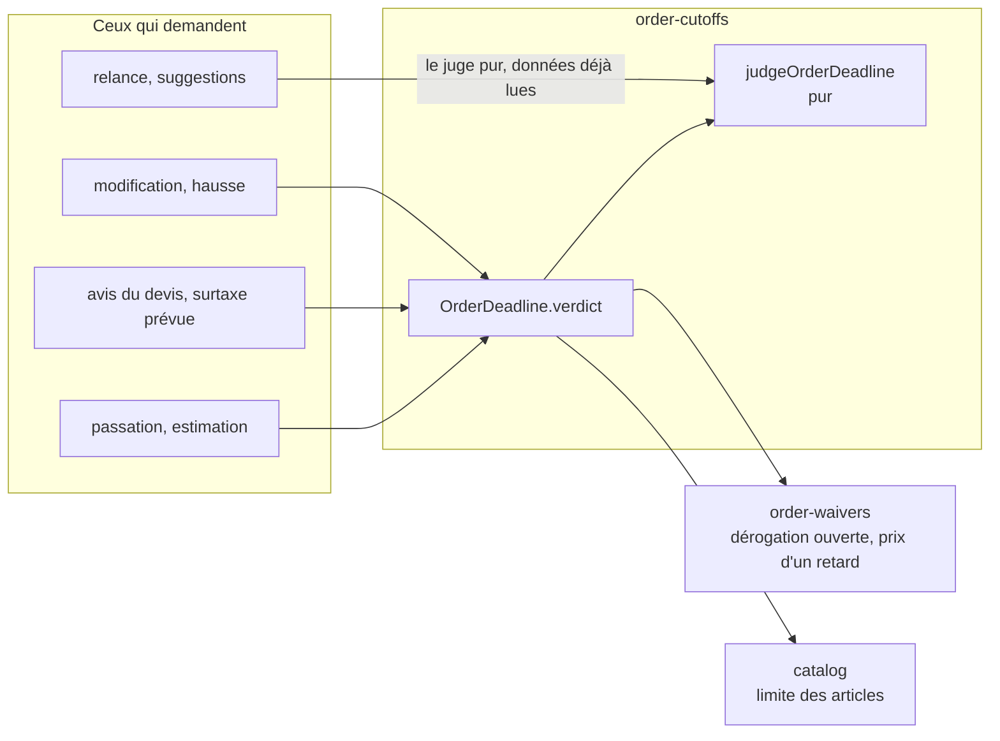

# Le verdict de l'heure limite

> ✅ **État, bâti le 2026-11-19** (commits `01016cec0` à `bc9ff3f8a`, puis le
> retrait de l'ancien jugement). « Trop tard ? » a une seule réponse, rendue par
> le délai de commande (`lafoliecoffee/order-cutoffs`). Le plan qui l'a bâti
> est retiré ; ses deux contradictions par `vitruve` sont dans l'historique
> git. Les pistes qui restent (les lignes bloquantes et leurs gestes, l'arrêt du
> plan dans le verdict) sont à la fin, **non bâties**.

## 1. En deux mots

Une commande demande une journée. Trois limites peuvent la refuser : la
**règle générale** du commerce (« la veille à 23 h », avec un rattrapage), la
**limite propre d'un article** (« 2 jours avant, 12 h », sans rattrapage), et,
pendant le rattrapage, l'absence de **dérogation**.

Tout cela se juge à **un seul endroit**. Celui qui a besoin de savoir pose une
question ; le délai de commande rend un **verdict** :



Le verdict est **ouvert** (jusqu'à telle heure), **en rattrapage** (jusqu'à
telle heure, avec la dérogation qui ferait passer et ce qu'elle coûte), ou
**fermé**. Il garde la limite retenue dans les trois états, dit ce qui l'a
retenue, et juge chaque ligne.

Celui qui demande **applique** : la passation laisse passer, passe sur une
dérogation qu'elle dépense dans sa transaction, ou refuse.

## 2. La technique

### 2.1 Le juge pur

`judgeOrderDeadline` (`apps/lfd-api/src/lafoliecoffee/order-cutoffs/domain/deadline/judge-order-deadline.ts`) :
sans port, sans horloge. Il reçoit la règle en vigueur, la limite de chaque
article, la journée, l'instant et la dérogation ouverte, déjà lus.

- **La plus stricte gagne toujours** (Hugo, 2026-10-21) : chaque ligne est
  jugée par la plus fermée entre la règle générale et sa propre limite ; le
  panier, par la plus fermée de ses lignes. Égalités : en rattrapage, la fin
  la plus proche ; ouvert, la limite la plus proche ; sinon la première
  retenue, c'est-à-dire la règle générale.
- **Seule la règle générale a un rattrapage** : une limite d'article ferme
  sèchement, même si une grâce est encore rangée sur l'article.
- **Un panier vide, aucune limite : tout passe.**
- **Une dérogation n'ouvre que le rattrapage** : le type du verdict ne porte la
  dérogation que sur la variante `grace`. La règle n'est pas vérifiée, elle
  est inexprimable.
- Les trois états et leurs bornes (incluses) vivent dans `decideOrderLimit`
  (`packages/contracts/src/order-cutoff.ts`), partagé avec les écrans.

`priceLateness` ajoute la surtaxe à un verdict en rattrapage qui a une
dérogation, si un réglage existe. `generalRuleStatus` dit la règle générale
seule, rattrapage compris.

### 2.2 La question

`OrderDeadline` (`order-cutoffs/application/deadline/order-deadline.ts`), publié
par la porte du contexte (`lafoliecoffee/order-cutoffs/index.ts`) :

- `verdict({ skus, serviceDay, at, asker })`, où `asker` dit la clientèle des
  limites d'article (`pro` aujourd'hui, partout), la société (pour sa
  dérogation) et si la dérogation est **considérée** (passation, estimation,
  surtaxe prévue) ou **ignorée** (avis, modification, hausse) ;
- `generalRuleStatuses(days, at)` : la règle générale de plusieurs journées,
  lue une fois — la question de la relance.

`JudgingOrderDeadline` lit en parallèle ce que la question demande, et
seulement cela. Ses sources, une par capacité
(`order-cutoffs/domain/deadline/ports/deadline-sources.ts`) :

| Port                                        | Implémenté par                                                      |
| ------------------------------------------- | ------------------------------------------------------------------- |
| la règle en vigueur (`OrderCutoffsInForce`) | `order-cutoffs` lui-même                                            |
| `ItemOrderLimitsReader`                     | `CatalogItemOrderLimitsReader`, sur la lecture publiée du catalogue |
| `OpenWaiverReader`                          | `order-waivers` (`PrismaOpenWaiverReader`)                          |
| `LateFeeSettingReader`                      | `order-waivers` (`RepositoryLateFeeSettingReader`)                  |

Le service vit dans `OrderCutoffsModule`, qui importe `CatalogModule` et
`OrderWaiversModule`. Pas dans `OrderCutoffsInForceModule` : le catalogue
l'importe, et y lire le catalogue fermerait un cycle.

### 2.3 Ceux qui appliquent

| Lecteur                                                                                                 | Question                                             | Ce qu'il en fait                                                                                                                                                         |
| ------------------------------------------------------------------------------------------------------- | ---------------------------------------------------- | ------------------------------------------------------------------------------------------------------------------------------------------------------------------------ |
| passation client, invité, boutique, saisie et estimation de l'équipe (`OrderDrafting.ensureNotTooLate`) | dérogation considérée, à l'horloge                   | `admitWithinDeadline` : passer, passer sur la dérogation (dépensée dans la transaction de la commande, avec sa surtaxe), ou `orders.cutoff.grace` / `orders.cutoff.past` |
| avis du devis et de l'estimation (`OrderCutoffNotice`)                                                  | ignorée                                              | ouvert → la limite ; rattrapage → sa fin ; fermé → rien                                                                                                                  |
| surtaxe prévue du devis d'une société (`ForeseenLateFee`)                                               | considérée, rien de dépensé                          | la surtaxe du verdict ; rien sur stock                                                                                                                                   |
| modification du client (`OrderRevising.ensureBeforeCutoff`)                                             | ignorée, à l'instant du geste                        | `admitWithinDeadline`, ancienne et nouvelle journée ; l'équipe n'y est pas soumise                                                                                       |
| révisabilité                                                                                            | ignorée                                              | ouverte jusqu'à la limite ; sinon `past_cutoff` nommant la limite franchie                                                                                               |
| hausse carte                                                                                            | ignorée                                              | la limite la plus proche des deux journées, quel que soit l'état                                                                                                         |
| relance de règlement                                                                                    | `generalRuleStatuses`                                | sonne dès que la règle générale n'est plus ouverte                                                                                                                       |
| suggestions (`keepOrderable`)                                                                           | le juge pur, avec la limite du candidat déjà chargée | garde ce qui est ouvert                                                                                                                                                  |

La dépense d'une dérogation est **exclusive** : `consume` lit le compte et
refuse une dérogation déjà servie (`orders.cutoff.waiver_spent`), dans la
transaction de la commande — commande, clé d'intention et lien de règlement
sont annulés avec elle.

### 2.4 La carte : ce qui décide encore ailleurs

Le verdict est **le juge complet du « trop tard »** : heure limite générale et
son rattrapage, limite de chaque produit, dérogation et surtaxe, dépassement
d'une limite de produit, et par ligne ce qui bloque. Ce qu'un geste peut faire
d'une commande **ce jour-là** se décide encore à quelques autres endroits,
chacun à un seul endroit (relevé le 2026-11-19) :

| Règle                            | Où                                                                                                                                                           | Ce qu'elle décide                                                                                                                                                                 |
| -------------------------------- | ------------------------------------------------------------------------------------------------------------------------------------------------------------ | --------------------------------------------------------------------------------------------------------------------------------------------------------------------------------- |
| Le plan arrêté                   | `OrderDrafting.ensureDayOpen` et `holdSupply` ; `OrderRevising.ensureDayOpen` et `holdDay` ; `Order.receiveOffPlan` ; `ApplyCardIncrease` (`ensurePlanOpen`) | client refusé, équipe reçue hors plan ; date changée vers un jour arrêté refusée à tous ; hausse refusée — lu sans verrou puis sous le verrou de la journée (`PlanAdmissionDesk`) |
| L'inscription au fournil         | `OrderRevising.standingOf`, sur la règle d'annulation (`CancellationRule`, `BEFORE_INSCRIPTION`)                                                             | une modification s'arrête à l'inscription ; après, l'équipe garde les quantités d'un pro au compte                                                                                |
| Le jour même                     | `OrderPlanGate.ensureNotTooSoon`, par porte (`same-day-doors.ts`)                                                                                            | « trop tôt » : aujourd'hui fermé ou ouvert selon la clientèle                                                                                                                     |
| La fenêtre d'une opération datée | `order-operation-guard.ts`                                                                                                                                   | commander dans la fenêtre de l'opération, sans dérogation                                                                                                                         |
| Les journées proposées           | `list-fulfillment-days.handler.ts`                                                                                                                           | la boutique ne propose ni un jour arrêté, ni un jour hors des délais                                                                                                              |
| Le circuit sur stock             | `ShelfCircuit`                                                                                                                                               | d'où vient la marchandise (pas un refus)                                                                                                                                          |

Ce que le fournil possède, et que le commerce lit par ses canaux : l'arrêt du
plan (`ClosedPlansReader`, `PlanAdmissionDesk`) et l'inscription
(`OrderInscriptionReader`). **Arrêter le plan, c'est inscrire** : la clôture
d'une journée fige le plan avec ses commandes (`ProductionDay.close`). Ce que
ces faits **impliquent** pour chaque geste est une décision du commerce.

**Changer ce qu'on peut faire après la clôture, aujourd'hui** :

- pour une commande **déjà inscrite** (le cas courant) : `standingOf` ;
- pour une commande **reçue après l'arrêt** (hors plan), ou une date déplacée
  vers un jour arrêté : les gardes du jour ci-dessus, et l'agrégat ;
- pour ce que la boutique propose : `list-fulfillment-days`.

### 2.4 bis Le point unique, en puissance

Décidé de ne pas bâtir le 2026-11-19 (Hugo : J6 et la carte d'abord) ; écrit
pour qu'un changement de comportement après la clôture parte d'ici, avec ce
qu'une contradiction de `vitruve` a déjà appris.

**L'idée** : une seule règle, « ce qu'un geste peut faire d'une commande, selon
la journée et l'état de la commande », pure, avec une table par geste × acteur
× (plan ouvert, arrêté, commande inscrite) × (date inchangée, changée). Elle
réunirait le plan arrêté, l'inscription et le jour même ; le verdict de
l'heure limite resterait le juge du « trop tard ». Le fait reste au fournil ;
la règle est au commerce.

**Ce qu'il faut savoir avant de la bâtir** (contradiction du plan « le verdict
de la journée », 2026-11-19) :

- **elle vit côté commande, pas dans ce verdict** : l'inscription est l'état de
  la commande et partage la règle d'annulation (réglage A1) ; la mettre dans le
  verdict de l'heure limite y ferait entrer l'annulation ;
- **l'agrégat tient déjà « client refusé, équipe hors plan »**
  (`receiveOffPlan`) : il doit appliquer la décision de la règle, pas la
  recalculer, sans devenir un simple setter ;
- **une même fonction pour les deux temps** : sans verrou, et sous le verrou
  de la journée (le guichet rend `open | closed`) ;
- **le jour même n'est pas le même par geste** : en passation l'équipe hors
  plan en est exemptée ; en modification il ne se juge que si la date change,
  et alors contre tous ;
- **en modification, le jugement du jour doit se demander une fois, avant le
  chargement, sur la nouvelle journée seulement** : juger l'ancienne
  refuserait à tort un client qui quitte un jour arrêté ;
- **l'application d'une hausse traverse trois lectures de l'arrêt**
  (recomposition, `ensurePlanOpen`, verrou), avec deux codes de refus : la
  table doit dire lequel, et quand ;
- **les devis de modification refusent aujourd'hui un jour arrêté**, le devis
  de passation non : un devis de modification est un geste, pas un avis ;
- **l'acteur est celui des règles appliquées** (`rulesOf`) : une demande du
  client appliquée par l'équipe se juge avec les règles de l'équipe ; la
  boutique est un client ;
- **la boutique** (`list-fulfillment-days`) doit suivre la même table, sans
  quoi elle masquera un jour que la règle ouvre ;
- **la porte** visera `ClosedPlansReader` dans `lafoliecoffee/` avec une liste
  admise, pas `OrderPlanGate.isClosed` ;
- **l'ordre des refus change** à la passation si la règle est jugée avant le
  chargement : à écrire refus par refus.

### 2.5 La porte

`lint:order-deadline-door` (`dev-toolbox/gates/order-deadline-door.mjs`) :
hors du juge, personne n'importe une fonction de décision du contrat
(`decideOrderCutoff`, `decideOrderLimit`) ni l'ancien jugement. Dette vide.

## 3. Ce qui reste

- La piste P1 ci-dessous et le point unique du § 2.4 bis : à inventorier sur ce code avant d'en faire
  un plan (Hugo, 2026-11-19 : « bâtir d'abord, puis faire l'inventaire des
  capacités »).
- Le dépassement d'une limite de produit par la commerciale est **bâti**
  sur le verdict ([`passer-outre-la-limite-d-un-produit.md`](passer-outre-la-limite-d-un-produit.md)) :
  `asker.exceedItemLimits`, `exceeded`, et par ligne `exceedable` et
  `itemStatus`.
- **Le « jour même » dans le verdict** ? « Trop tôt » plutôt que « trop tard ».
- **Fusionner `order-waivers` dans `order-cutoffs`** ? La dérogation et la
  surtaxe n'existent que par l'heure limite ; les fusionner déménage des tables
  et des droits (`b2b_order_waivers`, `b2b_late_fee`).
- **La fenêtre d'une opération datée dans le verdict**, par une raison de plus.

## Pistes, non bâties

Écrites et contredites le 2026-11-19, avant le bâti. Elles décrivent une
intention, pas le code.

### P1. Ce qui bloque, et les gestes de réponse

Demandé par Hugo le 2026-11-19 : « il faut savoir quelle ligne du panier est
bloquante pour pouvoir avoir les gestes de réponse ». Un refus qui ne dit pas
**quoi** fait chercher ; un refus qui le dit propose **quoi faire**.

**Aujourd'hui**, personne côté serveur ne sait quelle ligne ferme : la garde
rend une décision agrégée (§ 2.3), et l'avis (`OrderQuoteCutoffView`,
`packages/contracts/src/order.ts:1600`) n'a que `status` et `until`. La
boutique le recalcule **elle-même**, à partir des limites que la vitrine lui
sert (`decideDayNotice`, entrée `cartLimits`,
`apps/lfc-ecommerce-frontend/src/app/client/shop/service-day-notice.rules.ts`) :
« Un article de votre panier : trop tard pour jeudi, possible à partir de
samedi » (`limites-produit.md` § 6). C'est une quatrième copie du jugement,
en navigateur.

**Le verdict le dit, ligne par ligne.** `LineVerdict` gagne :

```ts
interface LineVerdict {
  readonly status: OrderCutoffStatus;
  /** La limite qui juge CETTE ligne (jamais `plan_closed` : la journée se lit sur le panier). */
  readonly source: "general_rule" | "item_limit" | "none";
  readonly limit: Instant | null;
  /**
   * Les limites que cette ligne a FRANCHIES, la plus fermée d'abord — vide si
   * elle passe. Les deux à la fois quand l'article et la règle générale sont
   * passés tous les deux.
   */
  readonly crossed: readonly CrossedLimit[];
  /** La première journée où CETTE ligne passerait, dans l'horizon ; `null` sinon. */
  readonly firstOpenDay: string | null;
}

/** Une limite franchie, de quoi la dire telle qu'elle a été réglée. */
interface CrossedLimit {
  readonly source: "general_rule" | "item_limit" | "plan_closed";
  /**
   * La règle telle qu'elle JUGE : pour une limite d'article, rattrapage à 0
   * (`withoutGrace`), jamais la grâce rangée sur l'article. `null` pour un plan
   * arrêté. : « 2 jours avant, 12 h », rattrapage compris. */
  readonly rule: OrderLimitSpec | null;
  /** L'instant où elle est tombée pour cette journée ; `null` pour un plan arrêté. */
  readonly limit: Instant | null;
  /** La fin du rattrapage ; égale à `limit` pour une limite d'article. */
  readonly graceEnd: Instant | null;
  /** `grace` : encore rattrapable ; `closed` : plus du tout. */
  readonly status: "grace" | "closed";
}
```

Demandé par Hugo le 2026-11-19 : « et quelle limite a été franchie par
ligne ». C'est ce qui permet de **dire** le refus (« Le pain au levain se
commande 2 jours avant, 12 h : c'était hier midi ») et de **choisir** le
geste : une limite d'article franchie se lève par le retrait de la ligne ou
le dépassement ; la règle générale franchie, par la dérogation ou une autre
journée.

Et le verdict d'un panier fermé ou en rattrapage porte **les gestes qui le
débloquent**, dérivés par le domaine, jamais par l'écran :

| Geste                                                                                            | Quand                                                                                          | Qui                                      |
| ------------------------------------------------------------------------------------------------ | ---------------------------------------------------------------------------------------------- | ---------------------------------------- |
| **Retirer ces articles** (`remove_lines`, avec leurs SKU)                                        | des lignes `item_limit` ferment, et le reste du panier passe sans elles                        | tous                                     |
| **Choisir une autre journée** (`move_day`, avec la première journée où **tout** le panier passe) | toujours, si une journée de l'horizon convient                                                 | tous                                     |
| **Accorder une dérogation** (`grant_waiver`)                                                     | `grace` venu de la règle générale, sans dérogation ouverte, avec une société                   | l'équipe, avec `b2b_order_waivers:write` |
| **Passer outre la limite** (`exceed_item_limit`)                                                 | plus tard : [`passer-outre-la-limite-d-un-produit.md`](passer-outre-la-limite-d-un-produit.md) | l'équipe, avec son droit                 |

Le geste dit ce qui est **possible**. Les droits n'entrent pas dans le juge
pur : la question porte `asker.remedies`, **la liste des gestes que cet
appelant peut faire**, construite par une fabrique par point d'entrée
(`customerAsker`, `staffAsker(permissions)`, `systemAsker`), jamais par
défaut. La relance, la hausse et l'estimation n'ont pas de contrôleur au point
d'appel : elles passent `systemAsker` (aucun geste) ou reçoivent les
permissions de leur contrôleur. Un geste hors de cette liste n'est pas rendu.

**Les journées proposées** (`firstOpenDay`, `move_day`) ne se calculent pas
par une boucle de plus. Elles se composent avec la source qui sert déjà
`/fulfillment-days` (`list-fulfillment-days.handler.ts` : jours servis du
point ou de la livraison, plans arrêtés, « jour même »), sur le même horizon
(`NEXT_FULFILLMENT_HORIZON_DAYS`, 14 jours), et lisent les plans arrêtés de
l'horizon en **une** requête (`closedBetween(from, to)`). Un jour que
`/fulfillment-days` ne proposerait pas n'est jamais proposé.

**Le back-office** : le contrat de l'avis (`OrderQuoteCutoffView`) s'étend
**en ajoutant** (`lines`, `remedies`) ; il n'est servi qu'au staff
(`packages/contracts/src/order.ts:1613`, `toCustomerQuote` le retire).

**La boutique** ne reçoit aucun avis du serveur : `decideDayNotice`
(`service-day-notice.ts:70-97`) est un `computed` pur, recalculé à chaque
changement de panier et à chaque tic d'horloge, **sans requête**. Lui faire
demander le verdict au serveur multiplierait les appels (une par mutation du
panier, plus une relance quand une limite tombe pendant la saisie), sur une
base facturée à l'opération, et exposerait au client les règles franchies.
**Ce que la boutique ne doit pas savoir** (Hugo, 2026-11-19 : « on ne peut
pas cacher les règles de cutoff ? »). Aujourd'hui, elle ne reçoit déjà
**aucune règle** : seulement l'instant annoncé de chaque journée
(`FulfillmentDayView.orderUntil`, rattrapage **non** compris) et, pour un
article plus strict que la règle générale, son délai et son heure
(`shownItemOrderLimit`, sans rattrapage). Le rattrapage, sa durée, les
dérogations, la surtaxe et l'arrêt du plan ne lui sont jamais servis. C'est
voulu : un client qui connaît la durée du rattrapage commande dedans.

Ce qui ne peut pas être caché, c'est **l'heure annoncée** : « commandez avant
18 h » est précisément ce qu'on veut qu'il lise.

Donc **pas de juge partagé fourni de règles** : il faudrait servir la règle
générale entière, rattrapage compris. La boutique garde ce qu'elle reçoit, et
`decideDayNotice` reste un calcul d'affichage sur des instants annoncés. Ce
qui change en la piste : il cesse de **recopier** la décision (« la plus fermée du
panier », `graceMinutes: 0` forcé à la main, l.148, 173, 194) et appelle une
fonction de présentation publiée par `@lfd/contracts` qui ne prend que ces
instants annoncés. Une décision, une implémentation côté serveur ; une
annonce, une implémentation côté écrans ; aucune règle de plus servie, aucun
appel de plus. Le serveur reste seul à refuser, et son refus (code, ligne
franchie, journée possible) ne dit au client que ce qui le concerne : jamais
`grace`, jamais la dérogation, jamais la surtaxe — une ligne en rattrapage lui
est dite « trop tard ». Les gestes servis à la boutique ne nomment que ce
qu'un client peut faire.
