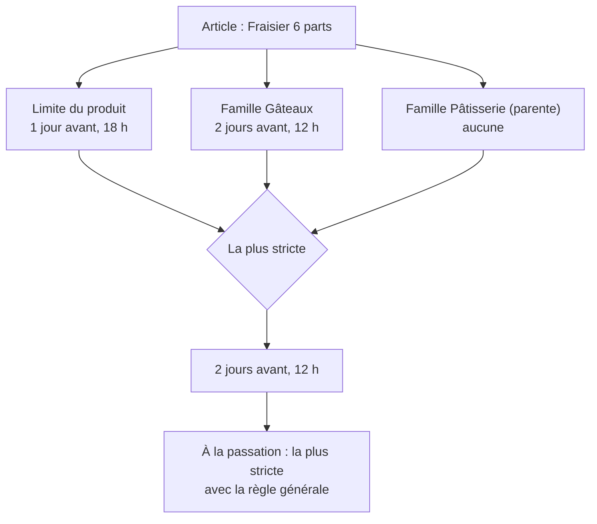

# La limite de commande du référentiel — état

> Doc d'état. Limite par produit : code ouvert le 2026-10-21. Limite par
> famille et exclusions : bâties le 2026-11-23 (commits `0aca8093e`,
> `0cf0ffed6`, `82f2e57e4` et les écrans qui suivent). Entrée du dossier :
> [`README.md`](README.md).

Le délai propre à ce qu'on fabrique : « un gâteau d'anniversaire se sait deux
jours avant ». Il se règle au **référentiel**, parce qu'il tient au temps de
production, et il s'oppose à **toutes** les clientèles.

## 1. En deux mots

Une limite se pose sur un **produit** ou sur une **famille**. Celle d'une
famille vise tous ses produits et ceux de ses sous-familles, y compris ceux
qu'on y créera, **sauf** les produits exclus nommément.

Un article peut donc être visé par plusieurs limites : la sienne, celle de sa
famille, celles des familles au-dessus. **La plus stricte gagne** (décision de
Hugo, 2026-11-23). Puis, à la passation, la plus stricte entre elle et la règle
générale du commerce (inchangé).

« Plus stricte » : plus de jours avant ; à jours égaux, l'heure la plus tôt.

Ce qui n'existe pas au référentiel : « toute la production » (elle se règle au
commerce, [`reglages-generaux.md`](reglages-generaux.md)), la limite par
déclinaison (elle suit son produit), le rattrapage (le seul est celui de la
règle générale), l'exclusion d'une sous-famille (on pose la limite plus bas).

**Passer outre** : l'équipe ne peut passer outre la limite d'un article que si
**toutes** les limites qui le visent le permettent. Passer outre fait juger la
ligne par la règle générale seule
([`passer-outre-la-limite-d-un-produit.md`](passer-outre-la-limite-d-un-produit.md)) :
toutes les limites d'article tombent, donc toutes doivent y consentir.

## 2. Au référentiel

**Tables** (`apps/lfd-api/prisma/schema/pim/sales-contexts.prisma`) :

- `pim.order_time_limit` (`OrderTimeLimit`) : `scope_type` (`product` ou
  `category`, CHECK `order_time_limit_product_or_family`), `scope_id`,
  `days_before`, `time` (`HH:MM`, pendule de Paris), `grace_minutes` (`NULL`
  ou `0`, CHECK `order_time_limit_no_grace`), `staff_may_exceed`,
  `archived_at`. Une règle par portée (`order_time_limit_one_per_scope`).
- `pim.order_time_limit_exclusion` (`OrderTimeLimitExclusion`) : un produit
  exclu d'une limite de famille. Retirer pose `removed_at` ; rien ne s'efface.
  Une seule exclusion vivante par produit et par limite (index unique partiel
  `order_time_limit_exclusion_one_live`). Ré-exclure crée une ligne.

**Le domaine** (`pim/order-time-limitation/domain/entities/order-time-limit.ts`) :

- `set` / `reset` refusent une portée autre que produit ou famille
  (`pim.order_time_limit.scope_retired`), une limite sans délai OU sans heure
  (`incomplete`), un rattrapage non nul (`grace_retired`) ;
- `exclude` / `include` refusent hors d'une limite de famille
  (`exclusion_on_product`, 400) et rendent `false` quand rien ne change ;
- archiver garde les exclusions ; reposer une limite archivée la remet en
  vigueur avec elles (l'écran les montre avant validation).

**La lignée d'un produit** : `order-time-limitation` ne lit pas les tables du
catalogue. Il déclare `ProductLineageReader` (`domain/ports/`), que
`appBootstrap/pim-catalogue-product-lineage.ts` implémente avec les lectures du
catalogue, relié dans `appBootstrap/order-time-limit-targets-feed.module.ts`.
Il sert à refuser une famille inconnue (`family_not_found`, 404) et l'exclusion
d'un produit hors de la famille (`exclusion_outside_family`, 409).

**Les gestes** (`application/`, un fichier par cas) : `SetOrderTimeLimit`,
`ArchiveOrderTimeLimit`, `RestoreOrderTimeLimit`, `ExcludeProductFromLimit`,
`IncludeProductInLimit`. Chacun écrit son fait au journal du référentiel
(`order_time_limit.product_excluded` / `product_included` pour les deux
derniers) et émet les règles dans sa transaction. Exclure et réintégrer sont
idempotents : rejoués, ils n'écrivent rien.

**Routes** (droit `pim_catalog`, sous `/pim/order-time-limits`) :

| Route                               | Ce qu'elle fait                                                      |
| ----------------------------------- | -------------------------------------------------------------------- |
| `GET /`                             | produits et familles, archivées comprises, exclusions nommées        |
| `PUT /`                             | pose ou repose une limite de produit ou de famille                   |
| `POST /:id/exclusions`              | exclut un produit (`{ productId }`)                                  |
| `DELETE /:id/exclusions/:productId` | le réintègre                                                         |
| `GET /effective/:productId`         | la lignée, les règles qui visent le produit, celle qui gagne et d'où |
| `GET /general-cutoff`               | la règle générale du commerce, en lecture                            |

**Écrans** :

- **Référentiel › Général › Limites de commande** (`/pim/limites-de-commande`) :
  la règle générale en lecture, puis les limites de produit et de famille ;
  « Poser une limite » fait choisir la portée ; une ligne de famille déplie ses
  produits exclus, chacun réintégrable.
- **Fiche famille** : une carte « Limite de commande » (poser, modifier,
  archiver, restaurer, exclure un produit de la famille, réintégrer).
- **Fiche produit** : la limite effective et sa provenance (« … — famille
  Gâteaux » ou « … — limite propre du produit »), si l'équipe peut passer
  outre, une case « Exclure de la limite de la famille X » par famille limitée
  de sa lignée, et la limite propre du produit.

## 3. La résolution, partagée par les deux rives

`resolveOrderTimeLimit` (`packages/catalog-sync/src/order-time-limit-resolution.ts`)
retient la règle du produit et chaque règle de famille de la lignée
(`categoryPath`, la plus proche d'abord) qui n'exclut pas le produit ; seules
les règles complètes comptent. Elle rend le délai et l'heure de la plus
stricte, un rattrapage `0`, et `staffMayExceed` = le ET de toutes les
candidates. `explainOrderTimeLimit` dit en plus d'où vient la limite (à
égalité, la plus précise : produit, puis famille la plus proche).

## 4. La propagation au commerce

Chaque geste émet le fait durable **`pim.catalog_rules_changed`**
(`pim/channels/b2b-platform/products/catalog-rules-changed.fact.ts`) : les
**règles** en vigueur de produit et de famille, avec leurs `excludedProductIds`
(`B2bCatalogRulesEmitter`). Le commerce (`OnCatalogRulesChangedHandler`, un
`@DurableHandler`) les range dans `public.catalog_rules` si le fait est plus
récent (`applied_seq`), ne garde que les portées produit et famille
(`admittedOrderLimitRules`), puis `OrderLimitsRefresher` **descend** sur chaque
article en vente la limite résolue — colonnes `CatalogItem.orderLimitDaysBefore`
/ `orderLimitTime` / `orderLimitGraceMinutes` / `orderLimitStaffMayExceed`.

Un produit reclassé redescend par le fait de sa fiche ; une famille déplacée,
par le fait de famille (`refresh(null)`). Le fait d'une fiche ne réécrit jamais
une famille déjà connue (`ensureFamily` en `skipDuplicates`), donc ne peut pas
déplacer une famille à l'insu des autres articles.

## 5. À la passation

`OrderDrafting.ensureNotTooLate` demande le verdict du délai de commande
(`OrderDeadline`) ([`le-verdict-de-l-heure-limite.md`](le-verdict-de-l-heure-limite.md)).
Le juge lit **une** limite par article, celle que le commerce a descendue :
il ne sait pas si elle vient du produit ou d'une famille. Une limite d'article
**n'a jamais de grâce** : passée l'heure, refus sec. Chaque ligne est jugée par
la plus fermée entre la limite de l'article et la règle générale en vigueur ;
puis la plus fermée du panier gagne ([`README.md`](README.md) §2).
Interrupteur de la règle générale désactivé, seule la limite d'article compte.

**L'équipe peut passer outre** la limite d'un article dont la case résolue le
permet (§1), avec le droit et un motif ; la règle générale reste le plancher
([`passer-outre-la-limite-d-un-produit.md`](passer-outre-la-limite-d-un-produit.md)).

## 6. Ce que sert la boutique (depuis `a1e1c62f5`, 2026-10-21)

`ShopItemView.orderTimeLimit` (`packages/contracts/src/shop-catalogue.ts`),
**facultatif** : `{ daysBefore, time }`, **jamais la grâce**. Posé par
`withOrderLimits` (`lafoliecoffee/catalog/application/shop-catalogue-order-limits.ts`)
sur `/shop/catalogue` et `/shop/catalogue/mine`, à partir de la limite résolue
de l'unité vendue par défaut.

Il n'est servi que si la limite est **plus stricte** que la règle générale — ce
qui est, depuis le 2026-10-21, exactement le cas où elle change la décision de la
passation
(`shownItemOrderLimit` / `isStricterOrderLimit`,
`packages/contracts/src/item-order-limit.ts`) : son instant, pour un même jour
de service, tombe plus tôt — comparé en minutes de pendule avant le minuit du
jour de service. À égalité, rien.

**La règle générale comparée** est le défaut tous jours, tous points
(`generalOrderCutoff`) parmi les règles **en vigueur** (port
`ShopOrderCutoffsReader` lié à `OrderCutoffsInForce`) : interrupteur
désactivé, il n'y en a plus, et toute limite d'article se montre. Une règle
propre à un jour ou à un point n'entre pas dans la comparaison.

**La vitrine des agences** partage la vue (`VitrineItemView` dérive de
`ShopItemView`) : `/vitrine/*` sert aussi `orderTimeLimit`, en XML
`<orderTimeLimit><daysBefore/><time/></orderTimeLimit>`, facultatif dans le XSD
(`lafoliecoffee/vitrine/http/xml/vitrine-xml-shapes.ts`).

## 7. La phrase, et ses trois formes

Sur la fiche produit et sous le prix de la ligne du panier
(`madeToOrderLabel`, `apps/lfc-ecommerce-frontend/src/app/client/shop/made-to-order.ts` ;
textes dans `copy/fr.ts`) :

| `daysBefore` | Phrase                                                                |
| ------------ | --------------------------------------------------------------------- |
| `0`          | « Préparé sur commande — à commander le jour même, avant 9 h »        |
| `1`          | « Préparé sur commande — à commander la veille, avant 18 h »          |
| `n ≥ 2`      | « Préparé sur commande — à commander 2 jours à l'avance, avant 12 h » |

Absente du flux, rien ne s'affiche : l'absence est la réponse.

## 8. Le compte à rebours d'un article du panier

Quand une limite d'article du panier tombe **plus tôt** que l'`orderUntil`
général du jour dont parle la barre, c'est elle qui décide — la plus fermée du
panier, comme à la passation. La phrase ne nomme pas l'article (Hugo,
2026-10-21 : la barre ne l'a pas sous les yeux, et un nom au milieu d'une
phrase oblige à gérer article et accord) : « Plus que 1 h 40 pour commander un
article de votre panier pour jeudi. », « Pour jeudi, commandez un article de
votre panier avant 18 h. » ; déjà passée : « Un article de votre panier : trop
tard pour jeudi, possible à partir de samedi. » (« 2 articles de votre
panier : … » s'il y en a plusieurs)
(`decideDayNotice`, entrée `cartLimits`, `service-day-notice.rules.ts`). Sans
règle générale, la plus fermée des articles décide. Le reste du compte à
rebours : [`reglages-generaux.md`](reglages-generaux.md) §6.

## 9. Ce qui reste

- **Une limite d'article déjà passée n'est pas dite** pour le jour accordé
  (une limite à deux jours, commandée pour demain) : la barre se tait, la fiche
  et la ligne disent le délai, et seule la passation refuse. Dire « trop tard
  pour cet article » au panier reste à décider.
- La comparaison « plus stricte » de la fiche ignore les règles par jour ou par
  point (§6) ; le compte à rebours, lui, compare au jour près.
- La fiche famille ne propose à l'exclusion que les produits de sa
  descendance ; une exclusion devenue inerte (produit reclassé ailleurs) reste
  listée, réintégrable, sans être signalée « hors de la famille ».
- Avant de déployer en production : compter les règles non produit dans
  `public.catalog_rules`, puis, après le déploiement, « Réémettre » les règles
  (`CatalogReemissionService`) pour que le commerce range l'état du
  référentiel.
