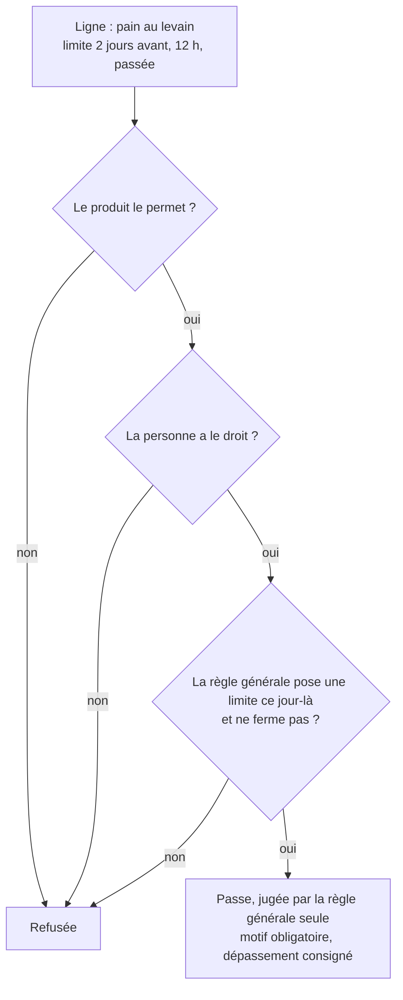

# Passer outre la limite d'un produit

> ✅ **État, bâti le 2026-11-19** (lots O1 à O6, commits `c0e825b1d` à
> `237fb6885`). Le plan qui l'a bâti est retiré ; ses trois contradictions par
> `vitruve` et les décisions de Hugo sont dans l'historique git.

## 1. En deux mots

Un produit peut demander d'être commandé longtemps à l'avance : « 2 jours
avant, 12 h ». Une commerciale peut passer outre, si **deux clés** sont réunies :

1. **le produit le permet** — une case « L'équipe peut passer outre cette
   limite », sur la limite du produit, au référentiel, décochée par défaut ;
2. **la personne en a le droit** — `lfc_product_limit_override`, donné à l'écran
   des rôles.

**Le plancher, c'est la règle générale, selon le geste.** À la saisie (et à
l'estimation, à l'avis), passer outre la limite d'un produit laisse l'heure
limite générale juger la ligne, avec son rattrapage, sa dérogation et sa
surtaxe : une commerciale met à J+1 un produit à 48 h, pas après l'heure
générale sans dérogation. En **modification par l'équipe** (et pour une
demande du client qu'elle applique), l'heure limite générale ne lui est pas
opposée — sa fenêtre est l'inscription au fournil : il suffit qu'une limite
générale existe ce jour-là (`itemLimitFloor`, `general_rule_open` /
`general_rule_posed`).

**La même réponse partout.** La case et le droit valent en saisie d'une
commande, en estimation et en modification par l'équipe. Le client, l'invité
et la boutique ne passent jamais outre.

## 2. La technique

### 2.1 La case, du référentiel au commerce

- `pim.order_time_limit.staff_may_exceed` (référentiel) et
  `public.catalog_items.order_limit_staff_may_exceed` (commerce), `false` par
  défaut ; une règle rangée avant se lit `false`. Migration
  `20261119140000_la_limite_que_l_equipe_peut_passer`.
- `OrderTimeLimitPayload` la rend obligatoire ; le panneau des limites du
  back-office (`pim/order-time-limits/limit-panel/`, ouvert par la page des
  limites et par la fiche produit) l'envoie.
- Le fil du catalogue la porte (`SyncOrderTimeLimit`, au seul rang du produit),
  `sameLimit` la compare, `orderLimitGroups` la met dans sa clé, et le
  déclencheur des versions du catalogue la lit.

### 2.2 Le droit

`lfc_product_limit_override` (migration
`20261119140100_le_droit_de_passer_outre_la_limite_d_un_produit`, aucun droit
accordé ; la graine ne le donne qu'à l'administrateur). Lu **au contrôleur**
par `@StaffPermissions()` et passé en booléen : la requête de l'écran ne peut
pas le forger (`orders/http/item-limit-override-permissions.ts`).

### 2.3 Le juge décide, une seule fois

Dans le verdict de l'heure limite
([`le-verdict-de-l-heure-limite.md`](le-verdict-de-l-heure-limite.md)) :
`exceededBy` et `isExceedable`
(`order-cutoffs/domain/deadline/judge-order-deadline.ts`). La question porte
`asker.exceedItemLimits` (obligatoire, sans défaut) ; le verdict rend
`exceeded` (sku, limite, instant) et, par ligne, `exceeded`, `exceedable` et
`itemStatus` (l'état de la seule limite d'article). Une ligne dépassée est
jugée par la règle générale seule. « Dépassable » ne regarde pas l'instant :
l'écran lit aussi l'état de la ligne.

### 2.4 Saisie et estimation de l'équipe

- Le droit va du contrôleur aux `OrderParties`, puis à l'asker
  (`OrderDrafting.ensureNotTooLate`) ; `DraftedOrder` rend `exceeded`.
- **Motif** : `itemLimitOverrideReason` (1 à 280, un seul pour la commande),
  dans `adminOrderEntryShape`. Sans lui, la passation refuse
  (`orders.cutoff.item_limit_reason_required`) juste après la préparation,
  **avant** le budget et toute intention de paiement ; la clé d'intention est
  rendue. L'estimation ne refuse pas : elle rend les dépassements. Le motif
  n'entre pas dans l'empreinte d'intention.
- **Trace** : `public.order_item_limit_overrides` (migration
  `20261119170000_les_depassements_de_limite_produit`), une ligne par produit
  dépassé, écrite dans la transaction de la commande, `origin` = `placement`
  ou `revision`. Au registre RGPD (`staff_user_id`, `reason`).
- La fiche d'une commande rend les dépassements, avec le nom de la personne, à
  qui a `lfc_product_limit_override:read`. L'avis du comptoir rend les
  dépassements et les lignes dépassables.

### 2.5 Modification

- **Par l'équipe** (`RevisionCutoffs`, `orders/revision/application/services/`) :
  les lignes **ajoutées ou augmentées** sont jugées par la limite de leur
  produit sur la nouvelle journée — refus `orders.cutoff.item_limit_past`
  (qui nomme le produit et les sorties) sauf dépassement avec les deux clés,
  motif, trace `revision`. La règle générale ne lui est toujours pas opposée.
  Une ligne existante non augmentée passe comme avant — **sauf quand la date
  change** : toutes les lignes sont alors jugées sur la nouvelle journée,
  aucune n'y ayant été jugée (`staffJudgedSkus`). Déplacer une commande ne
  fait pas passer en douce un produit dont la limite tombe avant la nouvelle
  date.
- **Par le client**, sur une commande qui porte un dépassement : pour sa
  journée, la ligne consignée n'est jugée que par la règle générale
  (`settledItemLimits` de la question), sans quitter le panier — un panier
  vidé n'opposerait plus rien. Écartée aussi de la borne de paiement d'une
  hausse carte. Une ligne augmentée se juge comme un ajout ; une autre journée
  la rejuge.
- **La hausse carte** est un geste du client seul (l'équipe ne fait pas de
  hausse carte, Q3 a, Hugo, 2026-11-10) : rien à figer, elle suit la règle du
  client ci-dessus.
- **Le devis d'une modification par l'équipe** annonce, sans refuser, les
  lignes soumises que leur limite ferme (`closedByItemLimit` : sku, délai,
  heure, `limitAt`, `exceedable`), lues sur le verdict
  (`staffItemLimitsOf`) ; `exceedable` dit que la modification la fera passer
  avec un motif (la case, le droit, une règle générale ce jour-là qui ne
  ferme pas). La modification, elle, refuse (`admitStaffItemLimits`). Le
  refus `orders.cutoff.item_limit_past` nomme le produit dans sa phrase, sans
  SKU : les faits publiables d'une erreur ne sont que des nombres
  (`PublicErrorFacts`).
- **Une demande de modification du client** (M4), appliquée par l'équipe, lit
  le droit de la personne qui l'applique (`@StaffPermissions()` au devis et
  à l'application de la demande, `admin-order-change-requests.controller.ts`)
  et son motif (`itemLimitOverrideReason`, au corps de l'application) : même
  règle et même trace `revision` que la modification par l'équipe (Hugo,
  2026-11-19). Le devis indicatif du client, lui, refuse un produit que sa
  limite ferme.

### 2.6 Les écrans

La saisie et la modification d'une commande au back-office annoncent les
lignes fermées par leur produit : « Passer outre » (si dépassable) ouvre le
motif, sinon « Ce produit ne se commande plus pour ce jour ». Le refus pour
motif manquant ramène au champ. La fiche d'une commande montre la carte
« Limites de produit dépassées ». La modification par l'équipe et
l'application d'une demande du client annoncent aussi les lignes fermées non
dépassables, avant le refus ; le journal du référentiel dit quand la case
change (« l'équipe peut désormais passer outre… »).

## 3. Ce qui reste

Comparé aux logiciels du marché (Odoo, SAP, Shopify — de mémoire, non
vérifié le 2026-11-19), la règle elle-même est plus stricte : un seul juge
pour tous les gestes, aucun geste qui la contourne, et la limite générale
toujours opposée. Ce qui manque est autour de la règle :

- **Rien ne vérifie qu'un produit se fabrique en moins de temps que sa
  limite** : la case du produit en répond. Le juge regarde le temps, jamais
  la capacité (un four plein ce jour-là ne refuse rien).
- **Aucun écran ne résume les dépassements** (qui, combien, quels produits) :
  la trace `order_item_limit_overrides` existe, le rapport non.
- **Le fournil n'est pas prévenu** d'un dépassement : il le lit sur la fiche
  de la commande, pas en alerte.
- **Le sélecteur de jour de la boutique propose encore un jour que le panier
  interdit** : le refus vient après le choix.
- **Les limites ne sont pas annoncées en cache à la boutique** (« on verra ça
  après », Hugo, 2026-11-19).
