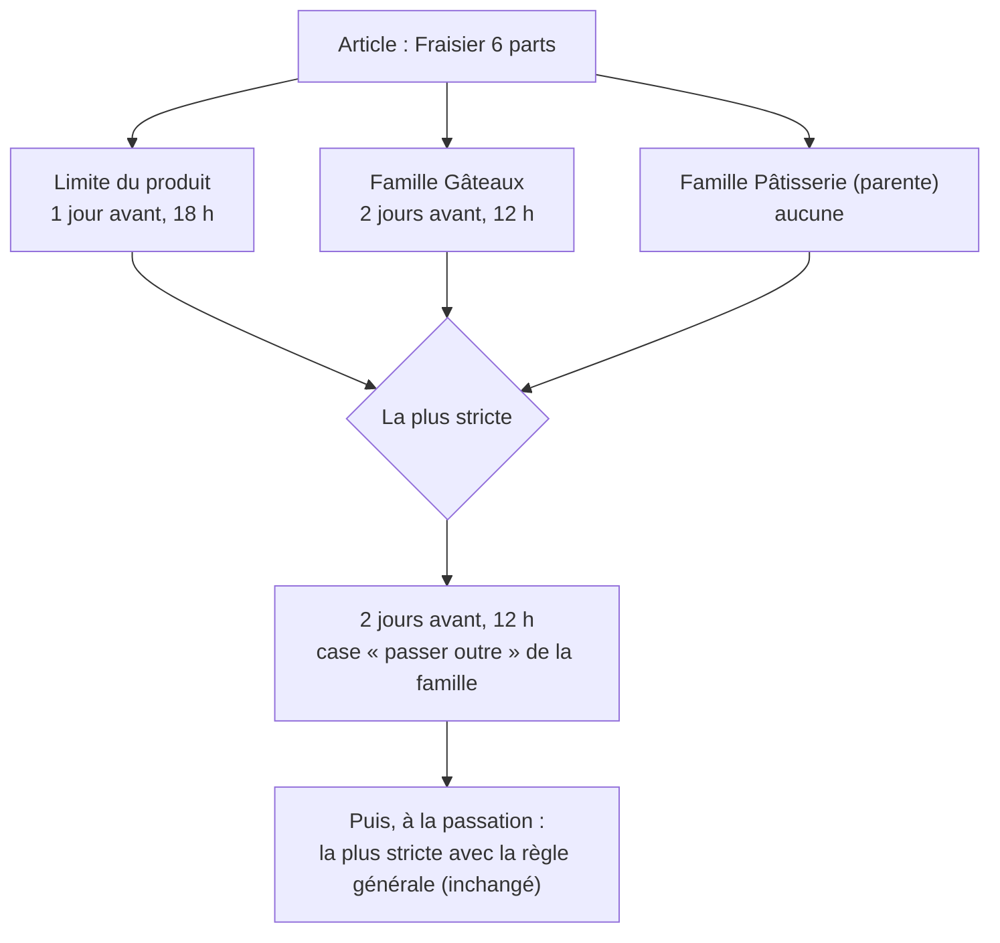

# Plan — la limite de commande d'une famille

> 🟨 **Plan, rien n'est bâti.** Demande de Hugo du 2026-11-23 : « appliquer une
> limite de commande sur toute une catégorie ». Décisions du même jour : la
> catégorie est la **famille du référentiel** ; **la plus stricte gagne** ;
> **« tout sauf »** (toute la famille, sauf des produits exclus nommément) ;
> **un seul point de décision** pour dire que l'équipe peut passer outre.
> Les affirmations sur l'existant ont été vérifiées en ouvrant les fichiers le
> 2026-11-23, puis contredites par `vitruve` le même jour (2 bloquants, 6
> sérieux, intégrés). Entrée du dossier : [`README.md`](README.md).

Ce plan revient sur une partie de la décision du 2026-10-21
([`limites-produit.md`](limites-produit.md) : « une famille n'a plus de limite
propre »). Ce qui reste de cette décision : pas de « toute la production » au
référentiel, pas de limite par déclinaison, **pas de rattrapage** sur une
limite du référentiel.

## 1. En deux mots

On pose « 2 jours avant, 12 h » sur la famille **Gâteaux**. Tous les produits
de la famille et de ses sous-familles la prennent, y compris ceux qu'on y
créera demain. On peut exclure un produit nommément : il échappe à la limite
de la famille (mais pas à la sienne, ni à la règle générale).

Un article peut donc être visé par plusieurs limites : celle de son produit,
celle de sa famille, celles des familles au-dessus. **La plus stricte gagne.**



« Plus stricte » se compare sans horloge : plus de jours avant est plus
strict ; à jours égaux, l'heure la plus tôt est plus stricte. C'est un ordre
total sur `(daysBefore, time)`.

## 2. Les décisions

| #   | Décision                                                                                                                                                                                                                                                                                                                                                                                                                                                                                                                                                                                                                                          |
| --- | ------------------------------------------------------------------------------------------------------------------------------------------------------------------------------------------------------------------------------------------------------------------------------------------------------------------------------------------------------------------------------------------------------------------------------------------------------------------------------------------------------------------------------------------------------------------------------------------------------------------------------------------------- |
| D1  | **Portées admises** : `product` et `category`. `global` et `variant` restent retirées.                                                                                                                                                                                                                                                                                                                                                                                                                                                                                                                                                            |
| D2  | **Une limite de famille couvre toute sa descendance** (sous-familles comprises), par la lignée `categoryPath` que les deux rives calculent déjà (`categoryPathOf`).                                                                                                                                                                                                                                                                                                                                                                                                                                                                               |
| D3  | **Combinaison** : parmi les règles qui visent l'article (son produit, chaque famille de sa lignée qui ne l'exclut pas), la plus stricte. Aucune ne relâche une autre.                                                                                                                                                                                                                                                                                                                                                                                                                                                                             |
| D4  | **Exclusions** : une limite de famille porte une liste de **produits** exclus (pas de sous-famille exclue — pour ça, poser la limite plus bas). Un produit exclu échappe à **cette** limite seulement : une famille parente qui ne l'exclut pas le vise encore.                                                                                                                                                                                                                                                                                                                                                                                   |
| D5  | **Règle entière, sans rattrapage**, comme le produit : délai ET heure, grâce `NULL`/`0`.                                                                                                                                                                                                                                                                                                                                                                                                                                                                                                                                                          |
| D6  | **Un seul point de décision pour « passer outre »** : la limite résolue d'un article porte **une** case, et c'est elle seule que la passation lit. Elle vaut **vrai seulement si toutes les règles qui visent l'article le permettent** (ET logique). Raison (objection de `vitruve`, 2026-11-23) : passer outre fait juger la ligne par la règle générale **seule** ([`passer-outre-la-limite-d-un-produit.md`](passer-outre-la-limite-d-un-produit.md) §1) — toutes les limites d'article tombent, pas seulement la gagnante. Prendre la case de la seule gagnante laisserait une famille cochée effacer la limite d'un produit qui l'interdit. |
| D7  | **Le juge de la passation ne change pas.** Il lit toujours une seule limite par article (`CatalogItem.orderLimit*`) ; seule la résolution qui l'y range change.                                                                                                                                                                                                                                                                                                                                                                                                                                                                                   |

## 3. Ce qui change, couche par couche

### 3.1 La résolution partagée — `@lfd/catalog-sync`

`resolveOrderTimeLimit` (`packages/catalog-sync/src/order-time-limit-resolution.ts`)
ne lit aujourd'hui que la règle du produit et ignore les autres portées. Elle
devient :

1. candidates = la règle `product` du produit + chaque règle `category` dont
   l'id est dans `target.categoryPath` et dont `excludedProductIds` ne contient
   pas `target.productId` ; seules les règles complètes (délai ET heure) ;
2. le délai et l'heure de la plus stricte (D3) ; à égalité, la plus précise
   (produit, puis la famille la plus proche) — seule la provenance affichée en
   dépend ;
3. rend `{ daysBefore, time, graceMinutes: 0, staffMayExceed }`, où
   `staffMayExceed` est le ET de toutes les candidates (D6).

`explainOrderTimeLimit` rend la provenance réelle (`product` ou `category`,
avec l'id de la famille). Elle n'a aujourd'hui **aucun appelant** hors tests
(vérifié par `vitruve` le 2026-11-23) : sa forme change donc sans casser
personne.

Côté commerce, `orderLimitChanges`
(`lafoliecoffee/catalog/domain/order-limit-descent.ts`) l'appelle déjà avec
la lignée `categoryPath`. Côté référentiel, `resolve-order-time-limit.ts`
n'est qu'un réexport : la fiche produit devra recevoir les règles et la
lignée (§3.5).

Le commentaire de `staffMayExceed` dans `snapshot.ts` (« lue au seul rang du
produit ») se réécrit.

### 3.2 Le fil

`syncOrderTimeLimitRuleSchema` (`packages/catalog-sync/src/snapshot.ts`)
admet déjà `category`. Il gagne
`excludedProductIds: z.array(z.string().min(1)).default([])` : une règle
rangée avant se lit sans exclusion. Le commerce range les règles en JSON
(`public.catalog_rules.rules`) : **aucune migration côté commerce**.

L'émetteur (`B2bCatalogRulesEmitter`) laisse passer `category` en plus de
`product`, avec ses exclusions (`toSyncRule`).

### 3.3 Le référentiel — domaine

- `OrderTimeLimit.set` / `reset` : `ensureProduct` devient `ensureAdmittedScope`
  (`product` | `category`) ; `RetiredOrderTimeLimitScopeError` garde son code
  pour `global` et `variant`.
- Exclusions sur l'agrégat : `exclude(productId)` / `include(productId)`,
  refusées hors portée `category` (`pim.order_time_limit.exclusion_on_product`,
  400). Un produit exclu deux fois ne change rien (idempotent, rend `false`).
- **Garde d'écriture** : exclure un produit qui n'appartient pas à la
  descendance de la famille est refusé (`pim.order_time_limit.exclusion_outside_family`) —
  sinon l'exclusion ne dirait rien et l'écran mentirait. `order-time-limitation`
  ne lit que le noyau (`lint:pim-subcontexts`, `lint:pim-table-owners`) : il
  **déclare** un port étroit `ProductLineageReader` (« la lignée de familles de
  ce produit ») dans `domain/ports/`, que le catalogue **implémente**, relié
  dans `order-time-limitation.module.ts` comme `LimitTargetLabelsReader`. Le
  même port sert à `set` sur une portée `category` pour refuser une famille
  inexistante (`scope_id` n'a pas de clé étrangère).
- Un produit exclu puis reclassé ailleurs garde son exclusion, inerte ;
  l'écran la montre « hors de la famille » et permet de la retirer.
- Un produit archivé reste dans la liste d'exclusion : l'archive ne détruit
  rien.
- **Archiver une limite de famille garde ses exclusions** ; la reposer (une
  ligne par portée, la ligne archivée revient) les remet en vigueur, et
  l'écran de pose les **montre** avant validation (« 3 produits restent
  exclus »).
- **Retirer une exclusion est un soft delete** (`removed_at`) : l'exclusion
  fait partie de l'agrégat, et CLAUDE.md §3 interdit le DELETE physique.
  Chaque geste écrit un fait au journal du PIM — deux types neufs,
  `order_time_limit.product_excluded` et `order_time_limit.product_included`.
  Le repository compare l'avant et l'après dans `save(aggregate)`.

### 3.4 Le référentiel — base (migration additive)

```sql
ALTER TABLE "pim"."order_time_limit"
  DROP CONSTRAINT "order_time_limit_product_only";
ALTER TABLE "pim"."order_time_limit"
  ADD CONSTRAINT "order_time_limit_product_or_family"
  CHECK ("scope_type" IN ('product', 'category'));

CREATE TABLE "pim"."order_time_limit_exclusion" (
  "id"         TEXT PRIMARY KEY,                 -- ULID (IdGenerator)
  "limit_id"   TEXT NOT NULL,
  "product_id" TEXT NOT NULL,
  "created_at" TIMESTAMPTZ NOT NULL,             -- du Clock, pas de défaut
  "removed_at" TIMESTAMPTZ,
  CONSTRAINT "order_time_limit_exclusion_limit_fkey"
    FOREIGN KEY ("limit_id") REFERENCES "pim"."order_time_limit"("id") ON DELETE RESTRICT,
  CONSTRAINT "order_time_limit_exclusion_product_fkey"
    FOREIGN KEY ("product_id") REFERENCES "pim"."product"("id") ON DELETE RESTRICT
);
CREATE UNIQUE INDEX "order_time_limit_exclusion_one_live"
  ON "pim"."order_time_limit_exclusion" ("limit_id", "product_id")
  WHERE "removed_at" IS NULL;
```

Le CHECK s'élargit : aucune ligne existante du référentiel ne le viole, et
aucune ligne `category` ne peut y être (le CHECK
`order_time_limit_product_only` a porté sur toutes les lignes, archivées
comprises). Le modèle Prisma vit sous `prisma/schema/pim/` avec
`@@schema("pim")` (`lint:prisma-schema-layout`), la relation retour sur
`Product` dans le fichier du catalogue (`lint:prisma-model-ownership`), et les
noms de contraintes ci-dessus sont ceux du schéma (`schema-drift`).

**Le vrai risque est côté commerce** : `public.catalog_rules.rules` est relu
sans filtre de portée (`prisma-catalog-order-limits.ts`) et la résolution
d'aujourd'hui ignore `category`. Une règle `category` rangée avant le
2026-10-21, si aucun fait de règles n'est arrivé depuis, **deviendrait
active au premier rafraîchissement** dès que F1 est déployé. Parade (lot F1) :
la résolution reste filtrée sur `product` côté récepteur tant que F3 n'est
pas livré, et le déploiement de F3 est suivi d'une émission des règles, qui
remplace le contenu rangé. On compte aussi les règles non `product` dans
`public.catalog_rules` en dev et en production avant la bascule.

Portes sans objet, dites pour qu'on ne les cherche pas :
`lint:context-version-columns` (le commerce écrit les mêmes colonnes
`order_limit_*`, déjà lues par le déclencheur) et `lint:dated-decisions` (la
limite n'entre pas dans la résolution du prix).

### 3.5 Le référentiel — application et écrans

- `SetOrderTimeLimit` accepte la portée `category` ; deux cas neufs :
  `ExcludeProductFromLimit`, `IncludeProductInLimit` (un fichier par cas,
  convention du PIM). Chacun émet `pim.catalog_rules_changed` dans sa
  transaction, comme `SetOrderTimeLimit`.
- `ListOrderTimeLimits` rend produits **et** familles, avec leurs exclusions
  nommées.
- **Écran « Limites de commande »** (`/pim/limites-de-commande`) : retour du
  choix de portée (produit / famille), sans « toute la production ». Une ligne
  famille montre « N produits exclus » et ouvre la liste.
- **Fiche famille** : une carte « Limite de commande » (poser, modifier,
  archiver, exclusions).
- **Fiche produit** (`product-form/form-sections/order-limit/`) : dit la
  limite effective et sa provenance (« 2 jours avant, 12 h — famille
  Gâteaux »), et, si une famille le vise, la case « Exclure de la limite de la
  famille Gâteaux ». Aujourd'hui la carte ne lit que la règle du produit : une
  route neuve `GET /pim/order-time-limits/effective/:productId` (query
  `ExplainProductOrderTimeLimit`) rend les règles en jeu, la lignée (par
  `ProductLineageReader`) et l'explication.
- Le panneau `limit-panel` garde la case « l'équipe peut passer outre » sur
  chaque limite. L'écran dit la règle de D6 : « Passer outre n'est possible
  que si toutes les limites qui visent ce produit le permettent. »

### 3.6 Le commerce

Rien à écrire hors de la résolution partagée :

- `OnCatalogRulesChangedHandler` range les règles, `OrderLimitsRefresher`
  redescend sur chaque article (`orderLimitChanges` appelle déjà
  `resolveOrderTimeLimit` avec la lignée) ;
- un produit reclassé ou une famille déplacée redescend déjà
  (`on-catalog-product-changed`, `on-catalog-category-changed`) ;
- **une fenêtre à fermer** : le fait d'une fiche écrit d'abord sa famille,
  puis ne redescend que cette fiche (`refresh(productId)`). Si cette écriture
  change le parent d'une famille déjà connue, les autres articles de la
  famille gardent leur ancienne limite jusqu'au fait de famille. Aujourd'hui
  sans effet (la lignée n'entre pas dans la résolution) ; avec ce plan, le
  handler fait `refresh(null)` quand la famille écrite a changé. À établir au
  bâti en lisant le chemin d'écriture de la famille depuis une fiche ;
- `judgeOrderDeadline`, le plancher de la règle générale, la dérogation, la
  case et le droit `lfc_product_limit_override` : inchangés (D7).

**La boutique** : `ShopItemView.orderTimeLimit` sert la limite résolue ; elle
dira la limite de la famille sans changement de contrat.

## 4. Les lots

| Lot | Contenu                                                                                                                                      | Tests                                                                                                                                                                                                                |
| --- | -------------------------------------------------------------------------------------------------------------------------------------------- | -------------------------------------------------------------------------------------------------------------------------------------------------------------------------------------------------------------------- |
| F1  | Résolution partagée (D2, D3, D4, D6) + `excludedProductIds` au fil ; **filtre `product` gardé côté récepteur** jusqu'à F3                    | unitaires purs : famille seule, produit plus strict, famille plus stricte, parente, exclusion, exclusion par une seule famille de la lignée, égalité, incomplète ; case : famille cochée + produit décoché ⇒ `false` |
| F2  | Migration (CHECK élargi, table d'exclusion) + domaine `OrderTimeLimit` + `ProductLineageReader` + repository                                 | domaine (portées, exclusions, soft delete, archivage, refus) ; e2e PIM : poser sur une famille, exclure, ré-exclure après retrait                                                                                    |
| F3  | Cas d'application + émetteur + routes ; levée du filtre récepteur ; `refresh(null)` sur famille changée ; émission des règles au déploiement | handlers ; e2e : le fait porte famille et exclusions ; le commerce range la limite sur un article de la famille, pas sur l'exclu ; **famille déplacée sous une famille limitée ⇒ ses articles la prennent**          |
| F4  | Écrans : page des limites, carte de la fiche famille, carte de la fiche produit                                                              | specs des composants                                                                                                                                                                                                 |
| F5  | Doc d'état : [`limites-produit.md`](limites-produit.md) → « limites du référentiel », README §1–2, ce plan retiré                            | —                                                                                                                                                                                                                    |

Ordre : F1 → F2 → F3 → F4 → F5. Avant F2 : `vitruve` (migration) puis Hugo.

## 5. Ce que ce plan ne fait pas

- pas de rattrapage sur une limite du référentiel ;
- pas de limite « toute la production » au référentiel (elle reste au
  commerce) ;
- pas d'exclusion d'une sous-famille ;
- pas de changement du juge ni de la passation.
