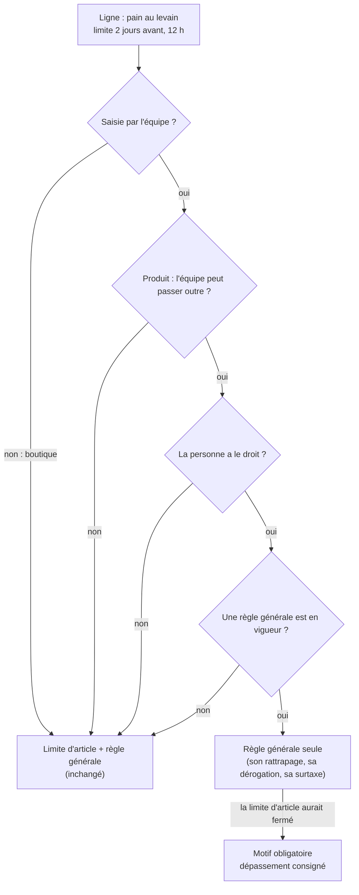

# Plan — passer outre la limite d'un produit

> 📐 **Plan v2, rien n'est bâti** (2026-11-19). Demandé par Hugo le
> 2026-11-19 : « décider si ces limites de commande sont overridable par notre
> commerciale ou non, par exemple un produit qui demanderait 48 h, si notre
> commerciale veut l'ajouter à 24 h elle doit pouvoir si on lui donne le
> droit ». Frontière de sécurité (un droit neuf) : la v1 est passée par
> `vitruve` le 2026-11-19 (quatre bloquants, six sérieux), et elle est
> réécrite ici. Les objections et ce qu'elles sont devenues sont au § 7.
> **Deux décisions attendent Hugo** (§ 6).
>
> ⏭️ **À réécrire avant d'être bâti.** Le verdict de l'heure limite est bâti
> ([`le-verdict-de-l-heure-limite.md`](le-verdict-de-l-heure-limite.md),
> 2026-11-19) : le dépassement s'y écrit une fois — une donnée de `asker` et une
> propriété de la limite d'un article —, au lieu d'un drapeau passé à cinq
> lecteurs. Les §§ 2 et 3.4 ci-dessous décrivent l'ancienne garde.

## 1. En deux mots

Deux clés, et il faut **les deux** :

1. **Le produit le permet.** Sur sa limite de commande, une case « l'équipe
   peut passer outre ». Décochée par défaut.
2. **La personne en a le droit.** Un droit neuf, réglé à l'écran des rôles.

Quand une personne qui a le droit saisit une commande pour un client, une ligne
dont le produit le permet **oublie sa limite d'article**. Elle n'est plus jugée
que par la **règle générale du commerce**. La personne donne un motif, et
chaque dépassement est consigné.



**Le plancher, c'est la règle générale.** La garde prend déjà « la plus
stricte » entre la limite d'article et la règle générale (`README.md` § 2).
Retirer la limite d'article laisse donc la règle générale juger la ligne, avec
son rattrapage, sa dérogation et sa surtaxe telles qu'elles sont. Une
commerciale peut mettre à J+1 un produit à 48 h. Elle ne peut pas le mettre
après l'heure limite générale sans dérogation, ni après le rattrapage.

🔴 **Sans règle générale, aucun dépassement** (choix par défaut, § 6 Q2). Quand
aucune règle générale n'est en vigueur, le lecteur n'en rend aucune
(`order-cutoff-guard.ts:44-46`, `pim-general-order-cutoff.reader.ts`). Retirer
la limite d'article ne laisserait alors plus rien. Dans ce cas, le dépassement
n'a pas lieu et la ligne reste jugée par sa limite.

Hors du plan :

- **la boutique** (client, invité) : la limite d'article lui reste opposée ;
- **la fenêtre d'une opération datée** (`ensureWithinOperation`, premier geste
  d'`arrange`) : elle n'a aucune dérogation et n'en gagne pas ;
- **le jour même** et **l'arrêt du plan** : leurs règles ne changent pas.

## 2. Ce qui existe (ouvert le 2026-11-19, revérifié après `vitruve`)

| Constat                                                                                                                                                                                                                                                                                                                                                                                                                                                                                               | Où                                                                                                                                                                                                                                           |
| ----------------------------------------------------------------------------------------------------------------------------------------------------------------------------------------------------------------------------------------------------------------------------------------------------------------------------------------------------------------------------------------------------------------------------------------------------------------------------------------------------- | -------------------------------------------------------------------------------------------------------------------------------------------------------------------------------------------------------------------------------------------- |
| Une limite d'article est une règle entière (délai + heure), par produit, sans rattrapage. Elle vit au référentiel.                                                                                                                                                                                                                                                                                                                                                                                    | `pim/order-time-limitation/domain/entities/order-time-limit.ts` ; `prisma/schema/pim/sales-contexts.prisma` `OrderTimeLimit`                                                                                                                 |
| Elle descend au commerce par le fait `catalog-rules-changed` → `public.catalog_rules` (jsonb) → `order-limit-descent` → colonnes de `public.catalog_items`. `OrderLimitsRefresher` (`lafoliecoffee/catalog/application/order-limits-refresher.service.ts`) les redescend après chacun des trois faits du catalogue ; avant le premier fait de règles, les limites posées par le push d'un instantané restent (chemin du push pas encore relu). `sameLimit` ne compare que délai, heure et rattrapage. | `pim/channels/b2b-platform/products/order-time-limits.ts` ; `packages/catalog-sync/src/snapshot.ts` (`SyncOrderTimeLimit`) ; `lafoliecoffee/catalog/domain/order-limit-descent.ts:61-70` ; `catalog-item-columns.ts`, `catalog-item-rows.ts` |
| Les colonnes de `catalog_items` font monter `context_versions` par un déclencheur, et une porte exige que chaque colonne y soit lue ou ignorée avec sa raison.                                                                                                                                                                                                                                                                                                                                        | `migrations/20261106120000_les_versions_par_contexte` ; `lint:context-version-columns`                                                                                                                                                       |
| La garde : par ligne, la plus fermée entre limite d'article et règle générale. Sur le panier, la plus fermée. La dérogation joue **dans le rattrapage seulement**. Elle rend une décision agrégée.                                                                                                                                                                                                                                                                                                    | `apps/lfd-api/src/lafoliecoffee/order-cutoffs/domain/deadline/judge-order-deadline.ts`                                                                                                                                                       |
| `decideStrictestOrderCutoff` a d'autres lecteurs que la passation : les suggestions (`recommendations/domain/orderable-today.ts`), l'avis d'heure limite (`order-cutoff-notice.service.ts`), `OrderCutoffGate.decide` et `foresee` (la surtaxe prévue).                                                                                                                                                                                                                                               | id.                                                                                                                                                                                                                                          |
| La passation de l'équipe **et son estimation** composent par `prepareStaffOrder` → `OrderDrafting.draft` → `ensureNotTooLate` (`order-drafting.service.ts:318`). La passation exige le total de l'estimation (`ensureTotalSeen`).                                                                                                                                                                                                                                                                     | `commands/place-order-for-customer.handler.ts` ; `queries/estimate-order-for-customer.handler.ts`                                                                                                                                            |
| 🔴 **La révision par l'équipe n'oppose aucune heure limite**, ni d'article ni générale : `ensureBeforeCutoff` sort tout de suite pour l'acteur `staff`, et la révisabilité aussi.                                                                                                                                                                                                                                                                                                                     | `orders/revision/application/services/order-revising.service.ts:159, 418-420`                                                                                                                                                                |
| Pour le client, la révisabilité d'une commande se lit par `cutoffs.decide` sur toutes ses lignes.                                                                                                                                                                                                                                                                                                                                                                                                     | id., l. 163-168                                                                                                                                                                                                                              |
| Un droit partiel se lit au contrôleur par `@StaffPermissions()` (résolu en base par `StaffAccessGuard`). Le contrôleur en tire un booléen pour la commande. Aucun handler du commerce ne lit un droit lui-même.                                                                                                                                                                                                                                                                                       | `platform/auth/staff.decorator.ts:32-53` (DG-D8)                                                                                                                                                                                             |
| Un droit = une valeur de l'enum `StaffResource` (migration additive, irréversible en pratique) et sa phrase dans `STAFF_RESOURCE_SCOPES`. Rien n'est accordé par migration.                                                                                                                                                                                                                                                                                                                           | `prisma/schema/public/staff.prisma` ; `packages/contracts/src/staff-resource-scopes.ts` ; `lint:no-role-grants-in-migrations`                                                                                                                |
| L'empreinte d'intention d'une saisie de l'équipe hache le panier.                                                                                                                                                                                                                                                                                                                                                                                                                                     | `staff-placement-intent.ts`                                                                                                                                                                                                                  |

## 3. Le modèle

### 3.1 Au référentiel : la limite dit si l'équipe peut passer outre

- Colonne `pim.order_time_limits.staff_may_exceed boolean NOT NULL DEFAULT
false`. Toutes les limites existantes restent infranchissables.
- `OrderTimeLimit` porte `staffMayExceed`. `set` et `reset` le reçoivent dans
  `OrderTimeLimitPayload`, avec un champ **obligatoire**. `reset` compte un
  changement de ce seul champ comme un changement (journal, fait).
  `OrderTimeLimitView` le rend.
- Le journal du référentiel nomme le geste.
- Écran : la case sur la fiche produit et dans Référentiel › Limites de
  commande, sous `pim_catalog:write`. **Décider qu'un produit le permet est une
  décision de catalogue**, et c'est elle qui répond de la faisabilité au
  fournil (§ 3.8).

### 3.2 Jusqu'au commerce

- `SyncOrderTimeLimitRule.staffMayExceed` (le fil) et `SyncOrderTimeLimit`
  (la limite résolue, `resolveOrderTimeLimit`) le portent.
- `sameLimit` (`order-limit-descent.ts`) **le compare**. Sans ça, cocher la
  case seule ne changerait rien sur l'article, et rien ne le dirait.
- Le push d'un instantané le porte aussi. Son chemin n'est pas encore relu : le fichier que `vitruve` nommait pour lui n'existe pas (vérifié le 2026-11-19). À ouvrir au début d'O1.
- Commerce : colonne `public.catalog_items.order_limit_staff_may_exceed
boolean NOT NULL DEFAULT false`, ses lignes (`catalog-item-columns.ts`,
  `catalog-item-rows.ts`) et `OrderTimeLimitFacts.staffMayExceed`. Le
  déclencheur des versions la **lit** (elle change ce que la saisie peut
  faire). La migration redéfinit donc le déclencheur, et
  `lint:context-version-columns` le vérifie.
- Une règle rangée avant (jsonb de `catalog_rules`, sans le champ) se lit
  `false`, jamais `true`.

### 3.3 Le droit : `lfc_product_limit_override`

- Valeur neuve de `StaffResource`, par migration additive. **Le nom est
  définitif au merge** : une valeur d'enum ne se retire pas. Elle n'est
  accordée à personne par la migration. Hugo la donne à l'écran des rôles.
- Phrases :
  - `read` : « Voir les dépassements de limite de produit consignés sur une
    commande. »
  - `write` : « En saisissant ou en modifiant une commande pour un client,
    passer outre la limite de commande d'un produit qui le permet. L'heure
    limite générale reste opposée. »
- Distinct de `b2b_order_waivers` : une dérogation rouvre **une journée** pour
  **une société** pendant le rattrapage ; ce droit-ci efface **la limite d'un
  article**.
- Lu au **contrôleur** par `@StaffPermissions()`, le patron DG-D8. Le
  contrôleur passe un booléen `productLimitOverride` à la commande ou à la
  query. Le serveur le résout en base, et la requête de l'écran ne peut pas
  le forger.

### 3.4 La garde : une décision par ligne

`ensureWithinOrderCutoff` et `decideStrictestOrderCutoff` reçoivent une entrée
**obligatoire**, pour qu'un appelant oublié ne compile pas :

```ts
/** L'appelant peut passer outre les limites d'article qui le permettent. */
readonly productLimitOverride: boolean;
```

Pour chaque ligne : si `productLimitOverride`, `limit.staffMayExceed` **et**
qu'une règle générale est en vigueur, la ligne est jugée sans sa limite
d'article. La garde calcule donc d'abord une **décision par ligne**, puis
l'agrège comme aujourd'hui. Elle rend aussi **les SKU dépassés** : ceux dont
la limite d'article seule aurait été `closed`. Une ligne encore dans les temps
n'est pas un dépassement.

Pure, sans port. Ses tests se posent en premier.

| Lecteur                                                                               | `productLimitOverride`                                               |
| ------------------------------------------------------------------------------------- | -------------------------------------------------------------------- |
| boutique : passation, devis, avis d'heure limite                                      | `false`                                                              |
| suggestions (`orderable-today`)                                                       | `false`                                                              |
| équipe sans le droit                                                                  | `false`                                                              |
| **équipe avec le droit** : estimation, passation, devis du comptoir, révision (§ 3.6) | `true`                                                               |
| surtaxe prévue (`foresee`)                                                            | celui de l'appelant, pour que l'annoncé et le facturé soient le même |

Le drapeau descend par `prepareStaffOrder` → `draft` → `ensureNotTooLate`.
Cette méthode, commune aux trois portes, le reçoit en paramètre explicite.

### 3.5 La passation de l'équipe : motif et trace

- `AdminOrderEstimatePayload` (que `prepareStaffOrder` reçoit, donc
  l'estimation **et** la passation) gagne `productLimitOverrideReason?:
string` (1 à 280 caractères).
- Si la garde rend au moins un dépassement et que le motif manque, la
  **passation** refuse avec `orders.cutoff.product_limit_reason_required`, en
  nommant les produits (« Le pain au levain se commande 2 jours avant :
  indiquez pourquoi vous passez outre. »). Le refus tombe avant l'écriture, et
  la clé d'intention est rendue. L'**estimation**, elle, ne refuse pas pour un
  motif manquant : elle chiffre et rend la liste des dépassements, pour que
  l'écran demande le motif.
- Un motif donné sans dépassement est ignoré.
- L'empreinte d'intention ne hache pas le motif : un renvoi du même panier
  avec un autre motif rend la commande déjà passée. C'est voulu.
- Trace : table `public.order_product_limit_overrides` — `id`, `order_id`,
  `sku`, `staff_user_id`, `reason`, `fulfillment_date`, la limite dépassée
  (`days_before`, `time`), `origin` (`placement` | `revision`), `created_at`.
  Elle est écrite **dans la transaction** de la commande, avec une ligne par
  SKU dépassé, et jamais modifiée. Propriétaire : `lafoliecoffee/orders`.
- `staff_user_id` et `reason` (texte libre, qui peut nommer un client) entrent
  au registre `documentation/legal/rgpd-registre.json` (`lint:rgpd-staff`).
  Durée de conservation : celle de la commande. À confirmer au registre.
- La vue d'une commande au back-office affiche les dépassements sous
  `lfc_product_limit_override:read`.

### 3.6 La révision

Aujourd'hui, l'équipe révise sans aucune heure limite (§ 2). Laisser ce chemin
ouvert rendrait les deux clés décoratives : n'importe qui passerait une
commande, puis y ajouterait le produit à 48 h sans droit, sans motif et sans
trace. **Choix par défaut (§ 6 Q1)** : la révision par l'équipe oppose la
**limite d'article** des lignes **ajoutées ou augmentées**, avec la même garde,
le même droit et le même motif (`origin = revision`). La règle générale reste,
pour l'équipe, ce qu'elle est aujourd'hui en révision : non opposée. Ce plan
ne touche pas à cette décision.

Côté client, une commande qui porte un dépassement serait figée : sa
révisabilité lit `decide` sur toutes ses lignes, et la ligne dépassée la
ferme. `decide` exclut donc de la révisabilité **du client** les SKU consignés
dans la trace pour cette commande. Le client peut toujours modifier le reste
tant que la règle générale le permet. Il ne peut pas augmenter la ligne
dépassée : une augmentation est un ajout, et l'ajout reste jugé par la limite
d'article.

### 3.7 Ce que dit l'écran de saisie

L'estimation et le devis du comptoir rendent, par ligne fermée par sa limite
d'article, `{ sku, exceedable: boolean }`. `exceedable` est vrai quand le
produit le permet, que la personne a le droit et qu'une règle générale est en
vigueur. L'avis d'heure limite de l'estimation (`cutoffOf`,
`OrderCutoffNotice.forDay`) tient compte du dépassement. L'écran affiche
« Limite dépassée — passer outre » et demande le motif, ou « Ce produit ne se
commande plus pour ce jour ».

### 3.8 Ce que le fournil voit

Rien de neuf. Une commande de l'équipe sur un plan arrêté est déjà reçue
« hors plan » (`placed_off_plan`). Avant l'arrêt, elle entre dans le plan
comme une autre ligne. **Rien ne vérifie qu'un produit se fabrique en moins de
temps que sa limite** : c'est la case du produit qui en répond. Un produit qui
ne se fait pas en moins de 48 h ne doit pas l'avoir cochée.

## 4. Les lots

| Lot    | Contenu                                                                                                                                                                                                                                                                             | Tests                                                                                                                                                                                                                                                                                          |
| ------ | ----------------------------------------------------------------------------------------------------------------------------------------------------------------------------------------------------------------------------------------------------------------------------------- | ---------------------------------------------------------------------------------------------------------------------------------------------------------------------------------------------------------------------------------------------------------------------------------------------- |
| **O1** | Référentiel (colonne `pim`, entité, `OrderTimeLimitPayload`/`View`, journal) ; fil (`SyncOrderTimeLimitRule`, `SyncOrderTimeLimit`, `resolveOrderTimeLimit`, `sameLimit`, `snapshot-limits`) ; commerce (colonne `public`, déclencheur des versions, lignes, `OrderTimeLimitFacts`) | domaine ; `sameLimit` sur la seule case ; règle d'avant → `false` ; e2e `pim-*` et ingestion ; **`pnpm test` racine** (`packages/` bouge)                                                                                                                                                      |
| **O2** | Droit : enum, migration, phrases                                                                                                                                                                                                                                                    | e2e : la migration n'accorde rien                                                                                                                                                                                                                                                              |
| **O3** | Garde par ligne, entrée obligatoire, SKU dépassés ; ses cinq lecteurs ; `prepareStaffOrder`/`draft` ; contrôleurs (`@StaffPermissions`) ; motif, refus, table, transaction, registre RGPD                                                                                           | unitaires de la garde (avec/sans droit, avec/sans case, sans règle générale, règle générale qui ferme quand même, panier mixte) ; handlers ; e2e : sans droit → refus, sans motif → refus et clé rendue, avec motif → commande + trace, boutique → refus, estimation → montants + dépassements |
| **O4** | Révision de l'équipe (§ 3.6) et révisabilité du client                                                                                                                                                                                                                              | e2e : ajout d'un produit à 48 h en révision sans droit → refus, avec droit + motif → trace `revision` ; client : commande avec dépassement encore modifiable sur le reste                                                                                                                      |
| **O5** | Back-office : case sur la limite, `exceedable` et motif à la saisie et en révision, dépassements sur la commande                                                                                                                                                                    | specs des composants                                                                                                                                                                                                                                                                           |
| **O6** | Doc d'état : `limites-produit.md` § 3, `README.md` § 1-2 ; ce plan retiré                                                                                                                                                                                                           | —                                                                                                                                                                                                                                                                                              |

## 5. Irréversible

- La valeur d'enum `StaffResource` : elle ne se retire pas. **Nom à confirmer
  avant O2.**
- Les colonnes `pim` et `public` restent en base même si le geste est retiré
  (§ 0 du `CLAUDE.md`).
- La table de trace devient de la donnée réelle au premier usage.

## 6. Décisions pour Hugo

- **Q1 — La révision par l'équipe.** Aujourd'hui, elle ignore toute heure
  limite. Défaut proposé : elle oppose désormais la limite d'article aux lignes
  ajoutées, avec la même porte à deux clés (§ 3.6). L'alternative est de
  laisser la révision telle qu'elle est. Dans ce cas, le droit n'ouvre rien de
  plus que ce que l'équipe a déjà, et seuls le motif et la trace sont neufs.
  C'est un **resserrement** pour l'équipe : sans le droit, elle ne pourra plus
  ajouter en révision un produit dont la limite est passée.
- **Q2 — Sans règle générale en vigueur.** Défaut proposé : pas de dépassement
  (§ 1). L'alternative : le dépassement ne laisse alors aucune limite.

## 7. La contradiction de `vitruve` (2026-11-19, v1)

| Objection                                                                                          | Devenue                                                                                                                      |
| -------------------------------------------------------------------------------------------------- | ---------------------------------------------------------------------------------------------------------------------------- |
| B1 — la révision de l'équipe contourne tout, et la v1 disait l'inverse                             | vérifiée (`order-revising.service.ts:159, 418`) ; § 2, § 3.6, Q1                                                             |
| B2 — sans règle générale, plus de plancher                                                         | vérifiée (`order-cutoff-guard.ts:44-46`) ; § 1, Q2                                                                           |
| B3 — la case n'arrivait pas au commerce (`sameLimit`, `SyncOrderTimeLimit`, colonnes, déclencheur) | § 3.2, lot O1                                                                                                                |
| B4 — l'estimation non branchée rendait la passation impossible                                     | § 3.4, § 3.5, § 3.7                                                                                                          |
| S5 — le droit se lit au contrôleur (`@StaffPermissions`)                                           | vérifié (`staff.decorator.ts:32-53`) ; § 3.3                                                                                 |
| S6 — une commande avec dépassement figée pour le client                                            | § 3.6                                                                                                                        |
| S7 — la surtaxe prévue sans le drapeau                                                             | § 3.4                                                                                                                        |
| S8 — cinq lecteurs de la garde, une décision par ligne                                             | § 3.4                                                                                                                        |
| S9 — registre RGPD                                                                                 | § 3.5                                                                                                                        |
| S10 — irréversibilité                                                                              | § 5                                                                                                                          |
| Mineurs (chemin du fil, ligne 318, idempotence, payload d'estimation)                              | § 2, § 3.5                                                                                                                   |
| Non vérifié par `vitruve` : un « délai de fabrication » dans `arrange`                             | ouvert le 2026-11-19 : `arrange` n'oppose que la fenêtre d'une opération datée (`operations.ensure`), pas un délai d'article |
