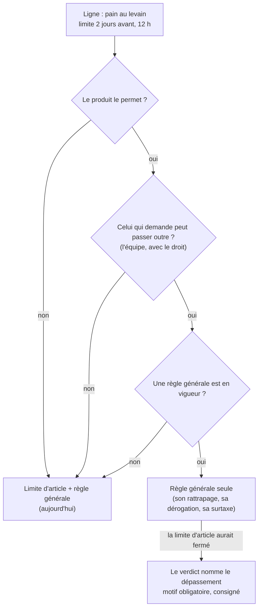

# Plan — passer outre la limite d'un produit

> 📐 **Plan v4, rien n'est bâti** (2026-11-19 ; v3 contredite par `vitruve`
> le même jour, trois bloquants et sept sérieux, tous intégrés, § 8). Demandé par Hugo le
> 2026-11-19 : « décider si ces limites de commande sont overridable par notre
> commerciale ou non, par exemple un produit qui demanderait 48 h, si notre
> commerciale veut l'ajouter à 24 h elle doit pouvoir si on lui donne le
> droit ». La v2 décrivait l'ancienne garde, éparpillée en cinq lecteurs ; le
> jugement a depuis été rassemblé
> ([`le-verdict-de-l-heure-limite.md`](le-verdict-de-l-heure-limite.md)), et
> cette version s'écrit dessus. Frontière de sécurité (un droit neuf) : `vitruve`
> avant Hugo. **Les deux décisions sont tranchées** (§ 7) : prêt à bâtir.

## 1. En deux mots

Deux clés, et il faut **les deux** :

1. **Le produit le permet.** Sur sa limite de commande, une case « l'équipe
   peut passer outre ». Décochée par défaut.
2. **La personne en a le droit.** Un droit neuf, réglé à l'écran des rôles.

Quand une personne qui a le droit saisit une commande pour un client, une ligne
dont le produit le permet **oublie sa limite d'article** : le verdict la juge
par la **règle générale** du commerce seule. La personne donne un motif, et
chaque dépassement est consigné.



**Le plancher, c'est la règle générale.** Le juge prend déjà « la plus stricte »
des deux limites ; retirer la limite d'article laisse la règle générale juger
la ligne, avec son rattrapage, sa dérogation et sa surtaxe telles qu'elles
sont. Une commerciale peut mettre à J+1 un produit à 48 h ; elle ne peut pas le
mettre après l'heure limite générale sans dérogation, ni après le rattrapage.

**Sans règle générale en vigueur, aucun dépassement** (défaut, § 7 Q2) : le
juge n'en rend aucune quand personne ne l'a posée, et retirer la limite
d'article ne laisserait plus rien.

**Pourquoi c'est court maintenant.** Tout le jugement passe par une question,
`OrderDeadline.verdict`. Le dépassement s'y écrit **une fois** : une capacité
de celui qui demande (`asker`), une propriété de la limite d'un article, et un
fait du verdict (« telle ligne a dépassé telle limite »). Chaque lecteur qui
pose la question hérite de la même réponse.

Hors du plan : la boutique (client, invité), qui ne peut jamais passer outre ;
la fenêtre d'une opération datée, le jour même et l'arrêt du plan, dont les
règles ne changent pas.

## 2. Ce qui existe (ouvert le 2026-11-19, après le bâti du verdict)

| Constat                                                                                                                                                                                                                                                                                                                                                               | Où                                                                                                                                                                                               |
| --------------------------------------------------------------------------------------------------------------------------------------------------------------------------------------------------------------------------------------------------------------------------------------------------------------------------------------------------------------------- | ------------------------------------------------------------------------------------------------------------------------------------------------------------------------------------------------ |
| Une limite d'article est une règle entière (délai + heure), par produit, sans rattrapage. Elle vit au référentiel.                                                                                                                                                                                                                                                    | `pim/order-time-limitation/domain/entities/order-time-limit.ts` ; `prisma/schema/pim/sales-contexts.prisma` `OrderTimeLimit`                                                                     |
| Elle descend au commerce par le fait des règles (`catalog-rules-changed` → `public.catalog_rules` → `order-limit-descent` → colonnes de `public.catalog_items`, rafraîchies par `OrderLimitsRefresher`) et par les faits d'une fiche (`prisma-catalog-product-facts.projection.ts`, `catalog-item-upsert.ts`). `sameLimit` ne compare que délai, heure et rattrapage. | `pim/channels/b2b-platform/products/order-time-limits.ts` ; `packages/catalog-sync/src/snapshot.ts` ; `lafoliecoffee/catalog/domain/order-limit-descent.ts`                                      |
| Les colonnes de `catalog_items` sont lues par l'instantané du catalogue et par le déclencheur des versions, qu'une porte tient.                                                                                                                                                                                                                                       | `catalog-item-columns.ts`, `catalogue-snapshot-columns.ts` ; `lint:context-version-columns`                                                                                                      |
| Le commerce lit la limite sur l'article : `OrderTimeLimitFacts` (délai, heure, rattrapage).                                                                                                                                                                                                                                                                           | `lafoliecoffee/catalog/domain/entities/catalog-item.ts:48`                                                                                                                                       |
| **Le juge** : par ligne, la plus fermée entre la règle générale et la limite d'article (rattrapage forcé à 0) ; sur le panier, la plus fermée. Il rend un verdict par ligne (`lines`) et ce qui a retenu la décision (`source`).                                                                                                                                      | `lafoliecoffee/order-cutoffs/domain/deadline/judge-order-deadline.ts`                                                                                                                            |
| **La question** porte `asker` : clientèle, société, dérogation considérée ou non. Les limites d'article sont lues par `ItemOrderLimitsReader`, sur le catalogue.                                                                                                                                                                                                      | `order-cutoffs/application/deadline/order-deadline.ts` ; `order-cutoffs/domain/deadline/ports/deadline-sources.ts` ; `order-cutoffs/infrastructure/deadline/catalog-item-order-limits.reader.ts` |
| La passation (client, invité, boutique, équipe, estimation) demande le verdict dans `OrderDrafting.ensureNotTooLate` et l'applique par `admitWithinDeadline`.                                                                                                                                                                                                         | `orders/application/services/order-drafting.service.ts` ; `orders/domain/services/admit-within-deadline.ts`                                                                                      |
| `prepareStaffOrder` est partagé par l'estimation et la passation de l'équipe ; il reçoit `AdminOrderEstimatePayload`. La passation exige le total de l'estimation (`ensureTotalSeen`).                                                                                                                                                                                | `orders/application/commands/place-order-for-customer.handler.ts` ; `queries/estimate-order-for-customer.handler.ts`                                                                             |
| 🔴 **La modification par l'équipe n'oppose aucune heure limite** : `ensureBeforeCutoff` et la révisabilité sortent tout de suite pour l'acteur `staff`.                                                                                                                                                                                                               | `orders/revision/application/services/order-revising.service.ts`                                                                                                                                 |
| Un droit partiel se lit au contrôleur par `@StaffPermissions()` (résolu en base par `StaffAccessGuard`) ; le contrôleur en tire un booléen pour la commande.                                                                                                                                                                                                          | `platform/auth/staff.decorator.ts` (DG-D8)                                                                                                                                                       |
| Un droit = une valeur de `StaffResource` (migration additive, irréversible en pratique) et sa phrase dans `STAFF_RESOURCE_SCOPES` ; rien n'est accordé par migration.                                                                                                                                                                                                 | `prisma/schema/public/staff.prisma` ; `packages/contracts/src/staff-resource-scopes.ts` ; `lint:no-role-grants-in-migrations`                                                                    |
| L'empreinte d'intention d'une saisie de l'équipe hache le panier.                                                                                                                                                                                                                                                                                                     | `orders/application/commands/staff-placement-intent.ts`                                                                                                                                          |

## 3. Le modèle

### 3.1 Au référentiel : la limite dit si l'équipe peut passer outre

- Colonne `pim.order_time_limits.staff_may_exceed boolean NOT NULL DEFAULT
false`. Toutes les limites existantes restent infranchissables.
- `OrderTimeLimit` porte `staffMayExceed`, reçu par `set` et `reset` dans
  `OrderTimeLimitPayload` (champ **obligatoire**) ; `reset` compte un
  changement de ce seul champ comme un changement (journal, fait).
  `OrderTimeLimitView` le rend. Le journal du référentiel nomme le geste.
- Écran : la case sur la fiche produit et dans Référentiel › Limites de
  commande, sous `pim_catalog:write`. **Décider qu'un produit le permet est une
  décision de catalogue**, et elle répond de la faisabilité au fournil (§ 3.7).

### 3.2 Jusqu'au commerce

- `SyncOrderTimeLimitRule.staffMayExceed` (le fil), `SyncOrderTimeLimit` (la
  limite résolue, `resolveOrderTimeLimit`) le portent ; `toSyncRule` l'envoie.
- `sameLimit` **le compare** : sans ça, cocher la case seule ne changerait rien
  sur l'article, et rien ne le dirait.
- Les faits d'une fiche (`prisma-catalog-product-facts.projection.ts`,
  `catalog-item-upsert.ts`, `catalog-fact-mapping.ts`) l'écrivent comme les
  règles.
- 🔴 **`orderLimitGroups`** (`catalog/infrastructure/prisma-catalog-order-limits.ts`)
  regroupe les articles par clé `délai|heure|rattrapage` avant un `updateMany`
  par groupe : la case **entre dans la clé**, sans quoi deux produits de même
  délai mais de cases différentes recevraient la même valeur, en silence. Le
  même fichier relit les colonnes pour `sameLimit` : il sélectionne la
  nouvelle.
- Les lecteurs : `prisma-catalog.reader.ts`, `catalog-backed-product-catalog.ts`,
  et le type de la limite sur le port `ProductCatalogReader` (aujourd'hui
  `OrderLimitSpec`, un type de contrat partagé, que le commerce étend par son
  propre type plutôt que de changer le contrat).
- La case ne se lit qu'au rang du **produit** : le schéma du fil admet encore
  d'autres rangs, que la résolution ignore déjà.
- **Le contrat du référentiel et l'écran** : `OrderTimeLimitPayload` rend la
  case obligatoire, et le back-office l'envoie. Les deux partent **dans le
  même déploiement** (O1 et la case de O6 ensemble) : un back-office en ligne
  qui ne l'envoie pas verrait chaque pose de limite refusée.
- Commerce : colonne `public.catalog_items.order_limit_staff_may_exceed
boolean NOT NULL DEFAULT false`, ses colonnes et lignes
  (`catalog-item-columns.ts`, `catalog-item-rows.ts`,
  `catalogue-snapshot-columns.ts`), et `OrderTimeLimitFacts.staffMayExceed`.
  Le déclencheur des versions la **lit** ; la migration le redéfinit, et
  `lint:context-version-columns` le vérifie.
- Une règle rangée avant (jsonb de `catalog_rules`, sans le champ) se lit
  `false`, jamais `true`.

### 3.3 Le droit : `lfc_product_limit_override`

- Valeur neuve de `StaffResource`, par migration additive. **Le nom est
  définitif au merge.** Accordée à personne par la migration : Hugo la donne à
  l'écran des rôles.
- La valeur entre aussi dans `staffResourceSchema` (`@lfd/contracts`), que
  `staff.prisma` cite.
- Phrases (`STAFF_RESOURCE_SCOPES`) :
  - `read` : « Voir les dépassements de limite de produit consignés sur une
    commande. »
  - `write` : « En saisissant une commande pour un client, passer outre la
    limite de commande d'un produit qui le permet. L'heure limite générale
    reste opposée. »
- Distinct de `b2b_order_waivers` : une dérogation rouvre **une journée** pour
  **une société** pendant le rattrapage ; ce droit-ci efface **la limite d'un
  article** pour la commande en cours.
- Lu au contrôleur par `@StaffPermissions()` (DG-D8), passé en booléen à la
  commande ou à la query. Le serveur le résout en base ; la requête de l'écran
  ne peut pas le forger.

### 3.4 Dans le verdict

**La limite d'un article porte la case.** `ItemOrderLimitsReader` rend, par
SKU, la limite et `staffMayExceed` (type `ItemOrderLimit`, qui remplace
`OrderLimitSpec` dans le port et dans `DeadlineLine`).

**Le juge reçoit la capacité par ses faits.** `DeadlineFacts` gagne
`exceedItemLimits: boolean`, **obligatoire** : c'est le juge qui décide, et les
suggestions l'appellent en direct (`recommendations/domain/orderable-today.ts`,
qui passe `false` et prend `ItemOrderLimit`). `OrderDeadlineAsker` gagne le
même champ, obligatoire, que le service transmet. Les constructeurs, relevés
le 2026-11-19 :

| Où                                               | Qui                                                            | `exceedItemLimits` |
| ------------------------------------------------ | -------------------------------------------------------------- | ------------------ |
| `order-drafting.service.ts` (`ensureNotTooLate`) | client, invité, boutique                                       | `false`            |
| id.                                              | équipe, estimation et passation                                | **son droit**      |
| `order-cutoff-notice.service.ts`                 | avis du devis client                                           | `false`            |
| id.                                              | avis du comptoir, de l'estimation, du devis d'une modification | **son droit**      |
| `foreseen-late-fee.service.ts`                   | surtaxe prévue du devis de la boutique                         | `false`            |
| `order-revising.service.ts` (`REVISION_ASKER`)   | modification                                                   | § 3.6              |
| `propose-card-increase.handler.ts`               | borne de paiement d'une hausse                                 | `false` (§ 3.6)    |
| `orderable-today.ts` (faits du juge)             | suggestions                                                    | `false`            |

La relance (`generalRuleStatuses`) ne juge pas de panier.

**Le plancher, nommé.** La ligne n'oublie sa limite d'article que si la règle
générale **pose une limite ce jour-là** (`decision.limit !== null`), pas
seulement si une règle est enregistrée : une heure qui n'existe pas ce jour-là
ouvre la journée sans limite, et un dépassement y ne laisserait rien (Q2).

**Le dépassement.** Si `exceedItemLimits`, `limit.staffMayExceed` et le
plancher : la ligne est jugée par la règle générale seule. Elle est un
**dépassement** quand sa limite d'article, seule, aurait été `closed` **et**
que la règle générale, seule, ne l'est pas — une ligne fermée de toute façon
n'est pas proposée au dépassement :

```ts
interface ExceededItemLimit {
  readonly sku: string;
  /** La limite telle qu'elle juge : délai et heure, rattrapage 0. */
  readonly rule: OrderLimitSpec;
  /** L'instant où elle est tombée pour cette journée. */
  readonly limit: Date;
}
```

Le verdict porte `exceeded: readonly ExceededItemLimit[]` dans ses bornes : un
panier peut dépasser une limite d'article et rester ouvert. `LineVerdict`
gagne `exceeded: boolean`.

**Ce que la limite d'article dit seule.** Le juge rend aussi, par ligne,
`itemStatus` : l'état de la **seule** limite d'article, indépendamment de la
règle générale et du droit. Aujourd'hui la décision d'une ligne fermée par les
deux garde `source: general_rule` (à égalité, la première retenue), et masque
la limite d'article ; la modification par l'équipe (§ 3.6) a besoin de la lire
sans elle.

Quand `exceedItemLimits` est faux, `kind`, `limit`, `graceEnd`, `source` et
`lines[].status` ne changent pas : `admit-within-deadline.spec.ts` garde ses
cas, et le juge ses tests.

### 3.5 La passation de l'équipe : motif et trace

- **Le chemin du drapeau.** `OrderParties` gagne `exceedItemLimits` (faux
  pour le client, l'invité, la boutique ; le droit pour l'équipe), lu par
  `ensureNotTooLate`. `DraftedOrder` rend `exceeded` à côté de `waiverUsed`,
  jusqu'à `persist`. Le contrôleur de la saisie lit le droit
  (`@StaffPermissions()`) ; celui de l'estimation aussi, pour
  `prepareStaffOrder` **et** pour son avis (`OrderCutoffNotice.forDay`).
  `QuoteOrderQuery`, partagé avec le devis client, garde `false` sur ce chemin.
- `admitWithinDeadline` rend aussi `exceeded`.
- Le motif `itemLimitOverrideReason?: string` (1 à 280 caractères) entre dans
  `adminOrderEntryShape`, que partagent la passation et l'estimation.
- **Passation** : `exceeded` non vide et motif absent → refus
  `orders.cutoff.item_limit_reason_required`, qui nomme les produits (« Le
  pain au levain se commande 2 jours avant, 12 h : indiquez pourquoi vous
  passez outre. »). Il tombe dans `prepareStaffOrder`, **avant `settle`** :
  aucune intention de paiement n'est créée ; la clé d'intention est rendue.
- **Estimation** : elle ne refuse pas pour un motif manquant ; elle chiffre et
  rend `exceeded`, pour que l'écran demande le motif.
- Un motif sans dépassement est ignoré. L'empreinte d'intention
  (`orderFingerprint`, qui choisit ses champs) n'y fait pas entrer le motif :
  un renvoi du même panier avec un autre motif rend la commande déjà passée.
- **Trace** : table `public.order_item_limit_overrides` — `id`, `order_id`,
  `sku`, `staff_user_id`, `reason`, `service_day`, la limite dépassée
  (`days_before`, `time`, `limit_at`), `origin` (`placement` | `revision`),
  `created_at`. Écrite **dans la transaction** de la commande, une ligne par
  SKU dépassé, jamais modifiée. Propriétaire : `lafoliecoffee/orders`.
- `staff_user_id` et `reason` (texte libre, qui peut nommer un client) entrent
  au registre `documentation/legal/rgpd-registre.json` (`lint:rgpd-staff`) ;
  durée de conservation : celle de la commande.
- La vue d'une commande au back-office (`GetAdminOrderQuery`) rend les
  dépassements sous `lfc_product_limit_override:read`, lu par
  `@StaffPermissions()` sur sa route.

### 3.6 La modification

Aujourd'hui, l'équipe modifie une commande **sans aucune heure limite** (§ 2).
Laisser ce chemin tel quel rend les deux clés décoratives : n'importe quel
membre de l'équipe passerait une commande, puis y ajouterait le produit à 48 h,
sans droit, sans motif, sans trace.

**Retenu (§ 7 Q1, Hugo, 2026-11-19)** : la modification par l'équipe oppose la **limite
d'article** aux lignes **ajoutées ou augmentées** — la règle générale, elle,
reste non opposée à l'équipe, comme aujourd'hui. Ce que ça demande :

- **le jugement « limite d'article seule »** : `lines[].itemStatus` (§ 3.4),
  pas `kind`, qui fermerait dès que la règle générale est passée ;
- **« ajoutée ou augmentée »** se calcule dans `OrderRevising` en comparant
  l'ancienne et la nouvelle composition par SKU ; seules ces lignes sont
  opposées ;
- **le droit et le motif** : la route de modification de l'équipe lit le droit
  (`@StaffPermissions()`), son devis aussi (`QuoteOrderRevisionQuery`, pour
  annoncer « dépassable »), et le motif entre dans sa charge ; la trace
  s'écrit avec `origin = revision` ;
- 🔴 **la hausse par carte** : une modification de l'équipe qui fait monter
  une commande payée par carte devient une proposition, appliquée plus tard,
  au paiement du client, sans personne de l'équipe dans la requête
  (`apply-card-increase.handler.ts`, qui recompose avec l'acteur figé). Le
  droit, le motif et les dépassements jugés à la proposition sont **figés
  dans `CardIncreaseProposal`** (l'objet et sa ligne), et l'application les
  relit : elle ne rejuge pas un droit qu'elle ne peut pas lire, et ne passe
  pas sans trace.

**Côté client**, une commande qui porte un dépassement serait figée : la ligne
dépassée, déjà passée, ferme tout jugement qui la voit. Les SKU consignés pour
cette commande sont écartés **aux trois endroits** qui jugent une
modification : la révisabilité, `ensureBeforeCutoff` (qui juge les deux
compositions sur les deux journées), et la borne de paiement d'une hausse
(`cutoffOf` dans `propose-card-increase.handler.ts`), sans quoi la limite déjà
passée deviendrait le minimum et la hausse naîtrait échue. Le client ne peut
pas **augmenter** la ligne dépassée : une augmentation est jugée comme un ajout.

### 3.7 Ce que dit l'écran, et ce que voit le fournil

- L'estimation et l'avis du comptoir rendent, par ligne fermée par sa limite
  d'article, si elle est **dépassable** (le produit le permet, la personne a
  le droit, une règle générale est en vigueur), et les dépassements retenus.
  L'écran affiche « Limite dépassée — passer outre » et demande le motif, ou
  « Ce produit ne se commande plus pour ce jour ». Le contrat de l'avis
  (`OrderQuoteCutoffView`) s'étend en ajoutant ; il n'est servi qu'au staff.
- Le fournil : rien de neuf. Une commande passée avant l'arrêt du plan y entre
  comme une autre ; après, l'équipe est déjà reçue « hors plan ». **Rien ne
  vérifie qu'un produit se fabrique en moins de temps que sa limite** : c'est
  la case du produit qui en répond.

## 4. Les lots

| Lot    | Contenu                                                                                                                                                                                                                                                                                                                                                                  | Tests                                                                                                                                                                                                |
| ------ | ------------------------------------------------------------------------------------------------------------------------------------------------------------------------------------------------------------------------------------------------------------------------------------------------------------------------------------------------------------------------ | ---------------------------------------------------------------------------------------------------------------------------------------------------------------------------------------------------- |
| **O1** | Référentiel (colonne `pim`, entité, contrats, journal) ; fil (`SyncOrderTimeLimitRule`, `SyncOrderTimeLimit`, `resolveOrderTimeLimit`, `sameLimit`) ; commerce (colonne `public`, déclencheur des versions, colonnes et lignes, `orderLimitGroups`, faits d'une fiche, lecteurs, `OrderTimeLimitFacts`) ; **la case à l'écran du référentiel, dans le même déploiement** | domaine ; `sameLimit` sur la seule case ; règle d'avant → `false` ; e2e `pim-*` et ingestion ; **`pnpm test` racine** (`packages/` bouge)                                                            |
| **O2** | Droit : enum, migration, phrases                                                                                                                                                                                                                                                                                                                                         | e2e : la migration n'accorde rien                                                                                                                                                                    |
| **O3** | Verdict : `ItemOrderLimit`, `exceedItemLimits` obligatoire (faits du juge et asker), plancher `decision.limit`, `exceeded`, `itemStatus` ; chaque constructeur passe sa valeur                                                                                                                                                                                           | unitaires du juge (avec/sans droit, avec/sans case, sans règle générale, règle générale qui ferme quand même, panier mixte, dépassement en panier ouvert) ; `admit-within-deadline.spec.ts` inchangé |
| **O4** | Passation et estimation de l'équipe : `OrderParties`, `DraftedOrder`, droit aux contrôleurs (saisie, estimation, avis), motif avant `settle`, table, transaction, registre RGPD ; lecture des dépassements sur la commande                                                                                                                                               | handler ; e2e : sans droit → refus, sans motif → refus et clé rendue, avec motif → commande + trace, boutique → refus, estimation → montants + dépassements                                          |
| **O5** | Modification (selon Q1) : lignes ajoutées, `itemStatus`, droit et motif sur la route et son devis, `CardIncreaseProposal` figé ; côté client, SKU consignés écartés aux trois endroits                                                                                                                                                                                   | e2e : ajout d'un produit à 48 h en modification sans droit → refus, avec droit + motif → trace `revision` ; client : commande avec dépassement encore modifiable sur le reste                        |
| **O6** | Back-office : « dépassable » et le motif à la saisie et en modification, les dépassements sur la commande (la case du référentiel part avec O1)                                                                                                                                                                                                                          | specs des composants                                                                                                                                                                                 |
| **O7** | Doc d'état : `le-verdict-de-l-heure-limite.md`, `limites-produit.md` ; ce plan retiré                                                                                                                                                                                                                                                                                    | —                                                                                                                                                                                                    |

Un lot par commit.

## 5. Irréversible

- La valeur d'enum `StaffResource` ne se retire pas : **nom à confirmer avant
  O2**.
- Les colonnes `pim` et `public` restent en base même si le geste est retiré.
- La table de trace devient de la donnée réelle au premier usage.

## 6. Ce que ce plan ne fait pas

- Pas de délai minimal propre au produit (« passer outre, mais jamais à moins
  de 24 h ») : la règle générale sert de plancher. À ajouter si un produit le
  demande.
- Pas de dépassement côté boutique, ni de dépassement de la règle générale (la
  dérogation existe pour ça, pendant le rattrapage).

## 7. Décisions

- **Q1 — La modification par l'équipe. Tranché par Hugo le 2026-11-19** :
  « la limite d'article est dépassable par le staff si l'option est cochée »,
  avec **les deux clés** (la case et le droit), en saisie comme en
  modification ; et un produit dont la case n'est pas cochée garde sa limite
  en modification par l'équipe — le resserrement du § 3.6 est retenu, avec le
  lot O5 entier.
- **Q2 — Sans limite générale ce jour-là. Tranché par Hugo le 2026-11-19** :
  « on essaye d'avoir un comportement prévisible ». Pas de dépassement : la
  limite d'un produit tient quand aucune limite générale ne s'applique ce
  jour-là (aucune règle posée, ou une heure qui n'existe pas ce jour-là). Un
  dépassement remplace toujours une limite par une autre, jamais par rien.

**Le principe qui tranche les deux** : une même case et un même droit
donnent la même réponse partout — saisie, estimation, modification, hausse —
et un dépassement ne fait jamais disparaître toute limite.

## 8. La contradiction de `vitruve` (2026-11-19, v3)

| Objection                                                                                                            | Devenue                                                                                       |
| -------------------------------------------------------------------------------------------------------------------- | --------------------------------------------------------------------------------------------- |
| B1 — le verdict ne sait pas dire « fermé par la limite d'article seule »                                             | vérifiée (`stricterOf` garde la règle générale à égalité) ; `itemStatus` (§ 3.4, § 3.6)       |
| B2 — la hausse par carte appliquée sans droit ni motif                                                               | vérifiée (`apply-card-increase.handler.ts:102-112`) ; gel dans `CardIncreaseProposal` (§ 3.6) |
| B3 — côté client, trois endroits jugent la modification                                                              | § 3.6                                                                                         |
| S1 — les constructeurs d'`asker`, et les suggestions qui appellent le juge                                           | tableau du § 3.4, drapeau dans `DeadlineFacts`                                                |
| S2 — le chemin du drapeau jusqu'à la passation                                                                       | `OrderParties`, `DraftedOrder` (§ 3.5)                                                        |
| S3 — `orderLimitGroups` et les lecteurs du catalogue                                                                 | vérifié (`prisma-catalog-order-limits.ts:118`) ; § 3.2                                        |
| S4 — « règle générale en vigueur » ambigu                                                                            | `decision.limit !== null` (§ 3.4)                                                             |
| S5 — payload obligatoire avant l'écran                                                                               | O1 et la case de l'écran dans le même déploiement                                             |
| S6 — le motif avant `settle`                                                                                         | § 3.5                                                                                         |
| S7 — un dépassement sur une ligne fermée de toute façon                                                              | exclu (§ 3.4)                                                                                 |
| Mineurs (`staffResourceSchema`, devis d'une modification, route de lecture, `adminOrderEntryShape`, rang du produit) | §§ 3.2 à 3.6                                                                                  |
