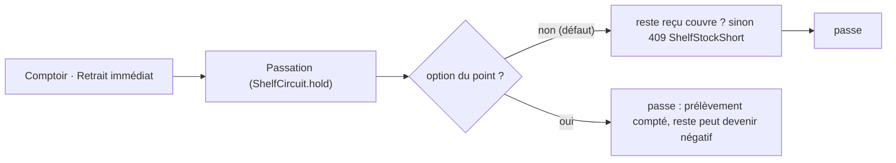

# Plan — le retrait immédiat sans le stock du réassort

> 📐 **Plan, rien n'est bâti** (2026-11-25). Demande de Hugo : « pouvoir
> débloquer avec une option le fait que la commande immédiate au comptoir ne
> dépende pas du stock du réassort reçu ». État du circuit :
> [`jour-meme-sur-stock.md`](jour-meme-sur-stock.md) ; réglages du comptoir :
> [`../reassort-boutiques/reception-et-stock.md`](../reassort-boutiques/reception-et-stock.md) § 5.

## 1. En deux mots

Aujourd'hui, un « Retrait immédiat » au comptoir est refusé si le point n'a
pas **reçu** (réceptionné) assez de réassort pour l'article : le stock du jour
est le reçu moins ce que les commandes sur stock ont déjà pris. Un point qui
ne réceptionne pas ses réassorts — ou qui vend ce qu'il a fabriqué lui-même —
ne peut donc rien vendre en immédiat.

L'option ajoute, **point par point**, dans **Réglages › Comptoir**, une case :

> ☐ **Retrait immédiat sans vérifier le stock reçu**

Ce qui ne change pas : la commande reste une `shelf` (prélèvement compté au
stock du jour), le verrou du stock est toujours pris, le client en ligne reste
borné par le reste, et l'option est **désactivée par défaut**.

## 2. Décisions proposées (à confirmer par Hugo)

| #   | Question                                 | Proposition                                                                                                                                                                          |
| --- | ---------------------------------------- | ------------------------------------------------------------------------------------------------------------------------------------------------------------------------------------ |
| D1  | Portée                                   | **Par point**, à côté de `stock_tracking` (même table, même écran). Pas un réglage général : un point qui réceptionne bien garde la protection.                                      |
| D2  | Qui en profite                           | **La saisie du comptoir seulement** (`isCounterEntry` : origine `counter` ou raccourci `immediate_pickup`). Une `shelf` d'un client en ligne reste bornée.                           |
| D3  | Le prélèvement                           | **Toujours compté** : la vente reste visible au stock du jour, qui peut devenir **négatif** (`estimateStock` le montre déjà — « une vente au-delà du stock est un fait à montrer »). |
| D4  | La modification d'une telle commande     | Même règle que la passation : la hausse n'est pas bornée si l'option est active **au moment de la révision** et la commande vient du comptoir.                                       |
| D5  | L'avertissement de l'estimation (saisie) | Plus d'avertissement « stock insuffisant » quand l'option couvre la saisie ; à la place, rien (le reste affiché à la vignette suffit).                                               |
| D6  | Indépendance de `stock_tracking`         | Les deux cases sont indépendantes : `stock_tracking` règle l'état OK/Faible/Rupture, la nouvelle règle le refus à la passation.                                                      |

## 3. Partie technique (vérifiée le 2026-11-25)

**Où se joue le refus** — `apps/lfd-api/src/lafoliecoffee/orders/application/services/shelf-circuit.service.ts` :

- `hold(order)` : verrou puis `ensureShelfStockCovers(claim.lines, stock.at(...))` ;
- `holdRevision(before, after)` : verrou puis `ensureShelfRevisionCovered` (appelé par `orders/revision/application/services/shelf-revising.service.ts:81`) ;
- `stockShortfallOf(order)` : l'avertissement, lu par `estimate-order-for-customer.handler.ts:102`.

**Le réglage existant** — `public.counter_stock_settings` (`site_id`, `stock_tracking`, trace) ;
domaine `lafoliecoffee/resupply/domain/counter-stock-setting.ts`, lecteur/écrivain
`counter-stock-settings.{reader,writer}.ts`, routes `GET/PUT admin/counter-settings[/:siteId]`
(`resupply/http/admin-counter-settings.controller.ts`, droit `lfc_order_settings`).

**La baisse d'un reçu** (`resupply/application/received-stock-lowering.ts`) ne refuse que la baisse
qui creuse un reste négatif : un reste déjà négatif par l'option ne bloque pas une correction
qui ne l'aggrave pas. Rien à changer.

### Lots

**R1 — le réglage (back)**

- Migration additive : `counter_stock_settings.immediate_without_stock boolean NOT NULL DEFAULT false`.
- `CounterStockSetting.immediateWithoutStock`, constante `IMMEDIATE_WITHOUT_STOCK_BY_DEFAULT = false`.
- `PUT admin/counter-settings/:siteId` : corps `{ stockTracking, immediateWithoutStock }` (les deux
  obligatoires — pré-release, contrat cassable, cf. CLAUDE.md § 0) ; `CounterSettingsView` l'expose.
- Port de lecture étroit pour les commandes : `CounterStockBypassReader.allowsAt(siteId): Promise<boolean>`
  (déclaré par `resupply`, même bloc `lafoliecoffee`, une requête `findUnique`).
- Tests : unitaire du handler PUT, e2e `admin-counter-settings`.

**R2 — la passation et la révision (back)**

- `Order.shelfClaim` porte déjà le point ; ajouter `atCounter: boolean` (depuis `entryOrigin` /
  `entryShortcut` de l'agrégat, par `isCounterEntry`).
- `ShelfCircuit.hold` : verrou **toujours** pris ; si `claim.atCounter && await bypass.allowsAt(siteId)`,
  ne pas appeler `ensureShelfStockCovers`. Idem `holdRevision` et `stockShortfallOf`.
- Pas de nouveau fait : la commande est une `shelf` ordinaire.
- Tests : unitaire `ShelfCircuit` (option on/off × comptoir/en ligne), e2e passation « Retrait immédiat »
  sans réassort reçu → 201 et reste négatif à la Supervision ; même chose option off → 409 inchangé ;
  client en ligne sur un point à l'option → 409 (D2). Régression de révision.

**R3 — l'écran (back-office)**

- Réglages › Comptoir : seconde case par point, libellé « Retrait immédiat sans vérifier le stock
  reçu », aide : « Le comptoir peut vendre au-delà du réassort réceptionné ; le stock du jour peut
  devenir négatif. »
- Comptoir : rien à changer, le refus disparaît de lui-même. La vignette du reste affiche déjà un
  négatif — vérifier son rendu (couleur rupture).

**R4 — la doc d'état**

- `jour-meme-sur-stock.md` § 8 et `reception-et-stock.md` § 5 décrivent l'option ; ce plan est supprimé
  et sa ligne d'index retirée.

### Ce que le plan ne fait pas

- Aucun droit nouveau : régler la case relève de `lfc_order_settings`, comme `stock_tracking`.
- Pas de `vitruve` : ni argent, ni migration de données (colonne additive à défaut), ni frontière de
  sécurité, ni runbook (CLAUDE.md § 9 bis).
