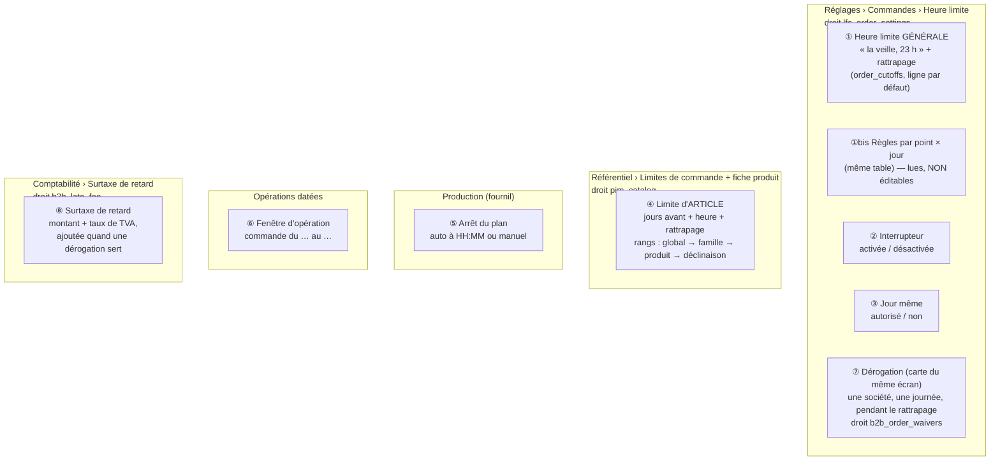
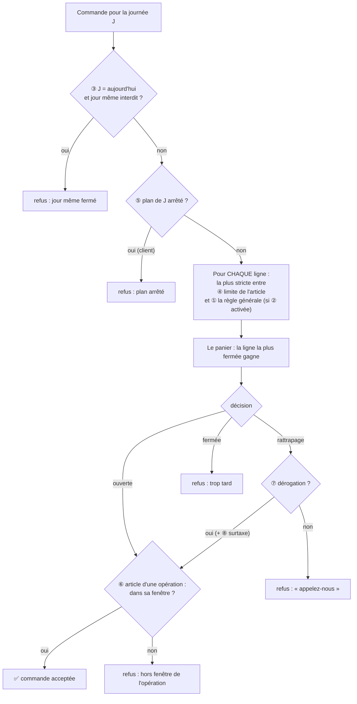
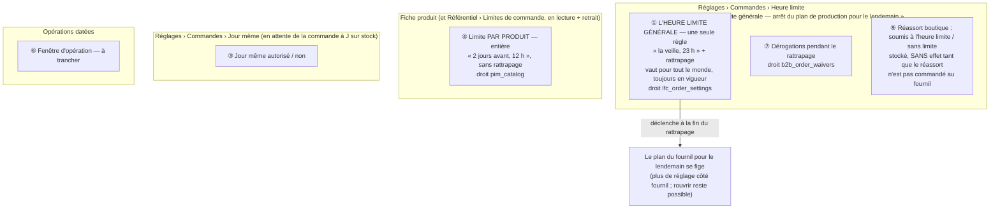
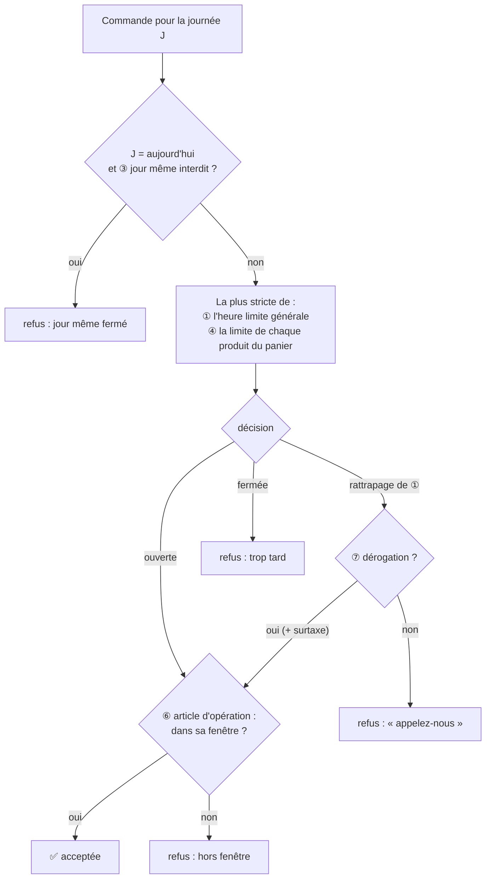

# Le schéma des réglages de limite de commande

> Écrit le 2026-10-21, à la demande de Hugo : « on a atteint quelque chose
> d'incompréhensible à paramétrer, on va commencer par un doc schéma ». Il
> dessine l'**existant** (code relu le 2026-10-21, via les docs d'état du
> dossier) et nomme ce qui embrouille — c'est le point de départ de la
> simplification, pas une proposition. Entrée du dossier : [`README.md`](README.md).

## 0. Le modèle, en une phrase (Hugo, 2026-10-21)

**Demain se commande avant l'heure limite ; aujourd'hui se prend dans le
stock.** La seule question est le jour visé — pas la clientèle.

| On commande pour…              | La marchandise vient…                       | Ce qui limite                                                                                  | Qui              |
| ------------------------------ | ------------------------------------------- | ---------------------------------------------------------------------------------------------- | ---------------- |
| **demain ou après** (J+1, J+N) | du **plan du fournil**, fabriquée pour elle | l'**heure limite générale** — passée (rattrapage compris), demain est fermé ET le plan se fige | tout le monde    |
| **aujourd'hui** (J)            | de la **vitrine**, déjà fabriquée           | le **stock disponible**, pas une heure                                                         | les particuliers |
| un produit **sur commande**    | du plan, avec un délai                      | sa **limite produit** (« 2 jours avant 12 h »), en plus de l'heure générale — la plus stricte  | tout le monde    |

Conséquences : pas de case « s'applique aux particuliers » (l'heure limite
protège le plan, donc tout le monde) ; le réglage « jour même » n'est pas une
exception à l'heure limite mais un autre circuit, celui du stock. ⚠️ Le stock
de la vitrine en temps réel **n'existe pas** (2026-10-21) : tant qu'il manque,
un particulier commande à partir de demain, comme un pro. La commande à J sur
stock est un chantier à part.

## 1. La carte : huit réglages, quatre écrans, quatre droits

## 2. Le chemin d'une commande : qui peut dire « trop tard »

Et la boutique **annonce** (sans rien décider) à partir de ① ② ③ ⑤ et ④ :
« Pour jeudi, commandez avant 23 h », « Plus que 2 h 15… », « Préparé sur
commande — … ». Le devis n'appelle aucune de ces gardes.

## 3. Ce qui rend le paramétrage incompréhensible

Chaque point est un fait du code, avec l'exemple qui le rend concret.

1. **Deux « limites globales », dans deux écrans, pour deux droits.** ① « la
   veille à 23 h » (Réglages, `lfc_order_settings`) et le rang **global** de ④
   (Référentiel, `pim_catalog`) disent la même chose — une heure pour tout le
   catalogue. _Exemple : en dev, ① dit la veille 18 h et ④ global dit la veille
   18 h avec 60 min de rattrapage ; laquelle compte ? Depuis le 2026-10-21, la
   plus stricte, grâce comprise — il faut lire le code pour le savoir._
2. **Le rattrapage existe trois fois, et il a un prix ailleurs.** Sur ①, sur
   chaque rang de ④, et la dérogation ⑦ qui ne vaut que pendant lui — sur
   l'écran de ①, avec un droit à elle ; ce qu'elle coûte (⑧, la surtaxe) se
   règle en Comptabilité, sous un troisième droit. Aucun écran ne montre le
   rattrapage qui s'appliquera vraiment à un panier, ni ce qu'il coûtera.
   _Fait le 2026-10-21 :_ la page de l'heure limite a une section
   « Rattrapage » sous l'heure — sa durée, les dérogations (`b2b_order_waivers`)
   et la surtaxe **en lecture** (`b2b_late_fee:read`, lien « Modifier dans
   Comptabilité » sous `b2b_late_fee:write`) ; l'écran de Comptabilité renvoie
   à cette page ([`reglages-generaux.md`](reglages-generaux.md) §3).
3. **L'échelle de ④ hérite CHAMP PAR CHAMP.** Une famille peut fixer les jours,
   le produit l'heure, la déclinaison le rattrapage : la limite d'une
   déclinaison est un assemblage de trois rangs. _Exemple : « 2 jours » (famille)
   - « 12 h » (produit) — aucune ligne en base ne dit « 2 jours, 12 h »._
4. **Des règles invisibles.** ①bis : des règles par point et par jour peuvent
   exister en base et s'appliquer à la passation, mais l'écran ne les édite
   pas (« non reprises »). La boutique, elle, ne compare la limite d'un
   article qu'à la règle par défaut.
5. **Trois façons de couper une journée, chez trois métiers.** ③ jour même
   (Réglages), ⑤ arrêt du plan (fournil, à une heure à lui), ① limite
   (Réglages). _Exemple : ① à la veille 23 h mais ⑤ en arrêt automatique à 20 h
   → la boutique annonce 23 h, la passation refuse à 20 h._ (Aujourd'hui en
   prod : arrêt manuel, donc pas de conflit — lu le 2026-10-21.)
6. **L'opération ⑥ a sa propre fenêtre, sans rattrapage ni dérogation,** et
   s'applique APRÈS les autres — une bûche peut passer ④ et être refusée par ⑥.
7. **Un interrupteur qui ne coupe qu'un des deux globaux.** ② désactive ① ;
   le rang global de ④ continue de s'appliquer.
8. **Le devis ne vérifie rien** : un devis peut être accepté puis refusé à la
   passation. _Fait le 2026-10-21 pour le devis du comptoir_ (`POST
admin/orders/quote`) : il prend `requestedDeliveryDate` (facultatif) et
   rend `cutoff: { status: open|grace|closed, until }`, calculé par la même
   décision que la passation (`decideStrictestOrderCutoff`) — un signal, pas un
   refus. Le devis client (`POST /orders/quote`) ne le porte pas, et le devis
   de la boutique (`POST /shop/quote`) ne connaît pas de jour : rien n'y change.
9. **Ce qui est en base n'est pas ce qu'on croit.** En prod le 2026-10-20, on
   pensait l'heure limite « désactivée le 14 octobre » : elle ne l'était qu'en
   dev ; la prod n'a aucune ligne d'interrupteur, donc elle est activée par
   défaut.

## 4. Les questions à trancher pour simplifier

- ✅ **Une seule limite « pour tout le catalogue »** — tranché par Hugo le
  2026-10-21 : c'est ① (la règle générale du commerce, `public.order_cutoffs`,
  Réglages › Commandes › Heure limite, droit `lfc_order_settings`). Le rang
  **global** de ④ disparaît : le référentiel refuse de le poser
  (`pim.order_time_limit.scope_retired`), la résolution ignore une ligne
  résiduelle, et la page `/pim/limites-de-commande` montre ① **en lecture**
  (route `GET /pim/order-time-limits/general-cutoff`, servie par le port
  `GeneralOrderCutoffReader` que le référentiel déclare et que le commerce
  implémente).
- ✅ **Un seul rattrapage** — tranché par Hugo le 2026-10-21 : celui de ①. Une
  limite de produit n'en a plus (refusé à la pose,
  `pim.order_time_limit.grace_retired` ; une grâce résiduelle vaut `0` à la
  résolution comme dans la garde de passation). La dérogation ⑦ reste le geste
  d'exception, pendant le rattrapage de ①.
- ✅ **L'héritage de ④** — tranché par Hugo le 2026-10-21 : il n'y a plus
  d'échelle. ④ est **une limite par produit**, règle entière (délai ET heure) ;
  plus de famille, plus de déclinaison (elle suit son produit). Détail :
  [`limites-produit.md`](limites-produit.md).
- ✅ **Les règles par point × jour** — tranché par Hugo le 2026-10-21 : les
  retirer ; **bâti le 2026-10-21** (lot 1). Il ne reste que ① : la base le
  tient (CHECK `order_cutoffs_general_only`, index `order_cutoffs_single_rule`,
  migration `20261021130000_une_seule_heure_limite_generale`), le domaine
  refuse un point ou un jour (`order_cutoffs.scope_retired`), les lectures
  ignorent une ligne résiduelle (`resolveOrderCutoff`), et l'écran n'a plus
  qu'une ressource, `GET`/`PUT admin/order-cutoffs/general`. ①bis disparaît
  de la carte. État : [`reglages-generaux.md`](reglages-generaux.md) §1.
- ✅ **L'arrêt du plan** — tranché par Hugo le 2026-10-21, **bâti le
  2026-10-21** (lot 2, [`plan-une-seule-heure.md`](plan-une-seule-heure.md)) :
  l'heure limite générale déclenche tout. Le plan de J s'arrête seul à la fin
  du rattrapage de ① pour J ; un arrêt à la main avant est refusé
  (`production.day.before_order_cutoff`) ; plus de mode ni d'alerte du soir ;
  l'écran du fournil montre l'heure en lecture. ⑤ disparaît de la carte en
  tant que réglage.
- ✅ **L'interrupteur ②** (point 7) — retiré, **bâti le 2026-10-21** (lot 2) :
  l'heure limite est toujours en vigueur (`OrderCutoffsInForce` ne lit plus
  `enabled`, colonne gardée). Le jour même ③ garde son réglage, sur sa page
  (Réglages › Commandes › Jour même).
- ✅ **Le devis** — tranché par Hugo le 2026-10-21, **bâti le 2026-10-21** :
  il SIGNALE (sans refuser) l'état de l'heure limite pour le jour visé, par
  la même décision que la passation (point 8). Les suggestions suivent aussi
  cette décision depuis le même jour (`keepOrderable` faisait encore primer
  la limite d'article).
- ✅ **Le rattrapage réuni** — tranché par Hugo le 2026-10-21, **bâti le
  2026-10-21** : une section « Rattrapage » sur la page de l'heure limite
  (point 2) ; la surtaxe s'y lit, elle se règle en Comptabilité.
- **Un écran de lecture unique** : pour un produit, un point et un jour, « la
  limite qui s'applique, et pourquoi ».

⚠️ Les §1 à §3 décrivent l'existant **d'avant** ces décisions : ④ y a encore
ses rangs, sa grâce et son héritage. Ils restent tels quels comme point de
départ de la simplification.

## 5. Aujourd'hui, après la simplification (2026-10-21)

Les §1 à §3 restent l'« avant ». Voici l'« après », bâti le 2026-10-21 (commits
a05a665c0, b1aff4320, 16841ad60). **Quatre réglages au lieu de huit.**

Disparus : ①bis (règles par point × jour), ② (l'interrupteur), le rang global,
les familles et les déclinaisons de ④, le rattrapage d'un produit, l'héritage
champ par champ, le mode manuel/automatique et l'heure propre de l'arrêt du plan.

Le plan arrêté n'apparaît plus comme une garde à part : il s'arrête à
l'instant où ① ferme, et ne contredit donc jamais l'heure annoncée. La boutique
annonce ① et ④ (« Pour jeudi, commandez avant 23 h », « Plus que… », « Préparé
sur commande — … », « un article de votre panier : trop tard pour… ») ; après
l'heure, elle propose le premier jour encore ouvert (le surlendemain).

**Ajouté le 2026-10-21** : ⑨, la limite du réassort boutique, sur la page de
l'heure limite (`order_cutoff_settings.resupply_subject_to_cutoff`, oui par
défaut). Elle ne décide rien encore : le réassort n'est pas commandé au
fournil ([`plan-jour-meme-sur-stock.md`](plan-jour-meme-sur-stock.md) §7 ; le réassort a son dossier,
[`../reassort-boutiques/`](../reassort-boutiques/README.md)).

**Reste à faire** : les recommandations « commandable aujourd'hui » alignées sur
« la plus stricte gagne », le devis qui signale la limite, le rattrapage réuni
sur la page de l'heure limite (surtaxe en lecture) — en cours ; puis ⑥ la
fenêtre des opérations ; puis l'écran de lecture unique ; plus tard, ③ avec la
commande à J sur stock.
