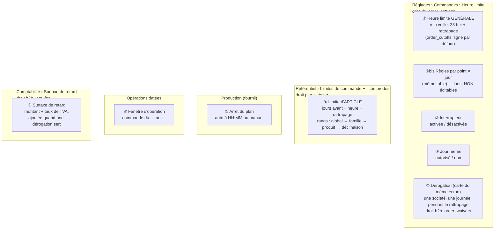
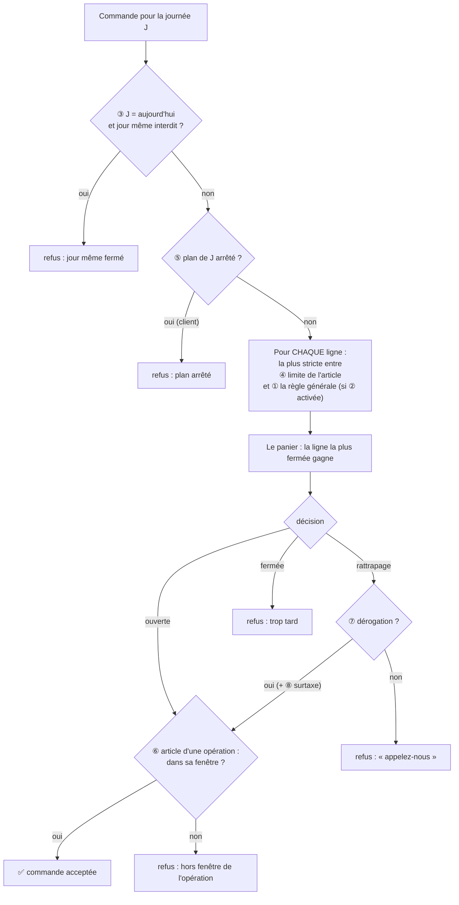

# Le schéma des réglages de limite de commande

> Écrit le 2026-10-21, à la demande de Hugo : « on a atteint quelque chose
> d'incompréhensible à paramétrer, on va commencer par un doc schéma ». Il
> dessine l'**existant** (code relu le 2026-10-21, via les docs d'état du
> dossier) et nomme ce qui embrouille — c'est le point de départ de la
> simplification, pas une proposition. Entrée du dossier : [`README.md`](README.md).

## 1. La carte : huit réglages, quatre écrans, quatre droits

## 2. Le chemin d'une commande : qui peut dire « trop tard »

Et la boutique **annonce** (sans rien décider) à partir de ① ② ③ ⑤ et ④ :
« Pour jeudi, commandez avant 23 h », « Plus que 2 h 15… », « Préparé sur
commande — … ». Le devis n'appelle aucune de ces gardes.

## 3. Ce qui rend le paramétrage incompréhensible

Chaque point est un fait du code, avec l'exemple qui le rend concret.

1. **Deux « limites globales », dans deux écrans, pour deux droits.** ① « la
   veille à 23 h » (Réglages, `lfc_order_settings`) et le rang **global** de ④
   (Référentiel, `pim_catalog`) disent la même chose — une heure pour tout le
   catalogue. _Exemple : en dev, ① dit la veille 18 h et ④ global dit la veille
   18 h avec 60 min de rattrapage ; laquelle compte ? Depuis le 2026-10-21, la
   plus stricte, grâce comprise — il faut lire le code pour le savoir._
2. **Le rattrapage existe trois fois, et il a un prix ailleurs.** Sur ①, sur
   chaque rang de ④, et la dérogation ⑦ qui ne vaut que pendant lui — sur
   l'écran de ①, avec un droit à elle ; ce qu'elle coûte (⑧, la surtaxe) se
   règle en Comptabilité, sous un troisième droit. Aucun écran ne montre le
   rattrapage qui s'appliquera vraiment à un panier, ni ce qu'il coûtera.
3. **L'échelle de ④ hérite CHAMP PAR CHAMP.** Une famille peut fixer les jours,
   le produit l'heure, la déclinaison le rattrapage : la limite d'une
   déclinaison est un assemblage de trois rangs. _Exemple : « 2 jours » (famille)
   - « 12 h » (produit) — aucune ligne en base ne dit « 2 jours, 12 h »._
4. **Des règles invisibles.** ①bis : des règles par point et par jour peuvent
   exister en base et s'appliquer à la passation, mais l'écran ne les édite
   pas (« non reprises »). La boutique, elle, ne compare la limite d'un
   article qu'à la règle par défaut.
5. **Trois façons de couper une journée, chez trois métiers.** ③ jour même
   (Réglages), ⑤ arrêt du plan (fournil, à une heure à lui), ① limite
   (Réglages). _Exemple : ① à la veille 23 h mais ⑤ en arrêt automatique à 20 h
   → la boutique annonce 23 h, la passation refuse à 20 h._ (Aujourd'hui en
   prod : arrêt manuel, donc pas de conflit — lu le 2026-10-21.)
6. **L'opération ⑥ a sa propre fenêtre, sans rattrapage ni dérogation,** et
   s'applique APRÈS les autres — une bûche peut passer ④ et être refusée par ⑥.
7. **Un interrupteur qui ne coupe qu'un des deux globaux.** ② désactive ① ;
   le rang global de ④ continue de s'appliquer.
8. **Le devis ne vérifie rien** : un devis peut être accepté puis refusé à la
   passation.
9. **Ce qui est en base n'est pas ce qu'on croit.** En prod le 2026-10-20, on
   pensait l'heure limite « désactivée le 14 octobre » : elle ne l'était qu'en
   dev ; la prod n'a aucune ligne d'interrupteur, donc elle est activée par
   défaut.

## 4. Les questions à trancher pour simplifier

- **Une seule limite « pour tout le catalogue »** : ① ou le rang global de ④ ?
  L'autre disparaît.
- **Un seul rattrapage**, ou aucun (et la dérogation devient le seul geste) ?
- **L'héritage de ④** : par règle entière (une ligne = « N jours, HH:MM ») plutôt
  que champ par champ ?
- **Les règles par point × jour** : les éditer à l'écran, ou les retirer ?
- **L'arrêt du plan** : l'aligner sur la limite (il ne la contredit jamais), ou
  l'annoncer dans la boutique ?
- **Le devis** : vérifie-t-il la limite ?
- **Un écran de lecture unique** : pour un produit, un point et un jour, « la
  limite qui s'applique, et pourquoi ».
