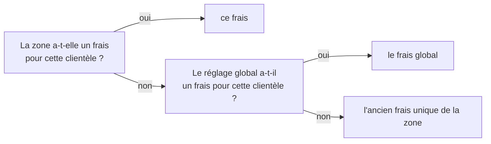

# Le prix de la livraison et la livraison offerte

> 📍 **État au 2026-11-05.** Ce document dit ce qui **existe** et les choix
> qui l'ont façonné, pour qu'on s'en souvienne. Le chantier vit dans le plan
> [`plan-livraison-offerte.md`](../promotions/plan-livraison-offerte.md) (lots
> 0b, 1a, 1b bâtis ; 1c, 0c et 2 à faire). Chaque choix porte sa date et qui
> l'a pris.

# Partie 1 — L'explication simple

## Ce que paie un client pour être livré

Chaque client appartient à une **clientèle** : les **pros** ou les
**particuliers**. Pour une zone de livraison donnée, son frais se cherche dans
cet ordre, et le premier trouvé gagne :



- **Le réglage global** sert de base à toutes les zones. Une zone ne le
  remplace que si elle a une raison (une station loin, un trajet cher).
- **L'ancien frais unique de la zone** est le dernier repli. Il garantit qu'une
  zone a **toujours** un frais : la livraison ne devient jamais gratuite par
  accident parce que personne n'a rien saisi.

À l'écran (Réglages › Livraison › Zones), chaque zone le dit par une pastille :
« Global » quand elle suit le réglage global, « + 20,00 € » quand c'est son
ancien frais, « Pros + 12,00 € » quand elle le remplace pour une clientèle.

## La livraison offerte

« Livraison offerte dès 80 € HT » : quand les articles du panier atteignent ce
montant, la livraison ne coûte plus rien. Le seuil se cherche comme le frais —
la zone, sinon le réglage global — **sans troisième repli** : sans seuil réglé,
il n'y a pas de livraison offerte.

| Choix                                 | Ce qui a été décidé                                                                                                                                    | Qui, quand       |
| ------------------------------------- | ------------------------------------------------------------------------------------------------------------------------------------------------------ | ---------------- |
| Où se règle le seuil                  | Dans **Réglages › Livraison**, avec les frais — pas dans Promotions. La promotion sur les frais viendra après, pour le temporaire et le ciblé (lot 2). | Hugo, 2026-11-05 |
| En HT ou en TTC                       | **HT**, pour les deux clientèles. Un particulier voit des prix TTC : l'affichage côté client devra le traduire (lot 1c).                               | Hugo, 2026-11-05 |
| Ce qui compte pour atteindre le seuil | Les articles **après** leurs remises, **avant** le bon de fidélité : un bon est un moyen de paiement, il ne fait pas perdre la livraison offerte.      | Hugo, 2026-11-05 |
| « Dès 80 € »                          | Atteint à 80,00 € pile.                                                                                                                                | —                |
| Une zone déjà gratuite                | Rien n'est « offert » quand la livraison ne coûtait rien : la commande ne garde aucune trace de livraison offerte.                                     | —                |
| Champ vide ou 0                       | **Vide = pas de livraison offerte.** Un champ vide n'envoie jamais 0 : 0 voudrait dire « toujours offerte ».                                           | 2026-11-05       |
| Montant mal saisi                     | Refusé, jamais arrondi en silence : un montant négatif ou plus fin que le centime bloque l'enregistrement.                                             | 2026-11-05       |

## Un pro dont la société attend sa validation

Il est **un pro partout**, y compris pour la livraison : il paie le frais des
pros et profite de leur livraison offerte. La seule chose qu'il ne peut pas
faire est de régler **au compte** — il paie par carte. (Hugo, 2026-11-05 :
« le seul truc qu'on ne peut pas faire sur un pending, c'est au compte ».)

## Une clientèle à qui la livraison n'est pas proposée

Quand la livraison n'est pas ouverte aux particuliers (case « B2C » de
« Disponibilité de la livraison », sur la même page), le réglage global les
montre quand même : **grisés, non modifiables**, avec un encadré qui dit où les
ouvrir. Leurs valeurs sont **gardées** et ne sont **jamais réécrites** tant
qu'ils sont fermés : les rouvrir retrouve le réglage d'avant. (Hugo,
2026-11-05.) Les pastilles des zones, elles, ne nomment que les clientèles
ouvertes.

## Une fois la commande passée : le tarif est figé

Le frais et le seuil **du jour de la commande** sont gravés sur la commande.
Ce qui compte, c'est le jour où le client **commande**, pas celui où il est
livré : un pro qui commande aujourd'hui pour dans trois mois est livré au
tarif d'aujourd'hui, quoi qu'on règle d'ici là.

Quand la commande est **modifiée** (révisée) :

| Cas                                             | Tarif appliqué                                                                                    | Qui, quand       |
| ----------------------------------------------- | ------------------------------------------------------------------------------------------------- | ---------------- |
| Même zone, la commande avait un seuil           | le frais et le seuil **figés** à la commande, même si les réglages ont changé                     | Hugo, 2026-11-05 |
| Même zone, la commande n'avait **aucun** seuil  | le frais figé, et le **seuil du jour** : elle ne peut qu'y gagner                                 | 2026-11-05 (1)   |
| Une **autre zone** (le client change d'adresse) | le frais et le seuil **du jour de la nouvelle zone** : l'ancien tarif valait pour un autre trajet | Hugo, 2026-11-05 |

(1) Tranché pour la version généreuse : un client qui voit « livraison offerte
dès 80 € » et complète sa commande pour l'atteindre ne comprendrait pas qu'on
la lui refuse parce qu'elle a été passée avant le réglage. Hugo n'en fait **pas
un réglage** (« pas une décision pour moi ») : un cas rare ne mérite pas un
paramètre que personne ne comprendra dans six mois.

## Ce qui n'est pas possible aujourd'hui

- **Une zone ne peut pas dire « jamais de livraison offerte ici »** quand le
  réglage global en a une : vide veut dire « reprendre le global ». Le seul
  contournement est un seuil très haut. Ouvrir ce cas demande une valeur de
  plus dans le contrat.
- **Le client ne voit encore rien** : pas de ligne « Livraison offerte » au
  panier, pas de « Plus que 12 € pour la livraison offerte ». C'est le lot 1c.
  Le devis et la commande, eux, appliquent déjà la livraison offerte.
- **Pas de promotion sur les frais** (« offerte le samedi », « −50 % du port
  en décembre ») : lot 2, avec son propre type de promotion et son propre
  formulaire, sans champ produit.

# Partie 2 — La partie technique

Vérifié dans le code le 2026-11-05.

## La résolution

[`delivery-fee-resolution.ts`](../../apps/lfd-api/src/b2b/delivery-zones/domain/delivery-fee-resolution.ts) :

- `resolvedDeliveryFee` : `zone.audienceTerms[a].fee ?? global[a].fee ?? zone.fee`.
  L'ancien frais (`fee_mode`/`fee_value`) est NOT NULL : la résolution rend
  toujours un barème.
- `resolvedFreeDeliveryThreshold` : `zone.audienceTerms[a].freeDeliveryThresholdCents ?? global[a].freeDeliveryThresholdCents`,
  sans troisième repli.

Le réglage global vit dans `delivery_pricing_settings`
([`settings.prisma`](../../apps/lfd-api/prisma/schema/public/settings.prisma),
`b2b_free_delivery_threshold_cents`, `b2c_free_delivery_threshold_cents`) ;
les remplacements d'une zone sont des colonnes nullables de `delivery_zones`.

L'audience d'un acheteur — `pending` compris côté pro — est tenue par
[`customer-audience.ts`](../../packages/contracts/src/customer-audience.ts).

## Le calcul

Une seule arithmétique : le frais n'est calculé que dans `price-basket.ts`, et
le jugement dans une fonction pure.

- [`basket-terms.ts`](../../apps/lfd-api/src/b2b/orders/domain/services/basket-terms.ts)
  calcule la base `goodsNetHtCents` :
  - pro (`line_ht`) : `subtotalCents − discountCents` ;
  - particulier (`exact_ht`) : Σ HT des lignes composées − HT des remises.
    Le bon de fidélité n'entre pas dans `priceBasket` : il ne peut pas faire
    perdre la livraison offerte.
- [`free-delivery-judgement.ts`](../../apps/lfd-api/src/b2b/orders/domain/services/free-delivery-judgement.ts),
  `judgedFreeDelivery` : `null` sans seuil, sous le seuil (`goodsNetHtCents < thresholdCents`),
  ou quand le frais vaut 0 HT et 0 TTC. Sinon, la livraison offerte avec le
  montant offert.
- Au franco, le frais facturé vaut 0 et `deliveryFeeAdjustment` garde le
  barème offert.

## Ce qui est figé sur la commande

Colonnes de `orders`
([`orders.prisma`](../../apps/lfd-api/prisma/schema/public/orders.prisma)) :

- `delivery_fee_adjustment` : le barème du jour de la passation (lot 1a) ;
- `free_delivery_threshold_cents`, `free_delivery_waived_cents`,
  `free_delivery_waived_ttc_cents` : présents **ensemble**, et seulement quand
  la livraison est offerte (migration `20261105160000_le_franco_fige_sur_la_commande`,
  CHECK `orders_free_delivery_together`, `orders_free_delivery_ttc_iff_exact_ht`,
  `orders_free_delivery_waives_fee`).

Conséquence : une commande passée **sans** livraison offerte n'a **aucun**
seuil figé — d'où la ligne (1) du tableau des révisions.

## La révision

`PricingContext.routeOf`
([`pricing-context.service.ts`](../../apps/lfd-api/src/b2b/orders/application/services/pricing-context.service.ts)) :

```ts
const tariff = frozenFee !== null && frozenFee.zoneId === zoneId ? frozenFee : zone.value;
const threshold = tariff.freeDeliveryThresholdCents ?? zone.value.freeDeliveryThresholdCents;
```

- même zone : le barème et le seuil figés (`FrozenDeliveryFee`, relu en base) ;
- seuil figé absent : celui du jour (commit `16838b1e3`, test
  « révision dans la même zone d'une commande SANS seuil figé : le seuil du
  jour » dans `pricing-context-delivery-fee.spec.ts`) ;
- autre zone : le tarif du jour de la nouvelle zone.

Les gardes de l'agrégat revérifient la forme : `ensureFreeDeliveryHolds`
refuse une livraison offerte sans barème, avec un frais facturé, ou sous le
seuil ; un seuil perdu entre le devis et la commande est refusé en 409
`orders.total_changed` sans rien écrire (e2e `test/free-delivery.e2e-spec.ts`).

## L'écran

Dossier
[`delivery-zones-section/`](../../apps/lfd-backoffice-frontend/src/app/b2b/reglages/delivery-zones-section/)
du back-office :

- [`delivery-threshold.ts`](../../apps/lfd-backoffice-frontend/src/app/b2b/reglages/delivery-zones-section/delivery-threshold.ts) :
  euros saisis → centimes ; vide → `null` ; négatif ou sous-centime →
  `INVALID_THRESHOLD`, qui bloque l'enregistrement. `fold-number-input` n'a
  pas reçu `decimals` : il arrondirait en silence en quittant le champ.
- `global-pricing-dialog/` : les deux clientèles, chacune dans un
  `fold-fieldset` ; une clientèle fermée a `disabled` et un `fold-callout`.
  Le patch n'envoie `{ fee, freeDeliveryThresholdCents }` que pour les
  clientèles **ouvertes**.
- `zone-panel/` : le seuil en remplacement par clientèle ; `termsToWrite`
  recopie à l'identique les termes d'une clientèle masquée.
- `delivery-zones-section.ts`, `zoneBadges` : l'ordre de la résolution
  (remplacement, sinon « Global », sinon ancien frais) ; une pastille de seuil
  sur une zone seulement s'il est remplacé, pour une clientèle ouverte.

Le message d'un montant mal formé passe par le `hint` du champ, sans le style
d'erreur : `errors` de `fold-number-input` attend des erreurs de signal forms.
À remonter à fold si un rendu d'erreur est voulu.
