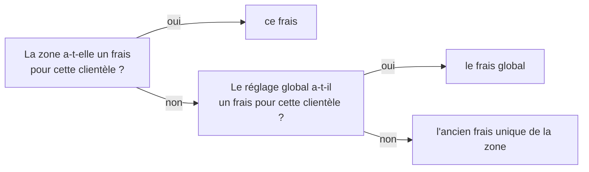
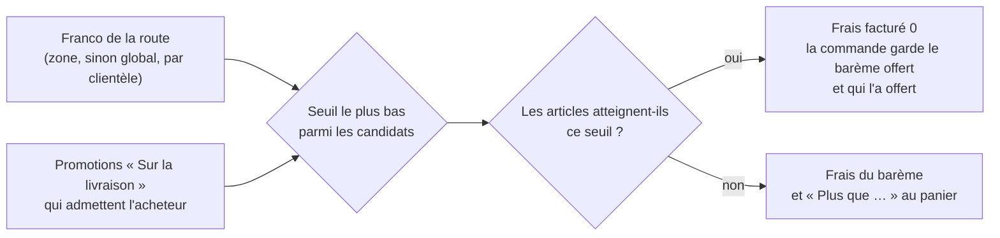

# Le prix de la livraison et la livraison offerte

> 📍 **État au 2026-11-20.** Ce document dit ce qui **existe** : le frais
> d'une zone par clientèle, le franco, la promotion « Sur la livraison », ce
> que la commande fige, et tout ce qui le dit au client (bon, e-mail, facture,
> écrans). Chaque choix porte sa date et qui l'a pris. Ce qui n'est pas fait
> est en fin de partie 1. Voisin de
> [`../promotions/promotions.md`](../promotions/promotions.md).

# Partie 1 — L'explication simple

## Qui décide du frais : deux endroits, jamais trois

Décidé par Hugo le 2026-11-20 : **deux endroits seulement** règlent le frais de
livraison.

| Où                                   | Ce qu'il dit                    | Pour qui              |
| ------------------------------------ | ------------------------------- | --------------------- |
| Réglage de livraison (global → zone) | le tarif et le franco           | une clientèle entière |
| Promotion « Sur la livraison »       | le cadeau, la livraison offerte | un public ciblé       |

Les conditions commerciales d'une société **ne portent pas** de frais de
livraison. Une société qui ne paie jamais la livraison a une promotion **sans
fin** (pas de date de fin) dont le public est cette société : l'espace
Promotions montre alors d'un coup d'œil tous les gestes faits sur la
livraison.

## Ce que paie un client pour être livré

Chaque client appartient à une **clientèle** : les **pros** ou les
**particuliers**. Pour une zone de livraison donnée, son frais se cherche dans
cet ordre, et le premier trouvé gagne :



- **Le réglage global** sert de base à toutes les zones. Une zone ne le
  remplace que si elle a une raison (une station loin, un trajet cher).
- **L'ancien frais unique de la zone** est le dernier repli. Il garantit qu'une
  zone a **toujours** un frais : la livraison ne devient jamais gratuite par
  accident parce que personne n'a rien saisi.

À l'écran (Réglages › Livraison › Zones), chaque zone le dit par une pastille :
« Global » quand elle suit le réglage global, « + 20,00 € » quand c'est son
ancien frais, « Pros + 12,00 € » quand elle le remplace pour une clientèle.

## La livraison offerte : un seuil, par deux voies

« Livraison offerte dès 80 € HT » : quand les articles du panier atteignent ce
montant, la livraison ne coûte plus rien. Il y a **deux voies**, et le calcul
retient **le seuil le plus favorable** parmi toutes celles qui s'appliquent :



- **Le franco de la route** : un seuil par clientèle, global ou remplacé par
  zone, réglé dans **Réglages › Livraison**, avec les frais (Hugo,
  2026-11-05). Il vaut pour **toute une clientèle**.
- **La promotion « Sur la livraison »** : un cadeau pour un **public ciblé**
  (une société avec ou sans ses sites, une clientèle, certaines zones, une
  période, des jours et heures), avec un **panier minimum** facultatif — sans
  lui, « toujours offerte ». Réglée dans l'espace Promotions, à côté de « Dans
  le prix affiché » et « Au panier ».

Deux livraisons offertes **ne se cumulent pas** : on retient le seuil le plus
bas. À seuil égal, la promotion l'emporte sur la route, pour que le cadeau
porte un nom.

| Choix                                 | Ce qui a été décidé                                                                                                                               | Qui, quand       |
| ------------------------------------- | ------------------------------------------------------------------------------------------------------------------------------------------------- | ---------------- |
| En HT ou en TTC                       | Le seuil se compte en **HT**, pour les deux clientèles. Un particulier voit des prix TTC : le devis lui sert aussi le manque en TTC « environ ».  | Hugo, 2026-11-05 |
| Ce qui compte pour atteindre le seuil | Les articles **après** leurs remises, **avant** le bon de fidélité : un bon est un moyen de paiement, il ne fait pas perdre la livraison offerte. | Hugo, 2026-11-05 |
| « Dès 80 € »                          | Atteint à 80,00 € pile.                                                                                                                           | —                |
| Une zone déjà gratuite                | Rien n'est « offert » quand la livraison ne coûtait rien : la commande ne garde aucune trace de livraison offerte.                                | —                |
| Champ vide ou 0 (franco)              | **Vide = pas de franco.** Un champ vide n'envoie jamais 0 : 0 voudrait dire « toujours offerte ».                                                 | 2026-11-05       |
| Montant mal saisi                     | Refusé, jamais arrondi en silence : un montant négatif ou plus fin que le centime bloque l'enregistrement.                                        | 2026-11-05       |
| Une réduction partielle               | Pas faite : une promotion **offre** la livraison ou ne fait rien (voir « Ce qui n'est pas fait »).                                                | 2026-11-20       |

## Un pro dont la société attend sa validation

Il est **un pro partout**, y compris pour la livraison : il paie le frais des
pros et profite de leur livraison offerte. La seule chose qu'il ne peut pas
faire est de régler **au compte** — il paie par carte. (Hugo, 2026-11-05 :
« le seul truc qu'on ne peut pas faire sur un pending, c'est au compte ».)

## Une clientèle à qui la livraison n'est pas proposée

Quand la livraison n'est pas ouverte aux particuliers (case « B2C » de
« Disponibilité de la livraison », sur la même page), le réglage global les
montre quand même : **grisés, non modifiables**, avec un encadré qui dit où les
ouvrir. Leurs valeurs sont **gardées** et ne sont **jamais réécrites** tant
qu'ils sont fermés : les rouvrir retrouve le réglage d'avant. (Hugo,
2026-11-05.) Les pastilles des zones, elles, ne nomment que les clientèles
ouvertes.

## Une fois la commande passée : le tarif est figé

Le frais et le seuil **du jour de la commande** sont gravés sur la commande.
Ce qui compte, c'est le jour où le client **commande**, pas celui où il est
livré : un pro qui commande aujourd'hui pour dans trois mois est livré au
tarif d'aujourd'hui, quoi qu'on règle d'ici là.

La commande retient aussi **ce que la livraison aurait coûté** et **qui l'a
offerte** (le franco de la route, ou une promotion nommée, avec son libellé tel
que l'acheteur l'a lu). Le franco se juge sur le panier **commandé** : un départ
incomplet ne le fait pas perdre, et le bon de livraison facture donc un frais
nul.

Quand la commande est **modifiée** (révisée), la livraison offerte est
**rejugée** (Hugo, 2026-11-05) : si le panier repasse sous le seuil, le frais
revient et le total monte.

| Cas                                                     | Tarif appliqué                                                                                                                                        | Qui, quand       |
| ------------------------------------------------------- | ----------------------------------------------------------------------------------------------------------------------------------------------------- | ---------------- |
| Même zone, la commande avait un seuil de route          | le frais et le seuil **figés** à la commande, même si les réglages ont changé                                                                         | Hugo, 2026-11-05 |
| Même zone, la commande n'avait **aucun** seuil de route | le frais figé, et le **seuil du jour** : elle ne peut qu'y gagner                                                                                     | 2026-11-05 (1)   |
| Une **autre zone** (le client change d'adresse)         | le frais et le seuil **du jour de la nouvelle zone** : l'ancien tarif valait pour un autre trajet                                                     | Hugo, 2026-11-05 |
| Une promotion avait offert                              | la promotion est **rejugée** : encore vivante, admettant l'acheteur, dans la zone. Archivée, en pause ou finie, elle n'offre plus et le frais revient | 2026-11-20 (2)   |

(1) Tranché pour la version généreuse : un client qui voit « livraison offerte
dès 80 € » et complète sa commande pour l'atteindre ne comprendrait pas qu'on
la lui refuse parce qu'elle a été passée avant le réglage. Hugo n'en fait **pas
un réglage** (« pas une décision pour moi ») : un cas rare ne mérite pas un
paramètre que personne ne comprendra dans six mois.

(2) Une promotion n'est jamais « acquise » : le seuil de route figé et la
promotion figée sont deux choses, et un 0 venu d'une promotion ne devient pas un
franco perpétuel de la route.

## Ce que le client lit

| Où                                                                    | Ce qui s'affiche                                                                                                                                                                                |
| --------------------------------------------------------------------- | ----------------------------------------------------------------------------------------------------------------------------------------------------------------------------------------------- |
| Panier de la boutique                                                 | « Coursier offert » (sans montant), ou « Plus que … pour la livraison offerte » (en TTC « environ » pour un particulier). Le libellé de la promotion, si elle offre.                            |
| Bon de commande et bon de livraison                                   | deux lignes qui s'annulent : « Livraison » au barème, puis « Livraison offerte » (ou le libellé de la promotion) au même montant, négatif. Le bon de livraison ne la porte que sur le **BL-1**. |
| E-mail de commande                                                    | une ligne dans le récapitulatif.                                                                                                                                                                |
| Facture                                                               | une phrase sous les commandes facturées : « Livraison offerte — 24,00 € HT (ORD-1042). » (Hugo, 2026-11-20).                                                                                    |
| Détail de commande (équipe, client), bon texte, ticket du particulier | les mêmes deux lignes que le bon.                                                                                                                                                               |

🔴 La ligne « Livraison offerte » est **affichée, pas comptable** (décision de
Hugo, 2026-11-05) : le frais facturé vaut 0, et ni la TVA, ni un total, ni
Factur-X ne dépendent du montant offert.

## Ce qui n'est pas fait

- **Réduire sans offrir** (« −5 € de livraison », « −50 % du port ») : c'est le
  seul cas qui demande un vrai terme comptable neuf du panier (sa TVA, sa
  ventilation Factur-X, sa place dans le calcul). Personne ne l'a demandé.
- **La liste « mes commandes »** de la boutique ne dit pas la livraison offerte :
  seul le détail et le ticket la lisent.
- **La saisie de commande du back-office** : le devis du staff ne porte pas
  `freeDelivery`, donc la saisie n'annonce ni « offerte » ni « Plus que … » (le
  calcul, lui, est le même et tient compte des faits du **client**).
- **Les spécimens** de la planche des documents (PDF) et des e-mails n'ont aucun
  cas « livraison offerte » : le chemin de rendu existe, l'exemple manque.
- **Une zone ne peut pas dire « jamais de franco ici »** quand le réglage global
  en a un : vide veut dire « reprendre le global ». Le seul contournement est un
  seuil très haut. Ouvrir ce cas demande une valeur de plus dans le contrat.

# Partie 2 — La partie technique

Vérifié dans le code le 2026-11-20.

## La résolution du frais et du seuil de route

[`delivery-fee-resolution.ts`](../../apps/lfd-api/src/lafoliecoffee/delivery-zones/domain/delivery-fee-resolution.ts) :

- `resolvedDeliveryFee` : `zone.audienceTerms[a].fee ?? global[a].fee ?? zone.fee`.
  L'ancien frais (`fee_mode`/`fee_value`) est NOT NULL : la résolution rend
  toujours un barème.
- `resolvedFreeDeliveryThreshold` : `zone.audienceTerms[a].freeDeliveryThresholdCents ?? global[a].freeDeliveryThresholdCents`,
  sans troisième repli.

Le réglage global vit dans `delivery_pricing_settings`
([`settings.prisma`](../../apps/lfd-api/prisma/schema/public/settings.prisma),
`b2b_free_delivery_threshold_cents`, `b2c_free_delivery_threshold_cents`) ;
les remplacements d'une zone sont des colonnes nullables de `delivery_zones`
(`null` = la zone reprend le global).

`CartAdjustments.deliveryRoute`
([`cart-adjustments.service.ts`](../../apps/lfd-api/src/lafoliecoffee/orders/application/services/cart-adjustments.service.ts))
résout le barème et le seuil de la zone du code postal livré, pour l'audience
de l'acheteur ; il n'applique rien.

## La route publique des zones

`GET /delivery-zones?audience=b2b|b2c`
([`delivery-zones.controller.ts`](../../apps/lfd-api/src/lafoliecoffee/delivery-zones/http/delivery-zones.controller.ts))
sert pour chaque zone un `AudienceDeliveryZoneView` : `fee` est le frais
**résolu** pour la clientèle déclarée, `freeDeliveryThresholdCents` le seuil de
route résolu (`null` = pas de franco). Les remplacements ne sortent que par la
vue admin.

- **L'audience se déclare**, elle ne se lit pas sur l'appelant : le tarif pro
  est public par choix (Hugo, 2026-11-05), et la saisie du staff déclare celle
  de son client. Sans paramètre : `b2c`. Une autre valeur : 400.
- **Cache** : `public, max-age=30, stale-while-revalidate=60`, étiquette
  `reglages-publics` ; Workers Cache prend l'URL entière pour clé, donc une
  adresse par audience. Création, modification, suppression d'une zone et
  écriture du réglage global purgent l'étiquette après validation.
- La boutique lit `?audience=` de l'espace **montré** (`ServicePoints`) et la
  saisie de commande du staff celle du client pour qui l'on commande
  (`DeliveryZonesService.listFor`).

L'audience d'un acheteur — `pending` compris côté pro — est tenue par
[`customer-audience.ts`](../../packages/contracts/src/customer-audience.ts).

## La promotion « Sur la livraison »

Dans `lafoliecoffee/promotions/domain/` :

- **Un troisième acheminement**, `delivery_fee`
  ([`promotion-fulfillment.ts`](../../apps/lfd-api/src/lafoliecoffee/promotions/domain/promotion-fulfillment.ts)) :
  la portée est `DeliveryReach` (toutes les zones, ou celles cochées) ; le
  retrait n'a pas de sens ici. Pas de portée sur le catalogue.
- **Un seul effet**, `free_delivery`, sans valeur
  ([`promotion-effect.ts`](../../apps/lfd-api/src/lafoliecoffee/promotions/domain/promotion-effect.ts),
  `EFFECTS_AT`). Pas de `percent_off` : un pourcentage laisserait croire qu'on
  sait réduire en partie.
- **La condition `min_basket`**
  ([`promotion-condition.ts`](../../apps/lfd-api/src/lafoliecoffee/promotions/domain/promotion-condition.ts)) :
  `{ kind: "min_basket", cents }`, HT, jugée sur la base du franco. Réservée à
  `delivery_fee` (Hugo, 2026-11-05 : sur une remise, elle dépendrait du total
  qu'elle réduit). Absente = 0, « toujours offerte ». `weekly_hours` s'applique
  tel quel.
- **Pas de cumul** : la migration pose un CHECK
  (`promotions_delivery_fee_not_cumulative`).

Les CHECK de `promotions`, réécrits par la migration
`20261120120000_la_livraison_offerte_par_une_promotion` :
`promotions_application_point_known`, `promotions_effect_fits_point`,
`promotions_effect_value_in_range` (`free_delivery` vaut 0),
`promotions_point_follows_modes`, `promotions_delivery_fee_reach` (retrait
`none`, livraison `all` ou `listed`) et `promotions_min_basket_on_delivery_fee`.
Retour arrière dans `prisma/rollback/`.

**Qui les lit.** Un lecteur à part des lecteurs de ligne et de panier, qui
filtrent par point : `DeliveryFeePromotionReader`
([`delivery-fee-promotion.reader.ts`](../../apps/lfd-api/src/lafoliecoffee/promotions/domain/ports/delivery-fee-promotion.reader.ts)),
implémenté par `PrismaDeliveryFeePromotionReader`
([`prisma-live-promotion.readers.ts`](../../apps/lfd-api/src/lafoliecoffee/promotions/infrastructure/prisma-live-promotion.readers.ts)),
par le même cache que les deux autres : l'estampille de `pricing_events` couvre
aussi ses actes. Il rend toutes les non archivées ; ce qui admet **cet**
acheteur dans **cette** zone à **cet** instant se juge au calcul. Aucune lecture
datée : la livraison offerte se juge au présent, à la passation comme en
révision.

`DeliveryFeePromotions`
([`delivery-fee-promotions.service.ts`](../../apps/lfd-api/src/lafoliecoffee/orders/application/services/delivery-fee-promotions.service.ts))
charge l'instant, les vivantes et les faits de l'acheteur — ceux du **client**,
y compris quand l'équipe commande pour lui. `basket-route-loading.ts` les passe
à la passation, au devis et à la révision.

## Le calcul

Une seule arithmétique : le frais n'est calculé que dans `price-basket.ts`, et
le jugement dans une fonction pure.

- [`free-delivery-candidates.ts`](../../apps/lfd-api/src/lafoliecoffee/orders/domain/services/free-delivery-candidates.ts) :
  `deliveryFeePromotionCandidates` garde les promotions que
  `promotionsAdmitted` admet (public, acheminement, fenêtre, pause, jours et
  heures) ; le seuil d'une promotion est son panier minimum, 0 sans lui.
  `freeDeliveryCandidatesOf` y ajoute le franco de la route s'il existe.
  `chosenFreeDeliveryCandidate` retient le plus bas parmi ceux que la base
  atteint, sinon le plus bas de tous (pour « Plus que … ») ; à seuil égal, la
  promotion avant la route, puis l'identifiant le plus petit.
- [`basket-terms.ts`](../../apps/lfd-api/src/lafoliecoffee/orders/domain/services/basket-terms.ts),
  `basketTermsOf`, calcule la base `goodsNetHtCents` :
  - pro (`line_ht`) : `subtotalCents − discountCents` ;
  - particulier (`exact_ht`) : Σ HT des lignes composées − HT des remises.
    Le bon de fidélité n'entre pas dans `priceBasket` : il ne peut pas faire
    perdre la livraison offerte.
    `subtotalCents` (HT avant remises) n'est jamais la base.
- [`free-delivery-judgement.ts`](../../apps/lfd-api/src/lafoliecoffee/orders/domain/services/free-delivery-judgement.ts),
  `judgedFreeDelivery` : `null` sans seuil, sous le seuil
  (`goodsNetHtCents < thresholdCents`), ou quand le frais vaut 0 HT et 0 TTC.
  Sinon, la livraison offerte avec le montant offert. `freeDeliveryProgressOf`
  calcule le manque (voir le devis).
- `withSource` (dans `basket-terms.ts`) fige **qui** a offert : le seuil de la
  **route** reste celui de la route (`null` sans franco de route), et la
  promotion qui a offert a ses propres champs. Une promotion n'est jamais lue
  comme un franco de route.
- Au franco, le frais facturé vaut 0 et `deliveryFeeAdjustment` garde le barème
  offert. Un frais nul ne fige rien : ni source ni libellé.

## Ce qui est figé sur la commande

Colonnes de `orders`
([`orders.prisma`](../../apps/lfd-api/prisma/schema/public/orders.prisma)) :

- `delivery_fee_adjustment` : le barème du jour de la passation ;
- `free_delivery_threshold_cents` (le seuil de la **route**),
  `free_delivery_waived_cents`, `free_delivery_waived_ttc_cents` (migration
  `20261105160000_le_franco_fige_sur_la_commande`) ;
- `free_delivery_promotion_id` (opaque, sans clé étrangère),
  `free_delivery_promotion_threshold_cents`, `free_delivery_label` (jsonb
  `{fr, en, it}`, la forme de `discount_label`) — migrations
  `20261120120000` et `20261120150100_la_promotion_figee_entiere`.

CHECK : `orders_free_delivery_together` (offerte ⇔ un montant offert ⇔ seuil de
route **ou** promotion figée), `orders_free_delivery_ttc_iff_exact_ht`,
`orders_free_delivery_waives_fee` (frais facturé nul), et
`orders_free_delivery_promotion_whole` (les trois colonnes de la promotion
ensemble, écrit avec `IS NOT DISTINCT FROM` : un CHECK qui vaut NULL admet la
ligne).

Le value object
([`free-delivery.ts`](../../apps/lfd-api/src/lafoliecoffee/orders/domain/value-objects/free-delivery.ts))
refuse une livraison offerte sans source (ni route ni promotion), ou aux
montants négatifs. `ensureFreeDeliveryHolds`
([`order-amount-guards.ts`](../../apps/lfd-api/src/lafoliecoffee/orders/domain/entities/order-amount-guards.ts))
refuse une livraison offerte sans barème, avec un frais facturé, ou sous le
seuil retenu ; l'éligibilité, elle, est jugée au calcul — l'agrégat ne voit
pas le public. Un seuil perdu entre le devis et la commande est refusé en 409
`orders.total_changed` sans rien écrire (e2e `test/free-delivery.e2e-spec.ts`,
`test/free-delivery-promotion.e2e-spec.ts`).

Le bon partiel, le reliquat, le soldé et la reprise des remises lisent le
barème FACTURÉ (`billedDeliveryFeeOf` : aucun au franco), jamais le barème
figé seul.

## La révision

`PricingContext.routeOf`
([`pricing-context.service.ts`](../../apps/lfd-api/src/lafoliecoffee/orders/application/services/pricing-context.service.ts)) :

```ts
const tariff = frozenFee !== null && frozenFee.zoneId === zoneId ? frozenFee : zone.value;
const threshold = tariff.freeDeliveryThresholdCents ?? zone.value.freeDeliveryThresholdCents;
```

- même zone : le barème et le seuil de route figés (`FrozenDeliveryFee`, bâti
  par `frozenDeliveryFeeOf` dans `order-revising.service.ts`) ;
- seuil figé absent : celui du jour (test « révision dans la même zone d'une
  commande SANS seuil figé : le seuil du jour » dans
  `pricing-context-delivery-fee.spec.ts`) ;
- autre zone : le tarif du jour de la nouvelle zone ;
- la promotion n'entre jamais dans `FrozenDeliveryFee` : elle est relue avec les
  promotions du jour, comme à la passation.

## Le devis dit où en est le panier

Le devis de la boutique (`POST /shop/quote`, `/shop/quote/mine`) porte
`freeDelivery` (`ShopQuoteFreeDeliveryView`,
[`shop-quote.ts`](../../packages/contracts/src/shop-quote.ts)) :

| Cas                                                      | `freeDelivery`                                                                                                                               |
| -------------------------------------------------------- | -------------------------------------------------------------------------------------------------------------------------------------------- |
| livraison, base ≥ seuil retenu                           | `{ status: "offered", label? }` — `deliveryFeeCents` vaut 0 ; `label` est celui de la promotion qui offre, absent pour le franco de la route |
| livraison, base < seuil                                  | `{ status: "short", remainingCents, remainingTtcCents? }` — le manque **HT**, et en TTC « environ » pour un particulier                      |
| retrait, sans acheminement, sans seuil, zone à frais nul | absente                                                                                                                                      |

- **« Coursier offert », sans montant** (Hugo, 2026-11-05) : le devis ne sert
  ni le montant offert ni le seuil.
- **Le libellé d'une promotion réservée n'est servi qu'à l'appelant qu'elle
  admet** : le devis est calculé sur ses faits, et aucune route publique ne le
  sert.
- **Le manque se calcule là où la base existe** : `freeDeliveryProgressOf`
  (`free-delivery-judgement.ts`), appelé par `basketTermsOf`, porté par
  `BasketAmounts.freeDeliveryProgress` et recopié par `shop-quote-view.ts`.
  L'écran ne recalcule rien.
- **Le manque TTC** (Hugo, 2026-11-05) : `remainingTtcCents =
ceil(remainingCents × goodsNetTtcCents / goodsNetHtCents)`, le rapport TTC/HT
  des marchandises déjà au panier sur la même base, arrondi au centime
  **supérieur** — on n'annonce jamais un manque trop petit. Arithmétique
  entière (`remainingTtcCentsOf`). Servi pour une commande `exact_ht` seulement
  et quand la base HT n'est pas nulle.

## Les documents

La vue de commande que les documents lisent porte `freeDelivery`
(`OrderFreeDeliveryView`,
[`order-free-delivery.ts`](../../packages/contracts/src/order-free-delivery.ts)) :
le barème offert (HT, et TTC figé d'une commande `exact_ht`) et le libellé figé
de la promotion, absent pour le franco de la route.

- **Bon de commande** :
  [`order-sheet-pdf-free-delivery.ts`](../../apps/lfd-api/src/lafoliecoffee/orders/domain/services/order-sheet-pdf-free-delivery.ts),
  `freeDeliveryRows` — « Livraison » au barème, puis « Livraison offerte » (ou
  le libellé français de la promotion) au même montant, négatif ; TTC pour le
  papier d'un particulier, HT annoncé « (HT) » quand le TTC n'a pas été figé.
  Hors de toute somme et de la répartition TTC.
- **Bon de livraison chiffré** :
  [`delivery-note-sheet.ts`](../../apps/lfd-api/src/lafoliecoffee/delivery-notes/domain/services/delivery-note-sheet.ts)
  recopie la livraison offerte **sur le BL de rang 1 seulement**
  (`FIRST_DELIVERY_NOTE_RANK`), celui qui porte le port : le franco s'est jugé
  une fois sur le panier commandé, et un reliquat n'a pas de port — la répéter
  offrirait deux fois la même livraison.
- **E-mail** :
  [`free-delivery-mail-row.ts`](../../apps/lfd-api/src/mail/templates/free-delivery-mail-row.ts),
  `freeDeliveryMailRows` — une seule ligne, sans signe (un montant négatif se
  lirait comme déduit du total), libellé de la promotion dans la langue du
  destinataire. Textes au dictionnaire des e-mails (`recapFreeDelivery`,
  `recapFreeDeliveryValue`), manifeste régénéré par `pnpm tool mail-copy:digest`.
- **Détail de commande, bon texte, ticket** :
  [`order-pricing.ts`](../../packages/b2b-ui/src/order/order-pricing.ts) et
  `order-sheet-free-delivery-text.ts` (équipe), `order-ticket.ts` de la
  boutique (client) — mêmes deux lignes que le PDF.

### La facture

Une facture se rend depuis l'agrégat `Invoice` et ses tables, jamais depuis
`orders` (son PDF est figé par empreinte) : la livraison offerte est donc
**figée dans la pièce à l'émission**.

- **Migration additive** `20261120150000_la_livraison_offerte_sur_la_facture` :
  colonne nullable `free_delivery` (jsonb) sur `invoice_order` —
  `{ waivedCents, waivedTtcCents | null, label? }`. `NULL` = rien d'offert, et
  toute pièce émise avant ce lot (lecture tolérante) ; pas de nouvelle
  `bodyVersion`.
- **À l'émission** : `accounting` a sa propre lecture des colonnes figées de la
  commande
  ([`invoice-free-delivery.columns.ts`](../../apps/lfd-api/src/lafoliecoffee/accounting/infrastructure/invoice-free-delivery.columns.ts),
  `INVOICE_ORDER_FREE_DELIVERY_SELECT`), sans importer l'infrastructure des
  commandes. `InvoiceOrderReference.freeDelivery` porte le champ ;
  `invoice.mapper.ts` l'écrit et le relit.
- **La phrase** :
  [`facturx-mentions.ts`](../../apps/lfd-api/src/lafoliecoffee/accounting/domain/services/facturx-mentions.ts),
  `freeDeliveryTexts` — « Livraison offerte — 24,00 € HT (ORD-1042). » (ou le
  libellé français de la promotion), **une par bon concerné**, parce qu'une
  facture du mois en couvre plusieurs. Le barème est HT : une facture pro se lit
  en HT. La même phrase part en note BG-1, sujet `AAI` (information générale),
  et sous les commandes facturées du PDF (`invoice-pdf-summary.ts`) — la règle
  « les phrases des mentions sont celles du XML » tient. Aucun montant XML neuf.
- **Avoir** : jamais de mention. `creditedOrdersOf` (`invoice-shape.ts`) reprend
  les bons sans leur livraison offerte, même si l'appelant la cite : sur un avoir
  partiel, elle ferait croire qu'on annule ou rembourse la livraison (décidé par
  Hugo le 2026-11-20).
- **Affichée, pas comptable** : aucun montant, aucune TVA, aucun total ne bouge ;
  `invoice-order-consistency.ts` n'est pas touché (le frais vaut déjà 0).
- **Révision après facturation** : sans effet sur la pièce, la mention est
  figée ; le dossier de facturation, qui relit `orders`, montre l'état de la
  commande.

## Ce que la boutique affiche

Dans le décompte du panier (`client/cart/cart-summary/`, popover et panier
entier) :

| `freeDelivery` | Pro (espace montré `b2b`)                                                                               | Particulier                                                                                       |
| -------------- | ------------------------------------------------------------------------------------------------------- | ------------------------------------------------------------------------------------------------- |
| `offered`      | « Coursier offert », icône `truck`, sans montant ; le libellé de la promotion quand le devis en sert un | idem                                                                                              |
| `short`        | « Plus que {remainingCents} HT pour la livraison offerte »                                              | « Plus qu'environ {remainingTtcCents} pour la livraison offerte » ; rien sans `remainingTtcCents` |
| absente        | rien                                                                                                    | rien                                                                                              |

- **Rien à qui la livraison n'est pas proposée** (Hugo, 2026-11-05) : les deux
  mentions se taisent quand `GET /delivery-availability` ferme le coursier à
  la clientèle de l'écran (`openToB2b` / `openToB2c`) ; non lu, le réglage
  vaut ouvert.
- Aucun calcul : les montants sont ceux du devis, mis en forme par
  `formatCents`. Textes au dictionnaire (`cart.courierOffered`,
  `cart.freeDeliveryShort`, `cart.freeDeliveryShortTtc`).
- Le frais d'une zone s'écrit par une seule fonction, `zoneFeeLabel`
  (`client/shop/pickup-points.store.ts`).

## Les écrans du back-office

**Réglages › Livraison** — dossier
[`delivery-zones-section/`](../../apps/lfd-backoffice-frontend/src/app/b2b/reglages/delivery-zones-section/) :

- [`delivery-threshold.ts`](../../apps/lfd-backoffice-frontend/src/app/b2b/reglages/delivery-zones-section/delivery-threshold.ts) :
  euros saisis → centimes ; vide → `null` ; négatif ou sous-centime →
  `INVALID_THRESHOLD`, qui bloque l'enregistrement. `fold-number-input` n'a
  pas reçu `decimals` : il arrondirait en silence en quittant le champ.
- `global-pricing-dialog/` : les deux clientèles, chacune dans un
  `fold-fieldset` ; une clientèle fermée a `disabled` et un `fold-callout`.
  Le patch n'envoie `{ fee, freeDeliveryThresholdCents }` que pour les
  clientèles **ouvertes**.
- `zone-panel/` : le seuil en remplacement par clientèle ; `termsToWrite`
  recopie à l'identique les termes d'une clientèle masquée.
- `zoneBadges` : l'ordre de la résolution (remplacement, sinon « Global », sinon
  ancien frais) ; une pastille de seuil sur une zone seulement s'il est
  remplacé, pour une clientèle ouverte.

Le message d'un montant mal formé passe par le `hint` du champ, sans le style
d'erreur : `errors` de `fold-number-input` attend des erreurs de signal forms.
À remonter à fold si un rendu d'erreur est voulu.

**Promotions** — dossier
[`targeted-promotions/`](../../apps/lfd-backoffice-frontend/src/app/targeted-promotions/) :
le choix « Sur la livraison » (`promotion-words.ts`,
`DraftFulfillmentKind = 'displayed_price' | 'basket' | 'delivery_fee'` dans
`promotion-draft.ts`) ; aucun effet à saisir, ni article, ni cumul, ni retrait ;
le panier minimum facultatif en euros HT ; au moins une zone, ou toutes.

**Détail d'une commande** : les deux lignes du bon, par `@lfd/b2b-ui`
(`order-pricing.ts`).
