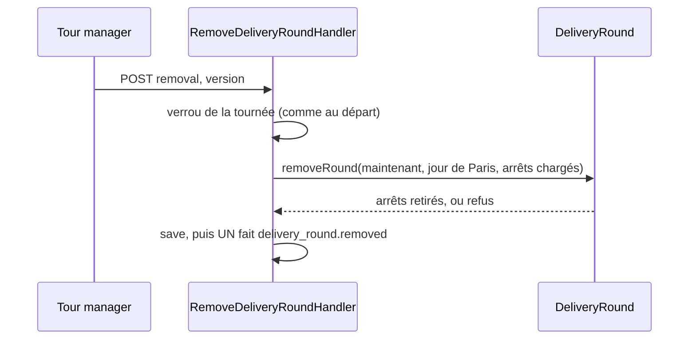

# Supprimer une tournée

> ✅ API bâtie le 2026-10-26 — **décision de Hugo du 2026-10-26**. Le bouton
> « Supprimer la tournée » de Tour manager n'est **pas encore posé** (lot à
> part).

Une tournée créée par erreur se supprime. Ses arrêts retournent « à répartir »
le jour même, et elle disparaît de Tour manager, de la feuille de route, du
dossier du jour, du chargement et de « Ma tournée ». Elle **reste en base** :
`delivery.delivery_round.removed_at` est posé, jamais de suppression physique.

## Le geste

`POST /admin/delivery/rounds/:roundId/removal`, corps `{ "version": n }` (la
version lue, comme tout geste de composition), droit `delivery_rounds` — celui
de créer et modifier une tournée. Réponse **204** sans corps ; rejoué sur une
tournée déjà supprimée, **204** sans effet ni second fait.

## Les refus (409)

| Cas                                           | Code                            | Geste de sortie                                                          |
| --------------------------------------------- | ------------------------------- | ------------------------------------------------------------------------ |
| tournée partie ou rentrée                     | `delivery.round_departed`       | aucun : elle a roulé                                                     |
| journée passée                                | `delivery.past_service_day`     | aucun : on ne compose pas une journée passée                             |
| un arrêt a un bac chargé                      | `delivery.loaded_round_removal` | « Déchargez d'abord les bacs de cette tournée » (Livraison → Chargement) |
| version périmée                               | `delivery.round_stale`          | recharger                                                                |
| tournée déjà supprimée, pour tout AUTRE geste | `delivery.round_removed`        | recharger, composer ailleurs                                             |

Les bacs chargés **refusent** plutôt que d'être déchargés en douce : un bac
déjà dans le véhicule en ressort par le geste « Décharger », qui se voit. Le
verrou pris avant de lire le chargement ferme la course avec un scan.

## Ce que deviennent ses arrêts

Chaque ligne d'arrêt prend `removed_at` à sa dernière position, exactement
comme un arrêt retiré à la main : la commande est libre pour une autre
tournée, et les déclencheurs `day_change` font relire la journée. Un **arrêt
de transfert interne** est traité comme un arrêt : le transfert redevient sans
arrêt, toujours prévu, réaffectable.

## Le journal

**UN** fait, `delivery_round.removed` : la clé de la tournée, `orders` (les
commandes, par leur numéro) et `transfers` (par leur site). Pas un
`stop_removed` par arrêt : ces faits partageraient sujet et trace, donc la clé
d'idempotence du journal, et seul le premier s'inscrirait (constaté en e2e le
2026-10-26).

## On ne compose pas une journée passée

Posé le même jour (`ensureServiceDayNotPast`, jour de Paris lu au `Clock`) :
**ouvrir** une tournée, **appliquer une proposition**, **réordonner** et
**supprimer** sont refusés sur un jour passé. Restent ouverts : retirer,
déplacer, « Mettre dans » un arrêt, rentrer une tournée, affecter ou retirer
un livreur, et les gestes sur les arrêts de transfert.

Migration : `20261026160000_la_tournee_supprimee` (additive, retour arrière en
tête). Code : `delivery/domain/entities/delivery-round-removal.ts`.
