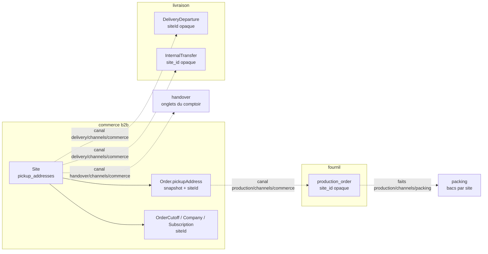
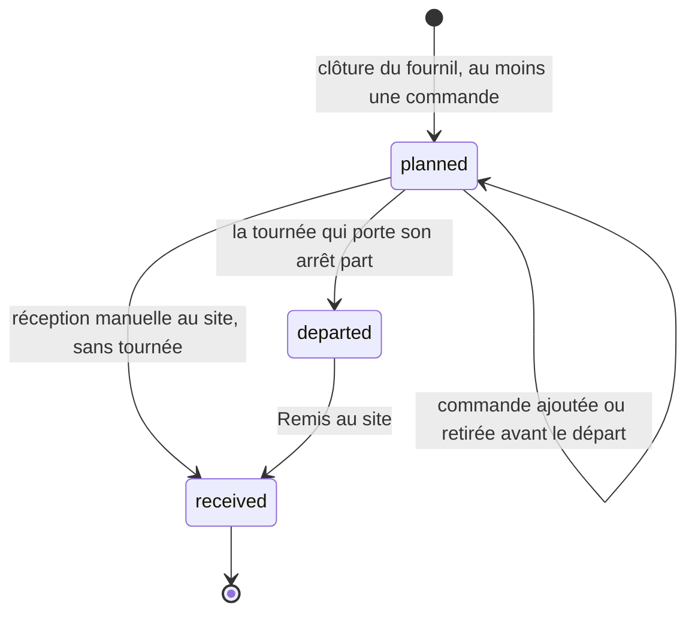
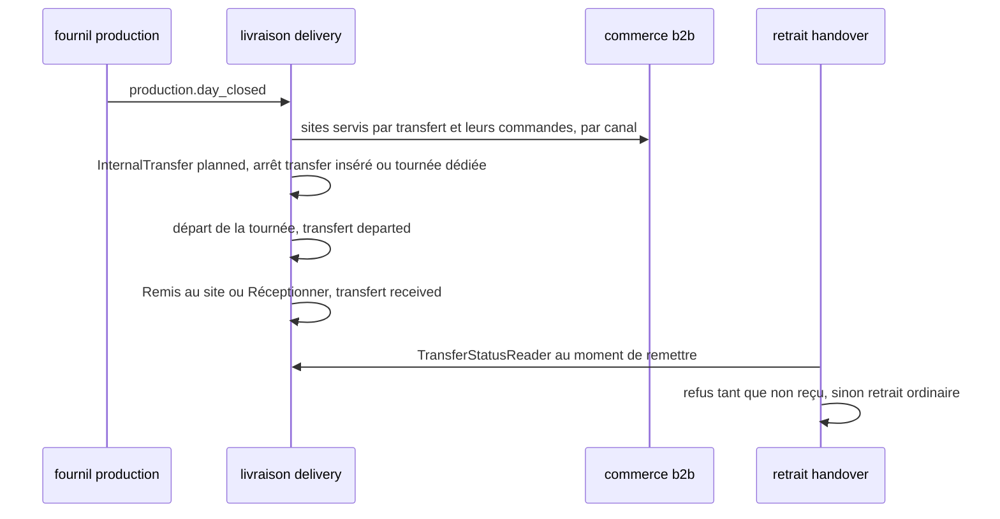

# Plan — les sites, le transfert interne, le tri par heure de départ et les couleurs

> **État : 📐 doc-first, 2026-10-13.** Rien n'est bâti. Ce document est la
> fusion, voulue par Hugo (« quitte à renommer le doc »), de l'écart logistique
> écrit le même jour dans le dossier des commandes
> (déplacé ici par `git mv`) et du plan des **sites** et du **transfert interne** que la
> [carte des chantiers](../../carte-des-chantiers.md) attendait sous
> `livraisons/transferts/`. Les deux ne se lisent pas séparément : le tri du
> village dépend du transfert, et les couleurs deviennent des données de site.
>
> Chaque affirmation sur l'existant a été vérifiée en ouvrant le fichier cité,
> le 2026-10-13. Ce qui ne l'a pas été est marqué « non vérifié ».
>
> 🔴 **`vitruve` d'office avant Hugo** (CLAUDE.md §9 bis) : le plan porte une
> **migration** (le point de retrait devient le site, des références changent
> de nom) et touche une **frontière** entre cinq blocs. Il ne touche pas
> l'argent, sauf indirectement (la remise de retrait reste sur le site, §3.2).

**Décisions de Hugo du 2026-10-13, reprises telles quelles :**

- on introduit la notion de **site** ; son but est aussi de **rassembler tous
  les points de définition qui concernent un lieu** ;
- un site porte **une couleur pour le retrait B2B et une pour le retrait B2C**,
  saisissables au back-office ;
- Val Village est servi par un **transfert interne** (du stock part du fournil
  vers le site, traité comme une livraison) : c'est ce départ qui range ses
  commandes avec les tournées B2B dans le tri par heure de départ ;
- les couleurs de la demande (bleu, jaune, orange, gris ; ni vert ni
  rouge/rose) deviennent des données de site, et la livraison a sa couleur
  propre (§5.3 dit où elle vit).

## 0. La demande

Une responsable logistique, après une visite du back-office, mot pour mot :

> « Ecrire » : prévoir un formulaire pour obtenir les coordonnées du client et infos nécessaires
>
> - Trier les commandes par heures de départ (attention au traitement du click & Collect val village qui doit être traité comme une livraison B to B)
> - Identification visuelle des commandes avec un code couleur (pas de vert et rose/rouge, gardés pour les surligneurs OK/KO), préconise : bleu, jaune, orange, gris, modifiable.
>   - Livraison B to B : Bleu
>   - Click & Collect B to B : Jaune
>   - Click & Collect B to C Adroit : orange
>   - Click & Collect B to C Val Village : Gris

## 1. Ce qui existe pour la demande logistique (vérifié le 2026-10-13)

### 1.1 « Écrire » — deux candidats, aucun ne colle tel quel

1. **Le bouton « Écrire » de la carte de contact de la boutique.** Le seul
   libellé « Écrire » du back-office est l'aperçu de cette carte
   (`apps/lfd-backoffice-frontend/src/app/b2b/contact/shop-contact-fallback.ts`).
   Côté boutique, il ouvre le dialogue « Nous écrire »
   (`apps/lfc-ecommerce-frontend/src/app/legacy/contact/contact-panel/contact-panel.html`).
   Ce formulaire **existe** et recueille déjà nom, e-mail, téléphone
   (facultatif), motif et texte : `CustomerRequest` dans
   `apps/lfd-api/prisma/schema/public/contact.prisma`, doc
   [`../../contenu-ecommerce/demandes-clients.md`](../../contenu-ecommerce/demandes-clients.md)
   (bâti le 2026-10-09). Les motifs se règlent au back-office.
2. **La saisie d'une commande par l'équipe** (comptoir ou téléphone).
   `/comptoir/nouvelle-commande` (`comptoir/nouvelle-commande-pro/nouvelle-commande-pro-page.ts`)
   **ne saisit rien** : elle cherche un compte pro **actif** existant puis
   passe la main à `commandes/nouvelle-commande/` (doc
   [`architecture-commande-saisie-par-l-equipe.md`](../../commandes/architecture-commande-saisie-par-l-equipe.md)).
   Il n'y a **aucun formulaire** pour saisir les coordonnées d'un client qui
   n'a pas de compte (particulier, ou pro pas encore ouvert).

Lecture la plus probable : la responsable logistique parle du **second** — elle
veut pouvoir « écrire » une commande pour un client et en recueillir les
coordonnées (téléphone, adresse, contact sur place) nécessaires au retrait ou à
la livraison. Mais « Nous écrire » est le seul endroit où le mot apparaît à
l'écran : **à confirmer (Q1)**.

### 1.2 Les écrans où la logistique voit « les commandes »

| Écran                                                     | Fichier                                                  | Ce qu'il trie aujourd'hui                                                                                                               |
| --------------------------------------------------------- | -------------------------------------------------------- | --------------------------------------------------------------------------------------------------------------------------------------- |
| `/commandes` (liste)                                      | `commandes/orders-list-page/`, `commandes/orders-table/` | plus récente d'abord ; `AdminOrderRow` porte `fulfillmentMethod`, `clientele`, `fulfillmentDay`, **pas** le point de retrait ni d'heure |
| `/comptoir/retrait`                                       | `handover-shop/handover-queue.ts` (`sortedQueue`)        | par **créneau** (`window.start ?? window.end`), puis heure de commande ; onglets par **point de retrait** (`pickupTabs`)                |
| `/supervision` (colonne 3)                                | `supervision/handover-slots.ts`                          | file de retrait groupée par tranche du créneau convenu                                                                                  |
| `/colisage`, `/tour-manager`, `/coursier`, `/livraison/…` | `app.routes.ts`                                          | tournées et bacs — non relus en détail ici                                                                                              |

Aucun écran ne mélange **livraisons et retraits** dans une même liste triée par
une heure commune. C'est pourtant ce que la demande suppose (« Val Village
traité comme une livraison B2B » n'a de sens que dans une liste qui contient
les deux). **Écran visé : à confirmer (Q2).** Candidats : la liste
`/commandes` filtrée sur un jour, ou la Supervision.

### 1.3 L'heure de « départ »

- **Livraison** : `DeliveryRound.plannedDepartureAt` (prévu par le calcul
  routier, effacé dès qu'un geste à la main change les arrêts) et
  `departedAt` (réel), schéma `delivery`
  (`apps/lfd-api/prisma/schema/delivery.prisma`). La commande y est reliée par
  `DeliveryRoundStop.orderId` (opaque). Le fournil a aussi
  `order_departure.departedAt` (`production.prisma`). **Aucun contrat de liste
  de commandes ne porte ces heures**, et le commerce ne peut les lire que par
  le canal `delivery/channels/commerce/` (matrice CLAUDE.md §3).
- **Retrait** : pas de « départ ». Ce qui en tient lieu est le **créneau
  convenu**, figé sur la commande : `Order.fulfillment.window`
  (`{ start: HH:mm | null, end: HH:mm }`, `OrderFulfillment` dans
  `packages/contracts/src/order.ts`, schéma `fulfillmentWindowSchema` dans
  `packages/contracts/src/address.ts`). Le retrait au comptoir trie déjà
  dessus.
- **Val Village** : c'est un **point de retrait** (`PickupAddress`,
  `public/settings.prisma`), donc une **donnée**, pas une notion du modèle.
  Le nom n'apparaît dans le code que dans un test
  (`handover-shop/handover-queue.spec.ts`, onglet « Val Village »). La
  commande en garde un snapshot (`Order.pickupAddress`, JSON) et les vues
  du retrait exposent `pickupLabel` (`packages/contracts/src/order-handover.ts`).
- **Adroit** : introuvable dans le code ou la doc, hormis un nom de ferme de
  démonstration (`apps/lfd-api/prisma/seed-growth/personas.ts`, « La Ferme de
  l'Adroit ») sans rapport. Probablement un autre point de retrait, saisi en
  production : **à confirmer (Q3)**.

### 1.4 Les quatre catégories se dérivent-elles ?

Oui, presque entièrement, de trois champs figés sur la commande :

| Catégorie demandée         | `fulfillmentMethod` | `clientele` | point de retrait |
| -------------------------- | ------------------- | ----------- | ---------------- |
| Livraison B2B — bleu       | `delivery`          | `pro`       | —                |
| C&C B2B — jaune            | `pickup`            | `pro`       | (tous ?)         |
| C&C B2C Adroit — orange    | `pickup`            | `public`    | « Adroit » ?     |
| C&C B2C Val Village — gris | `pickup`            | `public`    | « Val Village »  |

Trous : livraison **B2C** (`delivery` × `public`) n'a pas de couleur ;
`clientele = NULL` (commandes d'avant la distinction, jamais rattrapées,
`public/orders.prisma`) non plus ; et la clé « point de retrait » n'est qu'un
**libellé** dans les vues (`pickupLabel`) — couleur attachée à un libellé =
cassée au premier renommage.

### 1.5 Le vocabulaire fold disponible (fold-ng 0.28.1, lu dans `node_modules`)

- Badges : variantes `neutral | accent | info | warning | alert | success`.
  `success` (vert) et `alert` (rouge) sont exclus par la demande ; restent
  `info` (bleu/azur), `warning` (ambre = **jaune**), `neutral` (gris),
  `accent`.
- Palette de référence : `amber`, `azure`, `signal` (bleu), `steel`/`slate`
  (gris), `teal`, `purple`, `grape`… **Il n'y a pas d'orange** dans fold :
  `--fold-ref-amber-550/600` est ce qui s'en approche, mais se confond avec le
  jaune `warning`.
- Précédent d'un token local au back-office : `--lfc-stage-*` dans
  `apps/lfd-backoffice-frontend/src/styles.scss` (l. 127–129), bâtis sur des
  `--fold-ref-*`. `lint:fold-tokens` refuse un `var()` inexistant.
- **Modifiable** : aucun réglage de couleur par catégorie n'existe. Le seul
  réglage qui touche le retrait est l'écran des points de retrait
  (`PickupAddress`, sans champ de couleur).

## 2. Inventaire — tout ce qui définit un lieu aujourd'hui (vérifié le 2026-10-13)

Le site doit devenir **la** définition d'un lieu à nous. Voici, fichier ouvert,
tout ce qui en définit un — ou en a l'air — et ce que chacun devient.

| #   | Ce qui existe                                            | Fichier                                                                         | Ce qu'il porte                                                                                                                                | Bloc                            | Devient                                                                                                                                     |
| --- | -------------------------------------------------------- | ------------------------------------------------------------------------------- | --------------------------------------------------------------------------------------------------------------------------------------------- | ------------------------------- | ------------------------------------------------------------------------------------------------------------------------------------------- |
| 1   | `PickupAddress` (`pickup_addresses`)                     | `prisma/schema/public/settings.prisma`                                          | libellé, adresse postale, `isDefault`, remise de retrait (`discountMode/Value`, `discountForB2b/B2c`), `opening` (public + pros, JSON), `gps` | `b2b` (`b2b/pickup-addresses/`) | **le site lui-même** : la ligne est conservée, elle gagne des rôles et des couleurs (§3.3). Le JSDoc l'appelle déjà « laboratoire »         |
| 2   | `PublicPickupSlotRule`, `PublicPickupClosure`            | même fichier (relations de `PickupAddress`)                                     | créneaux publics du point, fermetures datées                                                                                                  | `b2b`                           | **attribut du site** (rôle « remet », côté B2C) — inchangé, la relation suit la ligne                                                       |
| 3   | `OrderCutoff.pickupAddressId`                            | `public/orders.prisma` (l. ~718)                                                | heure limite par point (`null` = défaut plateforme), par jour                                                                                 | `b2b`                           | **attribut du site** par référence — même colonne, même valeur ; seul le nom de champ Prisma change (`siteId`, `@map` inchangé)             |
| 4   | `Company.preferredPickupAddressId`                       | `public/account.prisma` (l. 196)                                                | le retrait préféré d'un pro                                                                                                                   | `b2b`                           | **référence au site** — idem, renommage Prisma seul                                                                                         |
| 5   | `Subscription.pickupAddressId`                           | `public/subscriptions.prisma` (l. 24)                                           | le point de retrait d'un abonnement                                                                                                           | `b2b`                           | **référence au site** — idem                                                                                                                |
| 6   | `Order.pickupAddress` (JSON)                             | `public/orders.prisma` (l. 153)                                                 | **snapshot** des champs postaux du point ; **aucun id**                                                                                       | `b2b`                           | **snapshot qui gagne `siteId`** (additif) : sans id, une couleur ou un transfert s'accrocherait à un libellé (§1.4)                         |
| 7   | `DeliveryDeparture.pickupAddressId`                      | `prisma/schema/delivery.prisma` (l. ~106)                                       | d'où partent les tournées ; ligne absente = point par défaut ; id **opaque**, lu par `delivery/channels/commerce/`                            | `delivery`                      | **référence opaque au site**, rôle « fournil / départ » — c'est déjà la forme visée ; seul le vocabulaire change                            |
| 8   | `production_order.pickup_label` (+ `address_*`)          | `prisma/schema/production.prisma` (l. 118–122)                                  | snapshot imprimé sur le bon                                                                                                                   | `production`                    | **snapshot qui gagne `site_id` opaque** (additif) : le colisage en a besoin pour grouper par site (§4.5)                                    |
| 9   | Onglets du comptoir (`pickupTabs(entries, places)`)      | `apps/lfd-backoffice-frontend/src/app/handover-shop/handover-queue.ts` (l. 132) | « tous les points connus », **par libellé**                                                                                                   | front (`handover`)              | **lecture du site par id** ; le libellé n'est plus une clé                                                                                  |
| 10  | `PointOfSale` (`point_of_sale`, `kind: shop / platform`) | `prisma/schema/pim/sales-contexts.prisma` (l. 147)                              | « d'où l'on vend » **pour le catalogue** : contextes de vente, tables à QR, `baseUrl` du C&C ; `platform` n'a aucun lieu                      | `pim`                           | **reste à part** : c'est un canal de vente, pas un lieu — la plateforme pro en est un sans adresse. Lien éventuel au site : Q-S3            |
| 11  | `CategoryChannel.pointOfSaleId` (ex-`location_id`)       | `pim/categories.prisma` (l. 55)                                                 | ce que l'on vend où                                                                                                                           | `pim`                           | **reste à part** (même raison que 10)                                                                                                       |
| 12  | `LegalEntity` (adresse)                                  | `public/accounting.prisma` (l. 75)                                              | siège tel qu'il s'imprime sur les mentions légales                                                                                            | `b2b` (comptabilité)            | **reste à part** : une adresse **juridique**, figée sur les documents émis ; qu'elle coïncide avec le fournil est un fait, pas une identité |
| 13  | `DeliveryZone`                                           | `public/settings.prisma` (l. 67)                                                | préfixes postaux **chez le client** + frais                                                                                                   | `b2b`                           | **reste à part** : un secteur de clients, pas un lieu à nous (rattachement au site de départ : plus tard, si un 2ᵉ fournil, Q-S4)           |
| 14  | `DeliveryAvailability` (une ligne `delivery`)            | `public/settings.prisma` (l. 96)                                                | ouverture B2B/B2C de la livraison, `windowMode`, marges de production                                                                         | `b2b`                           | **reste à part** et **reçoit les couleurs de livraison** (§5.3)                                                                             |
| 15  | `Address` (carnet), `MarketZone` (prospection)           | `public/account.prisma` (l. 517), `growth.prisma` (l. 209)                      | adresses des clients ; codes postaux ciblés                                                                                                   | `b2b`                           | **à part** : ce ne sont pas nos lieux                                                                                                       |

Ce qu'en dit l'inventaire :

- **Un lieu à nous n'est défini qu'une fois, et c'est déjà `PickupAddress`.**
  Les autres sont des **références** (3, 4, 5, 7), des **snapshots** (6, 8) ou
  des notions **qui ne sont pas des lieux** (10 à 15). Le travail n'est donc
  pas de fusionner des tables : c'est de **renommer et élargir** la ligne qui
  existe, et de donner un **id** aux deux snapshots qui n'en ont pas.
- Le nom ment déjà deux fois : le départ des tournées (7) s'appuie sur un
  « point de retrait », et le JSDoc de `PickupAddress` l'appelle
  « laboratoire ». Le site corrige le nom ; le modèle était juste.
- `PointOfSale` est le seul rival sérieux, et il est **dans le référentiel** :
  le fusionner ferait lire le PIM par le commerce hors de son canal, pour
  une notion (canal de vente) qui ne coïncide pas (la plateforme pro n'a pas
  de lieu). Il reste à part ; Q-S3 demande s'il faut un lien.

## 3. Le site

### 3.1 Ce que c'est

> Un **site** est un lieu physique **à nous**, avec une adresse, où au moins
> une de ces choses arrive : on y **fabrique et on en part** (le fournil), on
> y **remet** des commandes à des clients (retrait), on y **est servi** par
> un transfert interne.

Les rôles, et ce qu'ils portent :

| Rôle                | Champ                                            | Ce qui en dépend                                                                                           |
| ------------------- | ------------------------------------------------ | ---------------------------------------------------------------------------------------------------------- |
| **remet** (retrait) | `handsOver: boolean`                             | proposé au checkout, onglet au comptoir, créneaux publics, ouverture pros, remise de retrait, heure limite |
| **est servi par**   | `supply: 'on_site' \| 'transfer'`                | `on_site` = la marchandise est fabriquée/colisée **là** ; `transfer` = elle y arrive par transfert (§4)    |
| **expédie**         | `dispatches: boolean`                            | les livraisons et les transferts peuvent en partir ; porte les couleurs de livraison (§5.3)                |
| **départ**          | inchangé : `DeliveryDeparture` (bloc `delivery`) | LE site d'où partent tournées **et transferts**, choisi parmi ceux qui expédient ; ligne absente = défaut  |
| **vend**            | non modélisé ici                                 | c'est `PointOfSale` (§2, ligne 10) ; Q-S3                                                                  |

Invariants (agrégat `Site`, §3.1 de CLAUDE.md : « une règle peut refuser
l'écriture » → agrégat, pas CRUD) :

- un site servi par `transfer` **remet** forcément (sinon on n'y transfère
  rien qui ait un client) ;
- un site qui **expédie** est `on_site` ; la livraison ne propose comme
  départ que les sites qui expédient (`DepartureCandidatesReader`,
  `delivery/channels/commerce/departure-candidates.reader.ts`, étendu), et le
  commerce refuse de retirer `dispatches` au site désigné, qu'il lit par un
  port `DepartureSiteReader` qu'il déclare et que `delivery` implémente ;
- les **couleurs** : l'agrégat **tolère leur absence** (les lignes existantes
  n'en ont pas, et `toDomain` doit les relire) ; il refuse seulement
  d'**effacer** une couleur posée. Aucune couleur n'est inventée : l'écran les
  saisit, et le resserrement (lot S3r) pose le `CHECK` une fois toutes
  saisies ;
- **archiver, pas supprimer** : `archived_at` remplace la suppression
  physique d'aujourd'hui (`prisma-pickup-address.repository.ts`, l. 196,
  `tx.pickupAddress.delete`) ; un site archivé n'est plus proposé mais se
  résout par id (départ, tournée, copies). Refus d'archiver le site par
  défaut ou celui qui expédie ;
- les invariants existants (« au moins un point », « un seul défaut »,
  `PickupDiscount`) restent où ils sont, désormais portés par l'agrégat.

### 3.2 Quel bloc le possède : `b2b`, sous-contexte `b2b/sites/`

| Candidat     | Pour                                                                                                                                    | Contre                                                                                                                         |
| ------------ | --------------------------------------------------------------------------------------------------------------------------------------- | ------------------------------------------------------------------------------------------------------------------------------ |
| **`b2b`** ✅ | la ligne y vit déjà ; checkout, remise, heure limite, créneaux publics, abonnements, sociétés la lisent **en direct** dans le même bloc | `delivery`, `handover`, `production`, `packing` doivent la lire par un canal — **c'est déjà le cas** pour `delivery` (ligne 7) |
| `delivery`   | le transfert et le départ y vivent                                                                                                      | `b2b → delivery` n'est permis que par port : checkout et remise (de l'argent) liraient un port pour un fait de configuration   |
| `handover`   | « remet » est son verbe                                                                                                                 | `handover → b2b` interdit ; il ne connaît que la commande, pas la vente                                                        |
| nouveau bloc | neutre                                                                                                                                  | une ligne de matrice de plus pour une notion que cinq blocs lisent déjà au même endroit ; `lint:context-boundaries` à réarmer  |

Le site reste donc au **commerce**, et les autres blocs le lisent par les
canaux qu'ils **déclarent** et que le commerce **implémente** (forme normale
de la matrice §3) :

| Lecteur      | Canal (déclaré par le lecteur)                            | Ce qu'il lit                                                                     | État                                       |
| ------------ | --------------------------------------------------------- | -------------------------------------------------------------------------------- | ------------------------------------------ |
| `delivery`   | `delivery/channels/commerce/`                             | adresse + GPS du site de départ (existe) ; **sites servis par transfert** (neuf) | à étendre                                  |
| `handover`   | `handover/channels/commerce/`                             | la liste des sites qui remettent (onglets du comptoir), couleurs                 | à étendre (non vérifié : lecteur exact)    |
| `production` | `production/channels/commerce/` (`DayOrdersReader`)       | `siteId` dans le snapshot `ProducibleOrder`                                      | à étendre                                  |
| `packing`    | via les faits du fournil (`production/channels/packing/`) | `siteId` recopié du snapshot                                                     | à étendre ; `packing → b2b` reste interdit |

### 3.3 Le modèle et la migration

Pré-release (CLAUDE.md §0, corrigé le 2026-10-04) : un contrat servi **peut**
casser dans le même déploiement sur décision de Hugo ; **les données, elles,
ne se détruisent pas**. Aucune donnée ne bouge de table ici : la ligne
`pickup_addresses` **est** le site.

- **Table** : on garde `pickup_addresses` (un nom de table est un nom, mais le
  renommer n'achète rien et coûte une migration relue) ; le modèle Prisma
  devient `Site` avec `@@map("pickup_addresses")`. À trancher : Q-S1.
- **Colonnes ajoutées** (une migration **additive**) :
  `hands_over boolean not null default true` (l'existant : tout point remet),
  `supply site_supply not null default 'on_site'`,
  `dispatches boolean not null default false`, `archived_at timestamptz null`,
  `transfer_mode site_transfer_mode not null default 'integrated'`,
  `counter_setup_minutes int not null default 0`, `transfer_minutes int null` (trajet, Q-T11 ; §4.6),
  `pickup_color_b2b`, `pickup_color_b2c`, `delivery_color_b2b`,
  `delivery_color_b2c` (`site_color null`), plus des `CHECK` posés
  **après** la saisie (lot S3r). Le site par défaut actuel reçoit
  `dispatches = true` dans la même migration (c'est déjà lui, ou celui de
  `DeliveryDeparture`, qui expédie — fait, pas valeur inventée).
- **Références** (3, 4, 5) : renommage du **champ Prisma** seulement
  (`siteId`, `@map("pickup_address_id")` conservé) — aucun SQL.
- **Snapshots** (6, 8) : `siteId` ajouté au JSON `Order.pickupAddress` à la
  passation, depuis le `pickupAddressId` que la passation **reçoit déjà**
  (`b2b/orders/application/services/order-drafting.service.ts`, l. 48, 83,
  333 ; `null` = défaut, résolu à l'id du défaut au moment de figer) ;
  `site_id text null` sur `production_order`. Les commandes passées n'en
  ont pas : **pas de rattrapage** par libellé (irréversible, objection S5) —
  l'historique est « autre ».

Les trois temps, appliqués :

1. **Étendre** — colonnes nullables / par défaut, `siteId` écrit dans les
   nouveaux snapshots, contrats qui exposent `siteId` **à côté** de
   `pickupLabel`.
2. **Basculer** — l'écran saisit rôles et couleurs ; les lecteurs (comptoir,
   tri, couleurs) lisent `siteId`.
3. **Resserrer** — `CHECK` des couleurs ; les lectures par libellé
   disparaissent (`pickupTabs(places: string[])` → par id).



### 3.4 L'écran : Réglages › Sites, une seule entrée

Hugo, 2026-10-13 : « tout rassembler ce qui concerne les sites dans
réglages/sites ».

**Ce qui existe (vérifié le 2026-10-13)** — `/reglages` n'a **plus d'écran**
depuis le 2026-10-10 : `reglages/reglages.routes.ts` ne contient que des
redirections (`''` → `/documentation/facturation`, `retraits-livraisons` →
`/b2b/reglages/points-de-retrait`, …). Les écrans qui règlent un lieu sont
éparpillés :

| Écran actuel                               | Route                                                   | Droit (garde)                      | Ce qu'il règle                                                                         | Devient                                                                                                                                   |
| ------------------------------------------ | ------------------------------------------------------- | ---------------------------------- | -------------------------------------------------------------------------------------- | ----------------------------------------------------------------------------------------------------------------------------------------- |
| Points de retrait (liste + page de détail) | `/b2b/reglages/points-de-retrait`, `…/nouveau`, `…/:id` | sous l'espace B2B (`b2b_settings`) | adresse, rang par défaut, heures, réduction, clientèles, créneaux publics, suppression | **migre** : c'est la page du site ; ses cartes restent des cartes                                                                         |
| Heures limites de commande                 | `/b2b/reglages/heures-limites`                          | sous l'espace B2B                  | règles `OrderCutoff`, **par point** ou défaut plateforme                               | **en partie** : la carte « Heures limites » du site montre et règle les règles de CE site ; la page reste pour la règle par défaut        |
| Départ des tournées                        | `/livraison/depart`                                     | `delivery_settings:read`           | quel point est le départ (`DeliveryDeparture`)                                         | **migre** comme un rôle « départ » sur la page du site — l'écriture reste `delivery` (canal), le droit `delivery_settings:write` la garde |
| Zones de livraison                         | `/livraison/zones`                                      | (non relu en détail)               | secteurs clients + frais                                                               | **reste** : ce n'est pas un lieu à nous (§2, ligne 13)                                                                                    |
| Réglages du fournil                        | `/production/reglages`                                  | `production_settings:read`         | arrêt du plan, jours fermés                                                            | **reste** : réglage d'atelier, pas de lieu (un seul fournil, Q-S4)                                                                        |
| Véhicules, bacs, contenances               | `/livraison/vehicules`, `…/bacs`, `…/contenances`       | `delivery_settings:read`           | flotte                                                                                 | **reste** : rattacher un véhicule à un site attendra un second fournil                                                                    |

**La page** — route `/reglages/sites` (liste) et `/reglages/sites/:id`
(détail), `/reglages/sites/nouveau`. Une **page de détail**, pas un
panneau, par la règle « page ou panneau » du `CLAUDE.md` du back-office
(plusieurs sujets dont on va droit à un seul) : `fold-page-layout`,
`fold-back-link`, **une `fold-card` par sujet** :

1. Identité et adresse (libellé, adresse, GPS) ;
2. Rôles — « Remet des commandes », « Approvisionné par » (sur place /
   transfert), « Départ des tournées » (lecture + bascule sous
   `delivery_settings:write`) ;
3. Couleurs — retrait B2B, retrait B2C (pastilles, §3.5) ;
4. Ouverture (public / pros) ; 5. Créneaux publics et fermetures ;
5. Réduction de retrait et ses clientèles ; 7. Heures limites de ce site ;
6. Suppression (`fold-danger-zone`, `appearance="section"`).

Une carte d'un rôle absent est masquée (un site qui ne remet pas n'a ni
créneaux ni réduction).

**Le parent `reglages`** redevient un espace avec un écran : `''` mène à
`/reglages/sites` au lieu de `/documentation/facturation` (à faire confirmer
— cette redirection vit dans des favoris). Les redirections existantes
restent ses enfants.

**Anciennes routes** (elles vivent dans des favoris — on redirige, on ne
rend pas 404) : `/b2b/reglages/points-de-retrait` → `/reglages/sites`,
`…/points-de-retrait/:id` → `/reglages/sites/:id` (même id : la ligne ne
change pas, §3.3), `…/nouveau` → `/reglages/sites/nouveau`,
`/reglages/retraits-livraisons` → `/reglages/sites`, `/livraison/depart` →
`/reglages/sites` (le site de départ n'est plus une page à lui). Les liens
internes à suivre : `shared/journal/subject-routes.ts`,
`auth/permission.guard.ts` et `livraison/departure-page/` citent
`points-de-retrait` (trouvés par grep, non relus).

**Deux arbres de navigation** : l'entrée « Sites » s'ajoute au **rail**
(`shared/workspace-rail/workspaces.ts`, où « Points de retrait » est
aujourd'hui l'entrée `key: 'points-de-retrait'` de la section « Réglages »
de l'e-commerce, et « Départ » l'entrée `key: 'depart'` de la livraison) **et**
aux **tuiles** `fold-nav-launcher` du menu mobile — les deux modèles sont
séparés (dette notée au `CLAUDE.md` du back-office). Les deux anciennes
entrées disparaissent des deux arbres dans le même lot.

**Droit** (Hugo, Q-S5, 2026-10-13) : la page sous la ressource neuve
**`lfc_sites`**. Lot S0 : une migration ajoute la valeur à `StaffResource`
et **ne l'accorde à aucun rôle** (`lint:no-role-grants-in-migrations`).
**Geste de bascule** : après le déploiement de S0, l'admin accorde
`lfc_sites` (lecture, écriture) aux rôles voulus à `/admin/staff-roles` ;
**ensuite seulement** S1 met l'écran et l'API d'écriture des sites derrière
`lfc_sites` — sinon l'écran serait mort entre les deux (objection S3). La
carte « Départ » appelle l'API de la livraison, sous `delivery_settings`
(non relu : la séparation `:read`/`:write` de ce droit à l'écriture).

**Qui lit les sites hors de l'écran (objection S2)** : aujourd'hui le
comptoir (`handover-shop/handover-queue.store.ts`), la saisie
(`commandes/nouvelle-commande/nouvelle-commande-page.ts`) et les heures
limites lisent les points par `PickupAddressesService`
(`b2b/reglages/pickup-addresses.service.ts`) qui frappe
`admin/pickup-addresses` (`@AdminSurface("b2b_settings")`). Déplacer la
**route front** ne déplace pas l'API ; mais passer l'API sous `lfc_sites`
couperait le comptoir. S1 donne donc à chacun sa lecture : le comptoir par
le retrait (`handover/channels/commerce/`, sous `handover_counter`), la
saisie par une query des commandes (sous `b2b_place_order`) ; seul l'écran
des sites lit et écrit sous `lfc_sites`.

### 3.5 Les couleurs : une palette fermée

« Interdire plutôt que vérifier » (mémoire du dépôt) : une couleur libre
refusée si elle est « trop proche du vert » est une règle floue et une porte
à écrire. Une **palette fermée sans vert ni rouge** rend la faute
**inexprimable**.

- Enum Postgres `site_color` : `blue`, `yellow`, `orange`, `grey`, `purple`,
  `teal`, `brown` (proposition — Q-S6). **Ni `green`, ni `red`, ni `pink`**
  (surligneurs OK/KO, demande d'origine).
- Chaque valeur a un token local `--lfc-site-<couleur>` dans
  `apps/lfd-backoffice-frontend/src/styles.scss`, bâti sur des `--fold-ref-*`
  comme les `--lfc-stage-*` (l. 127–129). **Fold n'a pas d'orange** (§1.5) :
  `--lfc-site-orange` est le seul token qui n'a pas de référence fold directe
  — couleur choisie à l'œil, contraste vérifié en clair et sombre.
  `lint:fold-tokens` tient les autres. `teal` est un bleu-vert : à retirer si
  la logistique le confond avec le vert du surligneur.
- Valeurs **saisies à l'écran** après S1 (aucune posée par une migration) : le site du fournil (« Adroit » ?) jaune / orange, Val
  Village jaune / gris — d'après la demande, à faire confirmer (Q3).

## 4. Le transfert interne

> **Refondu le 2026-10-13 après la seconde contradiction (§10)** et la
> décision de Hugo du même jour : **option B — un seul arrêt « transfert »
> qui porte l'`InternalTransfer` et ses N commandes, sans commande propre.**
> Les commandes du village **restent des retraits** et n'entrent **jamais**
> dans le bloc livraison : ni `DeliveryOrderFacts`, ni `departed_at`, ni
> `RecordRoundDeparted`, ni le courriel « en route ».

### 4.1 Ce que c'est

Un **transfert interne** est, pour un site servi par `transfer` et un jour de
service, **le lot de ses commandes qui part du site de départ**. Il naît à la
clôture du fournil, part dans une tournée, et est **reçu** au site. Il
appartient à `delivery` (un véhicule, une heure ; `production → delivery`
reste interdit, la livraison compose déjà sur `production.day_closed`).

### 4.2 L'agrégat `InternalTransfer`

Table `delivery_internal_transfer` (schéma `delivery`), clé naturelle
`(service_day, site_id)` ; ses commandes dans
`delivery_internal_transfer_order(transfer_id, order_id)` — `order_id`
**opaque**, jamais lu comme une livraison.



Invariants portés par l'agrégat :

- **une réception, une seule** : `receive(at, by)` refuse un transfert déjà
  `received` (`TransferAlreadyReceivedError`), et l'adaptateur écrit
  `UPDATE … SET received_at = $1 WHERE id = $2 AND received_at IS NULL` en
  plus — deux comptoirs qui appuient ensemble : un seul gagne, l'autre lit
  le refus (même forme que `markHandedOver`, CLAUDE.md §3.1) ;
- `depart` seulement depuis `planned`, posé par le départ de la tournée ;
- **réception manuelle** depuis `planned` (sortie de S3, §4.5) : nommée,
  datée, auteur figé, motif obligatoire (« venu par le personnel », « pas de
  tournée ce jour ») ;
- une commande **retirée** du transfert après réception n'existe pas : une
  commande reçue au site relève du retrait (annulation, non retirée) — le
  transfert ne « ramène » rien.

### 4.3 L'arrêt de transfert : un **genre d'arrêt** dans `delivery_round_stop`

Deux formes, choisies en ouvrant `delivery.prisma` (l. 185–215), la
migration `20260929140200_les_tournees` (l. 78–84) et
`DeliveryRoundBase` (`delivery/domain/entities/delivery-round-base.ts`) :

| Forme                                          | Pour                                                                                                                                                    | Contre                                                                                                                                                    |
| ---------------------------------------------- | ------------------------------------------------------------------------------------------------------------------------------------------------------- | --------------------------------------------------------------------------------------------------------------------------------------------------------- |
| **A. genre d'arrêt dans la même table** ✅     | la `position` reste une seule séquence par tournée (déplacer, réordonner, retirer : la même ligne, C11) ; `removed_at`/`closed_at` valent pour les deux | `order_id` devient nullable                                                                                                                               |
| B. table `delivery_round_transfer_stop` à part | `order_id` intact                                                                                                                                       | deux tables partagent l'ordre de passage : l'invariant « positions uniques et contiguës » traverse deux tables, et chaque réordonnancement écrit les deux |

**Retenue : A.** Colonnes `kind delivery_stop_kind not null default 'order'`
(`order` | `transfer`), `transfer_id text null`, et

```sql
CHECK ((kind = 'order'    AND order_id IS NOT NULL AND transfer_id IS NULL)
    OR (kind = 'transfer' AND order_id IS NULL     AND transfer_id IS NOT NULL))
```

L'index partiel `delivery_round_stop_live_order_key` (unique sur `order_id`,
`removed_at IS NULL AND closed_at IS NULL`) ignore les `NULL` : il reste
juste pour les arrêts de commande. Son jumeau
`delivery_round_stop_live_transfer_key` (unique sur `transfer_id`, mêmes
conditions) dit « un transfert dans au plus une tournée vivante ». Les deux
s'écrivent à la main, comme le premier.

**Migration en trois temps** (`order_id` d'une table servie devient
nullable) :

1. **Étendre** — `kind` (défaut `order`), `transfer_id`, le `CHECK`, l'index
   jumeau ; `order_id` **reste NOT NULL**. Le code lit `kind` partout (§4.4)
   et le domaine passe à une union `OrderStop | TransferStop`.
2. **Basculer** — `ALTER COLUMN order_id DROP NOT NULL`, dans le
   déploiement qui écrit le premier arrêt `transfer`, **après** que tout
   lecteur gère le genre. Le `CHECK` tient la garantie que `NOT NULL`
   donnait pour les arrêts de commande.
3. **Resserrer** — rien à resserrer : le `CHECK` est la forme finale.

**Dans le domaine** : `DeliveryRoundBase.orderIds` (l. 102 :
`this.open.map((stop) => stop.orderId)`) devient « les commandes des arrêts
de commande » ; `transferIds` s'y ajoute. L'union discriminée est le
mécanisme qui rend l'inventaire **complet** : un lecteur qui lit `orderId`
sans tester `kind` ne compile plus. L'invariant « un passage par site » est
**structurel** : un transfert = un arrêt (objection B2 du §10).

### 4.4 Ce qui lit un arrêt, et ce que chacun fait du genre `transfer`

Ouvert le 2026-10-13. **Point de départ : la ressource** (la table et
l'entité), pas le nom des fichiers. 117 fichiers non-test de
`src/delivery` nomment `orderId` ou `orderIds` (grep) : le compte exact des
sites à changer sortira du compilateur à l'étape 1 de la migration — ce
tableau dit ce que **chaque famille** doit faire, pas un compte.

| Famille                              | Fichiers ouverts                                                                                                                                                                                                                    | Arrêt `transfer`                                                                                                                                                                                                                         |
| ------------------------------------ | ----------------------------------------------------------------------------------------------------------------------------------------------------------------------------------------------------------------------------------- | ---------------------------------------------------------------------------------------------------------------------------------------------------------------------------------------------------------------------------------------- |
| **Composition et retouche**          | `domain/services/insert-cheapest.ts`, `improve-plans.ts`, `move-delivery-stop.ts`, `route-timing.ts` (`RoutingStop { id, window, stopSeconds? }`), `insert-into-rounds.ts`, `propose-rounds.ts`                                     | **un `RoutingStop` comme un autre** : son point = GPS du site, sa fenêtre = « arrivé avant » l'arrivée requise figée (§4.6), `stopSeconds` = déchargement (réglage du site). Déplaçable, retirable — un seul arrêt, rien à garder groupé |
| **Départ**                           | `application/delivery-departure-support.ts` (`departAndFreeze`, l. 64–89)                                                                                                                                                           | les feuilles, retenues et faits portent sur `orderIds` (commandes) **seulement** ; le départ passe aussi chaque transfert de l'arrêt à `departed` (même transaction)                                                                     |
| **Fait de départ**                   | `channels/handover/delivery-round-departed.fact.ts` (`orderIds`)                                                                                                                                                                    | **inchangé** : il ne porte que les commandes livrées. Les commandes du village n'y sont pas, donc ni `RecordRoundDeparted` ni `mail-delivery-en-route` ne les voient                                                                     |
| **Chargement, bacs**                 | `application/delivery-loading-support.ts`, `delivery-bin-office.ts`, `prisma-stop-loading.repository.ts`, `prisma-round-placements.reader.ts`                                                                                       | les bacs des commandes du village se chargent **sur l'arrêt `transfer`** : `BinDesk` reçoit le `transferId` comme destination (Q-T4 : un bac par commande, inchangé)                                                                     |
| **Porte, décisions, ratés, ramené**  | `prisma-doorstep-stop.repository.ts`, `channels/handover/doorstep-handover.attestor.ts`, `prisma-stop-decisions.reader.ts`, `prisma-undelivered-stops.reader.ts`, `prisma-brought-back-orders.reader.ts`, `brought-back-support.ts` | **ignorés** (filtre `kind = 'order'`) ; le seul geste d'un arrêt `transfer` est « Remis au site » (§4.5)                                                                                                                                 |
| **Vue des tournées, app du livreur** | `prisma-delivery-rounds.reader.ts`, `driver-rounds.reader`, `round-paper.reader`                                                                                                                                                    | une ligne « → Val Village · N commandes », sans client, sans adresse de client                                                                                                                                                           |
| **Facturation**                      | `channels/commerce/order-delivery-history.reader.ts` + `prisma-order-delivery-history.reader.ts`                                                                                                                                    | **rien** : il lit des arrêts de commande ; une commande du village n'en a pas, son historique est celui d'un retrait                                                                                                                     |
| **Localisation, positions**          | `application/delivery-stops-locating.ts` (l. 77, écarte `delivery: false`), `prisma-gesture-positions.reader.ts`                                                                                                                    | le point d'un arrêt `transfer` vient du site (canal `delivery/channels/commerce/`), jamais du carnet d'adresses                                                                                                                          |

Le drapeau `delivery: boolean` (`delivery/channels/commerce/delivery-orders.reader.ts`,
l. 37) **ne change pas** de sens : une commande du village reste `false`, et
les filtres qui l'écartent (`delivery-stops-locating.ts:77`,
`delivery-loading-support.ts:107`, `assign-delivery-stop.handler.ts:107`,
cités par le §10) continuent de l'écarter — c'est ce que B1 demandait.

**Les deux modes avec ce même arrêt** (§4.2 de la version précédente,
inchangé sur le choix) — réglage `transfer_mode` du site servi, carte Rôles,
sous `lfc_sites`, **intégré par défaut** :

- **intégré** : la composition insère l'arrêt `transfer` dans une tournée
  B2B du jour, par `insertCheapest` sous la fenêtre « arrivé avant ». **Repli
  automatique** (objection S5) : si aucune tournée B2B ne peut l'insérer dans
  sa fenêtre — pas de tournée ce jour, ou toutes trop tardives —, la
  composition crée une **tournée dédiée** et le journal du jour le dit
  (« Val Village : aucune tournée ne passait à temps, tournée dédiée
  créée ») ; le tour manager peut ensuite déplacer l'arrêt à la main ;
- **dédié** : la composition crée une tournée qui ne porte que cet arrêt.
  Une tournée dédiée n'a **pas de genre** : c'est une tournée ordinaire à un
  arrêt `transfer` — `delivery_round` ne change pas.

### 4.5 La garde, la réception, le refus au comptoir

**Qui sait qu'une commande du village est en route ou reçue : le
transfert**, et lui seul. Le retrait le lit par un canal ; il n'écrit plus
`departed_at` pour ces commandes (objection S2 du §10) — la garde du
fournil et la preuve de remise (`handover/infrastructure/prisma-handover-proof.reader.ts`,
domaine `handover-proof-exhibit`) ne voient jamais une remise à la porte qui
n'a pas eu lieu.

1. **Lecture** : `TransferStatusReader.statusOf(orderIds)` →
   `{ state: 'planned' | 'departed' | 'received', at }` par commande,
   **déclaré par `delivery`** dans `delivery/channels/handover/` et
   implémenté par lui (forme des lecteurs « des deux sens » du 2026-10-08) ;
   le retrait le lit au moment de remettre. Lecture synchrone, par lot.
2. **Le comptoir refuse** : remettre une commande d'un site `transfer` dont
   le transfert n'est pas `received` lève `TransferNotReceivedError`
   (`BusinessError`, 409) — « Cette commande n'est pas encore arrivée au
   site : son transfert n'a pas été reçu. Réceptionnez le transfert (bouton
   « Réceptionner » de la file du comptoir), puis remettez-la. » Le geste
   nommé **existe toujours** (sortie de S3 ci-dessous).
3. **« Remis au site »** : sur l'arrêt `transfer`, par le livreur ; ou
   **« Réceptionner »** au comptoir du site, par le personnel (droit
   `handover_counter`), qui appelle la livraison par un port déclaré par
   `handover` (`handover/channels/delivery/`, implémenté par `delivery` ;
   `handover → delivery` : port uniquement ✓).
4. **Sortie quand aucune tournée ne l'a emporté** (objection S3 du §10) :
   la **réception manuelle** depuis `planned` (§4.2), même bouton, motif
   obligatoire. Proposé plutôt qu'une levée du refus : le refus protège
   d'une remise sans marchandise ; le lever sans trace effacerait la
   question « comment est-elle arrivée ? ». Une commande sans transfert
   (ajoutée après la clôture) obtient un transfert `planned` à son ajout,
   donc toujours une sortie.
5. **La preuve de remise au comptoir reste un retrait** : `markHandedOver`,
   ses pièces, inchangés.



### 4.6 L'échéance : figée à la clôture, marges intactes

`deadlineThresholds` (`b2b/orders/domain/services/deadline-thresholds.ts`,
l. 87–127) garde **ses deux interrupteurs** : `deliveryMinutes` et
`pickupMinutes` ; si l'un est `null`, toute la journée passe en seuil unique
(`UNDATED`). **`pickupMarginMinutes` reste intact** et reste un nombre servi
au fournil (`DayDueThresholds`).

Ce qui s'ajoute :

- **`counter_setup_minutes`** — réglage **neuf** du site (carte Rôles,
  `lfc_sites`, entier ≥ 0, défaut 0 : pas de valeur copiée d'un autre
  réglage). C'est la mise en place au comptoir, **après** le colisage :
  il s'**ajoute** à la marge de retrait, il ne la remplace pas.
- **L'heure requise, figée à la clôture du fournil**, par site et par jour,
  dans `site_day_requirement(site_id, service_day, required_arrival_at,
required_departure_at, frozen_at)` (commerce). Elle n'est **jamais
  réécrite** une fois posée : changer un créneau, une fermeture, la mise en
  place ou le trajet vaut pour les journées pas encore closes (objection S4).
  C'est un **fait daté par jour**, pas une décision à fenêtre :
  `lint:dated-decisions` couvre la résolution du prix (en-tête de
  `dev-toolbox/gates/dated-decisions.mjs`) et ne la verra pas — la règle
  « jamais réécrite » est portée par l'agrégat (`freeze` refuse une seconde
  écriture) et par la clé `(site_id, service_day)`.
- **De quels créneaux on part** : le plus tôt de (a) l'ouverture **pros**
  du site ce jour-là (`PickupAddress.opening`, fenêtre pros) et (b) le
  premier créneau **public** ouvert ce jour-là (`PublicPickupSlotRule` moins
  `PublicPickupClosure`), lus **à la clôture**.
  `required_arrival = ce plus tôt − counter_setup_minutes` ;
  `required_departure = required_arrival − trajet` (Q-T11).
- **Sans créneau ni ouverture ce jour-là** : on prend le plus tôt des
  créneaux **des commandes** du site ; s'il n'y en a pas non plus, l'heure
  requise est `null`, les commandes du site passent en `UNDATED` (comme une
  commande sans fenêtre aujourd'hui, l. 120–122), et le journal de la
  clôture le signale.

L'échéance d'une commande, en minutes avant laquelle sortir :

| Commande                       | Échéance (si les deux interrupteurs sont posés)                       |
| ------------------------------ | --------------------------------------------------------------------- |
| livraison                      | inchangée : fenêtre − `deliveryMinutes`                               |
| retrait sur un site sur place  | fenêtre − `pickupMinutes` − `counter_setup_minutes` du site           |
| retrait sur un site `transfer` | `required_departure` figé − `deliveryMinutes` (colisage + chargement) |

`DeadlineOrder` gagne `requiredBy: minute | null` (calculé par le commerce
depuis le site et la ligne figée) ; `dueMinute` le préfère à la fenêtre
quand il est posé. **Le snapshot du colisage suit la même règle** :
`ProducibleOrder.dueAt`, écrit par `dueAtOf`
(`b2b/orders/infrastructure/prisma-day-orders.reader.ts`, l. 113–119, qui ne
lit aujourd'hui que la fenêtre), lit la même fonction. Lot **T0**.

### 4.7 Le colisage

Chaque commande garde son sac / bac ([`colisage.md`](../../colisage/colisage.md)
§2). Les commandes du village se rangent sous leur `dueAt` (§4.6) — c'est la
réponse, pour le village, à la question 1 de
[`todo-colisage-tri-par-echeance.md`](../../colisage/todo-colisage-tri-par-echeance.md) —
et leurs bacs se chargent sur l'arrêt `transfer` (§4.4).

## 5. Le tri par heure de départ et le code couleur

### 5.1 L'écran

À confirmer (Q2). Par défaut : `/commandes` filtrée sur un jour de service.

### 5.2 D'où vient chaque heure

| Commande                                 | Heure de départ                                                                                                                                      | Source                                                                |
| ---------------------------------------- | ---------------------------------------------------------------------------------------------------------------------------------------------------- | --------------------------------------------------------------------- |
| livraison (B2B ou B2C)                   | `plannedDepartureAt ?? departedAt` de sa tournée                                                                                                     | `delivery`, nouveau lecteur par lot sur `delivery/channels/commerce/` |
| retrait sur un site `transfer` (village) | le départ de la tournée qui porte l'arrêt de son **transfert** (B2B en intégré, dédiée sinon) ; avant composition : `required_departure` figé (§4.6) | même lecteur ; puis le site (commerce)                                |
| retrait sur un site `on_site`            | `window.start ?? window.end` (créneau figé)                                                                                                          | commerce, déjà sur la commande                                        |
| sans heure                               | en fin, « pas encore de départ »                                                                                                                     | —                                                                     |

Le lecteur neuf : `OrderDepartureReader.departuresOf(orderIds)` → par
commande `{ plannedAt, departedAt, via: 'delivery' | 'transfer' }` — pour une
commande du village, lu par `delivery_internal_transfer_order` puis l'arrêt
du transfert, donc juste dans les deux modes, déclaré
et implémenté par `delivery` (forme des `OrderDeliveryHistoryReader` du
2026-10-08). Lecture par lot.

### 5.3 D'où vient chaque couleur — toutes sous `lfc_sites`

| Catégorie                           | Couleur (demande) | Où elle vit                                                           |
| ----------------------------------- | ----------------- | --------------------------------------------------------------------- |
| Livraison B2B                       | bleu              | `Site.deliveryColorB2b` du site **qui expédie** (`dispatches = true`) |
| Livraison B2C                       | (non demandée)    | `Site.deliveryColorB2c`, même site                                    |
| C&C B2B (tous sites)                | jaune             | `Site.pickupColorB2b`                                                 |
| C&C B2C Adroit                      | orange            | `Site.pickupColorB2c` du site Adroit                                  |
| C&C B2C Val Village                 | gris              | `Site.pickupColorB2c` de Val Village                                  |
| `clientele = NULL`, `siteId` absent | neutre            | catégorie « autre » de la fonction pure, jamais une couleur inventée  |

**S3 tranché (proposition)** : les couleurs de livraison **quittent
`DeliveryAvailability`** et vont sur le site qui expédie, sous `lfc_sites`.
Une palette, un écran, un droit. Le site qui expédie est celui d'où partent
les livraisons : rôle `dispatches` (§3.1). Une commande du village garde le
gris même triée avec les tournées : la couleur dit **à qui** on remet,
l'heure dit **quand** ça part.

`logisticsCategoryOf(order, sites)` vit **côté back-office** (pas dans
`@lfd/contracts` : la boutique ne s'en sert pas, et le baril pèse sur son
budget de 1,30 Mo).

## 6. Lots

Un lot à la fois (mémoire du dépôt). Tailles dites honnêtement : **T1 et T2
sont le cœur du chantier**, et T1 ne se coupe pas — son étape « étendre »
sans la composition ne sert à rien en production.

| Lot | Taille | Contenu                                                                                                                                                                                                                    | Migration                                                            | Touche                      |
| --- | ------ | -------------------------------------------------------------------------------------------------------------------------------------------------------------------------------------------------------------------------- | -------------------------------------------------------------------- | --------------------------- |
| S0  | S      | ressource `lfc_sites` ajoutée à `StaffResource`, accordée à **aucun** rôle ; bascule : après déploiement, l'admin l'accorde à `/admin/staff-roles`, **puis** S1 met l'écran derrière                                       | additive (valeur d'enum)                                             | sécurité (périmètre)        |
| S1  | M      | `b2b/sites` (agrégat `Site`, rôles, couleurs nullables, archivage, `transfer_mode`, `counter_setup_minutes`), Réglages › Sites, lecteurs du comptoir et de la saisie hors de l'écran                                       | additive (colonnes, enums)                                           | frontière (canaux)          |
| S2  | S      | `siteId` dans le snapshot de commande (depuis `pickupAddressId` reçu à la passation), `production_order.site_id`, onglets du comptoir par id ; pas de rattrapage                                                           | additive                                                             | —                           |
| L1  | S      | fonction pure de catégorie (back-office), tokens `--lfc-site-*`, pastille                                                                                                                                                  | —                                                                    | —                           |
| S3r | S      | `CHECK` des couleurs après saisie ; lectures par libellé retirées                                                                                                                                                          | contrainte                                                           | —                           |
| T0  | M      | `site_day_requirement` figée à la clôture (créneaux pros et publics, mise en place, trajet), `requiredBy` dans `deadlineThresholds` et `dueAtOf` ; marges intactes                                                         | additive (table)                                                     | production (échéances)      |
| T1  | **L**  | `InternalTransfer` + ses commandes ; arrêt `kind = transfer` (temps 1 : colonnes, `CHECK`, index jumeau ; union discriminée dans le domaine) ; chaque famille du §4.4 ; composition intégrée avec repli dédié ; mode dédié | **trois temps** : étendre (T1), basculer `DROP NOT NULL` (fin de T1) | migration servie, frontière |
| T2  | M      | « Remis au site » / « Réceptionner » (manuelle), `TransferStatusReader`, port `handover/channels/delivery/`, `TransferNotReceivedError`                                                                                    | additive (`received_at` du transfert)                                | frontière                   |
| L2  | M      | `OrderDepartureReader` + tri de la liste ; tri du colisage par `dueAt`                                                                                                                                                     | —                                                                    | frontière (canal)           |
| L4  | ?      | « Écrire » (Q1), indépendant                                                                                                                                                                                               | —                                                                    | —                           |
| L5  | S      | couleur sur les supports imprimés (si Q8 = papier)                                                                                                                                                                         | —                                                                    | —                           |

L'ancien T3 (mode dédié seul) est **absorbé par T1** : avec un arrêt unique,
la tournée dédiée est une tournée ordinaire à un arrêt, et le repli
automatique en a besoin. `lecteur-de-migrations` sur S0, S1, T0, T1, T2 ;
`vitruve` sur le §4 refondu avant Hugo.

## 7. Questions à Hugo

Tranchées le 2026-10-13 : Q4, Q5, Q6, Q7 ; **Q-T1** (option B : un arrêt
« transfert » unique ; deux modes, **intégré** par défaut) ; **Q-T2** (le
comptoir refuse) ; **Q-S5** (`lfc_sites`) ; **Q-S2** (pas de rattrapage).
Proposées ici, à valider : **Q-T9** (repli dédié automatique) et la sortie
de S3 (réception manuelle).

Restent :

- **Q1** — « Écrire » : saisie staff pour un client sans compte, ou « Nous
  écrire » ?
- **Q2** — Quel écran porte le tri et les couleurs ?
- **Q3** — « Adroit » est-il le site du fournil ? Les deux sites B2C sont-ils
  les seuls ?
- **Q8** — Surligneurs sur papier ou à l'écran ?
- **Q-S1** — Garder la table `pickup_addresses` sous le modèle `Site` ?
- **Q-S3** — Relier un `PointOfSale` (référentiel) à un site ?
- **Q-S4** — Un second fournil est-il envisagé ?
- **Q-S6** — La palette : `blue, yellow, orange, grey, purple, teal, brown` ?
- **Q-S7** — Les couleurs de livraison sur le site qui expédie (§5.3) ?
- **Q-T3** — Une commande du village ajoutée après le départ : transfert du
  lendemain, ou réception manuelle d'une course à part ?
- **Q-T4** — Un bac par commande (proposé), ou un bac de transfert commun ?
- **Q-T6** — « Remis au site » par le livreur, « Réceptionner » par le
  comptoir : les deux (proposé), ou un seul ?
- **Q-T7** — Changer le mode d'un site : seulement les journées pas encore
  composées (proposé) ?
- **Q-T11** — Trajet fournil → site : durée saisie au site (proposé,
  immédiat), ou calculateur routier ?
- **Q-T12** — Créneaux de référence de l'heure requise : le plus tôt de
  l'ouverture pros et du premier créneau public (proposé) ?

## 8. Ce dont ce plan n'est pas sûr

- Le nombre exact de sites de code à changer pour le genre d'arrêt : 117
  fichiers non-test de `src/delivery` nomment `orderId(s)` ; le compilateur
  le dira à l'étape 1 de T1.
- Que `BinDesk` (implémenté par la livraison pour le colisage) accepte un
  transfert comme destination sans changer le canal
  `packing/channels/delivery/` : non relu.
- Que la clôture du fournil soit le bon instant pour figer (et non l'arrêt
  du plan) : à relire dans `arret-du-plan.md` au lot T0.
- Le droit avec lequel le comptoir lit aujourd'hui `admin/pickup-addresses`.

## 9. Contradiction par `vitruve` (2026-10-13) — et son sort

| #   | Niveau   | Objection (résumé)                                                                                                                  | Sort                                                                                                                                                                                                                                                                                                                                                                                                                       |
| --- | -------- | ----------------------------------------------------------------------------------------------------------------------------------- | -------------------------------------------------------------------------------------------------------------------------------------------------------------------------------------------------------------------------------------------------------------------------------------------------------------------------------------------------------------------------------------------------------------------------- |
| B1  | BLOQUANT | couleurs obligatoires dans l'agrégat dès S1 : `toDomain` refuserait les lignes existantes                                           | **corrigé** (§3.1, §3.3) : l'agrégat **tolère** l'absence jusqu'au resserrement S3r ; il refuse seulement d'**effacer** une couleur posée ; la migration ne pose aucune couleur, l'écran les saisit                                                                                                                                                                                                                        |
| B2  | BLOQUANT | arrêt de transfert avec `order_id` nullable, cœur du bloc livraison, sans inventaire                                                | **dépassé** par la décision de Hugo (option B, §10) : `order_id` devient nullable **pour le seul genre `transfer`**, sous `CHECK`, en trois temps (§4.3) ; inventaire par familles au §4.4                                                                                                                                                                                                                                 |
| B3  | BLOQUANT | l'échéance du fournil pour le village est calculée en retrait                                                                       | **corrigé** (§4.6, lot T0) : heure requise figée à la clôture par site et par jour ; échéance = départ requis − marge de livraison                                                                                                                                                                                                                                                                                         |
| S1  | SÉRIEUX  | suppression physique d'un site référencé                                                                                            | **corrigé** (§3.1, §3.3) : `archived_at` ; « supprimer » archive ; refus d'archiver le site par défaut ou celui qui expédie                                                                                                                                                                                                                                                                                                |
| S2  | SÉRIEUX  | le comptoir lit les points par `PickupAddressesService` (l'API de l'écran de réglages)                                              | **corrigé** (§3.4) : l'API `admin/pickup-addresses` n'est pas déplacée par le changement de route front ; le comptoir et la saisie lisent les sites par leurs propres lectures, hors de `lfc_sites`                                                                                                                                                                                                                        |
| S3  | SÉRIEUX  | deux droits pour une palette ; ressource neuve = écran mort jusqu'à l'accord                                                        | **corrigé** (§5.3, lot S0) : toutes les couleurs sous `lfc_sites` ; S0 déployé et accordé **avant** que S1 ne garde l'écran                                                                                                                                                                                                                                                                                                |
| S4  | SÉRIEUX  | la page Sites écrit le départ (delivery) sans port ; invariant tenu d'un côté                                                       | **corrigé** (§3.1, §3.4) : la carte « Départ » appelle l'API de la livraison (`delivery_settings:write`), pas le commerce ; la livraison ne propose que les sites `dispatches` (lecteur `DepartureCandidatesReader` existant, étendu), et le commerce refuse de retirer `dispatches` au site désigné par un port `DepartureSiteReader` déclaré par `b2b`, implémenté par `delivery` (`b2b → delivery` : port uniquement ✓) |
| S5  | SÉRIEUX  | rattrapage par libellé irréversible ; `pickupAddressId` déjà reçu à la passation                                                    | **corrigé** (§3.3, lot S2) : le snapshot garde l'id reçu (`order-drafting.service.ts`, `pickupAddressId`, l. 48/83/333) ; pas de rattrapage                                                                                                                                                                                                                                                                                |
| S6  | SÉRIEUX  | `received` lu par personne                                                                                                          | **corrigé** par Q-T2 (§4.4) : fait durable `delivery.transfer_received`, abonné du retrait, `TransferNotReceivedError`                                                                                                                                                                                                                                                                                                     |
| S7  | SÉRIEUX  | Q-T1 dite ouverte alors que le corps bâtit l'option A                                                                               | **corrigé** : Q-T1 tranchée (deux modes, intégré par défaut), le corps refondu (§3.3, §4, §5.2) ; la tournée et l'échéance lues par l'arrêt, justes dans les deux modes                                                                                                                                                                                                                                                    |
| m   | mineurs  | `OrderCutoff` sans relation ; fold-ng 0.28.2 ; `Order.pickupAddress` typé `BillingAddressPayload` ; baril ; `lecteur-de-migrations` | **assumés / corrigés** : fonction pure côté back-office (baril) ; `lecteur-de-migrations` au §6 ; le typage du snapshot sera élargi à S2 (non relu) ; §1.5 garde la version lue ce jour-là                                                                                                                                                                                                                                 |

## 10. Seconde contradiction par `vitruve` (2026-10-13) — et son sort

Sur le §4 de la version à « arrêts marqués ». Hugo a tranché pour
l'option B le même jour ; le §4 a été refondu.

| #      | Niveau   | Objection (résumé)                                                                                  | Sort                                                                                                                                                                    |
| ------ | -------- | --------------------------------------------------------------------------------------------------- | ----------------------------------------------------------------------------------------------------------------------------------------------------------------------- |
| B1     | BLOQUANT | une commande du village est `delivery: false`, le bloc l'écarte en dix endroits                     | **corrigé** (§4.4) : elle n'entre plus dans le bloc ; le drapeau garde son sens, les filtres l'écartent toujours                                                        |
| B2     | BLOQUANT | « N arrêts consécutifs = un passage » sans mécanisme                                                | **corrigé** (§4.3) : un transfert = un arrêt ; l'invariant est structurel ; index partiel jumeau sur `transfer_id`                                                      |
| S1     | SÉRIEUX  | compte de lecteurs faux, parti du nom de la table                                                   | **corrigé** (§4.4) : par familles, depuis la table et l'entité ; le compte exact laissé au compilateur (union discriminée) plutôt qu'à un grep                          |
| S2     | SÉRIEUX  | `departed_at` fait mentir la garde et la preuve ; facturation « parti »                             | **corrigé** (§4.5) : aucune commande du village dans `DeliveryRoundDepartedFact` ; le transfert seul sait, lu par `TransferStatusReader` ; la preuve reste un retrait   |
| S3     | SÉRIEUX  | refus à vie si aucune tournée n'a emporté le transfert                                              | **corrigé** (§4.2, §4.5) : réception manuelle depuis `planned`, motif obligatoire ; toute commande a un transfert dès son ajout ; le message nomme un geste qui existe  |
| S4     | SÉRIEUX  | heure requise non datée                                                                             | **corrigé** (§4.6) : `site_day_requirement` figée à la clôture, jamais réécrite ; hors du champ de `lint:dated-decisions` (prix), tenue par l'agrégat et la clé         |
| S5     | SÉRIEUX  | mode intégré sans tournée qui convienne                                                             | **corrigé** (§4.4) : repli automatique sur une tournée dédiée, dit au journal ; à valider (Q-T9)                                                                        |
| B-bis  | BLOQUANT | `pickupMarginMinutes` est un interrupteur des vagues, pas une durée de comptoir                     | **corrigé** (§4.6) : marges intactes ; `counter_setup_minutes` neuf, défaut 0, **s'ajoute** ; `requiredBy` par commande ; `ProducibleOrder.dueAt` suit la même règle    |
| S-bis1 | SÉRIEUX  | « premier créneau ouvert » instable ; retraits pros ; sans créneau                                  | **corrigé** (§4.6) : lu et figé à la clôture ; plus tôt de l'ouverture pros et du premier créneau public ; repli sur les créneaux des commandes, puis `UNDATED` signalé |
| S-bis2 | SÉRIEUX  | double réception sans mécanisme ; commande ramenée après réception                                  | **corrigé** (§4.2) : refus de l'agrégat + `UPDATE … WHERE received_at IS NULL` ; une commande reçue relève du retrait, le transfert ne ramène rien                      |
| m      | mineurs  | tournée dédiée citée comme cas général ; backticks échappés au §6 ; numérotation des cartes du §3.4 | **corrigés** : §4 et §6 réécrits (intégré par défaut, backticks rétablis) ; la numérotation du §3.4 est laissée (1–8, lisible)                                          |
