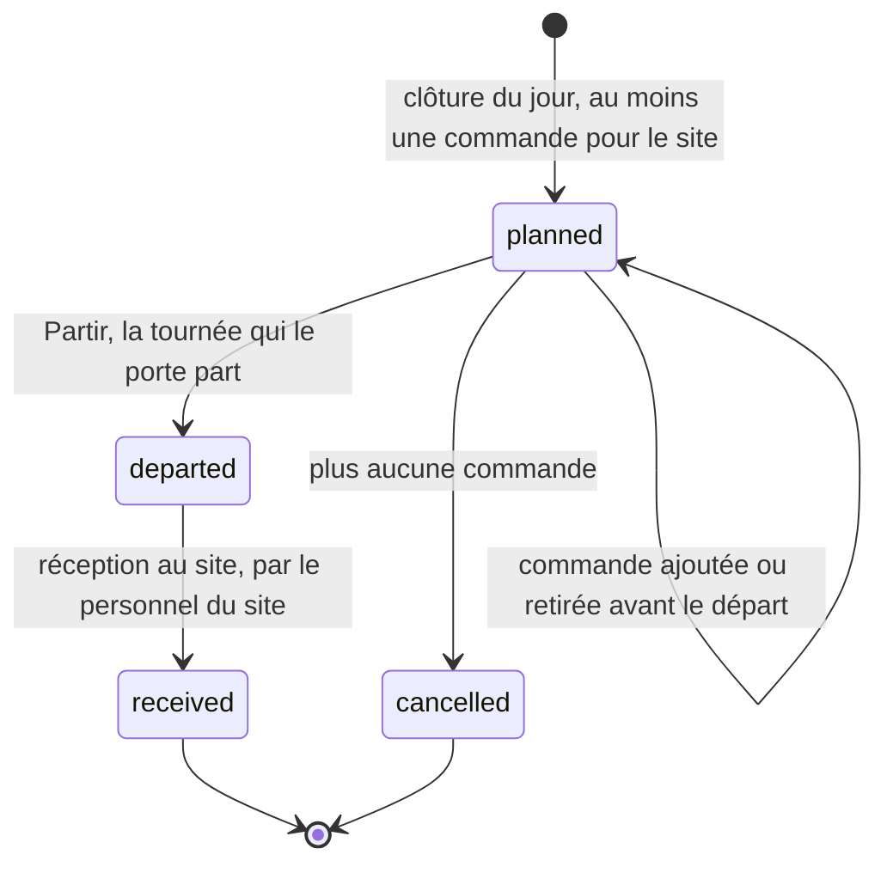
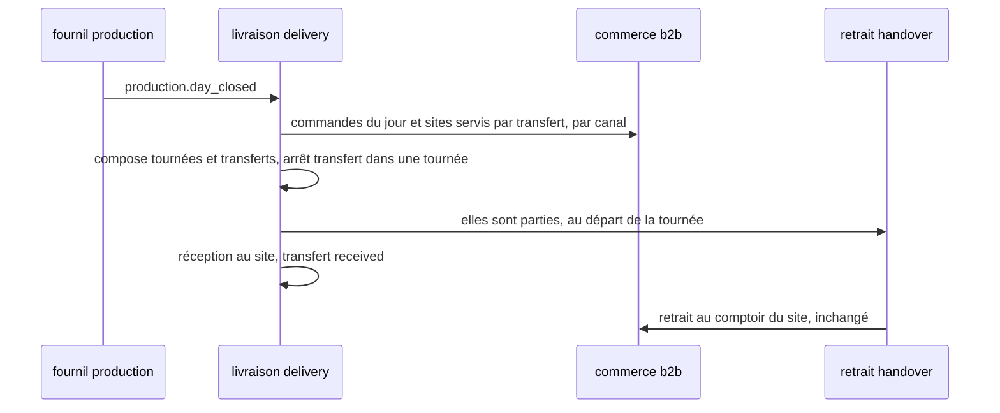

# Plan — les sites, le transfert interne, le tri par heure de départ et les couleurs

> **État : 📐 doc-first, 2026-10-13.** Rien n'est bâti. Ce document est la
> fusion, voulue par Hugo (« quitte à renommer le doc »), de l'écart logistique
> écrit le même jour dans le dossier des commandes
> (déplacé ici par `git mv`) et du plan des **sites** et du **transfert interne** que la
> [carte des chantiers](../../carte-des-chantiers.md) attendait sous
> `livraisons/transferts/`. Les deux ne se lisent pas séparément : le tri du
> village dépend du transfert, et les couleurs deviennent des données de site.
>
> Chaque affirmation sur l'existant a été vérifiée en ouvrant le fichier cité,
> le 2026-10-13. Ce qui ne l'a pas été est marqué « non vérifié ».
>
> 🔴 **`vitruve` d'office avant Hugo** (CLAUDE.md §9 bis) : le plan porte une
> **migration** (le point de retrait devient le site, des références changent
> de nom) et touche une **frontière** entre cinq blocs. Il ne touche pas
> l'argent, sauf indirectement (la remise de retrait reste sur le site, §3.2).

**Décisions de Hugo du 2026-10-13, reprises telles quelles :**

- on introduit la notion de **site** ; son but est aussi de **rassembler tous
  les points de définition qui concernent un lieu** ;
- un site porte **une couleur pour le retrait B2B et une pour le retrait B2C**,
  saisissables au back-office ;
- Val Village est servi par un **transfert interne** (du stock part du fournil
  vers le site, traité comme une livraison) : c'est ce départ qui range ses
  commandes avec les tournées B2B dans le tri par heure de départ ;
- les couleurs de la demande (bleu, jaune, orange, gris ; ni vert ni
  rouge/rose) deviennent des données de site, et la livraison a sa couleur
  propre (§5.3 dit où elle vit).

## 0. La demande

Une responsable logistique, après une visite du back-office, mot pour mot :

> « Ecrire » : prévoir un formulaire pour obtenir les coordonnées du client et infos nécessaires
>
> - Trier les commandes par heures de départ (attention au traitement du click & Collect val village qui doit être traité comme une livraison B to B)
> - Identification visuelle des commandes avec un code couleur (pas de vert et rose/rouge, gardés pour les surligneurs OK/KO), préconise : bleu, jaune, orange, gris, modifiable.
>   - Livraison B to B : Bleu
>   - Click & Collect B to B : Jaune
>   - Click & Collect B to C Adroit : orange
>   - Click & Collect B to C Val Village : Gris

## 1. Ce qui existe pour la demande logistique (vérifié le 2026-10-13)

### 1.1 « Écrire » — deux candidats, aucun ne colle tel quel

1. **Le bouton « Écrire » de la carte de contact de la boutique.** Le seul
   libellé « Écrire » du back-office est l'aperçu de cette carte
   (`apps/lfd-backoffice-frontend/src/app/b2b/contact/shop-contact-fallback.ts`).
   Côté boutique, il ouvre le dialogue « Nous écrire »
   (`apps/lfc-ecommerce-frontend/src/app/legacy/contact/contact-panel/contact-panel.html`).
   Ce formulaire **existe** et recueille déjà nom, e-mail, téléphone
   (facultatif), motif et texte : `CustomerRequest` dans
   `apps/lfd-api/prisma/schema/public/contact.prisma`, doc
   [`../../contenu-ecommerce/demandes-clients.md`](../../contenu-ecommerce/demandes-clients.md)
   (bâti le 2026-10-09). Les motifs se règlent au back-office.
2. **La saisie d'une commande par l'équipe** (comptoir ou téléphone).
   `/comptoir/nouvelle-commande` (`comptoir/nouvelle-commande-pro/nouvelle-commande-pro-page.ts`)
   **ne saisit rien** : elle cherche un compte pro **actif** existant puis
   passe la main à `commandes/nouvelle-commande/` (doc
   [`architecture-commande-saisie-par-l-equipe.md`](../../commandes/architecture-commande-saisie-par-l-equipe.md)).
   Il n'y a **aucun formulaire** pour saisir les coordonnées d'un client qui
   n'a pas de compte (particulier, ou pro pas encore ouvert).

Lecture la plus probable : la responsable logistique parle du **second** — elle
veut pouvoir « écrire » une commande pour un client et en recueillir les
coordonnées (téléphone, adresse, contact sur place) nécessaires au retrait ou à
la livraison. Mais « Nous écrire » est le seul endroit où le mot apparaît à
l'écran : **à confirmer (Q1)**.

### 1.2 Les écrans où la logistique voit « les commandes »

| Écran                                                     | Fichier                                                  | Ce qu'il trie aujourd'hui                                                                                                               |
| --------------------------------------------------------- | -------------------------------------------------------- | --------------------------------------------------------------------------------------------------------------------------------------- |
| `/commandes` (liste)                                      | `commandes/orders-list-page/`, `commandes/orders-table/` | plus récente d'abord ; `AdminOrderRow` porte `fulfillmentMethod`, `clientele`, `fulfillmentDay`, **pas** le point de retrait ni d'heure |
| `/comptoir/retrait`                                       | `handover-shop/handover-queue.ts` (`sortedQueue`)        | par **créneau** (`window.start ?? window.end`), puis heure de commande ; onglets par **point de retrait** (`pickupTabs`)                |
| `/supervision` (colonne 3)                                | `supervision/handover-slots.ts`                          | file de retrait groupée par tranche du créneau convenu                                                                                  |
| `/colisage`, `/tour-manager`, `/coursier`, `/livraison/…` | `app.routes.ts`                                          | tournées et bacs — non relus en détail ici                                                                                              |

Aucun écran ne mélange **livraisons et retraits** dans une même liste triée par
une heure commune. C'est pourtant ce que la demande suppose (« Val Village
traité comme une livraison B2B » n'a de sens que dans une liste qui contient
les deux). **Écran visé : à confirmer (Q2).** Candidats : la liste
`/commandes` filtrée sur un jour, ou la Supervision.

### 1.3 L'heure de « départ »

- **Livraison** : `DeliveryRound.plannedDepartureAt` (prévu par le calcul
  routier, effacé dès qu'un geste à la main change les arrêts) et
  `departedAt` (réel), schéma `delivery`
  (`apps/lfd-api/prisma/schema/delivery.prisma`). La commande y est reliée par
  `DeliveryRoundStop.orderId` (opaque). Le fournil a aussi
  `order_departure.departedAt` (`production.prisma`). **Aucun contrat de liste
  de commandes ne porte ces heures**, et le commerce ne peut les lire que par
  le canal `delivery/channels/commerce/` (matrice CLAUDE.md §3).
- **Retrait** : pas de « départ ». Ce qui en tient lieu est le **créneau
  convenu**, figé sur la commande : `Order.fulfillment.window`
  (`{ start: HH:mm | null, end: HH:mm }`, `OrderFulfillment` dans
  `packages/contracts/src/order.ts`, schéma `fulfillmentWindowSchema` dans
  `packages/contracts/src/address.ts`). Le retrait au comptoir trie déjà
  dessus.
- **Val Village** : c'est un **point de retrait** (`PickupAddress`,
  `public/settings.prisma`), donc une **donnée**, pas une notion du modèle.
  Le nom n'apparaît dans le code que dans un test
  (`handover-shop/handover-queue.spec.ts`, onglet « Val Village »). La
  commande en garde un snapshot (`Order.pickupAddress`, JSON) et les vues
  du retrait exposent `pickupLabel` (`packages/contracts/src/order-handover.ts`).
- **Adroit** : introuvable dans le code ou la doc, hormis un nom de ferme de
  démonstration (`apps/lfd-api/prisma/seed-growth/personas.ts`, « La Ferme de
  l'Adroit ») sans rapport. Probablement un autre point de retrait, saisi en
  production : **à confirmer (Q3)**.

### 1.4 Les quatre catégories se dérivent-elles ?

Oui, presque entièrement, de trois champs figés sur la commande :

| Catégorie demandée         | `fulfillmentMethod` | `clientele` | point de retrait |
| -------------------------- | ------------------- | ----------- | ---------------- |
| Livraison B2B — bleu       | `delivery`          | `pro`       | —                |
| C&C B2B — jaune            | `pickup`            | `pro`       | (tous ?)         |
| C&C B2C Adroit — orange    | `pickup`            | `public`    | « Adroit » ?     |
| C&C B2C Val Village — gris | `pickup`            | `public`    | « Val Village »  |

Trous : livraison **B2C** (`delivery` × `public`) n'a pas de couleur ;
`clientele = NULL` (commandes d'avant la distinction, jamais rattrapées,
`public/orders.prisma`) non plus ; et la clé « point de retrait » n'est qu'un
**libellé** dans les vues (`pickupLabel`) — couleur attachée à un libellé =
cassée au premier renommage.

### 1.5 Le vocabulaire fold disponible (fold-ng 0.28.1, lu dans `node_modules`)

- Badges : variantes `neutral | accent | info | warning | alert | success`.
  `success` (vert) et `alert` (rouge) sont exclus par la demande ; restent
  `info` (bleu/azur), `warning` (ambre = **jaune**), `neutral` (gris),
  `accent`.
- Palette de référence : `amber`, `azure`, `signal` (bleu), `steel`/`slate`
  (gris), `teal`, `purple`, `grape`… **Il n'y a pas d'orange** dans fold :
  `--fold-ref-amber-550/600` est ce qui s'en approche, mais se confond avec le
  jaune `warning`.
- Précédent d'un token local au back-office : `--lfc-stage-*` dans
  `apps/lfd-backoffice-frontend/src/styles.scss` (l. 127–129), bâtis sur des
  `--fold-ref-*`. `lint:fold-tokens` refuse un `var()` inexistant.
- **Modifiable** : aucun réglage de couleur par catégorie n'existe. Le seul
  réglage qui touche le retrait est l'écran des points de retrait
  (`PickupAddress`, sans champ de couleur).

## 2. Inventaire — tout ce qui définit un lieu aujourd'hui (vérifié le 2026-10-13)

Le site doit devenir **la** définition d'un lieu à nous. Voici, fichier ouvert,
tout ce qui en définit un — ou en a l'air — et ce que chacun devient.

| #   | Ce qui existe                                            | Fichier                                                                         | Ce qu'il porte                                                                                                                                | Bloc                            | Devient                                                                                                                                     |
| --- | -------------------------------------------------------- | ------------------------------------------------------------------------------- | --------------------------------------------------------------------------------------------------------------------------------------------- | ------------------------------- | ------------------------------------------------------------------------------------------------------------------------------------------- |
| 1   | `PickupAddress` (`pickup_addresses`)                     | `prisma/schema/public/settings.prisma`                                          | libellé, adresse postale, `isDefault`, remise de retrait (`discountMode/Value`, `discountForB2b/B2c`), `opening` (public + pros, JSON), `gps` | `b2b` (`b2b/pickup-addresses/`) | **le site lui-même** : la ligne est conservée, elle gagne des rôles et des couleurs (§3.3). Le JSDoc l'appelle déjà « laboratoire »         |
| 2   | `PublicPickupSlotRule`, `PublicPickupClosure`            | même fichier (relations de `PickupAddress`)                                     | créneaux publics du point, fermetures datées                                                                                                  | `b2b`                           | **attribut du site** (rôle « remet », côté B2C) — inchangé, la relation suit la ligne                                                       |
| 3   | `OrderCutoff.pickupAddressId`                            | `public/orders.prisma` (l. ~718)                                                | heure limite par point (`null` = défaut plateforme), par jour                                                                                 | `b2b`                           | **attribut du site** par référence — même colonne, même valeur ; seul le nom de champ Prisma change (`siteId`, `@map` inchangé)             |
| 4   | `Company.preferredPickupAddressId`                       | `public/account.prisma` (l. 196)                                                | le retrait préféré d'un pro                                                                                                                   | `b2b`                           | **référence au site** — idem, renommage Prisma seul                                                                                         |
| 5   | `Subscription.pickupAddressId`                           | `public/subscriptions.prisma` (l. 24)                                           | le point de retrait d'un abonnement                                                                                                           | `b2b`                           | **référence au site** — idem                                                                                                                |
| 6   | `Order.pickupAddress` (JSON)                             | `public/orders.prisma` (l. 153)                                                 | **snapshot** des champs postaux du point ; **aucun id**                                                                                       | `b2b`                           | **snapshot qui gagne `siteId`** (additif) : sans id, une couleur ou un transfert s'accrocherait à un libellé (§1.4)                         |
| 7   | `DeliveryDeparture.pickupAddressId`                      | `prisma/schema/delivery.prisma` (l. ~106)                                       | d'où partent les tournées ; ligne absente = point par défaut ; id **opaque**, lu par `delivery/channels/commerce/`                            | `delivery`                      | **référence opaque au site**, rôle « fournil / départ » — c'est déjà la forme visée ; seul le vocabulaire change                            |
| 8   | `production_order.pickup_label` (+ `address_*`)          | `prisma/schema/production.prisma` (l. 118–122)                                  | snapshot imprimé sur le bon                                                                                                                   | `production`                    | **snapshot qui gagne `site_id` opaque** (additif) : le colisage en a besoin pour grouper par site (§4.5)                                    |
| 9   | Onglets du comptoir (`pickupTabs(entries, places)`)      | `apps/lfd-backoffice-frontend/src/app/handover-shop/handover-queue.ts` (l. 132) | « tous les points connus », **par libellé**                                                                                                   | front (`handover`)              | **lecture du site par id** ; le libellé n'est plus une clé                                                                                  |
| 10  | `PointOfSale` (`point_of_sale`, `kind: shop / platform`) | `prisma/schema/pim/sales-contexts.prisma` (l. 147)                              | « d'où l'on vend » **pour le catalogue** : contextes de vente, tables à QR, `baseUrl` du C&C ; `platform` n'a aucun lieu                      | `pim`                           | **reste à part** : c'est un canal de vente, pas un lieu — la plateforme pro en est un sans adresse. Lien éventuel au site : Q-S3            |
| 11  | `CategoryChannel.pointOfSaleId` (ex-`location_id`)       | `pim/categories.prisma` (l. 55)                                                 | ce que l'on vend où                                                                                                                           | `pim`                           | **reste à part** (même raison que 10)                                                                                                       |
| 12  | `LegalEntity` (adresse)                                  | `public/accounting.prisma` (l. 75)                                              | siège tel qu'il s'imprime sur les mentions légales                                                                                            | `b2b` (comptabilité)            | **reste à part** : une adresse **juridique**, figée sur les documents émis ; qu'elle coïncide avec le fournil est un fait, pas une identité |
| 13  | `DeliveryZone`                                           | `public/settings.prisma` (l. 67)                                                | préfixes postaux **chez le client** + frais                                                                                                   | `b2b`                           | **reste à part** : un secteur de clients, pas un lieu à nous (rattachement au site de départ : plus tard, si un 2ᵉ fournil, Q-S4)           |
| 14  | `DeliveryAvailability` (une ligne `delivery`)            | `public/settings.prisma` (l. 96)                                                | ouverture B2B/B2C de la livraison, `windowMode`, marges de production                                                                         | `b2b`                           | **reste à part** et **reçoit les couleurs de livraison** (§5.3)                                                                             |
| 15  | `Address` (carnet), `MarketZone` (prospection)           | `public/account.prisma` (l. 517), `growth.prisma` (l. 209)                      | adresses des clients ; codes postaux ciblés                                                                                                   | `b2b`                           | **à part** : ce ne sont pas nos lieux                                                                                                       |

Ce qu'en dit l'inventaire :

- **Un lieu à nous n'est défini qu'une fois, et c'est déjà `PickupAddress`.**
  Les autres sont des **références** (3, 4, 5, 7), des **snapshots** (6, 8) ou
  des notions **qui ne sont pas des lieux** (10 à 15). Le travail n'est donc
  pas de fusionner des tables : c'est de **renommer et élargir** la ligne qui
  existe, et de donner un **id** aux deux snapshots qui n'en ont pas.
- Le nom ment déjà deux fois : le départ des tournées (7) s'appuie sur un
  « point de retrait », et le JSDoc de `PickupAddress` l'appelle
  « laboratoire ». Le site corrige le nom ; le modèle était juste.
- `PointOfSale` est le seul rival sérieux, et il est **dans le référentiel** :
  le fusionner ferait lire le PIM par le commerce hors de son canal, pour
  une notion (canal de vente) qui ne coïncide pas (la plateforme pro n'a pas
  de lieu). Il reste à part ; Q-S3 demande s'il faut un lien.

## 3. Le site

### 3.1 Ce que c'est

> Un **site** est un lieu physique **à nous**, avec une adresse, où au moins
> une de ces choses arrive : on y **fabrique et on en part** (le fournil), on
> y **remet** des commandes à des clients (retrait), on y **est servi** par
> un transfert interne.

Les rôles, et ce qu'ils portent :

| Rôle                | Champ                                            | Ce qui en dépend                                                                                           |
| ------------------- | ------------------------------------------------ | ---------------------------------------------------------------------------------------------------------- |
| **remet** (retrait) | `handsOver: boolean`                             | proposé au checkout, onglet au comptoir, créneaux publics, ouverture pros, remise de retrait, heure limite |
| **est servi par**   | `supply: 'on_site' \| 'transfer'`                | `on_site` = la marchandise est fabriquée/colisée **là** ; `transfer` = elle y arrive par transfert (§4)    |
| **départ**          | inchangé : `DeliveryDeparture` (bloc `delivery`) | d'où partent tournées **et transferts** ; un site désigné, ligne absente = site par défaut                 |
| **vend**            | non modélisé ici                                 | c'est `PointOfSale` (§2, ligne 10) ; Q-S3                                                                  |

Invariants (agrégat `Site`, §3.1 de CLAUDE.md : « une règle peut refuser
l'écriture » → agrégat, pas CRUD) :

- un site servi par `transfer` **remet** forcément (sinon on n'y transfère
  rien qui ait un client) ;
- le site de **départ** est `on_site` — on ne part pas d'un lieu qu'on doit
  approvisionner ; la livraison le vérifie à l'écriture de `DeliveryDeparture`
  par le canal (lecture du rôle) ;
- les deux couleurs sont **obligatoires si le site remet** (pas de couleur
  inventée par défaut : la migration les pose explicitement, §3.3) ;
- les invariants existants (« au moins un point », « un seul défaut »,
  `PickupDiscount`) restent où ils sont, désormais portés par l'agrégat.

### 3.2 Quel bloc le possède : `b2b`, sous-contexte `b2b/sites/`

| Candidat     | Pour                                                                                                                                    | Contre                                                                                                                         |
| ------------ | --------------------------------------------------------------------------------------------------------------------------------------- | ------------------------------------------------------------------------------------------------------------------------------ |
| **`b2b`** ✅ | la ligne y vit déjà ; checkout, remise, heure limite, créneaux publics, abonnements, sociétés la lisent **en direct** dans le même bloc | `delivery`, `handover`, `production`, `packing` doivent la lire par un canal — **c'est déjà le cas** pour `delivery` (ligne 7) |
| `delivery`   | le transfert et le départ y vivent                                                                                                      | `b2b → delivery` n'est permis que par port : checkout et remise (de l'argent) liraient un port pour un fait de configuration   |
| `handover`   | « remet » est son verbe                                                                                                                 | `handover → b2b` interdit ; il ne connaît que la commande, pas la vente                                                        |
| nouveau bloc | neutre                                                                                                                                  | une ligne de matrice de plus pour une notion que cinq blocs lisent déjà au même endroit ; `lint:context-boundaries` à réarmer  |

Le site reste donc au **commerce**, et les autres blocs le lisent par les
canaux qu'ils **déclarent** et que le commerce **implémente** (forme normale
de la matrice §3) :

| Lecteur      | Canal (déclaré par le lecteur)                            | Ce qu'il lit                                                                     | État                                       |
| ------------ | --------------------------------------------------------- | -------------------------------------------------------------------------------- | ------------------------------------------ |
| `delivery`   | `delivery/channels/commerce/`                             | adresse + GPS du site de départ (existe) ; **sites servis par transfert** (neuf) | à étendre                                  |
| `handover`   | `handover/channels/commerce/`                             | la liste des sites qui remettent (onglets du comptoir), couleurs                 | à étendre (non vérifié : lecteur exact)    |
| `production` | `production/channels/commerce/` (`DayOrdersReader`)       | `siteId` dans le snapshot `ProducibleOrder`                                      | à étendre                                  |
| `packing`    | via les faits du fournil (`production/channels/packing/`) | `siteId` recopié du snapshot                                                     | à étendre ; `packing → b2b` reste interdit |

### 3.3 Le modèle et la migration

Pré-release (CLAUDE.md §0, corrigé le 2026-10-04) : un contrat servi **peut**
casser dans le même déploiement sur décision de Hugo ; **les données, elles,
ne se détruisent pas**. Aucune donnée ne bouge de table ici : la ligne
`pickup_addresses` **est** le site.

- **Table** : on garde `pickup_addresses` (un nom de table est un nom, mais le
  renommer n'achète rien et coûte une migration relue) ; le modèle Prisma
  devient `Site` avec `@@map("pickup_addresses")`. À trancher : Q-S1.
- **Colonnes ajoutées** (une migration **additive**) :
  `hands_over boolean not null default true` (l'existant : tout point remet),
  `supply site_supply not null default 'on_site'`,
  `pickup_color_b2b site_color null`, `pickup_color_b2c site_color null`,
  plus une contrainte `CHECK (NOT hands_over OR (pickup_color_b2b IS NOT NULL AND pickup_color_b2c IS NOT NULL))`
  posée **après** la saisie (deuxième temps).
- **Références** (3, 4, 5) : renommage du **champ Prisma** seulement
  (`siteId`, `@map("pickup_address_id")` conservé) — aucun SQL.
- **Snapshots** (6, 8) : `siteId` ajouté au JSON `Order.pickupAddress` à la
  passation, `site_id text null` sur `production_order`. Les commandes
  passées n'en ont pas : un **rattrapage** par correspondance exacte du
  libellé + code postal est possible (migration de données — `vitruve`), ou
  on assume `null` = « autre » pour l'historique (Q-S2).

Les trois temps, appliqués :

1. **Étendre** — colonnes nullables / par défaut, `siteId` écrit dans les
   nouveaux snapshots, contrats qui exposent `siteId` **à côté** de
   `pickupLabel`.
2. **Basculer** — l'écran saisit rôles et couleurs ; les lecteurs (comptoir,
   tri, couleurs) lisent `siteId` ; le rattrapage éventuel tourne.
3. **Resserrer** — `CHECK` des couleurs ; les lectures par libellé
   disparaissent (`pickupTabs(places: string[])` → par id).

### 3.4 L'écran : Réglages › Sites, une seule entrée

Hugo, 2026-10-13 : « tout rassembler ce qui concerne les sites dans
réglages/sites ».

**Ce qui existe (vérifié le 2026-10-13)** — `/reglages` n'a **plus d'écran**
depuis le 2026-10-10 : `reglages/reglages.routes.ts` ne contient que des
redirections (`''` → `/documentation/facturation`, `retraits-livraisons` →
`/b2b/reglages/points-de-retrait`, …). Les écrans qui règlent un lieu sont
éparpillés :

| Écran actuel                               | Route                                                   | Droit (garde)                      | Ce qu'il règle                                                                         | Devient                                                                                                                                   |
| ------------------------------------------ | ------------------------------------------------------- | ---------------------------------- | -------------------------------------------------------------------------------------- | ----------------------------------------------------------------------------------------------------------------------------------------- |
| Points de retrait (liste + page de détail) | `/b2b/reglages/points-de-retrait`, `…/nouveau`, `…/:id` | sous l'espace B2B (`b2b_settings`) | adresse, rang par défaut, heures, réduction, clientèles, créneaux publics, suppression | **migre** : c'est la page du site ; ses cartes restent des cartes                                                                         |
| Heures limites de commande                 | `/b2b/reglages/heures-limites`                          | sous l'espace B2B                  | règles `OrderCutoff`, **par point** ou défaut plateforme                               | **en partie** : la carte « Heures limites » du site montre et règle les règles de CE site ; la page reste pour la règle par défaut        |
| Départ des tournées                        | `/livraison/depart`                                     | `delivery_settings:read`           | quel point est le départ (`DeliveryDeparture`)                                         | **migre** comme un rôle « départ » sur la page du site — l'écriture reste `delivery` (canal), le droit `delivery_settings:write` la garde |
| Zones de livraison                         | `/livraison/zones`                                      | (non relu en détail)               | secteurs clients + frais                                                               | **reste** : ce n'est pas un lieu à nous (§2, ligne 13)                                                                                    |
| Réglages du fournil                        | `/production/reglages`                                  | `production_settings:read`         | arrêt du plan, jours fermés                                                            | **reste** : réglage d'atelier, pas de lieu (un seul fournil, Q-S4)                                                                        |
| Véhicules, bacs, contenances               | `/livraison/vehicules`, `…/bacs`, `…/contenances`       | `delivery_settings:read`           | flotte                                                                                 | **reste** : rattacher un véhicule à un site attendra un second fournil                                                                    |

**La page** — route `/reglages/sites` (liste) et `/reglages/sites/:id`
(détail), `/reglages/sites/nouveau`. Une **page de détail**, pas un
panneau, par la règle « page ou panneau » du `CLAUDE.md` du back-office
(plusieurs sujets dont on va droit à un seul) : `fold-page-layout`,
`fold-back-link`, **une `fold-card` par sujet** :

1. Identité et adresse (libellé, adresse, GPS) ;
2. Rôles — « Remet des commandes », « Approvisionné par » (sur place /
   transfert), « Départ des tournées » (lecture + bascule sous
   `delivery_settings:write`) ;
3. Couleurs — retrait B2B, retrait B2C (pastilles, §3.5) ;
4. Ouverture (public / pros) ; 5. Créneaux publics et fermetures ;
5. Réduction de retrait et ses clientèles ; 7. Heures limites de ce site ;
6. Suppression (`fold-danger-zone`, `appearance="section"`).

Une carte d'un rôle absent est masquée (un site qui ne remet pas n'a ni
créneaux ni réduction).

**Le parent `reglages`** redevient un espace avec un écran : `''` mène à
`/reglages/sites` au lieu de `/documentation/facturation` (à faire confirmer
— cette redirection vit dans des favoris). Les redirections existantes
restent ses enfants.

**Anciennes routes** (elles vivent dans des favoris — on redirige, on ne
rend pas 404) : `/b2b/reglages/points-de-retrait` → `/reglages/sites`,
`…/points-de-retrait/:id` → `/reglages/sites/:id` (même id : la ligne ne
change pas, §3.3), `…/nouveau` → `/reglages/sites/nouveau`,
`/reglages/retraits-livraisons` → `/reglages/sites`, `/livraison/depart` →
`/reglages/sites` (le site de départ n'est plus une page à lui). Les liens
internes à suivre : `shared/journal/subject-routes.ts`,
`auth/permission.guard.ts` et `livraison/departure-page/` citent
`points-de-retrait` (trouvés par grep, non relus).

**Deux arbres de navigation** : l'entrée « Sites » s'ajoute au **rail**
(`shared/workspace-rail/workspaces.ts`, où « Points de retrait » est
aujourd'hui l'entrée `key: 'points-de-retrait'` de la section « Réglages »
de l'e-commerce, et « Départ » l'entrée `key: 'depart'` de la livraison) **et**
aux **tuiles** `fold-nav-launcher` du menu mobile — les deux modèles sont
séparés (dette notée au `CLAUDE.md` du back-office). Les deux anciennes
entrées disparaissent des deux arbres dans le même lot.

**Droit** : la page entière sous `b2b_settings` (celui de l'écran actuel,
`@AdminSurface("b2b_settings")` au contrôleur,
`admin-pickup-addresses.controller.ts` l. 39) ; la carte « Départ » sous
`delivery_settings`. Un droit `b2b_sites` à part est possible (Q-S5) : une
migration ajoute la **ressource** à `StaffResource`, jamais un droit à un
rôle — l'accord se fait à `/admin/staff-roles`
(`lint:no-role-grants-in-migrations`).

### 3.5 Les couleurs : une palette fermée

« Interdire plutôt que vérifier » (mémoire du dépôt) : une couleur libre
refusée si elle est « trop proche du vert » est une règle floue et une porte
à écrire. Une **palette fermée sans vert ni rouge** rend la faute
**inexprimable**.

- Enum Postgres `site_color` : `blue`, `yellow`, `orange`, `grey`, `purple`,
  `teal`, `brown` (proposition — Q-S6). **Ni `green`, ni `red`, ni `pink`**
  (surligneurs OK/KO, demande d'origine).
- Chaque valeur a un token local `--lfc-site-<couleur>` dans
  `apps/lfd-backoffice-frontend/src/styles.scss`, bâti sur des `--fold-ref-*`
  comme les `--lfc-stage-*` (l. 127–129). **Fold n'a pas d'orange** (§1.5) :
  `--lfc-site-orange` est le seul token qui n'a pas de référence fold directe
  — couleur choisie à l'œil, contraste vérifié en clair et sombre.
  `lint:fold-tokens` tient les autres. `teal` est un bleu-vert : à retirer si
  la logistique le confond avec le vert du surligneur.
- Valeurs posées à la migration (temps 2, saisies à l'écran, pas inventées
  par la migration) : le site du fournil (« Adroit » ?) jaune / orange, Val
  Village jaune / gris — d'après la demande, à faire confirmer (Q3).

## 4. Le transfert interne

### 4.1 Ce que c'est

Un **transfert interne** est le départ, un jour de service, d'un lot de
commandes **déjà colisées** du site de départ vers un site servi par
`transfer`, où elles attendent leur retrait. Pour la logistique, c'est une
livraison : il part à une heure, dans un véhicule, et il arrive.

### 4.2 Le bloc : `delivery`

Le transfert part d'un véhicule, à une heure prévue par le calcul routier :
tout cela est déjà dans `delivery` (`DeliveryRound.plannedDepartureAt`,
`departedAt`, `delivery.prisma` l. 130). Le commerce n'en connaît que les
heures, par `delivery/channels/commerce/`. `production → delivery` reste
interdit : le transfert est créé côté livraison, sur le fait
`production.day_closed` qu'elle écoute déjà
([`composition-automatique.md`](../tournees/composition-automatique.md) §2.2).

### 4.3 L'agrégat `InternalTransfer`

Schéma `delivery`, table `delivery_internal_transfer` (+ ses lignes
`delivery_internal_transfer_order(transfer_id, order_id)`), clé naturelle
`(service_day, site_id)` : **un** transfert par site servi et par jour.

Refus portés par l'agrégat : partir sans commande ; ajouter une commande
après le départ (elle prendra le transfert du lendemain ou une livraison à
part — Q-T3) ; recevoir avant d'être parti ; un site qui n'est pas
`transfer`.

### 4.4 Lien avec la tournée : un **arrêt de tournée** de genre transfert

Deux options :

| Option                                          | Pour                                                                                               | Contre                                                                                               |
| ----------------------------------------------- | -------------------------------------------------------------------------------------------------- | ---------------------------------------------------------------------------------------------------- |
| **A. un arrêt dans une tournée B2B** ✅ proposé | le village est sur la route ; un seul départ, un seul calcul routier ; l'heure vient du même champ | `DeliveryRoundStop.orderId` est obligatoire : il faut un arrêt qui porte un `transfer_id` à la place |
| B. une tournée dédiée (véhicule + passage)      | rien à changer à l'arrêt                                                                           | un véhicule mobilisé pour un arrêt ; deux départs à coordonner                                       |

Option A, en migration additive : `delivery_round_stop.transfer_id text null`,
`order_id` rendu nullable, `CHECK (num_nonnulls(order_id, transfer_id) = 1)`.
Le calcul routier traite l'arrêt comme une adresse (celle du site, GPS du
site). C'est une **migration de schéma servie** : `lecteur-de-migrations`
et `vitruve`.

### 4.5 Le colisage

Rien ne change au contenant d'une commande : chaque commande garde son sac /
bac (le colisage tient le contenu, la livraison le bac,
[`colisage.md`](../../colisage/colisage.md) §2). Ce qui change :

- le **regroupement** : la liste à coliser groupe les commandes d'un site
  servi par transfert **sous l'heure de départ du transfert**, avec les
  tournées — c'est le TODO
  [`todo-colisage-tri-par-echeance.md`](../../colisage/todo-colisage-tri-par-echeance.md),
  dont la question 1 (« d'où vient l'échéance ? ») reçoit ici sa réponse pour
  le village ;
- le **chargement** : les bacs des commandes du village se chargent dans la
  tournée qui porte l'arrêt de transfert (même mécanique `BinDesk`). Un « bac
  de transfert » qui en contiendrait plusieurs n'est pas proposé (Q-T4).

### 4.6 La garde

La garde passe deux fois, et seule la seconde est un **retrait** au sens du
lexique :

1. **Au départ** : la garde passe au livreur, par le canal existant
   `delivery/channels/handover/` (« elles sont parties ») — inchangé, les
   commandes du transfert y sont annoncées comme celles d'une tournée.
2. **À l'arrivée** : le personnel du site **reçoit** le transfert (geste
   `delivery`, `received`). Ce n'est pas un retrait : la commande n'a pas
   changé de mains au sens client. Les commandes deviennent alors
   **retirables** au site.
3. **Au comptoir du site** : le retrait, inchangé (`handover`, `markHandedOver`).

Question ouverte : faut-il que le comptoir du village **refuse** de remettre
une commande non reçue ? (Q-T2 — ce serait un nouveau lecteur
`handover ← delivery`, déjà permis par la matrice en port.)

## 5. Le tri par heure de départ et le code couleur

### 5.1 L'écran

Inchangé depuis l'écart : à confirmer (Q2). La proposition par défaut est la
liste `/commandes` filtrée sur un jour de service.

### 5.2 D'où vient chaque heure

| Commande                                 | Heure de départ                                                  | Source                                                                |
| ---------------------------------------- | ---------------------------------------------------------------- | --------------------------------------------------------------------- |
| livraison (B2B ou B2C)                   | `plannedDepartureAt ?? departedAt` de sa tournée                 | `delivery`, nouveau lecteur par lot sur `delivery/channels/commerce/` |
| retrait sur un site `transfer` (village) | heure de départ de la **tournée qui porte l'arrêt de transfert** | même lecteur                                                          |
| retrait sur un site `on_site`            | `window.start ?? window.end` (créneau figé)                      | commerce, déjà sur la commande                                        |
| sans heure (tournée non composée)        | rangée en fin, mention « pas encore de départ »                  | —                                                                     |

Le lecteur neuf : `OrderDepartureReader.departuresOf(orderIds)` → par commande
`{ plannedAt, departedAt, via: 'round' | 'transfer' }`, **déclaré et
implémenté par `delivery`** (forme des `OrderDeliveryHistoryReader` du
2026-10-08), lu par la query de liste du commerce. Lecture par lot, jamais
de jointure.

### 5.3 D'où vient chaque couleur

| Catégorie                           | Couleur (demande) | Où elle vit                                                                 |
| ----------------------------------- | ----------------- | --------------------------------------------------------------------------- |
| Livraison B2B                       | bleu              | `DeliveryAvailability.deliveryColorB2b` (neuf)                              |
| Livraison B2C                       | (non demandée)    | `DeliveryAvailability.deliveryColorB2c` (neuf) — répond à Q6 par une donnée |
| C&C B2B (tous sites)                | jaune             | `Site.pickupColorB2b`                                                       |
| C&C B2C Adroit                      | orange            | `Site.pickupColorB2c` du site Adroit                                        |
| C&C B2C Val Village                 | gris              | `Site.pickupColorB2c` de Val Village                                        |
| `clientele = NULL`, `siteId` absent | neutre            | catégorie « autre » de la fonction pure, jamais une couleur inventée        |

Pourquoi la livraison n'est pas sur un site : une livraison n'a pas de site
d'arrivée ; sa couleur est celle d'un **mode**, et le réglage du mode est
`DeliveryAvailability` (commerce, déjà la ligne « la livraison est-elle
ouverte en B2B / B2C »). Même enum `site_color` — à renommer `logistics_color`
si le nom gêne (Q-S6). Une commande du village **garde le gris** même triée
avec les tournées : la couleur dit **à qui** on remet, l'heure dit **quand**
ça part.

La fonction pure `logisticsCategoryOf(order, sites, deliveryColors)` vit
dans `@lfd/contracts` ou côté back-office (à trancher au lot) et rend une
catégorie + une couleur, ou « autre ».

## 6. Lots

Ordonnés ; un lot à la fois (mémoire du dépôt).

| Lot | Taille | Contenu                                                                                                                                                                                           | Migration                              | Touche                      |
| --- | ------ | ------------------------------------------------------------------------------------------------------------------------------------------------------------------------------------------------- | -------------------------------------- | --------------------------- |
| S1  | M      | `b2b/pickup-addresses` → `b2b/sites` (agrégat `Site`, rôles, couleurs), contrats `siteId` à côté de `pickupLabel`, Réglages › Sites (page à cartes, départ rapatrié, redirections, rail + tuiles) | additive (colonnes, enum)              | frontière (canaux), données |
| S2  | M      | `siteId` dans le snapshot de commande, `production_order.site_id`, onglets du comptoir par id ; rattrapage historique si Q-S2 le veut                                                             | additive (+ données si rattrapage)     | migration de données        |
| L1  | S      | fonction pure de catégorie, tokens `--lfc-site-*`, pastille dans l'écran choisi ; couleurs de livraison sur `DeliveryAvailability`                                                                | additive                               | —                           |
| T1  | M      | agrégat `InternalTransfer`, tables, réception au site (écran minimal)                                                                                                                             | additive                               | frontière                   |
| T2  | L      | arrêt de transfert dans la tournée (option A), composition à la clôture, calcul routier                                                                                                           | **schéma servi** (`order_id` nullable) | migration, frontière        |
| L2  | M      | `OrderDepartureReader` + tri de la liste ; tri du colisage par départ (TODO colisage)                                                                                                             | aucune                                 | frontière (canal)           |
| L4  | ?      | « Écrire » (Q1), indépendant                                                                                                                                                                      | —                                      | —                           |
| L5  | S      | couleur sur les supports imprimés (si Q8 = papier)                                                                                                                                                | —                                      | —                           |

L'ancien L3 (« réglage des couleurs ») est **absorbé par S1** : la couleur
est une donnée de site saisie à l'écran. L1 peut précéder T1–T2 : la couleur
du village ne dépend pas du transfert ; seul son tri en dépend.

## 7. Questions à Hugo

Celles de l'écart logistique restent ouvertes, sauf : Q4 (« modifiable » →
écran des sites, tranché par la décision du 2026-10-13), Q5 (la couleur
appartient au **site**, tranché), Q6 (livraison B2C : une donnée, §5.3 ;
`clientele = NULL` : « autre »), Q7 (transfert interne, tranché).

- **Q1** — « Écrire » : saisie staff pour un client sans compte, ou « Nous
  écrire » ?
- **Q2** — Quel écran porte le tri et les couleurs ?
- **Q3** — « Adroit » est-il le site du fournil ? Les deux sites B2C sont-ils
  les seuls ?
- **Q8** — Surligneurs sur papier ou à l'écran ?
- **Q-S1** — Garder la table `pickup_addresses` sous le modèle `Site`, ou la
  renommer `site` (migration de plus, rien de gagné) ?
- **Q-S2** — Commandes passées sans `siteId` : rattrapage par libellé + code
  postal, ou « autre » assumé ?
- **Q-S3** — Faut-il relier un `PointOfSale` (référentiel) à un site ? (une
  boutique à QR est-elle un site ?)
- **Q-S4** — Un second fournil est-il envisagé ? (sinon les zones de
  livraison restent globales)
- **Q-S5** — Droit : `b2b_settings` suffit, ou `b2b_sites` à part ?
- **Q-S6** — La palette : `blue, yellow, orange, grey, purple, teal, brown` ?
  `teal` est-il trop vert ?
- **Q-T1** — Le transfert du village prend-il un arrêt dans une tournée B2B
  (option A) ou une tournée à lui (B) ?
- **Q-T2** — Le comptoir du village refuse-t-il une commande non **reçue** ?
- **Q-T3** — Une commande ajoutée après le départ du transfert : lendemain,
  ou course à part ?
- **Q-T4** — Les commandes du village voyagent-elles chacune dans son bac, ou
  dans un bac de transfert commun ?

## 8. Ce dont ce plan n'est pas sûr

- Le lecteur exact du comptoir qui fournit `places` à `pickupTabs` : **non
  vérifié** (seule la fonction front a été ouverte).
- Que le calcul routier accepte un arrêt sans commande sans retouche : non
  vérifié dans le code du calculateur.
- Que le snapshot `ProducibleOrder` puisse porter `siteId` sans toucher au
  « bon figé à l'arrêt » (E1b) : à vérifier au lot S2.

## 9. Contradiction par `vitruve` (2026-10-13) — non encore corrigée

Le corps ci-dessus n'a **pas** été repris : ces objections sont remontées à
Hugo avec le plan, et la correction attend ses réponses.

| #   | Niveau   | Objection                                                                                                                                                                                                                                                                                 |
| --- | -------- | ----------------------------------------------------------------------------------------------------------------------------------------------------------------------------------------------------------------------------------------------------------------------------------------- |
| B1  | BLOQUANT | « Couleurs obligatoires si le site remet » dans l'agrégat dès S1, colonnes nulles jusqu'au resserrement : `toDomain` refuserait toutes les lignes existantes (checkout, retrait, heure limite tombent). §3.1 et §3.5 se contredisent (migration qui pose vs saisie à l'écran).            |
| B2  | BLOQUANT | `delivery_round_stop.order_id` nullable n'est pas un détail : l'arrêt = une commande est au cœur du bloc livraison (`binLoads`, exécution, attestation, `DeliveryRoundDepartedFact.orderIds`, `BinDesk`). Un arrêt de transfert porte N commandes ; T2 n'a pas d'inventaire des lecteurs. |
| B3  | BLOQUANT | Le fournil calcule l'échéance d'une commande Val Village sur son créneau de retrait (`DueThresholdsReader`, marge « colisage seul ») : elle sortira trop tard pour le départ du transfert. Aucun lot ne touche la résolution d'échéance.                                                  |
| S1  | SÉRIEUX  | `PrismaPickupAddressRepository` supprime physiquement ; le plan multiplie les références opaques au site (départ, transfert, production) sans archivage ni refus « site référencé ».                                                                                                      |
| S2  | SÉRIEUX  | Le comptoir lit les points par `PickupAddressesService` (écran de réglages), pas par un canal handover : déplacer l'API vers `/reglages/sites` le casse ; droits du comptoir non vérifiés.                                                                                                |
| S3  | SÉRIEUX  | Droits : couleurs de livraison sous `delivery_availability`, page Sites sous `b2b_settings` → deux droits pour une palette ; `delivery_settings:write` non vérifié ; une ressource neuve `b2b_sites` rend l'écran mort jusqu'à l'accord à l'écran.                                        |
| S4  | SÉRIEUX  | La page Sites (b2b) écrit le départ (delivery) sans port nommé ; l'invariant « site de départ = sur place » n'est tenu que d'un côté.                                                                                                                                                     |
| S5  | SÉRIEUX  | Rattrapage S2 par libellé = migration de données irréversible ; la passation reçoit déjà `pickupAddressId`, le snapshot aurait pu le garder.                                                                                                                                              |
| S6  | SÉRIEUX  | `received` du transfert n'est lu par personne (Q-T2 ouverte) : « retirables à la réception » n'a pas de mécanisme.                                                                                                                                                                        |
| S7  | SÉRIEUX  | Q-T1 dite ouverte alors que T2, §3.3, §4.5 et §5.2 bâtissent l'option « arrêt dans une tournée B2B ».                                                                                                                                                                                     |

Mineurs : `OrderCutoff` sans relation Prisma ; §1.5 dit fold-ng 0.28.1 (0.28.2
depuis) ; `Order.pickupAddress` typé `BillingAddressPayload` ; budget du baril
si `logisticsCategoryOf` va dans `@lfd/contracts` ; `lecteur-de-migrations` à
passer sur les enums de S1, L1, T1.
