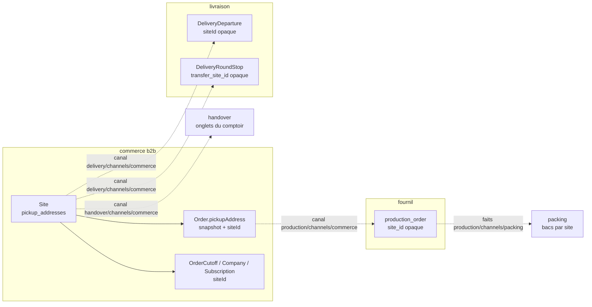
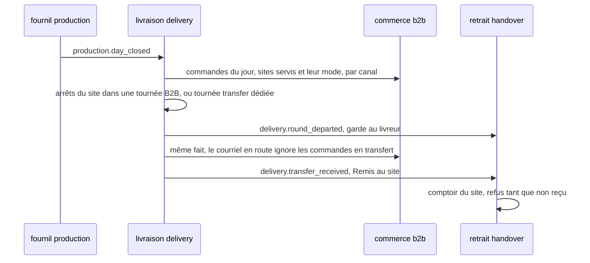

# Plan — les sites, le transfert interne, le tri par heure de départ et les couleurs

> **État : 📐 doc-first, 2026-10-13.** Rien n'est bâti. Ce document est la
> fusion, voulue par Hugo (« quitte à renommer le doc »), de l'écart logistique
> écrit le même jour dans le dossier des commandes
> (déplacé ici par `git mv`) et du plan des **sites** et du **transfert interne** que la
> [carte des chantiers](../../carte-des-chantiers.md) attendait sous
> `livraisons/transferts/`. Les deux ne se lisent pas séparément : le tri du
> village dépend du transfert, et les couleurs deviennent des données de site.
>
> Chaque affirmation sur l'existant a été vérifiée en ouvrant le fichier cité,
> le 2026-10-13. Ce qui ne l'a pas été est marqué « non vérifié ».
>
> 🔴 **`vitruve` d'office avant Hugo** (CLAUDE.md §9 bis) : le plan porte une
> **migration** (le point de retrait devient le site, des références changent
> de nom) et touche une **frontière** entre cinq blocs. Il ne touche pas
> l'argent, sauf indirectement (la remise de retrait reste sur le site, §3.2).

**Décisions de Hugo du 2026-10-13, reprises telles quelles :**

- on introduit la notion de **site** ; son but est aussi de **rassembler tous
  les points de définition qui concernent un lieu** ;
- un site porte **une couleur pour le retrait B2B et une pour le retrait B2C**,
  saisissables au back-office ;
- Val Village est servi par un **transfert interne** (du stock part du fournil
  vers le site, traité comme une livraison) : c'est ce départ qui range ses
  commandes avec les tournées B2B dans le tri par heure de départ ;
- les couleurs de la demande (bleu, jaune, orange, gris ; ni vert ni
  rouge/rose) deviennent des données de site, et la livraison a sa couleur
  propre (§5.3 dit où elle vit).

## 0. La demande

Une responsable logistique, après une visite du back-office, mot pour mot :

> « Ecrire » : prévoir un formulaire pour obtenir les coordonnées du client et infos nécessaires
>
> - Trier les commandes par heures de départ (attention au traitement du click & Collect val village qui doit être traité comme une livraison B to B)
> - Identification visuelle des commandes avec un code couleur (pas de vert et rose/rouge, gardés pour les surligneurs OK/KO), préconise : bleu, jaune, orange, gris, modifiable.
>   - Livraison B to B : Bleu
>   - Click & Collect B to B : Jaune
>   - Click & Collect B to C Adroit : orange
>   - Click & Collect B to C Val Village : Gris

## 1. Ce qui existe pour la demande logistique (vérifié le 2026-10-13)

### 1.1 « Écrire » — deux candidats, aucun ne colle tel quel

1. **Le bouton « Écrire » de la carte de contact de la boutique.** Le seul
   libellé « Écrire » du back-office est l'aperçu de cette carte
   (`apps/lfd-backoffice-frontend/src/app/b2b/contact/shop-contact-fallback.ts`).
   Côté boutique, il ouvre le dialogue « Nous écrire »
   (`apps/lfc-ecommerce-frontend/src/app/legacy/contact/contact-panel/contact-panel.html`).
   Ce formulaire **existe** et recueille déjà nom, e-mail, téléphone
   (facultatif), motif et texte : `CustomerRequest` dans
   `apps/lfd-api/prisma/schema/public/contact.prisma`, doc
   [`../../contenu-ecommerce/demandes-clients.md`](../../contenu-ecommerce/demandes-clients.md)
   (bâti le 2026-10-09). Les motifs se règlent au back-office.
2. **La saisie d'une commande par l'équipe** (comptoir ou téléphone).
   `/comptoir/nouvelle-commande` (`comptoir/nouvelle-commande-pro/nouvelle-commande-pro-page.ts`)
   **ne saisit rien** : elle cherche un compte pro **actif** existant puis
   passe la main à `commandes/nouvelle-commande/` (doc
   [`architecture-commande-saisie-par-l-equipe.md`](../../commandes/architecture-commande-saisie-par-l-equipe.md)).
   Il n'y a **aucun formulaire** pour saisir les coordonnées d'un client qui
   n'a pas de compte (particulier, ou pro pas encore ouvert).

Lecture la plus probable : la responsable logistique parle du **second** — elle
veut pouvoir « écrire » une commande pour un client et en recueillir les
coordonnées (téléphone, adresse, contact sur place) nécessaires au retrait ou à
la livraison. Mais « Nous écrire » est le seul endroit où le mot apparaît à
l'écran : **à confirmer (Q1)**.

### 1.2 Les écrans où la logistique voit « les commandes »

| Écran                                                     | Fichier                                                  | Ce qu'il trie aujourd'hui                                                                                                               |
| --------------------------------------------------------- | -------------------------------------------------------- | --------------------------------------------------------------------------------------------------------------------------------------- |
| `/commandes` (liste)                                      | `commandes/orders-list-page/`, `commandes/orders-table/` | plus récente d'abord ; `AdminOrderRow` porte `fulfillmentMethod`, `clientele`, `fulfillmentDay`, **pas** le point de retrait ni d'heure |
| `/comptoir/retrait`                                       | `handover-shop/handover-queue.ts` (`sortedQueue`)        | par **créneau** (`window.start ?? window.end`), puis heure de commande ; onglets par **point de retrait** (`pickupTabs`)                |
| `/supervision` (colonne 3)                                | `supervision/handover-slots.ts`                          | file de retrait groupée par tranche du créneau convenu                                                                                  |
| `/colisage`, `/tour-manager`, `/coursier`, `/livraison/…` | `app.routes.ts`                                          | tournées et bacs — non relus en détail ici                                                                                              |

Aucun écran ne mélange **livraisons et retraits** dans une même liste triée par
une heure commune. C'est pourtant ce que la demande suppose (« Val Village
traité comme une livraison B2B » n'a de sens que dans une liste qui contient
les deux). **Écran visé : à confirmer (Q2).** Candidats : la liste
`/commandes` filtrée sur un jour, ou la Supervision.

### 1.3 L'heure de « départ »

- **Livraison** : `DeliveryRound.plannedDepartureAt` (prévu par le calcul
  routier, effacé dès qu'un geste à la main change les arrêts) et
  `departedAt` (réel), schéma `delivery`
  (`apps/lfd-api/prisma/schema/delivery.prisma`). La commande y est reliée par
  `DeliveryRoundStop.orderId` (opaque). Le fournil a aussi
  `order_departure.departedAt` (`production.prisma`). **Aucun contrat de liste
  de commandes ne porte ces heures**, et le commerce ne peut les lire que par
  le canal `delivery/channels/commerce/` (matrice CLAUDE.md §3).
- **Retrait** : pas de « départ ». Ce qui en tient lieu est le **créneau
  convenu**, figé sur la commande : `Order.fulfillment.window`
  (`{ start: HH:mm | null, end: HH:mm }`, `OrderFulfillment` dans
  `packages/contracts/src/order.ts`, schéma `fulfillmentWindowSchema` dans
  `packages/contracts/src/address.ts`). Le retrait au comptoir trie déjà
  dessus.
- **Val Village** : c'est un **point de retrait** (`PickupAddress`,
  `public/settings.prisma`), donc une **donnée**, pas une notion du modèle.
  Le nom n'apparaît dans le code que dans un test
  (`handover-shop/handover-queue.spec.ts`, onglet « Val Village »). La
  commande en garde un snapshot (`Order.pickupAddress`, JSON) et les vues
  du retrait exposent `pickupLabel` (`packages/contracts/src/order-handover.ts`).
- **Adroit** : introuvable dans le code ou la doc, hormis un nom de ferme de
  démonstration (`apps/lfd-api/prisma/seed-growth/personas.ts`, « La Ferme de
  l'Adroit ») sans rapport. Probablement un autre point de retrait, saisi en
  production : **à confirmer (Q3)**.

### 1.4 Les quatre catégories se dérivent-elles ?

Oui, presque entièrement, de trois champs figés sur la commande :

| Catégorie demandée         | `fulfillmentMethod` | `clientele` | point de retrait |
| -------------------------- | ------------------- | ----------- | ---------------- |
| Livraison B2B — bleu       | `delivery`          | `pro`       | —                |
| C&C B2B — jaune            | `pickup`            | `pro`       | (tous ?)         |
| C&C B2C Adroit — orange    | `pickup`            | `public`    | « Adroit » ?     |
| C&C B2C Val Village — gris | `pickup`            | `public`    | « Val Village »  |

Trous : livraison **B2C** (`delivery` × `public`) n'a pas de couleur ;
`clientele = NULL` (commandes d'avant la distinction, jamais rattrapées,
`public/orders.prisma`) non plus ; et la clé « point de retrait » n'est qu'un
**libellé** dans les vues (`pickupLabel`) — couleur attachée à un libellé =
cassée au premier renommage.

### 1.5 Le vocabulaire fold disponible (fold-ng 0.28.1, lu dans `node_modules`)

- Badges : variantes `neutral | accent | info | warning | alert | success`.
  `success` (vert) et `alert` (rouge) sont exclus par la demande ; restent
  `info` (bleu/azur), `warning` (ambre = **jaune**), `neutral` (gris),
  `accent`.
- Palette de référence : `amber`, `azure`, `signal` (bleu), `steel`/`slate`
  (gris), `teal`, `purple`, `grape`… **Il n'y a pas d'orange** dans fold :
  `--fold-ref-amber-550/600` est ce qui s'en approche, mais se confond avec le
  jaune `warning`.
- Précédent d'un token local au back-office : `--lfc-stage-*` dans
  `apps/lfd-backoffice-frontend/src/styles.scss` (l. 127–129), bâtis sur des
  `--fold-ref-*`. `lint:fold-tokens` refuse un `var()` inexistant.
- **Modifiable** : aucun réglage de couleur par catégorie n'existe. Le seul
  réglage qui touche le retrait est l'écran des points de retrait
  (`PickupAddress`, sans champ de couleur).

## 2. Inventaire — tout ce qui définit un lieu aujourd'hui (vérifié le 2026-10-13)

Le site doit devenir **la** définition d'un lieu à nous. Voici, fichier ouvert,
tout ce qui en définit un — ou en a l'air — et ce que chacun devient.

| #   | Ce qui existe                                            | Fichier                                                                         | Ce qu'il porte                                                                                                                                | Bloc                            | Devient                                                                                                                                     |
| --- | -------------------------------------------------------- | ------------------------------------------------------------------------------- | --------------------------------------------------------------------------------------------------------------------------------------------- | ------------------------------- | ------------------------------------------------------------------------------------------------------------------------------------------- |
| 1   | `PickupAddress` (`pickup_addresses`)                     | `prisma/schema/public/settings.prisma`                                          | libellé, adresse postale, `isDefault`, remise de retrait (`discountMode/Value`, `discountForB2b/B2c`), `opening` (public + pros, JSON), `gps` | `b2b` (`b2b/pickup-addresses/`) | **le site lui-même** : la ligne est conservée, elle gagne des rôles et des couleurs (§3.3). Le JSDoc l'appelle déjà « laboratoire »         |
| 2   | `PublicPickupSlotRule`, `PublicPickupClosure`            | même fichier (relations de `PickupAddress`)                                     | créneaux publics du point, fermetures datées                                                                                                  | `b2b`                           | **attribut du site** (rôle « remet », côté B2C) — inchangé, la relation suit la ligne                                                       |
| 3   | `OrderCutoff.pickupAddressId`                            | `public/orders.prisma` (l. ~718)                                                | heure limite par point (`null` = défaut plateforme), par jour                                                                                 | `b2b`                           | **attribut du site** par référence — même colonne, même valeur ; seul le nom de champ Prisma change (`siteId`, `@map` inchangé)             |
| 4   | `Company.preferredPickupAddressId`                       | `public/account.prisma` (l. 196)                                                | le retrait préféré d'un pro                                                                                                                   | `b2b`                           | **référence au site** — idem, renommage Prisma seul                                                                                         |
| 5   | `Subscription.pickupAddressId`                           | `public/subscriptions.prisma` (l. 24)                                           | le point de retrait d'un abonnement                                                                                                           | `b2b`                           | **référence au site** — idem                                                                                                                |
| 6   | `Order.pickupAddress` (JSON)                             | `public/orders.prisma` (l. 153)                                                 | **snapshot** des champs postaux du point ; **aucun id**                                                                                       | `b2b`                           | **snapshot qui gagne `siteId`** (additif) : sans id, une couleur ou un transfert s'accrocherait à un libellé (§1.4)                         |
| 7   | `DeliveryDeparture.pickupAddressId`                      | `prisma/schema/delivery.prisma` (l. ~106)                                       | d'où partent les tournées ; ligne absente = point par défaut ; id **opaque**, lu par `delivery/channels/commerce/`                            | `delivery`                      | **référence opaque au site**, rôle « fournil / départ » — c'est déjà la forme visée ; seul le vocabulaire change                            |
| 8   | `production_order.pickup_label` (+ `address_*`)          | `prisma/schema/production.prisma` (l. 118–122)                                  | snapshot imprimé sur le bon                                                                                                                   | `production`                    | **snapshot qui gagne `site_id` opaque** (additif) : le colisage en a besoin pour grouper par site (§4.5)                                    |
| 9   | Onglets du comptoir (`pickupTabs(entries, places)`)      | `apps/lfd-backoffice-frontend/src/app/handover-shop/handover-queue.ts` (l. 132) | « tous les points connus », **par libellé**                                                                                                   | front (`handover`)              | **lecture du site par id** ; le libellé n'est plus une clé                                                                                  |
| 10  | `PointOfSale` (`point_of_sale`, `kind: shop / platform`) | `prisma/schema/pim/sales-contexts.prisma` (l. 147)                              | « d'où l'on vend » **pour le catalogue** : contextes de vente, tables à QR, `baseUrl` du C&C ; `platform` n'a aucun lieu                      | `pim`                           | **reste à part** : c'est un canal de vente, pas un lieu — la plateforme pro en est un sans adresse. Lien éventuel au site : Q-S3            |
| 11  | `CategoryChannel.pointOfSaleId` (ex-`location_id`)       | `pim/categories.prisma` (l. 55)                                                 | ce que l'on vend où                                                                                                                           | `pim`                           | **reste à part** (même raison que 10)                                                                                                       |
| 12  | `LegalEntity` (adresse)                                  | `public/accounting.prisma` (l. 75)                                              | siège tel qu'il s'imprime sur les mentions légales                                                                                            | `b2b` (comptabilité)            | **reste à part** : une adresse **juridique**, figée sur les documents émis ; qu'elle coïncide avec le fournil est un fait, pas une identité |
| 13  | `DeliveryZone`                                           | `public/settings.prisma` (l. 67)                                                | préfixes postaux **chez le client** + frais                                                                                                   | `b2b`                           | **reste à part** : un secteur de clients, pas un lieu à nous (rattachement au site de départ : plus tard, si un 2ᵉ fournil, Q-S4)           |
| 14  | `DeliveryAvailability` (une ligne `delivery`)            | `public/settings.prisma` (l. 96)                                                | ouverture B2B/B2C de la livraison, `windowMode`, marges de production                                                                         | `b2b`                           | **reste à part** et **reçoit les couleurs de livraison** (§5.3)                                                                             |
| 15  | `Address` (carnet), `MarketZone` (prospection)           | `public/account.prisma` (l. 517), `growth.prisma` (l. 209)                      | adresses des clients ; codes postaux ciblés                                                                                                   | `b2b`                           | **à part** : ce ne sont pas nos lieux                                                                                                       |

Ce qu'en dit l'inventaire :

- **Un lieu à nous n'est défini qu'une fois, et c'est déjà `PickupAddress`.**
  Les autres sont des **références** (3, 4, 5, 7), des **snapshots** (6, 8) ou
  des notions **qui ne sont pas des lieux** (10 à 15). Le travail n'est donc
  pas de fusionner des tables : c'est de **renommer et élargir** la ligne qui
  existe, et de donner un **id** aux deux snapshots qui n'en ont pas.
- Le nom ment déjà deux fois : le départ des tournées (7) s'appuie sur un
  « point de retrait », et le JSDoc de `PickupAddress` l'appelle
  « laboratoire ». Le site corrige le nom ; le modèle était juste.
- `PointOfSale` est le seul rival sérieux, et il est **dans le référentiel** :
  le fusionner ferait lire le PIM par le commerce hors de son canal, pour
  une notion (canal de vente) qui ne coïncide pas (la plateforme pro n'a pas
  de lieu). Il reste à part ; Q-S3 demande s'il faut un lien.

## 3. Le site

### 3.1 Ce que c'est

> Un **site** est un lieu physique **à nous**, avec une adresse, où au moins
> une de ces choses arrive : on y **fabrique et on en part** (le fournil), on
> y **remet** des commandes à des clients (retrait), on y **est servi** par
> un transfert interne.

Les rôles, et ce qu'ils portent :

| Rôle                | Champ                                            | Ce qui en dépend                                                                                           |
| ------------------- | ------------------------------------------------ | ---------------------------------------------------------------------------------------------------------- |
| **remet** (retrait) | `handsOver: boolean`                             | proposé au checkout, onglet au comptoir, créneaux publics, ouverture pros, remise de retrait, heure limite |
| **est servi par**   | `supply: 'on_site' \| 'transfer'`                | `on_site` = la marchandise est fabriquée/colisée **là** ; `transfer` = elle y arrive par transfert (§4)    |
| **expédie**         | `dispatches: boolean`                            | les livraisons et les transferts peuvent en partir ; porte les couleurs de livraison (§5.3)                |
| **départ**          | inchangé : `DeliveryDeparture` (bloc `delivery`) | LE site d'où partent tournées **et transferts**, choisi parmi ceux qui expédient ; ligne absente = défaut  |
| **vend**            | non modélisé ici                                 | c'est `PointOfSale` (§2, ligne 10) ; Q-S3                                                                  |

Invariants (agrégat `Site`, §3.1 de CLAUDE.md : « une règle peut refuser
l'écriture » → agrégat, pas CRUD) :

- un site servi par `transfer` **remet** forcément (sinon on n'y transfère
  rien qui ait un client) ;
- un site qui **expédie** est `on_site` ; la livraison ne propose comme
  départ que les sites qui expédient (`DepartureCandidatesReader`,
  `delivery/channels/commerce/departure-candidates.reader.ts`, étendu), et le
  commerce refuse de retirer `dispatches` au site désigné, qu'il lit par un
  port `DepartureSiteReader` qu'il déclare et que `delivery` implémente ;
- les **couleurs** : l'agrégat **tolère leur absence** (les lignes existantes
  n'en ont pas, et `toDomain` doit les relire) ; il refuse seulement
  d'**effacer** une couleur posée. Aucune couleur n'est inventée : l'écran les
  saisit, et le resserrement (lot S3r) pose le `CHECK` une fois toutes
  saisies ;
- **archiver, pas supprimer** : `archived_at` remplace la suppression
  physique d'aujourd'hui (`prisma-pickup-address.repository.ts`, l. 196,
  `tx.pickupAddress.delete`) ; un site archivé n'est plus proposé mais se
  résout par id (départ, tournée, copies). Refus d'archiver le site par
  défaut ou celui qui expédie ;
- les invariants existants (« au moins un point », « un seul défaut »,
  `PickupDiscount`) restent où ils sont, désormais portés par l'agrégat.

### 3.2 Quel bloc le possède : `b2b`, sous-contexte `b2b/sites/`

| Candidat     | Pour                                                                                                                                    | Contre                                                                                                                         |
| ------------ | --------------------------------------------------------------------------------------------------------------------------------------- | ------------------------------------------------------------------------------------------------------------------------------ |
| **`b2b`** ✅ | la ligne y vit déjà ; checkout, remise, heure limite, créneaux publics, abonnements, sociétés la lisent **en direct** dans le même bloc | `delivery`, `handover`, `production`, `packing` doivent la lire par un canal — **c'est déjà le cas** pour `delivery` (ligne 7) |
| `delivery`   | le transfert et le départ y vivent                                                                                                      | `b2b → delivery` n'est permis que par port : checkout et remise (de l'argent) liraient un port pour un fait de configuration   |
| `handover`   | « remet » est son verbe                                                                                                                 | `handover → b2b` interdit ; il ne connaît que la commande, pas la vente                                                        |
| nouveau bloc | neutre                                                                                                                                  | une ligne de matrice de plus pour une notion que cinq blocs lisent déjà au même endroit ; `lint:context-boundaries` à réarmer  |

Le site reste donc au **commerce**, et les autres blocs le lisent par les
canaux qu'ils **déclarent** et que le commerce **implémente** (forme normale
de la matrice §3) :

| Lecteur      | Canal (déclaré par le lecteur)                            | Ce qu'il lit                                                                     | État                                       |
| ------------ | --------------------------------------------------------- | -------------------------------------------------------------------------------- | ------------------------------------------ |
| `delivery`   | `delivery/channels/commerce/`                             | adresse + GPS du site de départ (existe) ; **sites servis par transfert** (neuf) | à étendre                                  |
| `handover`   | `handover/channels/commerce/`                             | la liste des sites qui remettent (onglets du comptoir), couleurs                 | à étendre (non vérifié : lecteur exact)    |
| `production` | `production/channels/commerce/` (`DayOrdersReader`)       | `siteId` dans le snapshot `ProducibleOrder`                                      | à étendre                                  |
| `packing`    | via les faits du fournil (`production/channels/packing/`) | `siteId` recopié du snapshot                                                     | à étendre ; `packing → b2b` reste interdit |

### 3.3 Le modèle et la migration

Pré-release (CLAUDE.md §0, corrigé le 2026-10-04) : un contrat servi **peut**
casser dans le même déploiement sur décision de Hugo ; **les données, elles,
ne se détruisent pas**. Aucune donnée ne bouge de table ici : la ligne
`pickup_addresses` **est** le site.

- **Table** : on garde `pickup_addresses` (un nom de table est un nom, mais le
  renommer n'achète rien et coûte une migration relue) ; le modèle Prisma
  devient `Site` avec `@@map("pickup_addresses")`. À trancher : Q-S1.
- **Colonnes ajoutées** (une migration **additive**) :
  `hands_over boolean not null default true` (l'existant : tout point remet),
  `supply site_supply not null default 'on_site'`,
  `dispatches boolean not null default false`, `archived_at timestamptz null`,
  `transfer_departure_time text null` (§4.5),
  `pickup_color_b2b`, `pickup_color_b2c`, `delivery_color_b2b`,
  `delivery_color_b2c` (`site_color null`), plus des `CHECK` posés
  **après** la saisie (lot S3r). Le site par défaut actuel reçoit
  `dispatches = true` dans la même migration (c'est déjà lui, ou celui de
  `DeliveryDeparture`, qui expédie — fait, pas valeur inventée).
- **Références** (3, 4, 5) : renommage du **champ Prisma** seulement
  (`siteId`, `@map("pickup_address_id")` conservé) — aucun SQL.
- **Snapshots** (6, 8) : `siteId` ajouté au JSON `Order.pickupAddress` à la
  passation, depuis le `pickupAddressId` que la passation **reçoit déjà**
  (`b2b/orders/application/services/order-drafting.service.ts`, l. 48, 83,
  333 ; `null` = défaut, résolu à l'id du défaut au moment de figer) ;
  `site_id text null` sur `production_order`. Les commandes passées n'en
  ont pas : **pas de rattrapage** par libellé (irréversible, objection S5) —
  l'historique est « autre ».

Les trois temps, appliqués :

1. **Étendre** — colonnes nullables / par défaut, `siteId` écrit dans les
   nouveaux snapshots, contrats qui exposent `siteId` **à côté** de
   `pickupLabel`.
2. **Basculer** — l'écran saisit rôles et couleurs ; les lecteurs (comptoir,
   tri, couleurs) lisent `siteId`.
3. **Resserrer** — `CHECK` des couleurs ; les lectures par libellé
   disparaissent (`pickupTabs(places: string[])` → par id).

### 3.4 L'écran : Réglages › Sites, une seule entrée

Hugo, 2026-10-13 : « tout rassembler ce qui concerne les sites dans
réglages/sites ».

**Ce qui existe (vérifié le 2026-10-13)** — `/reglages` n'a **plus d'écran**
depuis le 2026-10-10 : `reglages/reglages.routes.ts` ne contient que des
redirections (`''` → `/documentation/facturation`, `retraits-livraisons` →
`/b2b/reglages/points-de-retrait`, …). Les écrans qui règlent un lieu sont
éparpillés :

| Écran actuel                               | Route                                                   | Droit (garde)                      | Ce qu'il règle                                                                         | Devient                                                                                                                                   |
| ------------------------------------------ | ------------------------------------------------------- | ---------------------------------- | -------------------------------------------------------------------------------------- | ----------------------------------------------------------------------------------------------------------------------------------------- |
| Points de retrait (liste + page de détail) | `/b2b/reglages/points-de-retrait`, `…/nouveau`, `…/:id` | sous l'espace B2B (`b2b_settings`) | adresse, rang par défaut, heures, réduction, clientèles, créneaux publics, suppression | **migre** : c'est la page du site ; ses cartes restent des cartes                                                                         |
| Heures limites de commande                 | `/b2b/reglages/heures-limites`                          | sous l'espace B2B                  | règles `OrderCutoff`, **par point** ou défaut plateforme                               | **en partie** : la carte « Heures limites » du site montre et règle les règles de CE site ; la page reste pour la règle par défaut        |
| Départ des tournées                        | `/livraison/depart`                                     | `delivery_settings:read`           | quel point est le départ (`DeliveryDeparture`)                                         | **migre** comme un rôle « départ » sur la page du site — l'écriture reste `delivery` (canal), le droit `delivery_settings:write` la garde |
| Zones de livraison                         | `/livraison/zones`                                      | (non relu en détail)               | secteurs clients + frais                                                               | **reste** : ce n'est pas un lieu à nous (§2, ligne 13)                                                                                    |
| Réglages du fournil                        | `/production/reglages`                                  | `production_settings:read`         | arrêt du plan, jours fermés                                                            | **reste** : réglage d'atelier, pas de lieu (un seul fournil, Q-S4)                                                                        |
| Véhicules, bacs, contenances               | `/livraison/vehicules`, `…/bacs`, `…/contenances`       | `delivery_settings:read`           | flotte                                                                                 | **reste** : rattacher un véhicule à un site attendra un second fournil                                                                    |

**La page** — route `/reglages/sites` (liste) et `/reglages/sites/:id`
(détail), `/reglages/sites/nouveau`. Une **page de détail**, pas un
panneau, par la règle « page ou panneau » du `CLAUDE.md` du back-office
(plusieurs sujets dont on va droit à un seul) : `fold-page-layout`,
`fold-back-link`, **une `fold-card` par sujet** :

1. Identité et adresse (libellé, adresse, GPS) ;
2. Rôles — « Remet des commandes », « Approvisionné par » (sur place /
   transfert), « Départ des tournées » (lecture + bascule sous
   `delivery_settings:write`) ;
3. Couleurs — retrait B2B, retrait B2C (pastilles, §3.5) ;
4. Ouverture (public / pros) ; 5. Créneaux publics et fermetures ;
5. Réduction de retrait et ses clientèles ; 7. Heures limites de ce site ;
6. Suppression (`fold-danger-zone`, `appearance="section"`).

Une carte d'un rôle absent est masquée (un site qui ne remet pas n'a ni
créneaux ni réduction).

**Le parent `reglages`** redevient un espace avec un écran : `''` mène à
`/reglages/sites` au lieu de `/documentation/facturation` (à faire confirmer
— cette redirection vit dans des favoris). Les redirections existantes
restent ses enfants.

**Anciennes routes** (elles vivent dans des favoris — on redirige, on ne
rend pas 404) : `/b2b/reglages/points-de-retrait` → `/reglages/sites`,
`…/points-de-retrait/:id` → `/reglages/sites/:id` (même id : la ligne ne
change pas, §3.3), `…/nouveau` → `/reglages/sites/nouveau`,
`/reglages/retraits-livraisons` → `/reglages/sites`, `/livraison/depart` →
`/reglages/sites` (le site de départ n'est plus une page à lui). Les liens
internes à suivre : `shared/journal/subject-routes.ts`,
`auth/permission.guard.ts` et `livraison/departure-page/` citent
`points-de-retrait` (trouvés par grep, non relus).

**Deux arbres de navigation** : l'entrée « Sites » s'ajoute au **rail**
(`shared/workspace-rail/workspaces.ts`, où « Points de retrait » est
aujourd'hui l'entrée `key: 'points-de-retrait'` de la section « Réglages »
de l'e-commerce, et « Départ » l'entrée `key: 'depart'` de la livraison) **et**
aux **tuiles** `fold-nav-launcher` du menu mobile — les deux modèles sont
séparés (dette notée au `CLAUDE.md` du back-office). Les deux anciennes
entrées disparaissent des deux arbres dans le même lot.

**Droit** (Hugo, Q-S5, 2026-10-13) : la page sous la ressource neuve
**`lfc_sites`**. Lot S0 : une migration ajoute la valeur à `StaffResource`
et **ne l'accorde à aucun rôle** (`lint:no-role-grants-in-migrations`).
**Geste de bascule** : après le déploiement de S0, l'admin accorde
`lfc_sites` (lecture, écriture) aux rôles voulus à `/admin/staff-roles` ;
**ensuite seulement** S1 met l'écran et l'API d'écriture des sites derrière
`lfc_sites` — sinon l'écran serait mort entre les deux (objection S3). La
carte « Départ » appelle l'API de la livraison, sous `delivery_settings`
(non relu : la séparation `:read`/`:write` de ce droit à l'écriture).

**Qui lit les sites hors de l'écran (objection S2)** : aujourd'hui le
comptoir (`handover-shop/handover-queue.store.ts`), la saisie
(`commandes/nouvelle-commande/nouvelle-commande-page.ts`) et les heures
limites lisent les points par `PickupAddressesService`
(`b2b/reglages/pickup-addresses.service.ts`) qui frappe
`admin/pickup-addresses` (`@AdminSurface("b2b_settings")`). Déplacer la
**route front** ne déplace pas l'API ; mais passer l'API sous `lfc_sites`
couperait le comptoir. S1 donne donc à chacun sa lecture : le comptoir par
le retrait (`handover/channels/commerce/`, sous `handover_counter`), la
saisie par une query des commandes (sous `b2b_place_order`) ; seul l'écran
des sites lit et écrit sous `lfc_sites`.

### 3.5 Les couleurs : une palette fermée

« Interdire plutôt que vérifier » (mémoire du dépôt) : une couleur libre
refusée si elle est « trop proche du vert » est une règle floue et une porte
à écrire. Une **palette fermée sans vert ni rouge** rend la faute
**inexprimable**.

- Enum Postgres `site_color` : `blue`, `yellow`, `orange`, `grey`, `purple`,
  `teal`, `brown` (proposition — Q-S6). **Ni `green`, ni `red`, ni `pink`**
  (surligneurs OK/KO, demande d'origine).
- Chaque valeur a un token local `--lfc-site-<couleur>` dans
  `apps/lfd-backoffice-frontend/src/styles.scss`, bâti sur des `--fold-ref-*`
  comme les `--lfc-stage-*` (l. 127–129). **Fold n'a pas d'orange** (§1.5) :
  `--lfc-site-orange` est le seul token qui n'a pas de référence fold directe
  — couleur choisie à l'œil, contraste vérifié en clair et sombre.
  `lint:fold-tokens` tient les autres. `teal` est un bleu-vert : à retirer si
  la logistique le confond avec le vert du surligneur.
- Valeurs **saisies à l'écran** après S1 (aucune posée par une migration) : le site du fournil (« Adroit » ?) jaune / orange, Val
  Village jaune / gris — d'après la demande, à faire confirmer (Q3).

## 4. Le transfert interne

### 4.1 Ce que c'est

Un **transfert interne** est le départ, un jour de service, des commandes
**déjà colisées** d'un site servi par `transfer`, depuis le site de départ,
où elles attendent ensuite leur retrait. Pour la logistique, c'est une
livraison : il part à une heure, dans un véhicule, et il arrive.

Bloc **`delivery`** : le transfert part d'un véhicule, à une heure, ce que
la livraison tient déjà (`DeliveryRound.plannedDepartureAt`, `departedAt`,
`delivery.prisma` l. 130). `production → delivery` reste interdit : la
livraison compose sur `production.day_closed`, qu'elle écoute déjà.

### 4.2 Deux modes, au choix en admin — **intégré** par défaut (Hugo, Q-T1, 2026-10-13)

| Mode                       | Ce que c'est                                                                           | Statut     |
| -------------------------- | -------------------------------------------------------------------------------------- | ---------- |
| **intégré** (`integrated`) | les commandes du site voyagent **dans une tournée B2B** : la tournée passe par le site | **défaut** |
| **dédié** (`dedicated`)    | une tournée **à lui** (un véhicule, un passage) ne sert que le site                    | option     |

**Où se choisit le mode** : sur le **site servi**, carte « Rôles » de
Réglages › Sites, sous `lfc_sites` — colonne `transfer_mode site_transfer_mode
not null default 'integrated'` (additive), lue seulement si `supply =
'transfer'`. C'est un fait du lieu (« le village est sur la route de la
tournée du matin » / « il a son propre véhicule »), pas un réglage de
tournée : il vit avec le reste du lieu. La livraison le lit à la composition
par le canal qui lui sert déjà les sites (`delivery/channels/commerce/`). Un
changement de mode vaut pour les journées **pas encore composées** ; une
journée composée garde sa forme (Q-T7 : faut-il pouvoir recomposer ?).

### 4.3 La forme commune : un arrêt reste une commande

Dans les **deux** modes, chaque commande du site est un `DeliveryRoundStop`
ordinaire, **`order_id` non nul, inchangé**, à l'adresse du site, et
l'arrêt porte en plus `transfer_site_id text null` (additif). Les arrêts d'un
même site sont **consécutifs** dans la tournée et comptent pour **un seul
point de passage** au calcul routier. On n'introduit **pas** d'arrêt
portant N commandes : c'est ce que l'objection B2 refusait, et c'est évitable.

Ce que ça garde intact : la feuille de départ (`departAndFreeze`,
`delivery/application/delivery-departure-support.ts`, l. 64–89 :
`departureSheetsOf(round.orderIds)`, `heldOrders(round.orderIds)`), le fait
durable `DeliveryRoundDepartedFact(roundId, serviceDay, departedAt,
orderIds)` (`delivery/channels/handover/delivery-round-departed.fact.ts`,
l. 29–38), qui **déroule déjà les commandes du transfert**, et son abonné
`RecordRoundDeparted` (`handover/application/handlers/record-round-departed.handler.ts`),
qui pose la garde au livreur sans une ligne de plus. Les bacs restent par
commande (`BinDesk`, chargement).

**Ce que ça ne garde pas** : un arrêt de transfert n'est **pas** une porte
de client. Tous les lecteurs de `delivery_round_stop` doivent le savoir.

#### 4.3.1 Inventaire des lecteurs de `delivery_round_stop` (grep du 2026-10-13)

Quinze fichiers de production nomment la table (hors `dev/`, tests et
client Prisma généré). Classés par nom et rôle ; **le code de chacun n'a pas
été relu ligne à ligne** — c'est le premier travail du lot T1.

| Fichier (`src/delivery/…`)                                                                                                     | Rôle                           | Ce que l'arrêt de transfert lui demande                                                                                                                                         |
| ------------------------------------------------------------------------------------------------------------------------------ | ------------------------------ | ------------------------------------------------------------------------------------------------------------------------------------------------------------------------------- |
| `infrastructure/delivery-round.writes.ts`, `prisma-delivery-round.repository.ts`                                               | écrire / relire la tournée     | porter `transfer_site_id`, garder les arrêts d'un site consécutifs                                                                                                              |
| `infrastructure/prisma-delivery-rounds.reader.ts`                                                                              | la tournée vue du tour manager | montrer « → Val Village (N commandes) » comme **un** passage                                                                                                                    |
| `infrastructure/prisma-delivery-loading.reader.ts`, `prisma-stop-loading.repository.ts`, `prisma-round-placements.reader.ts`   | bacs et chargement             | inchangé en principe (bac par commande) — **à vérifier**                                                                                                                        |
| `infrastructure/prisma-doorstep-stop.repository.ts`                                                                            | gestes à la porte              | **refuser** « Remis au client » / « Déposé avec preuve » : `TransferStopHasNoDoorstepError`                                                                                     |
| `infrastructure/prisma-undelivered-stops.reader.ts`, `prisma-brought-back-orders.reader.ts`, `prisma-stop-decisions.reader.ts` | ratées, ramenées, décisions    | un transfert non reçu au retour : ramené ? (Q-T8) ; jamais une « livraison ratée » au client                                                                                    |
| `infrastructure/prisma-gesture-positions.reader.ts`, `prisma-gesture-position.pruner.ts`                                       | positions des gestes           | « Remis au site » pose sa position comme un geste                                                                                                                               |
| `infrastructure/prisma-delivery-day-readiness.reader.ts`                                                                       | la journée est-elle prête      | compter les arrêts de transfert comme à charger                                                                                                                                 |
| `channels/commerce/order-delivery-history.reader.ts` + `infrastructure/prisma-order-delivery-history.reader.ts`                | dossier de facturation         | dire « transféré vers {site} », **jamais** « livré » : une commande de retrait n'a pas de frais de livraison — touche au dossier de facturation, donc à l'argent par la lecture |

Hors de `delivery`, un abonné du fait de départ **casse** sans adaptation :
`b2b/orders/application/handlers/mail-delivery-en-route.handler.ts`
(« Votre livraison est en route », un courriel par commande du fait). Un
client du village recevrait un courriel de livraison pour un retrait. Le
fait doit distinguer les commandes en transfert
(`transferOrderIds`, champ additif du payload, ou un second fait) et
l'abonné les ignorer. Les autres abonnés de `delivery.round_departed` sont à
relire au lot (grep : `handover`, `b2b/orders`).

#### 4.3.2 Ce que chaque mode ajoute

- **Intégré (défaut)** — la composition automatique
  ([`composition-automatique.md`](../tournees/composition-automatique.md))
  insère le groupe du site dans une tournée B2B du jour (laquelle : celle qui
  minimise le détour — c'est un arrêt de plus pour le calculateur), avec les
  mêmes règles que l'insertion avant le départ
  ([`inserer-avant-le-depart.md`](../tournees/inserer-avant-le-depart.md)) ;
  le lecteur des commandes (`delivery/channels/commerce/delivery-orders.reader.ts`,
  implémenté par `b2b/orders/infrastructure/prisma-delivery-orders.reader.ts`)
  sert aussi les commandes de retrait des sites `transfer`. **Aucune
  tournée sans livraison** dans ce mode : s'il n'y a aucune tournée B2B ce
  jour-là, la composition en **crée une** pour le site (mode dédié de fait)
  plutôt que de laisser les commandes au fournil — à confirmer (Q-T9).
- **Dédié (option)** — `delivery_round.kind` (`delivery` | `transfer`,
  défaut `delivery`) + `delivery_round.transfer_site_id`, `CHECK` qui lie
  les deux ; la composition crée la tournée, la flotte la sert ; le calcul
  routier n'a qu'un point de passage (ou une durée fixe, Q-T5).

### 4.4 La réception au site, et le refus au comptoir (Hugo, Q-T2, 2026-10-13)

1. **Au départ** : la garde passe au livreur — inchangé.
2. **À l'arrivée** : « **Remis au site** », un geste par **(tournée, site)**,
   sur les arrêts de ce site. Il écrit, dans la même transaction, le fait
   **durable** `delivery.transfer_received`
   (`DeliveryTransferReceivedFact(roundId, siteId, receivedAt, orderIds)`,
   `delivery/channels/handover/`, même forme que le départ). Colonne
   additive `received_at` sur `delivery_round_stop`. Refus : site non
   partie de la tournée, tournée pas partie, deux réceptions.
3. **Le retrait l'enregistre** : abonné durable `RecordTransferReceived`
   (`handover/application/handlers/`), qui pose `received_at` sur la ligne
   de départ de chaque commande (`OrderDepartureRepository`, la même que
   `RecordRoundDeparted`, colonne additive).
4. **Le comptoir refuse** : remettre au comptoir une commande dont le site
   est `transfer` et sans `received_at` lève `TransferNotReceivedError`
   (`BusinessError`, 409) : « Cette commande n'est pas encore arrivée au
   site : son transfert n'a pas été reçu. Appuyez sur « Remis au site »,
   puis remettez-la. » Le retrait connaît le genre du site par ce qu'il lit
   déjà au commerce (`handover/channels/commerce/handover-subject.reader.ts`,
   `siteSupply` ajouté — non relu en détail).

Un fait plutôt qu'un lecteur synchrone `handover → delivery` : c'est la
forme déjà choisie pour le départ (`plan-depart-durable.md`, DD1).

### 4.5 L'échéance du fournil pour une commande du village (objection B3)

Aujourd'hui le commerce répond au fournil « avant quelle heure sortir quoi »
par `DueThresholds` (`b2b/orders/application/services/due-thresholds.service.ts`,
qui implémente `DueThresholdsReader` de `production/channels/commerce/`) :
retrait = créneau − marge de retrait (`pickupMarginMinutes`), livraison =
heure − marge de livraison. Une commande du village serait comptée **en
retrait**, donc sortie trop tard pour le départ du transfert.

Correction : l'échéance d'une commande d'un site `transfer` est **l'heure de
départ de la tournée qui l'emporte − marge de livraison**, dans les deux
modes. L'heure de départ du transfert
n'existe pas avant la composition (qui suit la clôture), et le fournil en a
besoin avant : le site porte donc une **heure de départ prévue du transfert**
(`transfer_departure_time HH:mm`, attribut du rôle « est servi », saisie à la
carte Rôles). `deadlineThresholds` (fonction pure du commerce) la lit par la
commande (`siteId`) — tout reste dans `b2b`, aucun canal neuf. En mode
**dédié**, la tournée composée prend cette heure comme `plannedDepartureAt`
par défaut. En mode **intégré**, l'heure saisie est celle de la tournée B2B
qui passe par le site (en pratique la première du matin) : la composition
**refuse** d'insérer le groupe dans une tournée qui part plus tard que
`transfer_departure_time` (sans quoi le fournil aurait sorti trop tôt pour
rien, ou le site serait servi en retard) — si aucune ne convient, Q-T9.
Lot **T0**.

### 4.5 bis Le temps de mise en place au comptoir (Hugo, 2026-10-13)

> « Si on me livre à 7h30 parce que mon premier click and collect est à 7h30,
> en réalité il faut que je sois livré avant. » — Hugo, 2026-10-13.

Le créneau d'un retrait est l'heure où le **client** se présente, pas l'heure
où la marchandise arrive. Entre les deux, le comptoir déballe, range et
prépare. Le site porte donc un **temps de mise en place**
(`counter_setup_minutes`, entier ≥ 0, carte « Rôles » de Réglages › Sites,
sous `lfc_sites`) : l'écart entre l'arrivée de la marchandise — ou, pour un
site servi sur place, l'état « prêt » de la commande — et le moment où elle
doit être prête au comptoir.

| Site                             | La marchandise doit être… | Calcul                                                                                  |
| -------------------------------- | ------------------------- | --------------------------------------------------------------------------------------- |
| servi par transfert (le village) | **arrivée** au site       | arrivée requise = premier créneau du jour − `counter_setup_minutes`                     |
|                                  | partie du fournil         | départ requis = arrivée requise − durée du trajet (Q-T5 : calcul routier ou durée fixe) |
| servi sur place (le fournil)     | **prête** (`ready`)       | prête au plus tard = créneau de la commande − `counter_setup_minutes`                   |

Conséquences sur ce qui précède :

- **`transfer_departure_time` (§4.5) n'est plus saisi seul** : il se
  **déduit** du premier créneau, du temps de mise en place et du trajet. Il
  reste affiché à la carte Rôles (« départ requis : 6 h 40 »), et la
  composition refuse toujours une tournée B2B qui part après lui (mode
  intégré). ⚠️ « Premier créneau du jour » : celui des créneaux **ouverts** ce
  jour-là au site (`PickupSlots`), pas celui de la première commande — sinon
  l'heure bougerait au gré des commandes, après la clôture du fournil.
- **L'échéance du fournil** (§4.5) pour un site sur place devient créneau −
  `counter_setup_minutes` au lieu de créneau − `pickupMarginMinutes` global :
  la marge de retrait actuelle (réglage commun) devient **la valeur par
  défaut** du temps de mise en place d'un site, pas une seconde marge qui
  s'additionnerait. À vérifier en ouvrant `due-thresholds.service.ts` au
  moment du lot : ce que couvre exactement `pickupMarginMinutes` aujourd'hui.
- **Le tri par heure de départ** (§5.2) lit le départ requis pour une commande
  du village tant que la tournée n'est pas composée.

Lot : **T0** (il porte déjà l'échéance du village) s'élargit à
`counter_setup_minutes`, au calcul du départ requis et à l'échéance des sites
sur place. Question ajoutée : **Q-T11** — la durée du trajet fournil → site
est-elle une valeur saisie au site (simple, immédiate) ou tirée du
calculateur routier (Q-T5) ?

### 4.6 Le colisage

Chaque commande garde son sac / bac ([`colisage.md`](../../colisage/colisage.md)
§2) ; les bacs du village se chargent dans la tournée `transfer` (même
`BinDesk`). Le colisage range les commandes du village sous l'heure de départ
du transfert — c'est la réponse, pour le village, à la question 1 de
[`todo-colisage-tri-par-echeance.md`](../../colisage/todo-colisage-tri-par-echeance.md)
(lot L2). Un bac de transfert commun n'est pas proposé (Q-T4).

## 5. Le tri par heure de départ et le code couleur

### 5.1 L'écran

À confirmer (Q2). Par défaut : `/commandes` filtrée sur un jour de service.

### 5.2 D'où vient chaque heure

| Commande                                 | Heure de départ                                                                                                                       | Source                                                                |
| ---------------------------------------- | ------------------------------------------------------------------------------------------------------------------------------------- | --------------------------------------------------------------------- |
| livraison (B2B ou B2C)                   | `plannedDepartureAt ?? departedAt` de sa tournée                                                                                      | `delivery`, nouveau lecteur par lot sur `delivery/channels/commerce/` |
| retrait sur un site `transfer` (village) | celui de la tournée qui porte son arrêt — B2B (intégré) ou `transfer` (dédié) ; avant composition : `transfer_departure_time` du site | même lecteur ; puis le site (commerce)                                |
| retrait sur un site `on_site`            | `window.start ?? window.end` (créneau figé)                                                                                           | commerce, déjà sur la commande                                        |
| sans heure                               | en fin, « pas encore de départ »                                                                                                      | —                                                                     |

Le lecteur neuf : `OrderDepartureReader.departuresOf(orderIds)` → par
commande `{ plannedAt, departedAt, via: 'delivery' | 'transfer' }` (lu par l'arrêt,
donc juste dans les deux modes), déclaré
et implémenté par `delivery` (forme des `OrderDeliveryHistoryReader` du
2026-10-08). Lecture par lot.

### 5.3 D'où vient chaque couleur — toutes sous `lfc_sites`

| Catégorie                           | Couleur (demande) | Où elle vit                                                           |
| ----------------------------------- | ----------------- | --------------------------------------------------------------------- |
| Livraison B2B                       | bleu              | `Site.deliveryColorB2b` du site **qui expédie** (`dispatches = true`) |
| Livraison B2C                       | (non demandée)    | `Site.deliveryColorB2c`, même site                                    |
| C&C B2B (tous sites)                | jaune             | `Site.pickupColorB2b`                                                 |
| C&C B2C Adroit                      | orange            | `Site.pickupColorB2c` du site Adroit                                  |
| C&C B2C Val Village                 | gris              | `Site.pickupColorB2c` de Val Village                                  |
| `clientele = NULL`, `siteId` absent | neutre            | catégorie « autre » de la fonction pure, jamais une couleur inventée  |

**S3 tranché (proposition)** : les couleurs de livraison **quittent
`DeliveryAvailability`** et vont sur le site qui expédie, sous `lfc_sites`.
Une palette, un écran, un droit. Le site qui expédie est celui d'où partent
les livraisons : rôle `dispatches` (§3.1). Une commande du village garde le
gris même triée avec les tournées : la couleur dit **à qui** on remet,
l'heure dit **quand** ça part.

`logisticsCategoryOf(order, sites)` vit **côté back-office** (pas dans
`@lfd/contracts` : la boutique ne s'en sert pas, et le baril pèse sur son
budget de 1,30 Mo).

## 6. Lots

Un lot à la fois (mémoire du dépôt).

| Lot | Taille | Contenu                                                                                                                                                                                                                                                                                                                                                                                                                      | Migration                                          | Touche                            |
| --- | ------ | ---------------------------------------------------------------------------------------------------------------------------------------------------------------------------------------------------------------------------------------------------------------------------------------------------------------------------------------------------------------------------------------------------------------------------- | -------------------------------------------------- | --------------------------------- |
| S0  | S      | ressource `lfc_sites` ajoutée à `StaffResource`, accordée à **aucun** rôle ; geste de bascule : après déploiement, l'admin l'accorde à l'écran `/admin/staff-roles`, **puis** S1 met l'écran derrière                                                                                                                                                                                                                        | additive (valeur d'enum)                           | sécurité (périmètre)              |
| S1  | M      | `b2b/sites` (agrégat `Site`, rôles, couleurs nullables, archivage), Réglages › Sites (page à cartes, départ rapatrié, redirections, rail + tuiles), lecteurs du comptoir et de la saisie hors de l'écran                                                                                                                                                                                                                     | additive (colonnes, enums)                         | frontière (canaux)                |
| S2  | S      | `siteId` dans le snapshot de commande (depuis `pickupAddressId` reçu à la passation), `production_order.site_id`, onglets du comptoir par id ; **pas** de rattrapage                                                                                                                                                                                                                                                         | additive                                           | —                                 |
| L1  | S      | fonction pure de catégorie (back-office), tokens `--lfc-site-*`, pastille dans l'écran choisi                                                                                                                                                                                                                                                                                                                                | —                                                  | —                                 |
| S3r | S      | resserrement : `CHECK` des couleurs d'un site qui remet / qui expédie, après saisie ; lectures par libellé retirées                                                                                                                                                                                                                                                                                                          | contrainte                                         | —                                 |
| T0  | S      | `transfer_departure_time` du site ; `deadlineThresholds` compte une commande d'un site `transfer` comme une livraison partant à cette heure                                                                                                                                                                                                                                                                                  | additive                                           | production (échéances)            |
| T1  | **L**  | la forme commune et le mode **intégré** (défaut) : \`transfer_site_id\` sur l'arrêt, \`transfer_mode\` sur le site, relecture des **quinze** lecteurs de §4.3.1, refus des gestes à la porte, groupe compté comme un passage, composition qui insère le groupe dans une tournée B2B, fait de départ qui distingue les commandes en transfert + courriel « en route » qui les ignore, historique de facturation « transféré » | additive (\`transfer_site_id\`, \`transfer_mode\`) | frontière, lecture de facturation |
| T2  | M      | « Remis au site » par (tournée, site), fait \`delivery.transfer_received\`, abonné du retrait, \`TransferNotReceivedError\` au comptoir                                                                                                                                                                                                                                                                                      | additive (\`received_at\` ×2)                      | frontière                         |
| T3  | M      | le mode **dédié** (option) : \`delivery_round.kind\` + \`transfer_site_id\`, composition d'une tournée par site, flotte                                                                                                                                                                                                                                                                                                      | additive                                           | —                                 |
| L2  | M      | `OrderDepartureReader` + tri de la liste ; tri du colisage par départ                                                                                                                                                                                                                                                                                                                                                        | —                                                  | frontière (canal)                 |
| L4  | ?      | « Écrire » (Q1), indépendant                                                                                                                                                                                                                                                                                                                                                                                                 | —                                                  | —                                 |
| L5  | S      | couleur sur les supports imprimés (si Q8 = papier)                                                                                                                                                                                                                                                                                                                                                                           | —                                                  | —                                 |

`lecteur-de-migrations` sur S0, S1, T0, T1, T2 (enums et colonnes). Aucune
migration de données : le rattrapage par libellé est abandonné (S5).

## 7. Questions à Hugo

Tranchées le 2026-10-13 : Q4, Q5, Q6 (une donnée), Q7, **Q-T1** (deux
modes au choix sur le site, **intégré** par défaut), **Q-T2** (le comptoir refuse), **Q-S5** (`lfc_sites`), **Q-S2**
(pas de rattrapage : l'historique sans `siteId` est « autre »).

Restent :

- **Q1** — « Écrire » : saisie staff pour un client sans compte, ou « Nous
  écrire » ?
- **Q2** — Quel écran porte le tri et les couleurs ?
- **Q3** — « Adroit » est-il le site du fournil ? Les deux sites B2C sont-ils
  les seuls ?
- **Q8** — Surligneurs sur papier ou à l'écran ?
- **Q-S1** — Garder la table `pickup_addresses` sous le modèle `Site` ?
- **Q-S3** — Relier un `PointOfSale` (référentiel) à un site ?
- **Q-S4** — Un second fournil est-il envisagé ?
- **Q-S6** — La palette : `blue, yellow, orange, grey, purple, teal, brown` ?
  `teal` est-il trop vert ?
- **Q-S7** — Les couleurs de livraison sur le site qui expédie (proposé,
  §5.3) plutôt que sur `DeliveryAvailability` : d'accord ?
- **Q-T3** — Une commande du village ajoutée après le départ du transfert :
  lendemain, ou course à part ?
- **Q-T4** — Un bac par commande, ou un bac de transfert commun ?
- **Q-T5** — La tournée `transfer` passe-t-elle par le calcul routier, ou
  prend-elle une durée fixe saisie sur le site ?
- **Q-T7** — Changer le mode d'un site après composition : recomposer la
  journée, ou seulement les suivantes (proposé) ?
- **Q-T8** — Un transfert non reçu au retour du véhicule : commandes
  ramenées au fournil comme une livraison ratée, ou réception tardive ?
- **Q-T9** — Mode intégré sans tournée B2B qui convienne (aucune ce jour,
  ou toutes trop tardives) : tournée dédiée de repli (proposé), ou alerte ?
- **Q-T10** — Livrer d'abord le mode dédié comme marche intermédiaire ?
- **Q-T6** — Qui appuie « Remis au site » : le livreur dans son app, ou le
  personnel du village au comptoir ?

- **Q-T11** — durée du trajet fournil → site : saisie au site, ou calculateur routier (Q-T5) ? (§4.5 bis)

## 8. Ce dont ce plan n'est pas sûr

- Que le calculateur accepte N arrêts à la même adresse (Q-T5).
- Le comportement exact de chaque port de `delivery/domain/ports/` qui porte
  `orderId` face à une tournée `transfer` : listés, pas relus un par un.
- Que `handover-subject.reader.ts` soit le bon endroit pour `siteSupply`.
- Le droit que porte aujourd'hui le comptoir pour lire la liste des points
  (`handover-queue.store.ts` appelle `PickupAddressesService`, qui frappe
  `admin/pickup-addresses`, sous `b2b_settings`) : non vérifié s'il passe
  aujourd'hui pour un staff sans `b2b_settings`.
- Que la copie `ProducibleOrder` puisse porter `siteId` sans toucher au bon
  figé (E1b).

## 9. Contradiction par `vitruve` (2026-10-13) — et son sort

| #   | Niveau   | Objection (résumé)                                                                                                                  | Sort                                                                                                                                                                                                                                                                                                                                                                                                                       |
| --- | -------- | ----------------------------------------------------------------------------------------------------------------------------------- | -------------------------------------------------------------------------------------------------------------------------------------------------------------------------------------------------------------------------------------------------------------------------------------------------------------------------------------------------------------------------------------------------------------------------- |
| B1  | BLOQUANT | couleurs obligatoires dans l'agrégat dès S1 : `toDomain` refuserait les lignes existantes                                           | **corrigé** (§3.1, §3.3) : l'agrégat **tolère** l'absence jusqu'au resserrement S3r ; il refuse seulement d'**effacer** une couleur posée ; la migration ne pose aucune couleur, l'écran les saisit                                                                                                                                                                                                                        |
| B2  | BLOQUANT | arrêt de transfert avec `order_id` nullable, cœur du bloc livraison, sans inventaire                                                | **corrigé** (§4.3) : dans les **deux** modes (intégré par défaut, dédié en option), un arrêt reste une commande, `order_id` reste obligatoire, l'arrêt est **marqué** `transfer_site_id` ; inventaire des quinze lecteurs au §4.3.1, plus le courriel « en route » ; lot T1 dit L                                                                                                                                          |
| B3  | BLOQUANT | l'échéance du fournil pour le village est calculée en retrait                                                                       | **corrigé** (§4.5, lot T0) : `transfer_departure_time` du site, échéance = départ − marge de livraison                                                                                                                                                                                                                                                                                                                     |
| S1  | SÉRIEUX  | suppression physique d'un site référencé                                                                                            | **corrigé** (§3.1, §3.3) : `archived_at` ; « supprimer » archive ; refus d'archiver le site par défaut ou celui qui expédie                                                                                                                                                                                                                                                                                                |
| S2  | SÉRIEUX  | le comptoir lit les points par `PickupAddressesService` (l'API de l'écran de réglages)                                              | **corrigé** (§3.4) : l'API `admin/pickup-addresses` n'est pas déplacée par le changement de route front ; le comptoir et la saisie lisent les sites par leurs propres lectures, hors de `lfc_sites`                                                                                                                                                                                                                        |
| S3  | SÉRIEUX  | deux droits pour une palette ; ressource neuve = écran mort jusqu'à l'accord                                                        | **corrigé** (§5.3, lot S0) : toutes les couleurs sous `lfc_sites` ; S0 déployé et accordé **avant** que S1 ne garde l'écran                                                                                                                                                                                                                                                                                                |
| S4  | SÉRIEUX  | la page Sites écrit le départ (delivery) sans port ; invariant tenu d'un côté                                                       | **corrigé** (§3.1, §3.4) : la carte « Départ » appelle l'API de la livraison (`delivery_settings:write`), pas le commerce ; la livraison ne propose que les sites `dispatches` (lecteur `DepartureCandidatesReader` existant, étendu), et le commerce refuse de retirer `dispatches` au site désigné par un port `DepartureSiteReader` déclaré par `b2b`, implémenté par `delivery` (`b2b → delivery` : port uniquement ✓) |
| S5  | SÉRIEUX  | rattrapage par libellé irréversible ; `pickupAddressId` déjà reçu à la passation                                                    | **corrigé** (§3.3, lot S2) : le snapshot garde l'id reçu (`order-drafting.service.ts`, `pickupAddressId`, l. 48/83/333) ; pas de rattrapage                                                                                                                                                                                                                                                                                |
| S6  | SÉRIEUX  | `received` lu par personne                                                                                                          | **corrigé** par Q-T2 (§4.4) : fait durable `delivery.transfer_received`, abonné du retrait, `TransferNotReceivedError`                                                                                                                                                                                                                                                                                                     |
| S7  | SÉRIEUX  | Q-T1 dite ouverte alors que le corps bâtit l'option A                                                                               | **corrigé** : Q-T1 tranchée (deux modes, intégré par défaut), le corps refondu (§3.3, §4, §5.2) ; la tournée et l'échéance lues par l'arrêt, justes dans les deux modes                                                                                                                                                                                                                                                    |
| m   | mineurs  | `OrderCutoff` sans relation ; fold-ng 0.28.2 ; `Order.pickupAddress` typé `BillingAddressPayload` ; baril ; `lecteur-de-migrations` | **assumés / corrigés** : fonction pure côté back-office (baril) ; `lecteur-de-migrations` au §6 ; le typage du snapshot sera élargi à S2 (non relu) ; §1.5 garde la version lue ce jour-là                                                                                                                                                                                                                                 |
