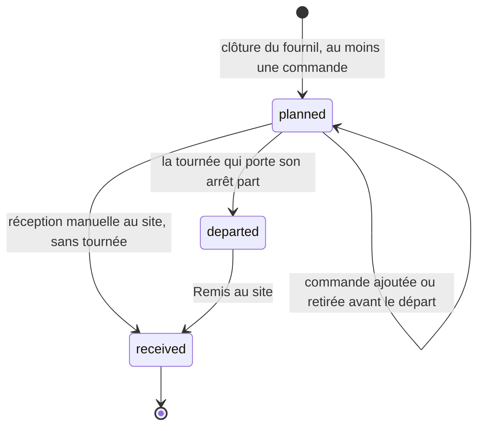
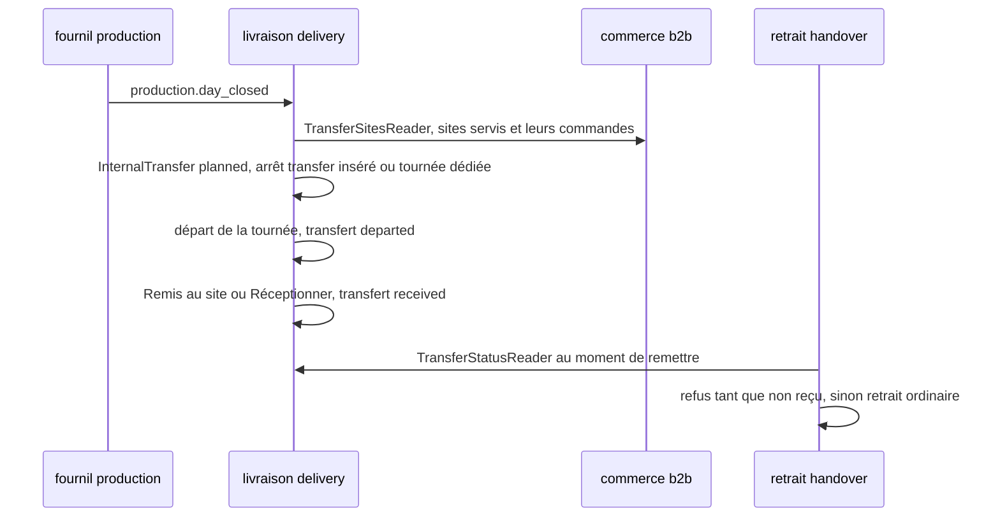

# Plan — le transfert interne vers un site éloigné

> **État : 📐 doc-first, 2026-10-13.** Rien du transfert n'est bâti. Le lot
> **T0** est en cours le 2026-10-13. Les **sites** dont il dépend sont bâtis
> et décrits dans [`../../sites/sites.md`](../../sites/sites.md) (rôle
> « Approvisionné par transfert », `transfer_mode`, `counter_setup_minutes`,
> point GPS) ; le **tri par heure de départ et les couleurs** de la
> logistique, qui lisent ce transfert, ont leur plan :
> [`../../commandes/plan-tri-depart-et-couleurs.md`](../../commandes/plan-tri-depart-et-couleurs.md).
>
> Ce fichier est l'ancien plan commun « sites, transfert interne, tri et
> couleurs » (2026-10-13, déplacé par `git mv` pour garder l'histoire),
> découpé le même jour à la demande de Hugo : il n'en garde que le
> transfert. Les sections ont été renumérotées ; les objections citent les
> nouvelles.
>
> Chaque affirmation sur l'existant a été vérifiée en ouvrant le fichier cité,
> le 2026-10-13. Ce qui ne l'a pas été est marqué « non vérifié ».
>
> 🔴 **`vitruve` d'office avant Hugo** (CLAUDE.md §9 bis) : migration servie
> (`order_id` nullable) et frontière entre quatre blocs (`delivery`, `b2b`,
> `handover`, `production`). Contredit trois fois (§12).

**Décision de Hugo du 2026-10-13, reprise telle quelle :** Val Village est
servi par un **transfert interne** (du stock part du fournil vers le site,
traité comme une livraison) : c'est ce départ qui range ses commandes avec
les tournées B2B dans le tri par heure de départ.

> **Refondu le 2026-10-13 après la seconde contradiction (§12.2)** et la
> décision de Hugo du même jour : **option B — un seul arrêt « transfert »
> qui porte l'`InternalTransfer` et ses N commandes, sans commande propre.**
> Les commandes du village **restent des retraits** et n'entrent **jamais**
> dans le bloc livraison : ni `DeliveryOrderFacts`, ni `departed_at`, ni
> `RecordRoundDeparted`, ni le courriel « en route ».

## 1. Deux précisions de Hugo (2026-10-13)

- **Autant de transferts que nécessaire par jour.** Il n'y a pas de règle
  « un transfert par site et par jour », ni « un seul ouvert » : un site peut
  recevoir plusieurs transferts dans la journée (le matin pour l'ouverture,
  un second l'après-midi, un de rattrapage pour une commande du jour même).
  Partout où ce plan écrit « un par site et par jour » ou « un seul
  `planned` », lire : **chaque transfert porte les commandes dont l'heure
  requise il tient** ; une commande rejoint le transfert `planned` du site
  qui part à temps pour son créneau, et s'il n'y en a aucun, l'app en ouvre
  un. Le regroupement (combien, à quelle heure) se décide au lot T1 — c'est
  une question de composition, pas un invariant d'unicité.
- **« Approvisionné depuis… »** : un site servi par transfert porte le site
  qui l'approvisionne (`supplied_from_site_id`, référence au site, qui doit
  avoir le rôle Livraison). Aujourd'hui il n'y a qu'un site qui livre et la
  valeur se déduit ; le champ est **écrit au plan, pas bâti** — il le sera
  quand un second site livrera (Q-S4). Le trajet du transfert part de ce
  site.

## 2. Ce que c'est

Un **transfert interne** est, pour un site servi par `transfer` et un jour de
service, **le lot de ses commandes qui part du site de départ**. Il naît à la
clôture du fournil, part dans une tournée, et est **reçu** au site. Il
appartient à `delivery` (un véhicule, une heure ; `production → delivery`
reste interdit, la livraison compose déjà sur `production.day_closed`).

## 3. L'agrégat `InternalTransfer`

Table `delivery_internal_transfer` (schéma `delivery`), clé naturelle
`(service_day, site_id)` ; ses commandes dans
`delivery_internal_transfer_order(transfer_id, order_id)` — `order_id`
**opaque**, jamais lu comme une livraison.



Invariants portés par l'agrégat :

- **une réception, une seule** : l'agrégat refuse un transfert déjà
  `received`, et l'adaptateur l'écrit en **un seul**
  `UPDATE … SET received_at, received_by, received_reason WHERE id = $1 AND
received_at IS NULL`, qui porte l'auteur et le motif ; **0 ligne →
  `TransferAlreadyReceivedError`**. Deux comptoirs ensemble : un seul gagne
  (même forme que `markHandedOver`, CLAUDE.md §3.1). Le journal reçoit
  `internal_transfer.received` (manuel : avec son motif) ;
- `depart` depuis `planned`, posé par le départ de la tournée ; **un
  transfert déjà `received` (réception manuelle) est ignoré par le départ** :
  l'arrêt reste dans la tournée, sans effet, et le départ ne lève jamais à
  cause de lui (objection B2 du §12.3). La vue du livreur le montre « déjà
  reçu au site » ;
- **réception manuelle** depuis `planned` (sortie de S3, §6) : nommée,
  datée, auteur figé, motif obligatoire (« venu par le personnel », « pas de
  tournée ce jour ») ;
- une commande **retirée** du transfert après réception n'existe pas : une
  commande reçue au site relève du retrait (annulation, non retirée) — le
  transfert ne « ramène » rien.

## 4. L'arrêt de transfert : un **genre d'arrêt** dans `delivery_round_stop`

Deux formes, choisies en ouvrant `delivery.prisma` (l. 185–215), la
migration `20260929140200_les_tournees` (l. 78–84) et
`DeliveryRoundBase` (`delivery/domain/entities/delivery-round-base.ts`) :

| Forme                                          | Pour                                                                                                                                                    | Contre                                                                                                                                                    |
| ---------------------------------------------- | ------------------------------------------------------------------------------------------------------------------------------------------------------- | --------------------------------------------------------------------------------------------------------------------------------------------------------- |
| **A. genre d'arrêt dans la même table** ✅     | la `position` reste une seule séquence par tournée (déplacer, réordonner, retirer : la même ligne, C11) ; `removed_at`/`closed_at` valent pour les deux | `order_id` devient nullable                                                                                                                               |
| B. table `delivery_round_transfer_stop` à part | `order_id` intact                                                                                                                                       | deux tables partagent l'ordre de passage : l'invariant « positions uniques et contiguës » traverse deux tables, et chaque réordonnancement écrit les deux |

**Retenue : A.** Colonnes `kind delivery_stop_kind not null default 'order'`
(`order` | `transfer`), `transfer_id text null`, et

```sql
CHECK ((kind = 'order'    AND order_id IS NOT NULL AND transfer_id IS NULL)
    OR (kind = 'transfer' AND order_id IS NULL     AND transfer_id IS NOT NULL))
```

L'index partiel `delivery_round_stop_live_order_key` (unique sur `order_id`,
`removed_at IS NULL AND closed_at IS NULL`) ignore les `NULL` : il reste
juste pour les arrêts de commande. Son jumeau
`delivery_round_stop_live_transfer_key` (unique sur `transfer_id`, mêmes
conditions) dit « un transfert dans au plus une tournée vivante ». Les deux
s'écrivent à la main, comme le premier.

**Migration** : Prisma passe `orderId` en `String?`. Les colonnes `kind`,
`transfer_id`, le `CHECK`, l'index jumeau **et** le `DROP NOT NULL` partent
dans le **même** déploiement que le code qui écrit le premier `NULL` — pas
de « trois temps » comme garde-fou : c'est assumé par le §0 du CLAUDE.md
(pré-release, Hugo 2026-10-04 : un contrat servi peut casser dans le même
déploiement ; aucune donnée n'est détruite, les lignes existantes sont
toutes `kind = 'order'` et satisfont le `CHECK`). Le `CHECK` tient pour les
arrêts de commande la garantie que `NOT NULL` donnait. `lecteur-de-migrations`
avant `main`.

**Dans le domaine** : `DeliveryRoundBase.orderIds` (l. 102 :
`this.open.map((stop) => stop.orderId)`) devient « les commandes des arrêts
de commande » ; `transferIds` s'y ajoute. L'union discriminée est le
mécanisme qui rend l'inventaire **complet** : un lecteur qui lit `orderId`
sans tester `kind` ne compile plus. L'invariant « un passage par site » est
**structurel** : un transfert = un arrêt (objection B2 du §12.2).

## 5. Ce qui lit un arrêt, et ce que chacun fait du genre `transfer`

Ouvert le 2026-10-13. **Point de départ : la ressource** (la table et
l'entité), pas le nom des fichiers. 117 fichiers non-test de
`src/delivery` nomment `orderId` ou `orderIds` (grep) : le compte exact des
sites à changer sortira du compilateur à l'étape 1 de la migration — ce
tableau dit ce que **chaque famille** doit faire, pas un compte.

| Famille                              | Fichiers ouverts                                                                                                                                                                                                                    | Arrêt `transfer`                                                                                                                                                                                                                                     |
| ------------------------------------ | ----------------------------------------------------------------------------------------------------------------------------------------------------------------------------------------------------------------------------------- | ---------------------------------------------------------------------------------------------------------------------------------------------------------------------------------------------------------------------------------------------------- |
| **Composition et retouche**          | `domain/services/insert-cheapest.ts`, `improve-plans.ts`, `move-delivery-stop.ts`, `route-timing.ts` (`RoutingStop { id, window, stopSeconds? }`), `insert-into-rounds.ts`, `propose-rounds.ts`                                     | **un `RoutingStop` comme un autre** : son point = GPS du site, sa fenêtre = « arrivé avant » l'arrivée requise figée (§7), `stopSeconds` = déchargement (réglage du site). Déplaçable, retirable — un seul arrêt, rien à garder groupé               |
| **Départ**                           | `application/delivery-departure-support.ts` (`departAndFreeze`, l. 64–89)                                                                                                                                                           | les feuilles, retenues et faits portent sur `orderIds` (commandes) **seulement** ; le départ passe aussi chaque transfert de l'arrêt à `departed` (même transaction)                                                                                 |
| **Fait de départ**                   | `channels/handover/delivery-round-departed.fact.ts` (`orderIds`)                                                                                                                                                                    | **inchangé** : il ne porte que les commandes livrées. Les commandes du village n'y sont pas, donc ni `RecordRoundDeparted` ni `mail-delivery-en-route` ne les voient                                                                                 |
| **Chargement, bacs**                 | `application/delivery-loading-support.ts`, `delivery-bin-office.ts`, `prisma-stop-loading.repository.ts`, `prisma-round-placements.reader.ts`                                                                                       | les bacs restent **par commande** : `BinDesk` (`packing/channels/delivery/bin-desk.ts`) est indexé par `orderId` et **ne bouge pas** ; c'est `delivery` qui résout, au chargement, commande → transfert (`delivery_internal_transfer_order`) → arrêt |
| **Porte, décisions, ratés, ramené**  | `prisma-doorstep-stop.repository.ts`, `channels/handover/doorstep-handover.attestor.ts`, `prisma-stop-decisions.reader.ts`, `prisma-undelivered-stops.reader.ts`, `prisma-brought-back-orders.reader.ts`, `brought-back-support.ts` | **ignorés** (filtre `kind = 'order'`) ; le seul geste d'un arrêt `transfer` est « Remis au site » (§9)                                                                                                                                               |
| **Vue des tournées, app du livreur** | `prisma-delivery-rounds.reader.ts`, `driver-rounds.reader`, `round-paper.reader`                                                                                                                                                    | une ligne « → Val Village · N commandes », sans client, sans adresse de client                                                                                                                                                                       |
| **Facturation**                      | `channels/commerce/order-delivery-history.reader.ts` + `prisma-order-delivery-history.reader.ts`                                                                                                                                    | **rien** : il lit des arrêts de commande ; une commande du village n'en a pas, son historique est celui d'un retrait                                                                                                                                 |
| **Localisation, positions**          | `application/delivery-stops-locating.ts` (l. 77, écarte `delivery: false`), `prisma-gesture-positions.reader.ts`                                                                                                                    | le point d'un arrêt `transfer` vient du site (canal `delivery/channels/commerce/`), jamais du carnet d'adresses                                                                                                                                      |

Le drapeau `delivery: boolean` (`delivery/channels/commerce/delivery-orders.reader.ts`,
l. 37) **ne change pas** de sens : une commande du village reste `false`, et
les filtres qui l'écartent (`delivery-stops-locating.ts:77`,
`delivery-loading-support.ts:107`, `assign-delivery-stop.handler.ts:107`,
cités par le §12.2) continuent de l'écarter — c'est ce que B1 demandait.

**Les deux modes avec ce même arrêt** (choix inchangé depuis la version
précédente) — réglage `transfer_mode` du site servi, carte Rôles,
sous `lfc_site_settings`, **intégré par défaut** :

- **intégré** : la composition insère l'arrêt `transfer` dans une tournée
  B2B du jour, par `insertCheapest` sous la fenêtre « arrivé avant ». **Repli
  automatique** (objection S5) : si aucune tournée B2B ne peut l'insérer dans
  sa fenêtre — pas de tournée ce jour, ou toutes trop tardives —, la
  composition crée une **tournée dédiée** et le journal du jour le dit
  (« Val Village : aucune tournée ne passait à temps, tournée dédiée
  créée ») ; le tour manager peut ensuite déplacer l'arrêt à la main. **Sans véhicule
  libre** pour la tournée de repli : la composition laisse le transfert
  `planned` sans arrêt et l'écrit au journal (« Val Village : aucune tournée
  ni véhicule libre — réception manuelle ou affectation à la main ») ; la
  sortie reste la réception manuelle (Q-T13) ;
- **dédié** : la composition crée une tournée qui ne porte que cet arrêt.
  Une tournée dédiée n'a **pas de genre** : c'est une tournée ordinaire à un
  arrêt `transfer` — `delivery_round` ne change pas.

## 6. La garde, la réception, le refus au comptoir

**Qui sait qu'une commande du village est en route ou reçue : le
transfert**, et lui seul. Le retrait le lit par un canal ; il n'écrit plus
`departed_at` pour ces commandes (objection S2 du §12.2) — la garde du
fournil et la preuve de remise (`handover/infrastructure/prisma-handover-proof.reader.ts`,
domaine `handover-proof-exhibit`) ne voient jamais une remise à la porte qui
n'a pas eu lieu.

1. **Lecture** : `TransferStatusReader.statusOf(orderIds)` →
   `{ state: 'planned' | 'departed' | 'received', at }` par commande,
   **déclaré par `delivery`** dans `delivery/channels/handover/` et
   implémenté par lui (forme des lecteurs « des deux sens » du 2026-10-08) ;
   le retrait le lit au moment de remettre. Lecture synchrone, par lot.
2. **Le comptoir refuse** : remettre une commande d'un site `transfer` dont
   le transfert n'est pas `received` lève `TransferNotReceivedError`
   (`BusinessError`, 409) — « Cette commande n'est pas encore arrivée au
   site : son transfert n'a pas été reçu. Réceptionnez le transfert (bouton
   « Réceptionner » de la file du comptoir), puis remettez-la. » Le geste
   nommé **existe toujours** (sortie de S3 ci-dessous).
3. **« Remis au site »** : sur l'arrêt `transfer`, par le livreur ; ou
   **« Réceptionner »** au comptoir du site, par le personnel (droit
   `handover_counter`), qui appelle la livraison par un port déclaré par
   `handover` (`handover/channels/delivery/`, implémenté par `delivery` ;
   `handover → delivery` : port uniquement ✓).
4. **Sortie quand aucune tournée ne l'a emporté** (objection S3 du §12.2) :
   la **réception manuelle** depuis `planned` (§3), même bouton, motif
   obligatoire. Proposé plutôt qu'une levée du refus : le refus protège
   d'une remise sans marchandise ; le lever sans trace effacerait la
   question « comment est-elle arrivée ? ». Une commande ajoutée après la
   clôture : à la passation, le commerce appelle un port **déclaré par la
   livraison** dans `delivery/channels/commerce/`
   (`InternalTransferDesk.attach(orderId, siteId, serviceDay)` ; `b2b →
delivery` permis par port ; `delivery → b2b` reste interdit), qui
   l'ajoute au transfert `planned` du jour ou en crée un. Si celui du jour
   est déjà `departed` ou `received` : **Q-T3** (proposé : un nouveau
   transfert `planned` du même jour, sans arrêt, sorti par réception
   manuelle — la commande n'est jamais sans sortie).
5. **La preuve de remise au comptoir reste un retrait** : `markHandedOver`,
   ses pièces, inchangés.



## 7. L'échéance : figée à la clôture, marges intactes

`deadlineThresholds` (`b2b/orders/domain/services/deadline-thresholds.ts`,
l. 87–127) garde **ses deux interrupteurs** : `deliveryMinutes` et
`pickupMinutes` ; si l'un est `null`, toute la journée passe en seuil unique
(`UNDATED`). **`pickupMarginMinutes` reste intact** et reste un nombre servi
au fournil (`DayDueThresholds`).

Ce qui s'ajoute :

- **`counter_setup_minutes`** — réglage **neuf** du site (carte Rôles,
  `lfc_site_settings`, entier ≥ 0, défaut 0 : pas de valeur copiée d'un autre
  réglage). C'est la mise en place au comptoir, **après** le colisage :
  il s'**ajoute** à la marge de retrait, il ne la remplace pas.
- **L'heure requise se calcule à la volée, et c'est le snapshot du fournil
  qui la fige** (objection B1 du §12.3). Pas de table figée à part : le
  fournil lit `DayOrdersReader` **pendant** la clôture
  (`close-production-day.handler.ts:117`, `run-auto-close-round.handler.ts:62`)
  et **avant** (fiche d'atelier, `production-worksheet-reading.service.ts:53`) —
  une table posée « à la clôture » n'existerait pas encore quand il la lit.
  `dueAtOf` (`b2b/orders/infrastructure/prisma-day-orders.reader.ts`,
  l. 113–119) calcule donc l'heure depuis les réglages du site (ouverture,
  mise en place, trajet), et la clôture la fige comme elle fige déjà le
  reste : dans `production_order.due_at` (`production.prisma`, l. 103),
  recopié du snapshot `ProducibleOrder` (« arrêter le plan d'une journée,
  c'est figer ce que le fournil va produire »,
  [`arret-du-plan.md`](../../production/arret-du-plan.md)). Avant la
  clôture, la fiche d'atelier montre l'heure du moment — elle peut bouger,
  et c'est vrai.
- **La reprise du tirage** (`retake-production-day.handler.ts`, l. 86 :
  `producibleFor(day)` relu hors du verrou) n'absorbe que les commandes
  **nouvelles** ; celles déjà inscrites gardent leur `due_at` figé. Une
  commande ajoutée après l'arrêt prend l'heure calculée **au retirage**,
  avec les réglages de ce moment — assumé : un réglage changé entre l'arrêt
  et le retirage ne vaut que pour les retardataires.
- **De quels créneaux on part** : le plus tôt de (a) l'ouverture **pros**
  du site ce jour-là (`PickupAddress.opening`, fenêtre pros) et (b) le
  premier créneau **public** ouvert ce jour-là (`PublicPickupSlotRule` moins
  `PublicPickupClosure`). Arrivée requise = ce plus tôt −
  `counter_setup_minutes` ; départ requis = arrivée requise − trajet,
  **calculé par l'app** depuis les coordonnées GPS du fournil et du site
  (Q-T11 tranchée : pas de durée saisie).
- **Sans créneau ni ouverture ce jour-là** : le plus tôt des créneaux **des
  commandes** du site ; sinon `null`, et les commandes passent en `UNDATED`
  (comme une commande sans fenêtre, `deadline-thresholds.ts` l. 120–122),
  signalé au journal de la clôture.

L'échéance d'une commande, en minutes avant laquelle sortir :

| Commande                       | Échéance (si les deux interrupteurs sont posés)             |
| ------------------------------ | ----------------------------------------------------------- |
| livraison                      | inchangée : fenêtre − `deliveryMinutes`                     |
| retrait sur un site sur place  | fenêtre − `pickupMinutes` − `counter_setup_minutes` du site |
| retrait sur un site `transfer` | départ requis − `deliveryMinutes` (colisage + chargement)   |

`DeadlineOrder` gagne `requiredBy: minute | null` (calculé par le commerce
depuis les réglages du site, par la même fonction que `dueAtOf`) ; `dueMinute` le préfère à la fenêtre
quand il est posé. **Le snapshot du colisage suit la même règle** :
`ProducibleOrder.dueAt`, écrit par `dueAtOf`
(`b2b/orders/infrastructure/prisma-day-orders.reader.ts`, l. 113–119, qui ne
lit aujourd'hui que la fenêtre), lit la même fonction. Lot **T0**.

## 8. Le colisage

Chaque commande garde son sac / bac ([`colisage.md`](../../colisage/colisage.md)
§2). Les commandes du village se rangent sous leur `dueAt` (§7) — c'est la
réponse, pour le village, à la question 1 de
[`todo-colisage-tri-par-echeance.md`](../../colisage/todo-colisage-tri-par-echeance.md) —
et leurs bacs, déclarés par commande comme aujourd'hui, se chargent sur
l'arrêt `transfer` par la résolution commande → transfert → arrêt que fait
`delivery` (§5).

## 9. Lots

Un lot à la fois (mémoire du dépôt). **T1 et T2 sont le cœur du chantier**,
et T1 ne se coupe pas — son étape « étendre » sans la composition ne sert à
rien en production. Les lots S0, S1 (bâtis), S2 et S3r sont ceux des sites
([`../../sites/sites.md`](../../sites/sites.md) §7) ; L1, L2, L5 ceux du tri.

| Lot | Taille | Contenu                                                                                                                                                                                                                                                                                                                             | Migration                                                                                                          | Touche                      |
| --- | ------ | ----------------------------------------------------------------------------------------------------------------------------------------------------------------------------------------------------------------------------------------------------------------------------------------------------------------------------------- | ------------------------------------------------------------------------------------------------------------------ | --------------------------- |
| T0  | M      | `dueAtOf` et `requiredBy` calculent l'heure requise depuis les réglages du site (ouverture pros, créneaux publics, mise en place, trajet) ; la clôture la fige dans `production_order.due_at` comme aujourd'hui ; marges intactes. **Dépend de S1** (`counter_setup_minutes`, coordonnées — bâti) ; trajet calculé (Q-T11 tranchée) | — (colonnes du site portées par S1)                                                                                | production (échéances)      |
| T1  | **L**  | `InternalTransfer` + ses commandes ; arrêt `kind = transfer` (colonnes, `CHECK`, index jumeau ; union discriminée dans le domaine) ; chaque famille du §5 ; composition intégrée avec repli dédié ; mode dédié                                                                                                                      | `String?` + `CHECK` + `DROP NOT NULL` avec le code qui écrit le premier `NULL`, un seul déploiement (CLAUDE.md §0) | migration servie, frontière |
| T2  | M      | « Remis au site » / « Réceptionner » (manuelle), `TransferStatusReader`, port `handover/channels/delivery/`, `TransferNotReceivedError`                                                                                                                                                                                             | additive (`received_at` du transfert)                                                                              | frontière                   |

L'ancien T3 (mode dédié seul) est **absorbé par T1** : avec un arrêt unique,
la tournée dédiée est une tournée ordinaire à un arrêt, et le repli
automatique en a besoin. `lecteur-de-migrations` sur T0, T1, T2.

## 10. Questions à Hugo

Tranchées le 2026-10-13 : **Q-T1** (option B : un arrêt « transfert »
unique ; deux modes, **intégré** par défaut) ; **Q-T2** (le comptoir
refuse). Proposées, à valider : **Q-T9** (repli dédié automatique) et la
sortie de S3 (réception manuelle).

- ~~**Q-T3**~~ — ✅ (Hugo, 2026-10-13) : si le transfert du jour est déjà
  parti et que la commande est pour **le jour même**, l'app prévoit **un
  autre transfert** pour honorer l'heure de retrait — un second
  `InternalTransfer` du même site et du même jour, placé comme le premier
  (intégré ou repli dédié). Commande pour un jour suivant : elle rejoint le
  transfert de ce jour-là. Précisé le même jour (§1) : **autant de
  transferts que nécessaire**, aucune unicité par site et par jour.
- **Q-T13** — Repli « tournée dédiée » sans véhicule libre : laisser le
  transfert sans arrêt avec une ligne au journal (proposé), ou une alerte
  qui sonne au tour manager ?
- **Q-T4** — Un bac par commande (proposé), ou un bac de transfert commun ?
- **Q-T6** — « Remis au site » par le livreur, « Réceptionner » par le
  comptoir : les deux (proposé), ou un seul ?
- **Q-T7** — Changer le mode d'un site : seulement les journées pas encore
  composées (proposé) ?
- ~~**Q-T11**~~ — ✅ (Hugo, 2026-10-13) : le site a des **coordonnées GPS**
  comme toute adresse, et l'app calcule le trajet (planificateur, OSRM).
  `transfer_minutes` disparaît du modèle ; T0 lit la durée par le canal
  du planificateur de tournées (à vérifier au lot : ce que le commerce
  peut en lire).
- **Q-T12** — Créneaux de référence de l'heure requise : le plus tôt de
  l'ouverture pros et du premier créneau public (proposé) ?
- **Q-S4** (des sites) — un second fournil ? Il déciderait de bâtir
  « approvisionné depuis » (§1).

## 11. Ce dont ce plan n'est pas sûr

- Le nombre exact de sites de code à changer pour le genre d'arrêt : 117
  fichiers non-test de `src/delivery` nomment `orderId(s)` ; le compilateur
  le dira à l'étape 1 de T1.
- Que la résolution commande → transfert → arrêt au chargement couvre tous
  les appels de `BinDesk` côté `delivery` : le canal a été ouvert, son
  implémentation non relue.

## 12. Contradictions par `vitruve` (2026-10-13) — et leur sort

### 12.1 Premier passage (plan commun) — ce qui concerne le transfert

Les autres objections de ce passage sont dans
[`../../sites/sites.md`](../../sites/sites.md) §8.

| #   | Niveau   | Objection (résumé)                                                                   | Sort                                                                                                                                                                                                                           |
| --- | -------- | ------------------------------------------------------------------------------------ | ------------------------------------------------------------------------------------------------------------------------------------------------------------------------------------------------------------------------------ |
| B2  | BLOQUANT | arrêt de transfert avec `order_id` nullable, cœur du bloc livraison, sans inventaire | **dépassé** par la décision de Hugo (option B, §12.2) : `order_id` nullable **pour le seul genre `transfer`**, sous `CHECK`, en un déploiement assumé par le §0 du CLAUDE.md (§4, S3 du §12.3) ; inventaire par familles au §5 |
| B3  | BLOQUANT | l'échéance du fournil pour le village est calculée en retrait                        | **corrigé** (§7, lot T0) : échéance = départ requis − marge de livraison ; heure requise figée par la clôture (revu au §12.3, B1)                                                                                              |
| S6  | SÉRIEUX  | `received` lu par personne                                                           | **corrigé, puis revu** (§6) : lecture synchrone `TransferStatusReader` au moment de remettre, plus de fait `delivery.transfer_received` ni d'abonné du retrait ; `TransferNotReceivedError`                                    |
| S7  | SÉRIEUX  | Q-T1 dite ouverte alors que le corps bâtit l'option A                                | **corrigé** : Q-T1 tranchée (deux modes, intégré par défaut), le transfert refondu ; la tournée et l'échéance lues par l'arrêt, justes dans les deux modes                                                                     |

### 12.2 Seconde contradiction (2026-10-13)

Sur le §4 du plan commun, version à « arrêts marqués ». Hugo a tranché pour
l'option B le même jour ; le transfert a été refondu.

| #      | Niveau   | Objection (résumé)                                                                                               | Sort                                                                                                                                                                  |
| ------ | -------- | ---------------------------------------------------------------------------------------------------------------- | --------------------------------------------------------------------------------------------------------------------------------------------------------------------- |
| B1     | BLOQUANT | une commande du village est `delivery: false`, le bloc l'écarte en dix endroits                                  | **corrigé** (§5) : elle n'entre plus dans le bloc ; le drapeau garde son sens, les filtres l'écartent toujours                                                        |
| B2     | BLOQUANT | « N arrêts consécutifs = un passage » sans mécanisme                                                             | **corrigé** (§4) : un transfert = un arrêt ; l'invariant est structurel ; index partiel jumeau sur `transfer_id`                                                      |
| S1     | SÉRIEUX  | compte de lecteurs faux, parti du nom de la table                                                                | **corrigé** (§5) : par familles, depuis la table et l'entité ; le compte exact laissé au compilateur (union discriminée) plutôt qu'à un grep                          |
| S2     | SÉRIEUX  | `departed_at` fait mentir la garde et la preuve ; facturation « parti »                                          | **corrigé** (§9) : aucune commande du village dans `DeliveryRoundDepartedFact` ; le transfert seul sait, lu par `TransferStatusReader` ; la preuve reste un retrait   |
| S3     | SÉRIEUX  | refus à vie si aucune tournée n'a emporté le transfert                                                           | **corrigé** (§3, §6) : réception manuelle depuis `planned`, motif obligatoire ; toute commande a un transfert dès son ajout ; le message nomme un geste qui existe    |
| S4     | SÉRIEUX  | heure requise non datée                                                                                          | **corrigé, puis revu au §12.3 (B1)** : plus de table figée ; l'heure est calculée par `dueAtOf` et figée par la clôture dans `production_order.due_at`                |
| S5     | SÉRIEUX  | mode intégré sans tournée qui convienne                                                                          | **corrigé** (§5) : repli automatique sur une tournée dédiée, dit au journal ; à valider (Q-T9)                                                                        |
| B-bis  | BLOQUANT | `pickupMarginMinutes` est un interrupteur des vagues, pas une durée de comptoir                                  | **corrigé** (§7) : marges intactes ; `counter_setup_minutes` neuf, défaut 0, **s'ajoute** ; `requiredBy` par commande ; `ProducibleOrder.dueAt` suit la même règle    |
| S-bis1 | SÉRIEUX  | « premier créneau ouvert » instable ; retraits pros ; sans créneau                                               | **corrigé** (§7) : lu et figé à la clôture ; plus tôt de l'ouverture pros et du premier créneau public ; repli sur les créneaux des commandes, puis `UNDATED` signalé |
| S-bis2 | SÉRIEUX  | double réception sans mécanisme ; commande ramenée après réception                                               | **corrigé** (§3) : refus de l'agrégat + `UPDATE … WHERE received_at IS NULL` ; une commande reçue relève du retrait, le transfert ne ramène rien                      |
| m      | mineurs  | tournée dédiée citée comme cas général ; backticks échappés au §6 ; numérotation des cartes de la page des sites | **corrigés** : §4 et §6 réécrits (intégré par défaut, backticks rétablis) ; la numérotation est laissée (lisible)                                                     |

### 12.3 Troisième contradiction (2026-10-13, sur le transfert de l'option B)

| #   | Niveau   | Objection (résumé)                                                                                                             | Sort                                                                                                                                                                                                                                     |
| --- | -------- | ------------------------------------------------------------------------------------------------------------------------------ | ---------------------------------------------------------------------------------------------------------------------------------------------------------------------------------------------------------------------------------------- |
| B1  | BLOQUANT | `site_day_requirement` « figée à la clôture » n'existe pas quand le fournil lit `DayOrdersReader`, pendant et avant la clôture | **corrigé** (§7) : pas de table ; `dueAtOf` calcule à la volée depuis les réglages du site, la clôture fige dans `production_order.due_at` ; la reprise n'absorbe que les nouvelles commandes, avec les réglages du moment               |
| B2  | BLOQUANT | une réception manuelle d'un transfert dont l'arrêt est dans une tournée vivante ferait échouer le départ                       | **corrigé** (§3) : le départ **ignore** un transfert déjà reçu ; l'arrêt reste sans effet ; aucun départ n'est bloqué                                                                                                                    |
| S1  | SÉRIEUX  | ajout tardif : `delivery → b2b` interdit, mécanisme non nommé                                                                  | **corrigé** (§9) : port `InternalTransferDesk` déclaré par la livraison dans `delivery/channels/commerce/`, appelé par le commerce à la passation ; transfert déjà parti ou reçu → **Q-T3**, avec une proposition                        |
| S2  | SÉRIEUX  | `BinDesk` est indexé par `orderId`                                                                                             | **corrigé** (§5, §8) : le canal du colisage ne bouge pas ; `delivery` résout commande → transfert → arrêt                                                                                                                                |
| S3  | SÉRIEUX  | « trois temps » pour `order_id` nullable n'est pas un garde-fou réel                                                           | **corrigé** (§4, §6) : `String?`, `CHECK` et `DROP NOT NULL` partent avec le code qui écrit le premier `NULL`, assumé par le §0 du CLAUDE.md (pré-release) ; `lecteur-de-migrations` avant `main`                                        |
| S4  | SÉRIEUX  | réception : mécanisme et trace                                                                                                 | **corrigé** (§3) : un seul `UPDATE … WHERE received_at IS NULL` avec auteur et motif ; 0 ligne → `TransferAlreadyReceivedError` ; fait de journal `internal_transfer.received`                                                           |
| S5  | SÉRIEUX  | T0 dépend de S1 et de Q-T11                                                                                                    | **corrigé** (§9)                                                                                                                                                                                                                         |
| m   | mineurs  | §12.1 S6 contre la lecture synchrone ; nom du fichier du fait de départ ; lecteur des sites servis ; repli sans véhicule       | **corrigés** : §12.1 S6 aligné ; `delivery-round-departed.fact.ts` vérifié (existe) ; lecteur nommé `TransferSitesReader` (§9) ; repli sans véhicule : transfert sans arrêt, ligne au journal, sortie par réception manuelle (**Q-T13**) |
