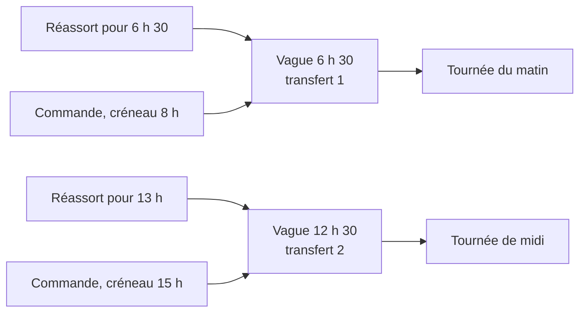

# Plan — les vagues de transfert : plusieurs transferts par point et par jour

> **Plan, doc-first** (lot H4 de
> [`../../reassort-boutiques/plan-heure-du-reassort.md`](../../reassort-boutiques/plan-heure-du-reassort.md)).
> Écrit le 2026-11-24, chaque affirmation sur l'existant ouverte ce jour-là.
> Rien n'est bâti. À contredire par `vitruve` avant de bâtir : il touche la
> composition des tournées, que les commandes partagent.

## 1. En deux mots

Depuis H1, un réassort dit pour quelle heure il doit être au point ; depuis
H2, le transfert du point prend la plus tôt des heures qu'il porte. Mais il
n'y a **qu'un** transfert par point et par jour : un réassort voulu pour
13 h part avec celui de 6 h 30.

On donne à chaque point des **vagues** : des heures d'arrivée fixes
(« 6 h 30 », « 12 h 30 »), réglées dans Réglages › Sites. Chaque vague est un
transfert. Un élément (commande ou réassort) monte dans **la dernière vague
qui arrive à temps** pour son heure.

Un point sans vague réglée a **une seule vague implicite** : c'est le
comportement d'aujourd'hui, à l'identique.

## 2. Pourquoi des vagues, et pas un écart

Le plan de l'heure (§ 5, question 3) laissait le choix entre un **écart**
(« au-delà de 3 h d'écart, un nouveau transfert s'ouvre ») et des **vagues
fixes**. Tranché ici pour les vagues :

- **L'écart dépend de l'ordre d'arrivée** : le premier élément fixe l'heure
  du transfert, et le même jeu de réassorts donnerait deux ou trois
  transferts selon qui a envoyé le premier. Une vague ne dépend que de
  l'heure de l'élément.
- **Le personnel le dit déjà ainsi** : « le transfert du matin », « celui de
  midi ». Une vague a un nom à l'écran ; un écart n'en a pas.
- **Le fournil s'organise par vagues** : une vague est une échéance fixe
  qu'il peut prévoir la veille.

## 3. Ce qui existe (vérifié le 2026-11-24)

| Fait                                                                                                                                                | Où                                                                                                 |
| --------------------------------------------------------------------------------------------------------------------------------------------------- | -------------------------------------------------------------------------------------------------- |
| `delivery_internal_transfer` n'a pas d'unicité `(service_day, site_id)` : plusieurs transferts par point et par jour sont déjà permis en base.      | `prisma/schema/delivery.prisma`, `@@index([serviceDay, siteId])`                                   |
| L'attache range un élément dans **le premier** transfert prévu du point (`const [planned] = plannedOf(...)`, trié par `createdAt`), ou en ouvre un. | `delivery/application/transfer-attachment.ts`, `attach`                                            |
| Un « au plus tôt » lancé passe par la même attache : il rejoint le transfert du soir s'il n'est pas encore parti.                                   | `delivery/application/handlers/attach-launched-resupply.handler.ts`                                |
| Le placement lit une heure **par point** (`TransferSiteFacts.arrivalBy`) et l'applique à chaque transfert non placé du point.                       | `delivery/application/transfer-placement.ts`, `placeDay` ; `transfer-routing.ts`, `transferStopOf` |
| Le papier de tournée lit aussi l'heure par point.                                                                                                   | `delivery/application/round-paper-transfers.ts`                                                    |
| `TransferRouting` sait déjà juger plusieurs passages d'un même véhicule (« un second passage ne part qu'au retour du premier »).                    | `delivery/application/transfer-routing.ts`, JSDoc de la classe                                     |
| Un élément est une commande ou un réassort, par identifiant opaque : la livraison ne connaît ni le créneau d'une commande ni l'heure d'un réassort. | `delivery/domain/entities/internal-transfer-state.ts`, `TransferItem`                              |

## 4. Les décisions (v2, après `vitruve`)

La v1 a été contredite le 2026-11-24 : quatre bloquants (§ 7). La v2 tient
en une idée : **la vague d'un élément est décidée une fois, par le
commerce, à l'arrêt du plan, et FIGÉE** dans la copie du fournil. La
livraison, le colisage et l'échéance du fournil lisent tous cette copie :
une seule source, comme le réassort le fait déjà
(`FrozenResuppliesReader`).

- **V-D1. Une vague est une heure d'arrivée au point**, réglée dans les
  réglages du point (`pickup_addresses.transfer_waves`, `VARCHAR(5)[]`, vide
  par défaut ; CHECK de forme par élément et tableau trié, tenus par un
  value object du commerce et un CHECK sur `array_position` / forme). Le
  commerce la possède, comme l'ouverture.
- **V-D2. Le commerce range chaque élément dans sa vague, à l'arrêt** :
  la dernière vague d'heure ≤ heure de l'élément (commande : créneau − mise
  en place ; réassort : son `arrivalBy`), la première s'il est plus tôt que
  toutes. Une seule fonction pure, `waveOf(arrival, waves)`, au commerce.
  Sans vague réglée, ou sans heure : la vague implicite, notée `""`.
- **V-D3. La vague est figée dans les copies du fournil**, comme l'heure
  (H3) : `production_resupply.transfer_wave` et
  `production_order.transfer_wave` (même canal `production/channels/commerce/`,
  que le commerce implémente). Changer les vagues après l'arrêt ne change
  rien à la journée arrêtée (V-D8 de la v1, désormais vrai par construction) ;
  la réouverture refait les copies, donc les vagues.
- **V-D4. La livraison range par la copie figée.** L'attache lit la vague
  de l'élément dans la copie du fournil (`production/channels/delivery/`,
  arête `delivery → production` déjà admise : `FrozenResuppliesReader` pour
  les réassorts, un lecteur jumeau pour les commandes) et cherche le
  transfert **prévu** du même `(jour, point, vague)`, sinon en ouvre un.
  `delivery_internal_transfer.transfer_wave VARCHAR(5) NOT NULL DEFAULT ''`,
  et l'unicité est **interdite en base** : index unique partiel sur
  `(service_day, site_id, transfer_wave) WHERE departed_at IS NULL AND
received_at IS NULL` — la chaîne vide, pas `NULL`,
  pour que la vague implicite soit unique elle aussi.
- **V-D5. Le transfert porte son heure** :
  `delivery_internal_transfer.arrival_by`, recalculée par l'agrégat à chaque
  attache et détache = le plus tôt des heures figées de ses éléments ;
  `null` sans heure connue. Le placement et le papier lisent l'heure **du
  transfert** ; `TransferSiteFacts.arrivalBy` ne sert plus qu'au repli (un
  transfert sans élément daté).
- **V-D6. Une vague ne part pas trop tôt** (bloquant 1) : la fenêtre de
  l'arrêt devient `{ start: vague − avance, end: arrival_by }`, où
  `avance` est un réglage de livraison (`transfer_wave_early_minutes`, 60 par
  défaut). `route-timing.ts` gère déjà un début de fenêtre (attente sur
  place, l. 92 et 216). La vague implicite garde `start: null`.
- **V-D7. Deux transferts dans une même tournée se chronomètrent**
  (bloquant 2) : la matrice porte le point de **chaque** transfert, clé par
  identifiant de transfert, au lieu d'un seul `SITE_ID` ;
  `timeableVehicles` accepte un arrêt de transfert dont le point est connu.
  `placeFor` prend un transfert (son point, sa fenêtre), plus un site.
- **V-D8. L'échéance du fournil suit la vague** (bloquant 4) : elle se
  calcule au commerce, à l'arrêt, avec le reste de l'échéance (`dueAtOf`
  écrit déjà `ProducibleOrder.dueAt` à l'arrêt) : départ requis de la vague
  − marge de livraison. Le fournil la lit figée ; il ne lit ni vague ni
  transfert.
- **V-D9. « Au plus tôt »** (sérieux 5) : il n'a pas de vague. Il rejoint
  le transfert prévu **non parti dont la vague est la plus proche à venir**
  (la plus petite vague ≥ maintenant, sinon la dernière) ; s'il n'y en a
  aucun, il ouvre un transfert de vague implicite. Une attache à part
  (`attachLaunched`), plus le chemin commun.
- **V-D10. Un transfert prévu vide ne part pas** (sérieux 7) : à la
  détache qui le vide, son arrêt est retiré de sa tournée (geste existant de
  retrait d'arrêt) et il n'est plus candidat au placement. Il reste en base,
  vide, et sera repris par la prochaine attache de sa vague.
- **V-D11. Une commande ne change pas de vague après l'arrêt** (sérieux 9) :
  c'est la règle du figé. Un créneau changé après l'arrêt suit le chemin
  existant des changements après l'arrêt (le retirage), qui refait sa copie
  et donc sa vague ; à vérifier en V3, et refusé à la modification si le
  retirage ne la couvre pas.
- **V-D12. Le colisage range par vague** (sérieux 10) : la fiche de
  réassort au colisage lit la vague dans le fait que le fournil publie déjà
  (`production.resupply_list_drawn`, canal `production/channels/packing/`),
  et sa destination devient `{ kind: "transfer", siteId, wave }`. Arête
  `packing → production` déjà admise.
- **V-D13. Le personnel est prévenu par l'écran** (sérieux 11) : le réglage
  des vagues d'un point dit, avant d'enregistrer, que les commandes du point
  partiront désormais selon leur créneau, et à partir de quelle journée
  (la prochaine non arrêtée).

## 5. Les lots

- **V1 — les vagues du point.** Colonne, value object, écran Réglages ›
  Sites avec l'avertissement de V-D13. `waveOf` et ses tests (bornes : pile
  à l'heure, avant la première, après la dernière, sans vague, sans heure).
- **V2 — la vague figée à l'arrêt.** Colonnes `transfer_wave` des deux
  copies du fournil, le canal commerce, l'échéance par vague (V-D8) ; e2e de
  l'arrêt.
- **V3 — l'attache par vague.** Colonnes `transfer_wave` et `arrival_by`
  du transfert, index unique partiel, lecteur des commandes figées, attache
  et détache, « au plus tôt » (V-D9), transfert vide (V-D10), retirage
  (V-D11).
- **V4 — le placement.** Fenêtre avec début (V-D6), réglage d'avance,
  matrice multi-transferts et `timeableVehicles` (V-D7), `placeFor` par
  transfert ; papier de tournée, « Ma tournée », dossier des tournées
  (`round-paper-transfers.ts`, `my-round-transfer-stops.ts`,
  `day-rounds-dossier.ts`) lisent l'heure du transfert.
- **V5 — le colisage par vague** (V-D12).
- **V6 — les écrans.** Le tableau des tournées et le papier disent la vague
  (« Transfert 12 h 30 — Village ») ; Comptoir › Réassort affiche la vague qui
  portera le réassort.

## 6. Ce qui peut casser

- **Les commandes changent de transfert** dès qu'un point a deux vagues : à
  dire au réglage (V-D13).
- **Plus d'arrêts**, donc plus de route ; V-D7 permet au moins de les
  intégrer aux tournées existantes.
- **Le premier lot qui fige** (V2) touche l'arrêt du plan : une erreur y
  arrête la journée. Ses e2e d'arrêt passent avant tout le reste.

## 7. La contradiction de la v1 (`vitruve`, 2026-11-24)

| #   | Niveau   | Objection                                                                      | Réponse     |
| --- | -------- | ------------------------------------------------------------------------------ | ----------- |
| 1   | BLOQUANT | rien n'empêche la vague de 12 h 30 de partir dans la tournée de 6 h            | V-D6        |
| 2   | BLOQUANT | un véhicule portant un transfert devient inchronométrable (`timeableVehicles`) | V-D7        |
| 3   | BLOQUANT | « l'heure du transfert » n'a pas de source                                     | V-D5        |
| 4   | BLOQUANT | l'échéance par vague n'a pas de chemin admis par la matrice                    | V-D3, V-D8  |
| 5   | SÉRIEUX  | « au plus tôt » contradictoire entre V-D2 et V-D7                              | V-D9        |
| 6   | SÉRIEUX  | l'heure vivante contre la copie figée                                          | V-D3, V-D4  |
| 7   | SÉRIEUX  | transferts vides et vague implicite                                            | V-D4, V-D10 |
| 8   | SÉRIEUX  | unicité seulement vérifiée ; `NULL` distincts                                  | V-D4 (`''`) |
| 9   | SÉRIEUX  | une commande ne change pas de vague                                            | V-D11       |
| 10  | SÉRIEUX  | le colisage range par point                                                    | V-D12       |
| 11  | SÉRIEUX  | personne ne prévient le personnel                                              | V-D13       |

## 8. La contradiction de la v2 (`vitruve`, 2026-11-24) — non résolue

La v2 règle les objections 4, 6 et 8. Il reste quatre bloquants ; le plan
n'est **pas bâtissable en l'état** et attend une décision de Hugo.

| #     | Niveau   | Objection                                                                                                                                                                                                                                                             |
| ----- | -------- | --------------------------------------------------------------------------------------------------------------------------------------------------------------------------------------------------------------------------------------------------------------------- |
| B1    | BLOQUANT | un début de fenêtre contraint l'**arrivée**, pas le départ : le véhicule part à 6 h et attend au point (`route-timing.ts:216`). Seul le premier arrêt d'une tournée recule son départ (`route-timing.ts:139`). Il faut une contrainte « départ ≥ marchandise prête ». |
| B2    | BLOQUANT | `dueAtOf` n'existe pas : l'échéance est `destinationDueAt` (`deadline-thresholds.ts:188`), une heure d'**arrivée** pour un point par transfert ; la changer en « départ − marge » change l'unité de `production_order.due_at` pour le colisage (`ready-by.ts`).       |
| B3    | BLOQUANT | aucune heure figée par commande : `arrival_by` du transfert n'a de source que pour les réassorts.                                                                                                                                                                     |
| B4    | BLOQUANT | le retrait d'arrêt existant est un geste humain versionné (`remove-delivery-stop.handler.ts`) et laisse le transfert prévu, que le placement replace.                                                                                                                 |
| S1–S5 | SÉRIEUX  | fenêtres des autres transferts dans la matrice ; changement de créneau après l'arrêt ; vague absente du fait `production.resupply_list_drawn` ; contrôle des doublons avant l'index unique ; fuseau de « maintenant » pour l'au plus tôt.                             |

**Une voie plus courte, proposée** : une vague au-delà de la première part
**toujours en tournée dédiée** (jamais intégrée). Une tournée dédiée n'a
qu'un arrêt, donc son départ se calcule à rebours de son heure
(`route-timing.ts:139`) : B1 et S1 disparaissent, et V-D7 n'est plus
nécessaire. Restent B2–B4, plus petits. Prix : un véhicule de plus par
vague, à midi.
