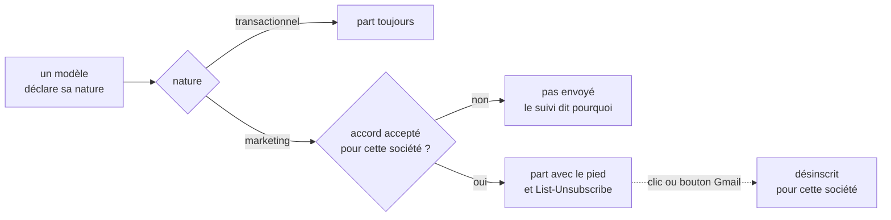
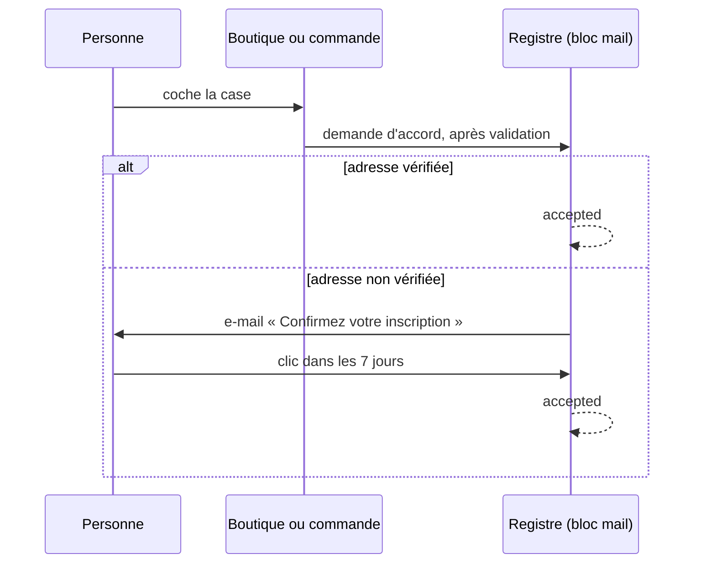

# La désinscription et l'accord marketing

> ✅ **En production depuis le 2026-11-09** (déploiement de `d71268047`). Ce document remplace
> le plan `plan-desinscription-des-e-mails` (écrit le 2026-11-08, contredit
> par `vitruve` le même jour, bâti du 2026-11-08 au 2026-11-09 : U1
> `56cc95a15`, U2 `b75170517`, U3 + C1 `5bca60823`, C2-C3-C5 `431ce5162`,
> boutique `3f0495387`, U4-C4 `7c69b48d1`, U5 `07a2b1d6f`). Les numéros de
> règle (1 à 25), de contradiction (B1 à B3) et de lot (U1–U5, C1–C5) sont
> gardés : le code les cite.

## Partie 1 — En simple

Un e-mail est soit **transactionnel** — il répond à un geste (commande,
facture, mot de passe) et part toujours —, soit **marketing** — une offre,
une nouvelle, la lettre d'information. Un e-mail marketing ne part **qu'à une
personne qui l'a accepté**, pour la société qui l'envoie, et porte toujours un
moyen de se désinscrire en un clic.

- Chaque modèle **déclare sa nature** ; un modèle sans nature ne compile pas.
  Aujourd'hui, un seul modèle marketing d'essai existe, dans les tests : les
  33 modèles servis sont transactionnels.
- L'accord se recueille **à l'inscription**, sur **« Mes e-mails »** de
  l'espace client, **à la commande** (invité compris) et par la **lettre du
  pied de page**. Une adresse non vérifiée reçoit d'abord un e-mail
  « Confirmez votre inscription » (7 jours).
- Une personne **désinscrite** n'est plus jamais réinscrite par une case :
  seul son geste, connectée, sur « Mes e-mails » la réinscrit.
- Un e-mail marketing porte un **pied « Se désinscrire »** que l'éditeur ne
  peut pas retirer, et les en-têtes qui font apparaître le bouton
  « Se désabonner » de Gmail et d'Apple Mail.
- Le staff **voit** le registre (adresse masquée, révélation tracée) et peut
  **désinscrire** à la demande d'un client ; il ne peut **jamais réinscrire**.

## Partie 2 — Technique (vérifiée dans le code le 2026-11-09)

### La nature (U1, règle 1)

`MailNature = "transactional" | "marketing"`, déclarée par une table
`PerMail<MailNature>` dans
`apps/lfd-api/src/mail/templates/sections/mail-block-declarations.ts`, sans
valeur par défaut, et portée par `MailTemplateDeclaration`
(`packages/mail-blocks/src/mail-document.ts`) pour l'éditeur et le suivi.

### Le registre (U2, C1 ; règles 10, 18, 20, 22, 23)

`mail.mail_marketing_preference` (`apps/lfd-api/prisma/schema/mail.prisma`,
modèle `MailMarketingPreference`) : une ligne par `(space, recipient_key)`,
pas de ligne = jamais demandé. `status` : `pending` | `accepted` |
`unsubscribed` ; `origin` : `direct` | `partners` ; la preuve
(`accepted_text_version`, `accepted_locale`, `accepted_where` — `signup`,
`preferences`, `order`, `newsletter`, `staff` —, `accepted_ref`,
`requested_at`, `confirmed_at`) ; le retrait (`unsubscribed_at`,
`unsubscribed_source` — `link`, `one_click`, `staff`, `group`). `print` est
l'empreinte HMAC-SHA256 de l'adresse (`AppConfig.mailMarketingPrintKey`,
étiquette `lfd/mail-unsubscribe-print/v1`) : à l'effacement
(`EraseMarketingPreferencesCommand`), une ligne `pending` ou `accepted` est
supprimée, une ligne `unsubscribed` perd sa clé et garde son empreinte. Les
colonnes sont au registre RGPD (`documentation/legal/rgpd-registre.json`).

Le domaine vit dans `apps/lfd-api/src/mail/marketing/` (entité
`MarketingPreference`, transitions dans `marketing-preference-state.ts`). Une
ligne `pending` expire à 7 jours (`CONSENT_CONFIRMATION_DAYS`,
`domain/services/consent-confirmation.ts`) et le purgeur
(`prisma-pending-consent.pruner.ts`) la retire.

### Le port des autres blocs (règles 12, 17, 21, 24)

`MarketingConsent` (`apps/lfd-api/src/mail/channels/marketing/marketing-consent.ts`),
déclaré et implémenté par `mail` : `request` (accord, double confirmation par
l'e-mail transactionnel `customer.marketing-confirm`), désinscription,
réinscription, `askable` (connecté seulement, sur SES adresses), `moveAddress`.
Il ne dit jamais à l'appelant ce qu'il a fait : pas d'oracle. Le commerce
l'appelle **après** la validation de la commande
(`lafoliecoffee/orders/application/services/order-marketing-consent.ts`) et du compte
(`lafoliecoffee/account/application/services/account-marketing-consent.ts`) ; la réponse
ne change pas l'empreinte d'idempotence de la commande.

### Les routes publiques (U2, C1, C5 ; règle 5, B1)

Toutes `@Public()`, par la passerelle sous `/api/lfd`
(`gateway/src/__tests__/routes.spec.ts`) :

| Route                                     | Ce qu'elle fait                                                                                                                                       |
| ----------------------------------------- | ----------------------------------------------------------------------------------------------------------------------------------------------------- |
| `GET /mail/unsubscribe/:token`            | page neutre, la même pour tout jeton, ne lit pas le jeton, ne désinscrit jamais (les antivirus ouvrent les liens). 20 par minute et par IP.           |
| `POST /mail/unsubscribe/:token`           | désinscrit (bouton de la page et « One-Click » RFC 8058), même page de fin pour tout jeton. Exemptée du seau par IP, 5 par minute **par jeton** (B1). |
| `GET/POST /mail/marketing/confirm/:token` | la confirmation d'un accord (le GET ne confirme pas).                                                                                                 |
| `POST /mail/newsletter`                   | la lettre du pied de page : `202` sans corps, toujours ; champ piège ; débit par IP et par empreinte d'adresse.                                       |

Les pages : `private, no-store`, `noindex`, `Referrer-Policy: no-referrer`,
CSP `default-src 'none'` (`apps/lfd-api/src/mail/marketing/http/`). Le jeton
de désinscription chiffre (AES-GCM, `AppConfig.mailUnsubscribeTokenKey`,
étiquette `lfd/mail-unsubscribe/v1`) l'espace et la clé d'adresse, sans date
d'expiration ; il meurt à la rotation de `FIELD_ENCRYPTION_KEY`. Le jeton de
confirmation a sa propre étiquette (`lfd/mail-marketing-confirm/v1`).
L'origine du lien est celle de l'espace (`config-space-public-origins.ts`) :
la boutique pour `lfc` ; `lfd` n'en a pas (`null`, aucun lien ne se fabrique).

### Le contrôle avant Resend (U3 ; règles 7, 11, 25, B3)

`MailSendAttempt.attempt`
(`apps/lfd-api/src/mail/requests/application/mail-send-attempt.ts`) : juste
avant l'appel au fournisseur, à chaque essai — envoi immédiat, envoi différé,
reprise du balayeur. Un e-mail marketing sans accord `accepted` pour son
espace est clos `refused` avec `refusal_code` = `unsubscribed` ou
`no_consent` (`MailRequest.markRefusedFor`), et rien ne part ; un e-mail
transactionnel ne lit jamais le registre (`marketing-control-paths.spec.ts`).
Course assumée : une désinscription arrivée entre le contrôle et
l'acceptation de Resend laisse partir CET e-mail.

### Le pied injecté et les en-têtes (U3 ; règle 3, B2)

Le pied n'est pas une section du document : il est **injecté au rendu**
(HTML et texte), après tout le document, par
`apps/lfd-api/src/mail/templates/sections/mail-unsubscribe-scope.ts`. Son
texte est une phrase système (`mail/templates/copy/mail-system-copy.ts`,
variable `{unsubscribeUrl}` posée par le bloc), inscrite au manifeste. Les
en-têtes `List-Unsubscribe: <url>` et
`List-Unsubscribe-Post: List-Unsubscribe=One-Click` sont posés par
`unsubscribeHeadersOf` (`mail/requests/infrastructure/mailer-mail-dispatch.ts`),
sans `mailto:`. L'éditeur montre le pied grisé sous l'aperçu.

### Le back-office (U4, C4 ; règle 8)

`/admin/mail/preferences`
(`apps/lfd-api/src/mail/marketing/http/admin-marketing-preferences.controller.ts`),
sous le droit `mail_sends` : liste par espace (adresse masquée), fiche,
recherche par adresse, révélation, désinscription par le staff (une ligne, ou
une adresse donnée par le client). Les écritures exigent `mail_sends:write` ;
aucune route ne réinscrit. Chaque révélation et chaque recherche est tracée
dans `mail.mail_preference_consultation` (l'empreinte, jamais l'adresse) et
compte dans le **plafond partagé** avec le suivi des envois : 30
consultations par heure et par personne (`MAIL_CONSULTATIONS_PER_HOUR`,
`mail/sends/domain/entities/staff-mail-consultations.ts`). Le front : l'onglet
voisin du suivi (`apps/lfd-backoffice-frontend/src/app/mail-editor/ui/mail-preferences-page/`).

### L'identité d'envoi par nature (U5 ; règle 9)

`mail.mail_sender_identity` a la clé `(space, nature)`. Le repli
(`senderEntryFor`, `mail/templates/effective-copy/published-mail-senders.ts`) :
sans identité `marketing` rangée, un e-mail marketing part sous l'identité
`transactional` de son espace — une identité marketing rangée mais illisible
ne se replie pas en silence. `lfd` n'a jamais de ligne `marketing`
(contrainte en base, et `MailSenderNatureNotOfferedError` à l'écran).

### « Partenaires » éteint (règles 14, 15, 19)

`MARKETING_SPACES` est **vide**
(`apps/lfd-api/src/mail/marketing/domain/services/marketing-group.ts`) : la
case « partenaires » et « Ne plus rien recevoir du groupe » ne s'affichent
qu'à partir de deux espaces marketing. Le mécanisme est bâti, éteint. `lfd`
est l'espace de l'équipe et n'enverra jamais de marketing.

### Les décisions de Hugo (2026-11-08)

- **Une marque, plusieurs sociétés** (la boulangerie — La Folie Coffee —, le
  textile, les concerts) : plusieurs responsables de traitement. Chaque
  société recueille SON accord ; l'espace d'e-mail est la société émettrice
  (`lfc` = la boulangerie).
- **Le recueil, plus strict que l'« exception client » de la CNIL** : à
  l'inscription, sur « Mes e-mails », à chaque commande tant que la personne
  n'a jamais été inscrite, et en pied de page. Une case vide n'est pas un
  refus ; une désinscription éteint la question pour toujours.
- **« Partenaires » = les autres sociétés du groupe**, nommées dans la case ;
  une société ajoutée plus tard n'hérite pas de l'accord.
- **Double confirmation** de toute adresse non vérifiée (règle 18) ; **pas
  d'oracle** nulle part (règle 17).

### Ce qui reste à faire

- **Paragraphe marketing de la politique de confidentialité** (qui écrit,
  pourquoi, comment se désinscrire, transmission aux sociétés nommées) — à
  écrire par Hugo ; les cases y renvoient.
- **Accorder `mail_sends:write`** à l'écran (`/admin/staff-roles`) à qui doit
  désinscrire à la demande d'un client — aucune migration ne le fait.
- **La lettre du pied de page ne s'affiche qu'à partir de 900 px**
  (`client-foot.scss`) : à trancher pour le mobile.
- **Les inscriptions Google / Facebook** ne passent pas par la case : pas
  d'accord recueilli à ce moment.
- **Vérifier la signature DKIM** de `List-Unsubscribe` et
  `List-Unsubscribe-Post` sur un vrai envoi (lire `h=` dans
  `DKIM-Signature`) — sans quoi Gmail ignore le one-click.
- **DNS du sous-domaine marketing** (SPF, DKIM, DMARC) — geste de Hugo, puis
  régler l'identité marketing à l'écran ; d'ici là, le repli transactionnel
  vaut.
- **La sonde de déploiement n'éprouve pas l'identité marketing.**
- **L'effacement** : `EraseMarketingPreferencesCommand` n'a encore aucun
  appelant hors des tests (vérifié le 2026-11-09) — à relier au processus
  d'effacement du dépôt, avec `mail_request.recipient` et `recipient_key`.
