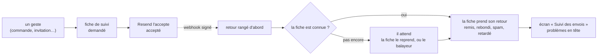

# Le suivi des e-mails

> 🟡 **État au 2026-11-08, vérifié dans le code.** Bâti : les retours de
> Resend rattachés à chaque envoi, l'écran « Suivi des envois », l'adresse
> masquée et sa révélation tracée, la porte du mot « envoyé », et T1b — la
> carte de santé et la veille lisent le suivi, `ops.mail_send` n'est plus
> écrite — avancé par Hugo le 2026-11-08 pour partir dans le même
> déploiement que T1 (la carte repart donc sans historique). Ce document remplace le plan
> du même chantier ; ses numéros de règles et de lots sont gardés, parce que
> le code les cite. Vue d'ensemble des e-mails : [`les-e-mails.md`](les-e-mails.md).

## Partie 1 — En simple

Chaque e-mail que la plateforme envoie a une **fiche de suivi** qui dit où il
en est, de deux points de vue :

- **notre côté** : demandé, en cours d'envoi, accepté par Resend, en échec,
  ou refusé ;
- **le retour de Resend** : remis, retardé, rebondi (adresse rejetée, boîte
  pleine…), ou signalé comme spam.

« Accepté » veut dire que Resend l'a pris en charge, pas qu'il est arrivé.
C'est le retour qui dit s'il est arrivé.

Dans le back-office, **Email Templates › Suivi des envois** liste ces fiches,
les problèmes en tête. Une fiche s'ouvre sur son détail : les étapes datées,
le genre d'un rebond, la version du modèle qui a servi.

L'adresse du destinataire est **masquée** partout (`c•••@halles.fr`). Pour
la voir, on clique « Afficher l'adresse » : la consultation est **inscrite
au journal** (qui, quand, quel envoi — jamais l'adresse) et vaut cinq
minutes. On peut aussi **chercher par adresse** : la recherche est tracée de
la même façon, et on ne garde de l'adresse cherchée qu'une empreinte. Trente
consultations par heure et par personne au plus. Un droit à part, « Suivi
des e-mails », ouvre l'écran.

## Partie 2 — Technique

### Où ça vit

| Pièce                           | Où                                                                                                                                                                               |
| ------------------------------- | -------------------------------------------------------------------------------------------------------------------------------------------------------------------------------- |
| La fiche (une demande d'e-mail) | `mail.mail_request` (`apps/lfd-api/prisma/schema/mail.prisma`), agrégat `MailRequest` (`apps/lfd-api/src/mail/requests/domain/entities/mail-request.ts`)                         |
| Les retours rangés              | `mail.mail_delivery_event`, contexte `apps/lfd-api/src/mail/deliveries/`                                                                                                         |
| Le webhook Resend               | `apps/lfd-api/src/mail/deliveries/http/resend-webhook.controller.ts`, route `webhooks/resend` ; la signature Svix reste vérifiée par `platform/mailer/webhook/svix-signature.ts` |
| Les lectures et la révélation   | contexte `apps/lfd-api/src/mail/sends/`, routes `/admin/mail/sends/*`, contrats `packages/contracts/src/mail-sends.ts`                                                           |
| Les consultations               | `mail.mail_recipient_reveal`, `mail.mail_recipient_search`, `mail.mail_recipient_search_hit`                                                                                     |
| L'écran                         | `apps/lfd-backoffice-frontend/src/app/mail-editor/ui/mail-sends-page/` (et `mail-sends-table/`, `mail-send-filters/`, `mail-send-panel/`), route `/emails/envois`                |
| La porte                        | `dev-toolbox/gates/mail-status-honest.mjs` (`lint:mail-status-honest`)                                                                                                           |

### Les règles (numérotées : le code les cite)

1. **Deux axes.** `status` est le cycle de la demande (`requested`,
   `sending`, `sent`, `failed`, `refused`) ; `delivery` est le retour du
   fournisseur (`null`, `delayed`, `delivered`, `complained`, `bounced`),
   avec `delivery_at` et `delivery_kind`. Une demande acceptée puis rebondie
   n'a pas échoué de notre côté et n'est pas relancée. `email.sent`,
   `opened` et `clicked` sont écartés.
2. **Aucun retour ne se perd.** Resend peut répondre avant que l'envoi ait
   écrit son `provider_id`. Chaque retour est donc **rangé d'abord** dans
   `mail_delivery_event` (le `svix-id` unique y dédoublonne un rejeu), puis
   appliqué : tout de suite si la fiche est connue ; sinon par la fiche
   elle-même quand elle reçoit son identifiant (`MailOutcomeRecorder`, même
   transaction) ; sinon par le balayeur `*/5` (`sweep-mail-requests`). Un
   retour sans fiche au bout de 30 jours est purgé. Un échec d'application
   après rangement est journalisé et laissé au balayeur ; le webhook répond
   toujours 200 après une signature valide.
3. **Le retour ne fait que monter** : `delayed` < `delivered` <
   `complained` < `bounced` (`MailRequest.recordDelivery`). Index **non
   unique** sur `provider_id` : un retour s'applique à toutes les fiches qui
   le portent.
4. **Aucun texte du fournisseur n'est rangé.** Seul le **genre** du rebond
   (`bounce.type` / `subType`, par exemple `Permanent/General`, filtré à des
   lettres) ; jamais `bounce.message`, qui cite l'adresse — ni dans le
   suivi, ni dans `ops.mail_send`. `failure_reason` n'est servi qu'avec
   l'adresse, au moment d'une révélation.
5. **`ops.mail_send` n'est plus écrite** (T1b, dans le même déploiement que
   T1, décision de Hugo du 2026-11-08). La carte de santé lit le suivi par le
   port `MailDeliveryTally` (`platform/mailer/delivery-tally/`), que le bloc
   `mail` sert (`BlockMailDeliveryTally`) et qu'`apps/lfd-api/src/appBootstrap/mail-delivery-tally.module.ts`
   relie : « Envoyés » compte les demandes **acceptées** (`sent` avec un
   `provider_id`), sans la sonde ni le mode à blanc ; « sans retour »,
   celles sans `delivery`. La veille sonne aussi pour un `bounced` /
   `complained` arrivé depuis 24 h : une cloche par modèle (droit
   `mail_sends:read`, lien `/emails/envois`), sonde exclue, clé
   `mail.rejected.<modèle>:<instant du plus récent>` — elle ne resonne qu'à
   un nouveau rebond. La table reste en base ; la purge de dev la vide
   encore. `JournalingMailer` est retiré ; la garde réseau de l'envoi est
   passée à `EffectiveCopyMailer`.
6. **Les ports.** Le webhook vit dans le bloc `mail` et relaie
   `email.received` au port `InboundMailSink` de `platform/`, que
   `b2b/contact` implémente (inchangé). `MailJournal` ne porte plus que
   `rememberEvent`, que seul `send-guest-order-notice` lit.
7. **La révélation, en deux temps.** `POST
/admin/mail/sends/:id/recipient-reveal` range la consultation et publie
   `mail.recipient_revealed` ; `GET …/:id/recipient` ne rend l'adresse et
   `failure_reason` qu'à son auteur, moins de 5 minutes après, sinon 403
   nommé. La trace dit « révélé » : relire pendant ces 5 minutes ne trace
   rien de plus. Plafond : 30 consultations par heure et par personne
   (`StaffMailConsultations`, 409 au-delà).
8. **La recherche par adresse.** `POST /admin/mail/sends/searches`
   (adresse dans le **corps**, jamais l'URL) range l'empreinte HMAC de
   l'adresse (clé dérivée de `FIELD_ENCRYPTION_KEY`) **et les identifiants
   des envois trouvés**, publie `mail.recipient_searched` (le nombre trouvé,
   pas d'adresse) et rend l'identifiant de la recherche ; `GET
…/searches/:id` rend ces envois, masqués, à son seul auteur, 5 minutes.
   Le résultat est figé à l'instant de la recherche. Même plafond.
9. **L'adresse se compare normalisée** : `recipient_key` (minuscules),
   écrite par l'agrégat, index ordinaire. Nullable : une fiche écrite par
   l'ancien binaire pendant un déploiement l'a vide, et la migration de T2
   l'a remplie.
10. **Ce qui ne compte pas.** Les modèles `outOfEditor` (la sonde
    `ops.deploy-check`) sont listés à part (`scope=probes`). Une demande
    acceptée à blanc (`provider_id` nul) est servie `dry_run`.
11. **Un droit à part** : `mail_sends` (« Suivi des e-mails »), lecture.
    Aucune migration ne l'accorde ; il s'accorde à l'écran des rôles. Le menu
    « Email Templates » s'affiche avec `mail_templates:read` ou
    `mail_sends:read`, et mène au suivi pour qui n'a que le second.
12. **L'état servi en code anglais** : `requested`, `sending`, `accepted`
    (`sent` en base), `failed`, `refused` ; `dry_run`, `delayed`,
    `delivered`, `complained`, `bounced`. Le back-office traduit.

Le mot « envoyé » dans le code : `mail.send` rend `MailRequested
{ requestId }` (la demande est rangée), `mail.sendAndAwaitReceipt` rend
`MailAcceptance { providerId }` (`isMailAccepted`). La porte
`lint:mail-status-honest` refuse un champ d'étape tiré du réglage du mailer
ou d'une simple demande ; les 37 anciens champs `mailSent` / `sent` /
`notified` (21 fichiers, relevé du 2026-11-08 ; 34 dans 18 après T1b) — tous issus d'une
acceptation réelle — sont une dette comptée. `mailSent` ne se renomme pas
facilement : c'est aussi une valeur rangée dans les intentions déjà écrites
(rejeu) et une colonne de la vitrine.

### Les lots, et où les retrouver

| Lot | Ce qu'il a bâti                                    | Commit                   | Migrations                                                                                              |
| --- | -------------------------------------------------- | ------------------------ | ------------------------------------------------------------------------------------------------------- |
| T1  | retours rangés puis appliqués, webhook dans `mail` | `3848a9b75`              | `20261108100000_le_suivi_des_retours_d_e_mails`                                                         |
| T2  | droit, lectures, révélation, recherche             | `58b0f5700`              | `20261108120000_le_droit_du_suivi_des_e_mails`, `20261108120100_les_consultations_du_suivi_des_e_mails` |
| T3  | l'écran ; l'entrée du menu au seul droit du suivi  | `eb6792a8f`, `e52fa57ac` | —                                                                                                       |
| T4  | `MailRequested` / `MailAcceptance`, la 68ᵉ porte   | `8220b4ad1`              | —                                                                                                       |
| T1b | la carte et la veille lisent le suivi (règle 5)    | —                        | —                                                                                                       |

Le plan a été contredit par `vitruve` avant le bâti (deux bloquants : un
retour arrivé avant l'identifiant était perdu ; le texte du rebond cite
l'adresse) ; les règles 2 et 4 en viennent. Au bâti, la recherche par
empreinte seule s'est révélée impossible (la lecture n'avait plus de quoi
retrouver les envois) : d'où les identifiants rangés de la règle 8.

### Ce qui reste

**T1b est bâti** (règle 5). Passé son déploiement, un retour arrière du code
retrouverait un trou dans `ops.mail_send` : c'est le point qui ne se défait
plus.

**À vérifier après le déploiement** : `SELECT count(*) FROM mail.mail_request
WHERE recipient_key IS NULL` (lecture seule) vaut 0 ou presque ; un vrai
retour Resend apparaît dans `mail.mail_delivery_event` et pose `delivery`
sur sa fiche ; l'écran, une fois le droit accordé (il n'a pas été vu en
vrai).

**Non bâti, à décider** : les faits `mail.delivered` / `mail.bounced`
publiés aux autres blocs (« e-mail reçu » sur la fiche d'une commande) —
une fiche ne connaît pas son sujet (commande, compte) aujourd'hui ; le
filtre « rien reçu du fournisseur », que l'API ne propose pas.

**Non vérifié** : le délai réel de Resend avant son premier webhook ; le
texte exact d'un `bounce.message` (jamais lu) ; d'éventuels doublons de
`provider_id` en production.
