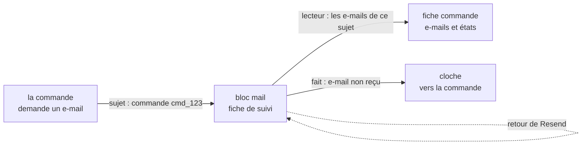

# L'e-mail connaît son sujet

> 🟢 **Bâti le 2026-11-08, vérifié dans le code** (lots E1 à E5, voir « Les
> lots »). Ce document remplace le plan du même chantier ; ses numéros de
> règles et de lots sont gardés, parce que le code les cite. Demande de
> Hugo (« et si le mail connaît sa commande avec le suivi ? », puis « fais ce
> plan et code-le en entier »). Il prolonge le suivi des envois
> ([`le-suivi-des-e-mails.md`](le-suivi-des-e-mails.md)) et tranche le cas 1
> de la liste « À valider par Hugo » du service
> ([`plan-service-e-mails.md`](plan-service-e-mails.md)) : « client
> prévenu » montre l'état réel de l'e-mail.

## Partie 1 — En simple

Aujourd'hui, une fiche du suivi dit à qui un e-mail est parti et ce que
Resend en a fait, mais pas **pour quoi** il est parti. Sur la fiche d'une
commande, rien ne dit si le client a vraiment reçu sa confirmation, ni si
l'e-mail « commande prête » a rebondi.

Chaque demande d'e-mail porte **ses sujets** — « commande
`cmd_123` », « compte `acc_45` »… ; une facture en porte plusieurs, une par
commande —, que le bloc `mail` range sans savoir ce
qu'est une commande. Alors :

- la fiche d'une commande, au back-office, liste **ses e-mails et leur état
  réel** : « Confirmation : remise le 8/11 à 10 h 02 », « Commande prête :
  adresse rejetée » ;
- « Client prévenu » (retard, lettre de manque) devient l'état réel de
  l'e-mail, plus une supposition ;
- un rebond sur l'e-mail d'une commande **sonne une cloche qui mène à la
  commande** : le staff peut appeler le client à temps ;
- dans le suivi des envois, une ligne mène à sa commande.

## Partie 2 — Technique

### Ce qui existait avant le chantier (lu le 2026-11-08)

- `MailDemand` (`apps/lfd-api/src/mail/channels/requests/mail.ts`) : modèle,
  destinataire, données, clé d'idempotence, `replyTo?`. Aucun sujet.
  `DeferredMailDemand` en est un `Omit<…>` : un champ neuf doit traverser
  les deux formes.
- `mail.mail_request` : la fiche, avec `status`, `delivery`, `delivery_at`,
  `delivery_kind` depuis le suivi (T1). Un retour s'y applique par
  `MailRequest.recordDelivery()` (`mail-request.ts`), appelé par TROIS
  chemins : le webhook et le balayeur (`MailDeliveryApplier`) et la pose de
  l'identifiant Resend dans la transaction de l'envoi
  (`MailOutcomeRecorder`). Un même `provider_id` peut porter plusieurs
  fiches.
- Envoyeurs liés à une commande — `lafoliecoffee/orders` : placée, réglée, prête (et
  son rappel de retrait, même modèle), en route, annulée, paiement échoué ou
  expiré, lien de paiement renvoyé, retard, lettre de manque, avis à un
  invité ; `lafoliecoffee/contact` : modification appliquée ou refusée. Plusieurs
  passent par une enveloppe à arguments positionnels
  (`this.mail.send(fact.orderId)`) avant le vrai `mail.send({…})` d'un
  service (`order-ready-mail.service.ts`, `delivery-en-route-mail.service.ts`).
  Les avis de facture et de prélèvement vivent dans `lafoliecoffee/accounting`
  (`invoice-notice-sender.ts`, `collection-notice-sender.ts`) et portent
  PLUSIEURS commandes. `lafoliecoffee/contact` porte aussi la demande client
  (`staff.customer-request`), qui n'est pas une commande.
- La fiche commande du back-office : `apps/lfd-backoffice-frontend/src/app/commandes/commande-page/` ;
  la lettre de manque affiche « Client prévenu le … »
  (`commandes/order-shortfall-letter/`).
- `lint:durable-cross-block` lit le bloc d'un fait au premier dossier de son
  chemin sous `src/` (vérifié le 2026-11-08) : un fait déclaré dans
  `mail/channels/` est un fait de `mail`.

### Les règles

1. **Un sujet = un type fermé et un identifiant opaque.** `MailSubject {
type, id }` ; les types, décidés ici : `order`, `account`, `company`,
   `invoice`, `collection_batch`, `mandate`, `customer_request`,
   `staff_member`, `production_day`, et `appointment` (ajouté au bâti, le
   2026-11-08 : le rendez-vous pris a un objet), et `vitrine_subscriber`
   (lot E5, 2026-11-08 : l'annonce de la vitrine part à un abonné du
   webhook, une agence, qui n'est ni un compte ni une société). La liste est fermée et déclarée par le
   canal du bloc ; un type neuf s'ajoute par une ligne. `id` : chaîne non
   vide, 120 caractères au plus. Le bloc `mail` ne lit jamais l'objet :
   `mail → b2b` reste interdit.
2. **Plusieurs sujets par demande** (sérieux 3 de vitruve) :
   `MailDemand.subjects?: readonly MailSubject[]` — une facture ou un avis
   de prélèvement nomme chacune de ses commandes, et la commande ET son
   compte peuvent être nommés ensemble. Rangés dans une table enfant
   `mail.mail_request_subject (request_id, subject_type, subject_id)`, clé
   primaire sur les trois, index `(subject_type, subject_id)` : la fiche
   commande retrouve aussi la facture qui la concerne. Migration additive ;
   rien n'est déduit pour les fiches d'avant (on n'invente pas un sujet en
   lisant une clé d'idempotence). Le champ traverse `DeferredMailDemand`.
3. **La porte `lint:mail-subject-declared`** (68ᵉ → 69ᵉ porte, compte du § 10
   de `CLAUDE.md` mis à jour) : elle vise les fichiers hors du bloc qui
   INJECTENT `Mail` (pas le nom `mail.send`, qu'une enveloppe déguise), et
   chaque appel `send(` / `sendAndAwaitReceipt(` de cette injection doit
   passer un littéral objet qui porte la clé `subjects` ; un objet étalé
   (`...demand`) ou passé par variable est refusé, sauf liste admise datée.
   Les fichiers pas encore migrés sont une dette comptée — le chiffre de
   départ est celui que la porte relève à E1, écrit ici au bâti : **16
   fichiers** au 2026-11-08 (`DEBT` de `dev-toolbox/gates/mail-subject-declared.mjs`). Admis sans
   sujet, avec leur raison : l'essai, la sonde, les alertes d'équipe sans
   objet.
4. **Un seul point d'émission du fait d'échec** (bloquant 1). C'est
   l'agrégat qui le décide : `MailRequest.recordDelivery()` note un événement
   de domaine quand la fiche ENTRE dans l'échec — passage de « rien »,
   `delayed` ou `delivered` à `complained` ou `bounced` ; jamais de
   `complained` à `bounced` (bloquant 2). Le dépôt l'écrit dans la boîte
   d'envoi (outbox) dans la même unité de travail que le `save`, quel que
   soit le chemin (webhook, balayeur, pose de l'identifiant). N fiches sur un
   même `provider_id` → N faits, un par fiche. Un `delivered` qui suit un
   `bounced` ne fait rien (l'échelle ne descend pas) ; un `bounced` qui suit
   un `delivered` sonne, et c'est juste : l'écran a dit « remis », il dira
   « rebondi ».
5. **Le fait est déclaré par le canal** `mail/channels/deliveries/` :
   `mail.delivery_failed { requestId, template, subjects, delivery, kind,
at }`, sans adresse. `lafoliecoffee/orders` s'y abonne en `@DurableHandler` et, pour
   chaque sujet `order`, sonne une cloche adressée au droit `b2b_orders`,
   lien vers la commande, clé **`mail.failed:<requestId>:<orderId>`** : une
   cloche par fiche et par commande — le rappel de retrait et l'e-mail
   « prête » d'origine sont deux fiches, donc deux cloches ; un rejeu du fait
   ne resonne pas.
6. **Un lecteur dans le canal du bloc.** `MailSubjectDeliveries`, déclaré ET
   implémenté par `mail` (la figure d'`OrderHandoverHistoryReader`) :
   `forSubjects(type, ids)` → pour chaque id, ses fiches (modèle, demandé à,
   état de la demande, retour et son instant) — **jamais l'adresse**. Lecture
   par lot.
7. **La commande lit par une requête nommée, après avoir prouvé la
   commande** (sérieux 8). `GET /admin/orders/:id/mails` sous
   `@AdminSurface("b2b_orders")` comme les autres routes `admin/orders/…`
   (vérifié le 2026-11-08) ; le handler lit d'abord la commande par son port
   de lecture et rend 404 si elle n'existe pas, puis lit le port de `mail`.
   États en code anglais (`requested`, `accepted`, `dry_run`, `delivered`,
   `bounced`…), traduits par le back-office.
8. **« Client prévenu » : pas de champ qui ment** (sérieux 7). Le champ
   servi aujourd'hui (l'instant de la demande) garde son nom et son sens, et
   N'ENTRE PAS dans la dette de `lint:mail-status-honest` ; l'écran change son
   LIBELLÉ en « E-mail demandé le … » et affiche à côté l'état réel lu par la
   règle 7.
9. **Le suivi des envois relie.** Liste et détail servent les sujets ; le
   back-office fait d'un sujet `order` un lien vers `/commandes/:id`.

### Les lots, et où les retrouver

| Lot | Ce qu'il a bâti                                                                                                                                                          | Commit      |
| --- | ------------------------------------------------------------------------------------------------------------------------------------------------------------------------ | ----------- |
| E1  | les sujets rangés (`mail.mail_request_subject`, migration `20261108130000_le_sujet_des_e_mails`), la 69ᵉ porte `lint:mail-subject-declared`, les envoyeurs des commandes | `da20ff7d0` |
| E2  | `MailSubjectDeliveries` (canal `mail/channels/deliveries/`), `GET /admin/orders/:orderId/mails`, les sujets dans le suivi                                                | `da20ff7d0` |
| E3  | la carte « E-mails » de la fiche commande, « E-mail demandé le … » et l'état réel, les liens depuis le suivi                                                             | `0dc0178c9` |
| E4  | `mail.delivery_failed` né dans la fiche et publié par son dépôt, la cloche des commandes                                                                                 | `8f0fc8972` |
| —   | les libellés des 32 e-mails dans `@lfd/mail-blocks`, lus par les cloches                                                                                                 | `54c46982f` |
| E5  | les 16 derniers envoyeurs nomment leurs sujets (type neuf `vitrine_subscriber`) ; dette de la porte à 0                                                                  | `91553e84d` |

**Écarts au texte, retenus** : le type `appointment` (rendez-vous) et
`vitrine_subscriber` (agence abonnée) ajoutés à la liste fermée ;
`production_day` identifié par sa date de service ; le port d'identité
client reçoit l'identifiant du compte pour la réinitialisation du mot de
passe ; à la Supervision, le retard dit « E-mail de retard demandé le … »
sans l'état (une lecture par ligne serait nécessaire — l'état est sur la
fiche de la commande).

**Ce qui reste** : trois sujets connus seulement par une lecture de plus, non
posés — les commandes et les factures d'un avis de prélèvement, le site et
la commande d'un avis au compte principal ; et ce qui se vérifie après le
déploiement : une commande passée affiche ses e-mails, une commande d'avant
n'en affiche aucun (voulu), aucune attente de verrou sur `mail_request` au
`migrate deploy`.

### La contradiction de `vitruve` (2026-11-08), et ce qu'elle a changé

| Objection                                                                                  | Traitement                                                                           |
| ------------------------------------------------------------------------------------------ | ------------------------------------------------------------------------------------ |
| B1 — trois chemins appliquent un retour, aucun point d'émission                            | règle 4 : l'agrégat décide, le dépôt écrit à l'outbox dans la même unité             |
| B2 — `complained` puis `bounced` sonne deux fois ; deux fiches « prête » partagent une clé | règle 4 (seule l'entrée dans l'échec émet) ; règle 5 (clé par fiche et par commande) |
| S3 — une facture, un lot de prélèvement couvrent plusieurs commandes                       | règle 2 : plusieurs sujets, table enfant                                             |
| S4 — l'inventaire mettait les relances dans `lafoliecoffee/orders`                         | « Ce qui existe » corrigé ; la dette est comptée par la porte                        |
| S5 — la porte lisait le nom `mail.send`, que les enveloppes déguisent                      | règle 3 : elle vise l'injection et exige un littéral `subjects`                      |
| S6 — le fait doit être déclaré par un canal                                                | règle 5 ; `durable-cross-block` lit le bloc au chemin (vérifié)                      |
| S7 — « Client prévenu » élargissait une dette en silence                                   | règle 8 : le libellé change, le champ n'entre pas en dette                           |
| S8 — un identifiant arbitraire lisait des e-mails                                          | règle 7 : 404 venu de la commande avant la lecture                                   |
| Mineurs — types non décidés, `DeferredMailDemand`, compte des portes                       | règles 1, 2, 3                                                                       |

### Hors du chantier

- Une carte « E-mails » sur la fiche d'un compte client : même lecteur,
  quand les sujets `account` seront posés (E5).
- Les e-mails partis avant la colonne n'auront jamais de sujet.
