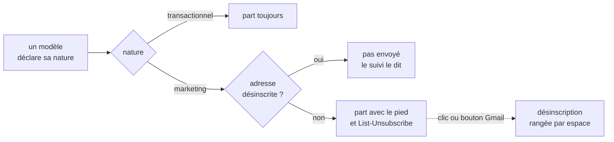

# La nature des e-mails et la désinscription — plan

> 📝 **Doc-first**, écrit le 2026-11-08 à la demande de Hugo (« donner une
> identité à chaque template, transactionnel / marketing, pour activer un
> footer avec l'obligatoire de désinscription » ; puis « plan complet »).
> Relevé des 32 modèles validé par Hugo le même jour : **tous
> transactionnels** — l'annonce de la vitrine (`agency.vitrine-notice`)
> s'adresse aux contacts techniques des agences abonnées au webhook, c'est un
> e-mail de service, pas une promotion (`documentation/webhooks/vitrine.md`,
> § 7). Aucun e-mail marketing n'existe donc aujourd'hui : ce plan prépare le
> premier, et rend impossible de l'envoyer sans désinscription. Contredit
> par `vitruve` le 2026-11-08 (3 bloquants, 9 sérieux) : voir la section
> de la contradiction, qui remplace les règles 2 à 8 là où elles divergent.

## Partie 1 — En simple

Un e-mail est soit **transactionnel** — il répond à un geste du client ou
du staff (commande, facture, mot de passe) : on ne s'en désinscrit pas —,
soit **marketing** — une offre, une nouvelle, une lettre d'information : la
loi exige qu'on puisse s'en désinscrire en un clic, et Gmail et Yahoo
l'exigent pour les envois en nombre depuis 2024.

Après ce chantier :

- chaque modèle **déclare sa nature** ; un modèle sans nature ne compile pas ;
- un e-mail marketing porte **toujours** un pied « Se désinscrire » que
  l'éditeur ne peut pas retirer, et les en-têtes qui font apparaître le
  bouton « Se désabonner » de Gmail et d'Apple Mail ;
- le lien mène à une page qui confirme la désinscription, sans compte ni mot
  de passe ;
- un e-mail marketing n'est **jamais** envoyé à une adresse désinscrite, et
  le suivi le dit (« Non envoyé : désinscrit ») ;
- un e-mail transactionnel part toujours, désinscription ou pas.

**Ce que ce plan ne règle pas, et qui précède le premier envoi marketing :
le consentement.** Pour écrire à un particulier une offre commerciale, la
CNIL demande son accord **préalable** (case non précochée) ; pour un
professionnel, une information et un droit d'opposition suffisent si l'offre
concerne son métier. Ce plan gère le retrait (« ne plus recevoir ») ; il ne
crée pas l'accord (« accepter de recevoir »). C'est une décision de Hugo,
listée au bas du plan : sans elle, un e-mail marketing à un particulier
reste interdit, même avec la désinscription.

## Partie 2 — Technique

### Ce qui existe (lu le 2026-11-08)

- Les déclarations des modèles : `MailTemplateDeclaration`
  (`packages/mail-blocks/src/mail-document.ts`) et, côté API,
  `apps/lfd-api/src/mail/templates/sections/mail-block-declarations.ts`, où
  chaque propriété est une table `PerMail<T>` sur les clés de `B2bMails` —
  une clé oubliée ne compile pas.
- Les libellés des 32 modèles : `packages/mail-blocks/src/mail-labels.ts`.
- La demande et la fiche : `mail.mail_request`, `recipient_key` (adresse en
  minuscules), `status` (`requested` … `refused`) ; l'envoi par
  `mail/requests/` ; le rendu par `@lfd/mailer` (HTML et texte) et l'appel à
  Resend avec `headers?` (`packages/mailer/src/resend-mailer.ts`).
- Les identités d'envoi par espace (`mail.mail_sender_identity`).
- Un lien public signé existe déjà : l'annulation d'une commande par un
  invité (`b2b/orders/http/guest-order-cancellation.controller.ts`), clé
  dérivée de `FIELD_ENCRYPTION_KEY` (`AppConfig.cancellationLinkKey`, HKDF) ;
  la recherche par adresse du suivi dérive aussi sa clé HMAC ainsi.

### Les règles

1. **La nature est déclarée, sans valeur par défaut.** `MailNature =
"transactional" | "marketing"`, une table `PerMail<MailNature>` dans les
   déclarations : les 32 modèles d'aujourd'hui sont `transactional`. Le
   champ est porté par `MailTemplateDeclaration` pour l'éditeur et le suivi.
2. **La désinscription est structurelle, pas une case à cocher.** Un modèle
   `marketing` reçoit d'office une section système `unsubscribe` (texte et
   lien, trois langues au dictionnaire), placée en dernier, que l'éditeur
   affiche verrouillée — ni retirable, ni déplaçable au-dessus du corps. Le
   rendu HTML ET texte la portent. La validation d'un document refuse un
   modèle marketing sans elle (défense en profondeur ; le chemin normal ne
   peut pas la perdre).
3. **Les en-têtes de la RFC 8058** sur tout envoi marketing :
   `List-Unsubscribe: <https://…/mail/unsubscribe/<jeton>>` et
   `List-Unsubscribe-Post: List-Unsubscribe=One-Click`. Pas de `mailto:`
   (personne ne traiterait ces e-mails tant que le Support n'existe pas).
4. **Le jeton ne contient pas l'adresse en clair.** Il chiffre (AES-GCM, clé
   dérivée de `FIELD_ENCRYPTION_KEY`, étiquette `lfd/mail-unsubscribe/v1`)
   l'espace et la clé d'adresse (`recipient_key`) : une URL finit dans des
   journaux d'accès, une adresse lisible n'y entre jamais. Sans date
   d'expiration : un lien de désinscription doit marcher des mois plus tard,
   même après la purge du suivi.
5. **Deux routes publiques, et un clic ne suffit pas à un robot.**
   `GET /mail/unsubscribe/:token` rend une page minimale servie par l'API
   (charte de l'espace, trois langues, un bouton « Confirmer la
   désinscription ») — le GET ne désinscrit PAS, parce que les antivirus de
   messagerie ouvrent les liens ; `POST /mail/unsubscribe/:token` désinscrit
   (le bouton de la page, et le POST « One-Click » de Gmail), idempotent,
   réponse sans rien révéler (même page pour un jeton inconnu et un jeton
   valide déjà utilisé). Limite de débit sur les deux. Passent par la
   passerelle comme les autres routes publiques.
6. **La désinscription se range par espace.** `mail.mail_unsubscription
(space, recipient_key, unsubscribed_at, source)` — `source` : `link`,
   `one_click`, `staff` ; clé primaire `(space, recipient_key)`. Se
   désinscrire de La Folie Coffee n'éteint pas La Folie Douce. Migration
   additive. Registre RGPD : `recipient_key` est une donnée personnelle,
   gardée **tant que la désinscription vaut** (la supprimer reviendrait à
   réécrire à quelqu'un qui a dit non) ; elle ne part qu'à une demande
   d'effacement, qui la remplace par une empreinte.
7. **Le contrôle à l'envoi, dans le bloc.** Avant de rendre un e-mail
   `marketing`, le bloc lit la désinscription de `(espace, recipient_key)` :
   désinscrit → la fiche passe `refused`, raison `unsubscribed`, rien ne
   part, et le suivi l'affiche « Non envoyé : désinscrit ». Un e-mail
   `transactional` ne lit jamais cette table. Le contrôle vit dans
   `mail/requests/` — aucun appelant ne peut l'oublier.
8. **Le staff voit, et ne réabonne pas en douce.** Dans le suivi des
   envois, une fiche refusée pour désinscription le dit ; un onglet
   « Désinscriptions » (droit `mail_sends`) liste les désinscrits par
   espace, adresse masquée, avec la même révélation tracée que le suivi. Le
   staff peut **désinscrire** à la demande d'un client (`source: staff`,
   fait au journal) ; il ne peut pas **réabonner** : seul un nouvel accord du
   client le fait (hors plan, voir le consentement).
9. **Le domaine du marketing.** Le premier modèle marketing part d'un
   sous-domaine dédié (ex. `news.lafoliecoffee.info`), une identité d'envoi
   par nature et par espace, pour qu'une plainte sur une offre ne fasse pas
   tomber les confirmations de commande en spam. Le réglage existe déjà par
   espace ; il s'étend à la nature. DNS par Hugo.

### La contradiction de `vitruve` (2026-11-08), et ce qu'elle tranche

Ces décisions **remplacent** ce que les règles 2 à 8 disaient autrement.

- **B1 — le one-click de Gmail ne se limite pas par IP.** Le limiteur global
  compte par adresse IP du client (`platform/security/security.module.ts`) ;
  les POST « One-Click » viennent de quelques serveurs de Gmail et Yahoo et
  tomberaient en 429 après un envoi en nombre. Le POST est **exempté** du
  limiteur par IP et limité **par jeton** (un même jeton : quelques POST par
  minute) — le chiffrement authentifié du jeton le protège déjà. Le GET garde
  la limite par IP.
- **B2 — le pied de désinscription est INJECTÉ au rendu, hors du document.**
  Il n'est pas une section du document par blocs : une version publiée avant
  le passage d'un modèle en marketing ne la porterait pas, et la fiche rejoue
  sa version. Le rendu (HTML et texte) ajoute le pied après tout le
  document — colonnes et sections du modèle comprises —, à côté du pied de la
  charte. Son texte est une **phrase système** du dictionnaire (trois
  langues, verrouillée), avec la variable `{unsubscribeUrl}` que le BLOC pose
  (jamais l'appelant), inscrite au manifeste (`lint:mail-copy-digest`).
  L'éditeur la montre, grisée, sous l'aperçu. La règle 2 n'a plus de
  « validation du document » : il n'y a rien à valider, le document ne peut
  pas l'atteindre.
- **B3 — le contrôle a un point d'application : juste avant l'appel à
  Resend, dans le bloc, sur les trois chemins** — l'envoi immédiat (avant
  l'appel ; la fiche est alors écrite `refused`), la livraison différée par
  la boîte d'envoi, et chaque reprise du balayeur (revérifie à chaque
  tentative). Course assumée : une désinscription arrivée dans les quelques
  secondes entre le contrôle et l'acceptation de Resend laisse partir CET
  e-mail ; le suivant est arrêté.
- **Une clé d'adresse nulle** (`recipient_key` est nullable pour les fiches
  d'avant T1) : le contrôle la recalcule depuis `recipient`, jamais « pas de
  clé = envoyer ».
- **L'effacement ne rouvre pas la porte.** Une désinscription garde, à côté
  de la clé, une **empreinte HMAC à clé** (clé dérivée de
  `FIELD_ENCRYPTION_KEY`, étiquette propre `lfd/mail-unsubscribe-print/v1` —
  jamais un hachage nu, qui se renverse par dictionnaire). À une demande
  d'effacement, la clé en clair est retirée et l'empreinte reste ; le
  contrôle compare les deux. L'empreinte est une donnée **pseudonyme** : le
  registre la nomme comme telle. Le même effacement atteint
  `mail_request.recipient` et `recipient_key` (gardés un an) — à relier au
  processus d'effacement du dépôt.
- **Une raison fermée.** La fiche gagne `refusal_code` (nullable, liste
  fermée : `unsubscribed` pour commencer), pour que le suivi affiche « Non
  envoyé : désinscrit » sans lire un texte libre. Migration additive.
- **Les liens sont bornés par la clé, pas par le temps.** Ils n'expirent pas,
  mais meurent à la rotation de `FIELD_ENCRYPTION_KEY` ou à un changement
  d'étiquette : décision irréversible pour les e-mails déjà partis, écrite
  au runbook de rotation.
- **Le jeton est dans l'URL, et c'est assumé** : la RFC 8058 exige une URL
  dans `List-Unsubscribe`. Il ne contient pas l'adresse, il ne permet que de
  désinscrire, et il n'est jamais journalisé par l'API.
- **Le POST n'exige rien de plus** que le jeton (ni cookie, ni anti-CSRF, ni
  confirmation) — exigence de la RFC ; le bouton de la page le réutilise.
- **Pas d'oracle par la page.** Le GET rend une page **neutre** (sans charte
  ni nom d'espace), la même pour un jeton valide, inconnu ou déjà utilisé.
  Servie par l'API en `private, no-store` (la porte `cache-control` le tient
  déjà) et sous une CSP stricte propre à la page (`default-src 'none'`,
  styles en ligne).
- **L'hôte de chaque espace.** L'URL se construit sur l'hôte public de
  l'espace, par la passerelle (préfixe `/api/lfd`) : la boutique pour `lfc`,
  le back-office pour `lfd` — réglage lu par `AppConfig`, vérifié au bâti
  contre `gateway/src/routes.ts`.
- **À vérifier sur un envoi réel** : que Resend signe `List-Unsubscribe` et
  `List-Unsubscribe-Post` en DKIM (lire `h=` dans l'en-tête
  `DKIM-Signature`) — sans quoi Gmail ignore le one-click.

### Les lots

- **U1 — la nature** (petit, autonome) : `MailNature`, la table des 32
  natures, la nature dans `MailTemplateDeclaration`, le suivi et l'éditeur
  l'affichent ; un test qui prouve qu'aucun modèle marketing n'existe sans
  section `unsubscribe` dès que U3 existe (aujourd'hui : aucun marketing).
- **U2 — la désinscription rangée** : la table et `refusal_code` (migration additive), l'empreinte HMAC, le
  jeton, les deux routes publiques, la page minimale par espace, le registre
  RGPD, les e2e (GET ne désinscrit pas ; POST idempotent ; jeton altéré ;
  pas d'adresse dans l'URL ni les journaux).
- **U3 — l'e-mail marketing** : le pied injecté au rendu (phrase système, variable `{unsubscribeUrl}`), les
  en-têtes RFC 8058, le contrôle à l'envoi et l'état `unsubscribed` du
  suivi ; un modèle marketing d'essai, seulement dans les tests.
- **U4 — l'écran** : la nature dans l'éditeur et le suivi, l'onglet
  « Désinscriptions », la désinscription par le staff.
- **U5 — le domaine du marketing** : l'identité d'envoi par nature (règle 9).

### Décisions de Hugo avant le premier e-mail marketing

- **Le consentement, par marque, et les « partenaires » internes** (Hugo,
  2026-11-08). L'accord se recueille et se range **par espace** (une case
  par marque, avec la date et le texte accepté pour la preuve) : un accord
  donné à La Folie Coffee ne vaut pas pour La Folie Douce. En plus, une case
  facultative et non précochée : « J'accepte de recevoir les offres des
  partenaires », où les **partenaires sont les autres marques du groupe**
  (internes, pas des tiers). La CNIL demande que les partenaires soient
  identifiables : la case les nomme (« La Folie Douce ») ou renvoie à leur
  liste, et un ajout de marque à cette liste ne vaut pas accord pour les
  personnes déjà inscrites. La désinscription suit la même maille : le lien
  d'un e-mail désinscrit de la marque qui l'envoie (et retire l'accord
  « partenaires » qui l'aurait permis), et la page propose en plus « Ne plus
  rien recevoir de nos marques ». Statut juridique précisé par Hugo le 2026-11-08 : **une marque, La Folie
  Douce, portée par plusieurs sociétés** (la boulangerie — La Folie Coffee
  —, le textile, les concerts). Ce sont plusieurs responsables de
  traitement : chaque société recueille SON consentement ; la case
  « partenaires » est obligatoire pour qu'une société écrive aux clients
  d'une autre, et elle nomme les sociétés du groupe (ou renvoie à leur
  liste) ; partager l'adresse d'un client avec une autre société du groupe
  est une transmission à un tiers, annoncée dans l'information RGPD au
  moment où l'adresse est recueillie. La désinscription désinscrit de la
  société qui envoie (et retire l'accord « partenaires » qui l'a permis) ; la
  page propose « Ne plus rien recevoir du groupe La Folie Douce ». Dans le
  code, l'**espace** d'e-mail correspond à la société émettrice : `lfc` est
  la boulangerie ; une société du groupe qui enverra du marketing aura son
  espace, sa charte et son identité d'envoi.
- **Le consentement des particuliers** : où se recueille l'accord (case à
  l'inscription, page « Mes préférences »), comment il se prouve (date,
  texte accepté), et qu'un e-mail marketing vers un particulier sans accord
  est refusé comme une désinscription. À planifier à part.
- **Le sous-domaine marketing** et ses DNS (SPF, DKIM, DMARC).
- **Bâtir U1 maintenant, ou tout ensemble** au premier e-mail marketing.
