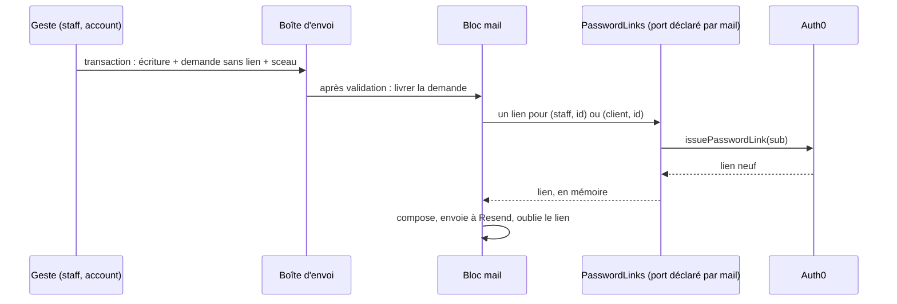

# Plan — le lien de mot de passe, fabriqué à l'envoi

> 📐 **Plan, 2026-11-12.** Rien n'est bâti. Né du plan de l'idempotence des
> écritures ([`../ops/l-idempotence-des-ecritures.md`](../ops/l-idempotence-des-ecritures.md), § 7) :
> Hugo a choisi le 2026-11-12 que les gestes d'ouverture d'accès passent leur
> e-mail par la boîte d'envoi pour être scellés avec leur écriture, et le
> bâtisseur s'est arrêté avant d'écrire : la boîte d'envoi aurait gardé le
> lien de mot de passe en clair. Frontière de sécurité : passe par `vitruve`
> avant Hugo.
>
> ⏸️ **Refusé par `vitruve` et mis de côté par Hugo le 2026-11-12.** Un lien
> neuf à chaque essai change le corps de l'e-mail d'un essai à l'autre : un
> envoi accepté par Resend mais non noté, repris par le balayeur avec la même
> clé et un autre corps, n'est plus dédoublonné (`mail-send-attempt.ts:55-58`,
> `resend-mailer.ts:233-256`). S'y ajoutent les durées (7 jours pour une
> invitation, 1 heure pour une réinitialisation), les deux écrans qui
> remettent le lien en main propre, et la réparation d'un sujet inconnu.
> **La conception retenue pour plus tard** : l'e-mail porte NOTRE lien
> (`/acces/<demande>.<HMAC>`), recalculé à l'identique à chaque essai et
> jamais rangé ; au clic, une page à bouton vérifie la signature et la
> validité, demande le ticket Auth0 à ce moment-là et redirige ; usage unique
> noté en base. En attendant, les quatre gestes restent en `run` : risque
> assumé, écrit au plan de l'idempotence.

## 1. En simple

Un lien de mot de passe vaut la prise d'un compte. Aujourd'hui, il part par
l'envoi immédiat, qui ne range nulle part le contenu d'un e-mail ; mais
l'envoi immédiat empêche de sceller le geste avec son écriture.

Le plan fait passer ces e-mails par la boîte d'envoi **sans le lien** : la
demande porte seulement « un lien de mot de passe pour cette personne », et
le bloc `mail` le fait fabriquer **au moment d'envoyer**, à chaque essai. Le
lien n'existe qu'en mémoire, le temps de l'envoi. C'est déjà ainsi que les
pièces jointes voyagent : la demande porte une référence au stockage, relue
à l'envoi (`MailAttachments.resolve`).

## 2. Ce qui existe (vérifié le 2026-11-12)

- `mail.send` écrit le fait `mail.requested`
  (`mail/requests/application/mail-requested.fact.ts`), dont la charge porte
  `data` en entier, rangée dans `platform.outbox.payload` (jsonb), gardée
  30 jours après la livraison (`OUTBOX_RETENTION_DAYS`), sans limite tant que
  `OUTBOX_PURGE` reste en essai, et relue par le balayeur.
- `sendAndAwaitReceipt` (`mail/requests/application/immediate-mail-sender.service.ts`)
  ne range que la ligne de suivi `mail.mail_request`, qui n'a aucune colonne
  de données : aucun lien n'a jamais été gardé.
- L'abonné `DeliverRequestedMail` (`mail/requests/application/deliver-requested-mail.handler.ts`)
  marque la demande dans la transaction de livraison et envoie par
  `AfterCommit`, hors transaction ; le balayeur relance un envoi orphelin ou
  reprenable avec la même clé, dans les 23 h de la fenêtre de Resend.
- `MailAttachments.resolve` (`mail/requests/application/mail-attachments.ts`)
  relit les pièces au moment de l'envoi, à chaque essai.
- Les gabarits qui portent `passwordSetupUrl` : `staff.invited`,
  `staff.password-reset`, `customer.password-reset`, `customer.access-opened`
  (`mail/channels/templates/b2b-mails.ts`, `mail/templates/mail-templates.ts`).
- Les fabricants du lien : `OpenStaffAccess` (`staff/invitations/open-staff-access.service.ts`)
  et `GrantAccountAccess` (`lafoliecoffee/account/application/services/grant-account-access.service.ts`),
  par `issuePasswordLink` du fournisseur d'identité
  (`platform/identity/auth0-identity.gateway.ts`). Auth0 est idempotent au
  rejeu pour l'identité (un 409 retrouve le sujet) ; un lien est neuf à chaque
  appel.

## 3. La conception

- **Le gabarit ne déclare plus `passwordSetupUrl: string`** mais
  `passwordLink: PasswordLinkRef`, `{ holder: "staff" | "customer", id }` —
  l'identifiant opaque de la fiche du staff ou du compte client, jamais le
  `sub` (`lint:subject-readers`, `lint:auth0-id-readers`), jamais l'adresse.
- **Le bloc `mail` déclare un port** `PasswordLinks` dans
  `mail/channels/requests/` : `linkFor(ref): Promise<string>`. Il est
  implémenté par `staff` (fiche → `sub` → lien) et par `lafoliecoffee/account`
  (compte → `sub` → lien), et relié par `appBootstrap` — la figure de
  `card-payment/channels/subjects/`. `mail` ne connaît toujours aucun bloc
  métier.
- **La résolution, à chaque essai** : une étape `MailPasswordLinks.resolve`
  à côté de `MailAttachments.resolve`, sur les trois chemins d'envoi (après
  validation, balayeur, immédiat). Le lien entre dans les données composées,
  puis est oublié.
- **Le geste** écrit, dans sa transaction, son changement et la demande par
  `mail.send`, puis scelle son intention (`runSealed`). Son résultat gardé
  dit l'étape « demandé » (`lint:mail-status-honest`), plus « accepté ».
- **Un renvoi fabrique un lien neuf** : un essai repris par le balayeur une
  heure plus tard n'envoie pas un lien déjà expiré. Avec la même clé
  d'idempotence, Resend ne renvoie pas un message déjà accepté : le second
  lien n'est fabriqué que si le premier envoi n'est pas parti.
- **Une porte** refuse qu'une donnée de demande d'e-mail porte une URL de
  mot de passe (`passwordSetupUrl`, ou une chaîne au format du ticket Auth0)
  hors de la résolution : la figure de `lint:mail-attachment-by-reference`.

## 4. Le bâti

- **L1 — le port et la résolution** : `PasswordLinks`, `MailPasswordLinks`,
  ses trois chemins, les deux implémentations, la liaison. Tests : un lien
  fabriqué par essai ; une panne d'Auth0 laisse la demande `failed`
  reprenable ; aucun lien dans le fait, la ligne de suivi ni les journaux.
- **L2 — les gabarits** passent à `passwordLink`, le dictionnaire et le
  manifeste des textes (`pnpm tool mail-copy:digest`), les exemples de la
  planche.
- **L3 — les quatre gestes** (invitation staff, invitation d'un membre,
  création d'un client par l'équipe, rattachement du titulaire) passent à
  `mail.send` + `runSealed` ; le contrat et les écrans disent « e-mail
  demandé » ; la liste de `lint:mail-receipt-admitted` se vide d'autant ; la
  dette de `write-idempotence` est régénérée.
- **L4 — la porte** du § 3.

## 5. Questions pour `vitruve`

- **V1** — un lien fabriqué par essai : deux essais concurrents (l'envoi
  après validation et le balayeur) peuvent-ils fabriquer deux liens valides
  pour la même personne ? Le second invalide-t-il le premier chez Auth0 ?
- **V2** — la panne d'Auth0 au moment d'envoyer : un e-mail d'invitation
  « demandé » mais jamais parti doit se voir à l'écran du staff ; le suivi
  existant suffit-il ?
- **V3** — l'implémentation côté `staff` lit le `sub` : `lint:auth0-id-readers`
  admet-elle ce nouveau lecteur, et sous quelle raison ?
- **V4** — la fenêtre de 23 h du balayeur et la durée du ticket (une heure) :
  un e-mail reparti 20 h plus tard porte un lien neuf — est-ce voulu pour une
  invitation ?
