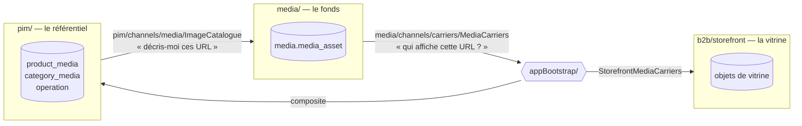
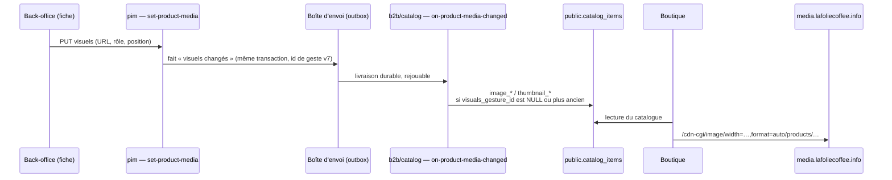
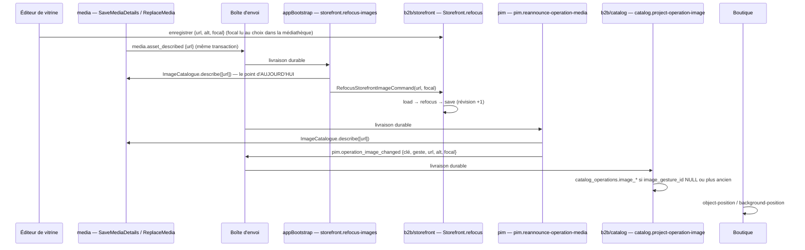
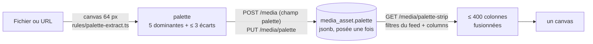

# La médiathèque — état des lieux

> **Doc technique, écrite le 2026-10-10 contre le code** (`dev` = `8560a5be1`).
> Chaque affirmation sur l'existant a été ouverte dans le dépôt ce jour-là.
>
> Elle **remplace** neuf documents, retirés le même jour : l'ancienne doc
> d'architecture et son TODO, le versant référentiel des images, la note
> d'infrastructure du stockage des images, le TODO du poids des images, et les
> quatre plans exécutés. Des migrations appliquées citent encore ces plans
> par leur nom : elles ne se retouchent pas, et leur texte se retrouve dans
> l'historique git (ce document les remplace tous).
>
> **Relue le 2026-10-11** (`dev` = `b19e0a893`) pour y fondre le plan de la
> médiathèque améliorée, retiré ce jour-là : ses décisions, toutes validées
> par Hugo, sont devenues les règles énoncées ci-dessous, là où elles
> s'appliquent. Cinq migrations citent encore ce plan par son nom : elles ne
> se retouchent pas.
>
> Ce qui reste à faire est au §11, et **nulle part ailleurs**.

---

## 1. Ce que c'est

Le **fonds d'images de la maison**. Il n'appartient à aucun de ceux qui
l'affichent : les fiches produit, les familles, les opérations datées et les
objets de la vitrine du commerce y **choisissent** des images. Aucun d'eux
n'en dépose.

| Couche       | Où                                                                               |
| ------------ | -------------------------------------------------------------------------------- |
| Bloc backend | `apps/lfd-api/src/media/`, monté par `MediaModule`                               |
| Schéma       | Postgres `media` : `media_asset`, `media_upload_failure`                         |
| Routes       | `/media` (staff), `/admin/media/sweep` (cron)                                    |
| Droit        | `media_library` (`read` pour `GET`, `write` pour le reste)                       |
| Écran        | back-office `/mediatheque` (`apps/lfd-backoffice-frontend/src/app/mediatheque/`) |
| Octets       | bucket R2 `lfc-media`, servi par `https://media.lafoliecoffee.info`              |
| Contrats     | `@lfd/pim-contracts` (`media.ts` : vues, limites, payloads)                      |

---

## 2. L'identité d'une image est son URL

`images/{SHA-256}.{ext}` : la clé de stockage **est** le hachage du contenu
(`DepositImageHandler`, `MEDIA_KEY_PREFIX = "images"` dans
`media/application/deposit-image.ts`). `media_asset.url` est `@unique`.

**Deux préfixes cohabitent, et c'est voulu** (renommage du 2026-10-13,
déployé) : les dépôts antérieurs restent sous `products/`, servis et justes
tant que personne ne les supprime ; tout dépôt neuf va sous `images/`. Aucune
migration n'a réécrit l'existant (décision de Hugo : le volume est petit, le
geste existe). Le **redépôt retrouve une image par son contenu**, préfixe
ignoré (`MediaLibrary.holdingContent(contentAddressOf(storageKey))`) : redéposer
un fichier identique rend la ligne existante, quel que soit son préfixe.

**Passer une image de `products/` à `images/`**, à l'écran : la détacher de
ses porteurs, la supprimer (le fonds refuse de supprimer une image portée),
puis redéposer le fichier et le rattacher. Entre la suppression et le
redépôt, le porteur est sans image. Les **photographies figées** (contenu des
révisions du référentiel, snapshots de livraison, versions du catalogue,
faits du journal) gardent l'URL `products/`, qui répondra 404 une fois l'objet
ramassé : elles disent ce qui a été servi tel jour.

Il en découle trois propriétés :

- **la déduplication est gratuite** : les mêmes octets tombent sur la même
  ligne ;
- **un redépôt est idempotent** : reprendre un lot à moitié échoué ne
  duplique rien — le dépôt répond `alreadyInLibrary` et n'écrit rien (vrai
  depuis le 2026-10-10 seulement : avant, un `create` sur l'URL unique
  rendait un 409). Deux dépôts **simultanés** des mêmes octets aussi, depuis
  le 2026-10-11 : le perdant de la course à l'unicité relit l'image et rend
  `alreadyInLibrary` ;
- **l'identité est stable** : tous les porteurs désignent l'image par son URL,
  jamais par l'identifiant de ligne.

⚠️ **La contrepartie : retoucher une photo crée une AUTRE image.** D'autres
octets, donc une autre URL. Le geste « Remplacer » (`POST /media/replace`)
fait passer TOUS les porteurs de l'ancienne à la nouvelle en une unité :
fiches, familles, opérations, objets de vitrine, porte de l'accueil. Le canal
des porteurs l'exprime par `MediaCarriers.repoint(replacement, ticket)`, qui
exige un `WriteTicket` ; la vitrine y signe sa révision, si bien qu'un
éditeur ouvert avant le remplacement est refusé (409) au lieu de réécrire
l'ancienne URL.

- Un porteur qui affichait déjà la nouvelle **sous le même rôle** garde une
  seule ligne, celle de l'ancienne, à son rang : remplacer garde la place.
  Sous deux rôles différents, les deux restent.
- **L'ancienne reste au fonds** ; le ramassage l'emporte après 7 jours sans
  porteur (§9).
- **La boutique suit sans republier** : le remplacement écrit le fait durable
  `media.asset_described` sur la nouvelle, et les abonnés du §7 et du §7 bis
  — fiches, vitrine, opérations — la posent avec **son** point focal.
- **Déposer et remplacer sont deux appels**, pas une route : une route
  combinée échouerait à moitié (nouvelle image entrée, remplacement refusé).
- À l'écran, le panneau de l'image se ferme pendant le remplacement (fold
  n'ouvre qu'un panneau à la fois), et « Remplacer… » est inactif tant que la
  description a des modifications. La reprise de la description de l'ancienne
  est proposée, cochée d'office seulement si la nouvelle n'en a aucune : on
  n'écrase jamais une description sans geste.

⚠️ **Une copie au commerce compte comme porteur.** L'image d'une opération
est copiée au commerce (`catalog_operations`) au push, et suit sans push
un remplacement comme une image changée sur l'opération au référentiel
(§7 bis) : la copie passe à la nouvelle dès que le fait
`pim.operation_image_changed` est livré. Tant que la copie affiche
l'ancienne image — ces quelques secondes —, celle-ci n'est ni retirable ni
ramassable : le panneau des porteurs la nomme « Boutique — opération « X »
(copie, suit en quelques secondes) ». Le
repointage de la copie dans la transaction du remplacement reste à zéro
(`CatalogCopyMediaCarriers.repoint`) : c'est le fait qui la fait suivre,
avec l'ordre de ses gestes. Une opération finie ou masquée compte encore
tant qu'un envoi ne l'a pas retirée : un effacement ne dépend pas d'un
calcul de date. Les copies d'image des **articles**, elles, ne comptent
pas : la projection vive les réécrit.

⚠️ **Ce qu'un redépôt ne rend pas** : l'étiquette, les mots-clés,
l'alternative et le point focal. Ils décrivent l'image, pas ses octets. **Et
il ne change pas sa série** : une image garde celle de son premier dépôt, et
le compte rendu du lot le dit.

---

## 3. Les frontières



**Deux canaux, un par sens**, et aucun bloc ne lit la table de l'autre
(`lint:prisma-model-ownership`) :

| Canal                      | Déclaré par    | Implémenté par                                                                                                                            |
| -------------------------- | -------------- | ----------------------------------------------------------------------------------------------------------------------------------------- |
| `pim/channels/media/`      | le référentiel | la médiathèque (`PrismaImageCatalogue`)                                                                                                   |
| `media/channels/carriers/` | la médiathèque | le référentiel (`PrismaMediaCarriers` : fiches, familles, opérations) **et** la vitrine (`StorefrontMediaCarriers`, dans `appBootstrap/`) |

`appBootstrap/composite-media-carriers.ts` interroge **tous** les porteurs et
additionne leurs réponses. 🔴 **Il échoue dès qu'un seul échoue.** Un porteur
muet ne vaut pas « zéro emploi » : sans cette règle, une panne de port
deviendrait un effacement de masse.

La surface Prisma du bloc (`MediaPrismaService`) ne déclare que ses deux
modèles.

### Ce que le bloc prend ailleurs

**Rien au référentiel, hors de son canal** : `lint:context-boundaries` borne
`media→pim` à `pim/channels/media/` depuis le 2026-10-10. Les briques
techniques viennent de `platform/` :

| Brique                                     | Où                                   |
| ------------------------------------------ | ------------------------------------ |
| le laissez-passer d'écriture du journal    | `platform/journal/scoped-journal.ts` |
| les identifiants UUID v7 (`UuidGenerator`) | `platform/id/uuid-generator.ts`      |
| la mécanique du texte en plusieurs langues | `platform/i18n/localized-text.ts`    |
| la lecture des colonnes `jsonb`            | `platform/database/json-columns.ts`  |

La **liste** des langues, elle, reste au contrat (`LOCALES`, `SOURCE_LOCALE`
de `@lfd/pim-contracts`) : `platform/` n'importe aucun contrat métier, et
chaque bloc lui passe ses langues en donnée (`MEDIA_LANGUAGES`,
`media/domain/value-objects/alt-text.ts`).

---

## 4. Le modèle

```
media.media_asset
  id            uuid v7
  url           UNIQUE — l'identité
  name          l'étiquette, "" par défaut
  alt           jsonb { fr: …, en: … } — UNE alternative par image
  tags          text[] — index GIN media_asset_tags_idx, déclaré au schéma
  focal_x/_y    fractions 0..1 depuis le coin haut-gauche, NULL = « personne ne s'est prononcé »
  series_id     → media_series, NULL = sans série (ON DELETE RESTRICT)
  storage_key, content_type, width, height, bytes
  created_at

media.media_series              d'où viennent les images
  id, title (≤ 120), shot_on (jour, jamais futur), note (≤ 2000), created_at

media.media_upload_failure      les dépôts refusés, 90 jours
  file_name, reason (français), code, bytes?, content_type?, actor_name?, occurred_at
```

### Ce qui appartient à l'image, et ce qui appartient à l'emploi

C'est la règle de partage, et elle décide de tout le reste :

| À l'IMAGE (`media_asset`)                                      | À l'EMPLOI (la table du porteur) |
| -------------------------------------------------------------- | -------------------------------- |
| étiquette, mots-clés, **alternative**, point focal, dimensions | URL, **rôle**, **position**      |

🔴 **L'alternative est sur l'image** (Hugo, 2026-09-23 : « un seul point dans
la médiathèque »). La corriger change ce que toutes les fiches en disent, et
c'est voulu. Le panneau Visuels de la fiche n'en porte donc plus.

Une image a **une** ligne : la lecture ne regroupe rien, la page est un
`findMany` trié par date de dépôt (départagé par l'URL), le total un `count()`.

---

## 5. Les gestes

| Geste                            | Route                                                                            | Où, à l'écran                      | Ce qu'il tient                                                                                                                                                                                                                                                                                                                                                                                                                                                                                                      |
| -------------------------------- | -------------------------------------------------------------------------------- | ---------------------------------- | ------------------------------------------------------------------------------------------------------------------------------------------------------------------------------------------------------------------------------------------------------------------------------------------------------------------------------------------------------------------------------------------------------------------------------------------------------------------------------------------------------------------- |
| Parcourir, trier, filtrer        | `GET /media?after=&sort=&q=&tags=&from=&to=&shotFrom=&shotTo=&untagged=&unused=` | médiathèque (le fil), sélecteur    | par **curseur** (`next`), jamais par décalage : un dépôt pendant qu'on défile ne crée ni doublon ni saut. Tris : dépôt, prise de vue, étiquette (vides en dernier), emplois. `tags` filtre par `hasEvery`. Le tri par emplois et « inutilisées » sont bornés à 5 000 images filtrées (409, « restreignez d'abord ») : les emplois viennent des porteurs, il n'y a pas de pagination SQL possible. « Inutilisées » garde ainsi un total exact, plutôt que des pages courtes qui promettraient des pages inexistantes |
| Déposer                          | `POST /media` (multipart)                                                        | **médiathèque seulement**          | PNG, JPEG ou WebP, lu dans les octets ; 10 Mo ; 200 px de côté au moins ; garde de transport à 25 Mo                                                                                                                                                                                                                                                                                                                                                                                                                |
| Voir les refus                   | `GET /media/failures`                                                            | médiathèque                        | l'historique survit au rechargement ; il ne **rejoue** pas, puisque l'octet n'a pas été stocké                                                                                                                                                                                                                                                                                                                                                                                                                      |
| Nommer, taguer, décrire, pointer | `PUT /media`                                                                     | médiathèque                        | les tags sont découpés, mis en minuscules et dédoublonnés (`mediaTags`)                                                                                                                                                                                                                                                                                                                                                                                                                                             |
| Le vocabulaire                   | `GET /media/tags`                                                                | la bande de tags                   | chaque mot du fonds ENTIER et son nombre d'images — jamais la page chargée                                                                                                                                                                                                                                                                                                                                                                                                                                          |
| Renommer, fusionner un mot       | `PUT /media/tags/rename`                                                         | menu de la pastille                | partout, en une unité ; la fusion avec un mot existant est annoncée avant de valider                                                                                                                                                                                                                                                                                                                                                                                                                                |
| Retirer un mot partout           | `DELETE /media/tags?tag=`                                                        | menu de la pastille                | confirmation avec le compte ; les images restent                                                                                                                                                                                                                                                                                                                                                                                                                                                                    |
| Lire une image seule             | `GET /media/one?url=`                                                            | outils agent                       | la même vue qu'une ligne du fil ; 404 `media.not_in_library` si elle n'est pas au fonds. Ouverte le 2026-10-11 : qui écrit sans voir l'image doit la relire, `PUT /media` remplaçant tout                                                                                                                                                                                                                                                                                                                           |
| Qui l'affiche ?                  | `GET /media/carriers?url=`                                                       | médiathèque                        | les porteurs, nommés et cliquables, pas un simple compte                                                                                                                                                                                                                                                                                                                                                                                                                                                            |
| Retirer du fonds                 | `DELETE /media?url=`                                                             | médiathèque                        | **409 dès qu'un porteur l'affiche**, avec leur nombre                                                                                                                                                                                                                                                                                                                                                                                                                                                               |
| Choisir, donner un usage         | `PUT` du porteur                                                                 | fiche, famille, opération, vitrine | le porteur écrit sa propre table de rattachement ; il ne touche jamais le fonds                                                                                                                                                                                                                                                                                                                                                                                                                                     |

🔴 **On ne dépose qu'à la médiathèque**, et c'est un choix de métier. Celui qui
alimente et tague le fonds n'est pas celui qui rédige les fiches. Un dépôt
offert au rédacteur remplirait le fonds d'images non taguées, donc
introuvables. Les clients HTTP du référentiel n'ont plus de méthode de dépôt :
le geste y est inexprimable.

### Le fil à l'écran

Une barre d'outils (recherche, tri, période, « Non taguées », « Inutilisées »,
mots-clés filtrés, compte) au-dessus d'une grille qui charge la page suivante
en approchant du bas. Sous le tri par dépôt, des intercalaires de mois à
l'heure de Paris — jamais par tag, une image y paraîtrait plusieurs fois : on
**filtre** par tag, on **regroupe** par date et par série. L'adresse porte la
vue, sans le curseur.

`shotFrom` / `shotTo` filtrent par **jour de prise de vue**, bornes incluses :
la date de la série, le jour de dépôt à l'heure de Paris à défaut — la même
date que la frise (§9 bis). Une période inversée est refusée en 400
(`shotPeriodOf`, `media/application/library-period.ts`). L'écran les montre
en pastille « Prises du … au … » (`shotRangeLabel`, `rules/feed-filters.ts`), qui
se retire d'un clic.

### Les séries

Une série dit l'**origine** d'un lot d'images : « Shooting carte 2026 », sa
date de prise de vue, sa note d'intention. Facultative au dépôt ; une image
en a au plus une, celle de son premier dépôt. Le fait `media_asset.deposited`
nomme la série, pour savoir qui a rangé quelle image où.

| Geste                  | Route                        | Ce qu'il tient                                                              |
| ---------------------- | ---------------------------- | --------------------------------------------------------------------------- |
| Lister                 | `GET /media/series`          | avec le nombre d'images, prise de vue décroissante                          |
| Ouvrir, corriger       | `POST` / `PUT /media/series` | prise de vue future refusée — faute de frappe, et tête du tri pour toujours |
| Déposer dans une série | `POST /media` (`seriesId`)   | vérifiée AVANT d'écrire au bucket ; un redépôt garde sa série               |
| Rattacher, détacher    | `PUT /media` (`seriesId`)    | un id rattache, `null` détache, l'absence ne change rien                    |

À l'écran : la série du lot se choisit au-dessus de la zone de dépôt, le
compte rendu dit « déjà au fonds — série X » sans alarme, une pastille de
série paraît sur les tuiles et dans le panneau, et le fil se filtre par
série et se trie par prise de vue (intercalaires par série). Le poste vérifie
type, poids et dimensions avant d'envoyer, avec les phrases du serveur, qui
reste l'autorité. Pas de suppression de série.

### Les tags à l'écran

Une **pastille unique** (`tag-chip`) sert partout : bande (mot et compte,
menu intégré), tuile (×), filtre, panneau de l'image (mots portés et
suggestions). Retirer un mot d'une tuile est immédiat et s'annule pendant six
secondes. La recherche de la bande ignore accents et casse pour filtrer, mais
« Créer » reste exact : le serveur tient « eclair » et « éclair » pour deux
mots, et le filtre montre le voisin (`rules/tag-words.ts`). Chaque geste de tags renvoie l'alternative de l'image
telle qu'elle est : le serveur lit une alternative **absente** comme effacée
(c'est ainsi que le panneau la vide), et ces gestes l'ont effacée jusqu'au
2026-10-10.

⚠️ Renommer n'est pas verrouillé ligne à ligne (pas de SQL brut sur le fonds) :
un enregistrement de tags concurrent peut écraser le renommage. La fenêtre est
celle d'une transaction courte, et elle est écrite dans le handler.

Le dépôt en lot (`state/batch-upload.ts`) est **séquentiel**. Il ne s'arrête jamais
sur un refus et garde les `File` refusés pour qu'on puisse les rejouer. Il est
séquentiel parce que le serveur tient les octets en mémoire pour les mesurer.

L'URL passe en paramètre de requête plutôt que dans le chemin, parce qu'elle
contient des `/`.

### L'écran : organisation du code

`apps/lfd-backoffice-frontend/src/app/mediatheque/` est rangé en cinq
dossiers, un par raison de changer. Les dépendances descendent : `ui/` lit
`state/` et appelle `gestures/` ; `gestures/` et `state/` lisent `data/` ;
tout le monde lit `rules/`, qui ne lit personne.

```
mediatheque/
├── data/      un client HTTP par ressource du serveur — images, mots-clés,
│              séries, porteurs, palettes et frise —, plus le lecteur de
│              palette du navigateur (canvas)
├── state/     les magasins à signaux (fil, critères de l'adresse, frise,
│              recherche, porteurs, séries, rattrapage des palettes, dépôt en
│              lot) et les saisies d'un panneau (description, remplacement)
├── gestures/  les services d'action : un geste ouvre son panneau, écrit,
│              relit, et le dit (mots-clés, vocabulaire, description,
│              remplacement, retrait, actions d'une image)
├── rules/     les fonctions pures, chacune avec sa spec : formats et faits
│              d'une image, libellés et pluriels, calendrier de Paris,
│              couleurs et extraction de palette, critères et adresse du fil,
│              règles du remplacement, pli et vocabulaire des mots-clés
└── ui/        un dossier par composant (page, panneaux, sections, bande,
               frise, dépôt, tuiles) — `.ts`, `.html`, `.scss`, `.spec.ts`
```

| Dossier     | Ce qui y entre                                                                                                                                                                      |
| ----------- | ----------------------------------------------------------------------------------------------------------------------------------------------------------------------------------- |
| `data/`     | `providedIn: 'root'`, une `Promise` par appel (`firstValueFrom`), les types de `@lfd/pim-contracts`. Aucun état. Un client par ressource : un écran n'injecte que ce qu'il appelle. |
| `state/`    | Un signal par fait, une mutation qui relit. Fourni par la page (ou le panneau) qui le montre, pour mourir avec elle. Aucun `subscribe()`.                                           |
| `gestures/` | L'orchestration d'un geste : panneau, écriture, relecture, message. Pas de règle : il l'emprunte à `rules/`.                                                                        |
| `rules/`    | Une fonction pure, testée sans Angular. Le DOM n'y entre que passé en paramètre (`layoutOf`, `paintStrip`).                                                                         |
| `ui/`       | L'affichage et ses événements, rien d'autre : une règle va dans `rules/`, un état dans `state/`.                                                                                    |

Un fichier `.ts` y tient en moins de 200 lignes, specs non comprises. Les
outils agent (`src/app/agent/`) et le sélecteur de la fiche
(`pim/catalogue/library-picker`) prennent les mêmes clients de `data/`.

### Le droit

`media_library` ne vient **pas** de `pim_catalog`. Depuis la migration
`20260923200000`, seuls `admin` et `communication` l'ont, en écriture. Pour
`commercial`, `comptabilite` et `dev`, le bouton « Choisir dans la
médiathèque » d'une fiche rend 403. Le rôle `communication` a aussi
`pim_catalog:read` : sans lui, les liens vers les porteurs mèneraient à un 403.

---

## 6. Les usages d'un visuel sur une fiche

`MediaRole` : `hero`, `thumbnail`, `gallery`, `lifestyle`, `print`.

| Rôle        | Cardinalité | Ratio annoncé | Traverse vers le commerce | Lu par                                       |
| ----------- | ----------- | ------------- | ------------------------- | -------------------------------------------- |
| `hero`      | un seul     | 4/3           | ✅ `image`                | ouverture de fiche ; tuile de rayon en repli |
| `thumbnail` | un seul     | 4/3           | ✅ `thumbnail` (fil v10)  | tuile de rayon                               |
| `gallery`   | plusieurs   | —             | ❌                        | personne                                     |
| `lifestyle` | plusieurs   | 16/9          | ❌                        | personne                                     |
| `print`     | plusieurs   | 1/1           | ❌                        | personne                                     |

- **L'unicité appartient au verbe.** `setMediaRole` déloge en une seule mise à
  jour celui qui portait le même rôle unique, et seulement lui.
- **La fourche `hero` / `thumbnail` est tranchée.** Les deux traversent, et la
  boutique retombe sur `hero` quand la fiche n'a pas de vignette
  (`thumbnailOf` dans `prisma-catalog.reader.ts`).
- 🔴 **Le rôle par défaut ne voyage nulle part, et l'écran le dit.** Une
  image choisie sans rôle prend `gallery` (`DEFAULT_MEDIA_ROLE`), qui ne
  traverse pas. Rien n'est décidé à la place de qui photographie (Hugo,
  2026-10-10, option B), mais depuis ce jour :
  - une tuile en usage non publié porte la pastille « Non publié » (jamais
    sur un visuel de famille, qui n'a pas d'usage) ;
  - le panneau d'usage le dit au moment du choix ;
  - une fiche qui a des visuels et aucun publié affiche un avertissement
    au-dessus de la grille.

  La liste des usages publiés est `PUBLISHED_MEDIA_ROLES`
  (`apps/lfd-backoffice-frontend/src/app/pim/catalogue/media-roles.ts`) : elle
  recopie ce que `showcase.ts` fait traverser, et doit le suivre.

- **Les formats se signalent, ils ne se refusent jamais.** Une seule table, `pim/catalogue/media-formats.ts` du back-office, recopiée
  des feuilles de style de la boutique : ouverture et vignette 4/3 (l'ancien
  libellé « 3/2 » était faux), mise en situation 16/9, tirage 1/1 ; cadres
  d'aperçu 4/3, 1/1, 16/9, 21/9. Au-delà de 8 % d'écart entre l'image et son
  usage, le panneau d'usage le dit et la tuile porte « Format » : en dessous
  (≈ 4 % rognés par bord), `cover` ne se voit pas ; un 3/2 posé en 4/3
  (12,5 %) est signalé. Le 21/9 est celui des grandes bannières et des
  opérations, le 16/9 celui des cartes d'info de la vitrine. ⚠️ Cette
  table recopie la boutique : changer un `aspect-ratio` là-bas demande de la
  suivre ici.

---

## 7. Le trajet d'une image jusqu'à la boutique



- **Changer une photo ne demande plus de republier.** La projection vive passe
  par un abonné **durable** (`ProductMediaChanged`, lot E5 du 2026-10-10).
  L'ordre est tenu par `visuals_gesture_id` (migration
  `20261010120000_l_ordre_des_visuels`) : un fait plus ancien rejoué après un
  plus récent ne l'écrase pas.
- **Deux écrivains, et c'est voulu.** Un push (ingestion d'un instantané)
  réécrit aussi `image_*` et `thumbnail_*`. Les deux lisent la même source :
  la projection fait la fraîcheur, le push fait la réparation. Une image qui
  « revient » après une publication n'est pas un défaut.
- **Le point focal voyage.** `ImageCatalogue` le rend ; le
  fait des visuels et le fil (`syncMediaSchema.focal`, facultatif, sans
  changer de version) le portent ; `catalog_items` le range en
  `image_focal_x/y` et `thumbnail_focal_x/y` (migration
  `20261010200000_le_point_focal_voyage`) ; la boutique pose
  `object-position` sur la tuile et l'ouverture de fiche — au centre quand il
  est absent.
- **Redécrire une image fait suivre la boutique.** Quand l'alternative ou le
  point focal changent, `SaveMediaDetailsHandler` écrit le fait durable
  `media.asset_described` (`media/channels/carriers/`) dans sa transaction ;
  le référentiel l'écoute (`on-media-asset-described.ts`, `@DurableHandler`)
  et réannonce `pim.product_media_changed` pour chaque fiche qui porte l'URL
  en `hero` ou `thumbnail`. Deux autres abonnés recadrent la vitrine et les
  opérations (§7 bis) ; les familles n'ont pas de copie projetée.
- **La boutique garde une copie de l'URL** : le snapshot vaut aussi pour
  l'image. Repointer le référentiel ne repointe la boutique que par l'un de
  ces deux chemins.
- **Le poids.** La boutique ne sert jamais l'original : `media-source.ts`
  demande une transformation Cloudflare à la largeur affichée, avec un
  `srcset`. Mesures, réglages et repli silencieux :
  [`../ops/cloudflare-images.md`](../ops/cloudflare-images.md) §3.

---

## 7 bis. Le point focal hors des fiches : vitrine et opérations

La bannière, les cartes d'info, les deux portes de l'accueil (« Je passe la
prendre » et livraison) et la bannière d'opération se cadrent sur le point focal de la médiathèque — au
centre seulement quand l'image n'en a pas.



- **À l'enregistrement**, `StorefrontImage` porte `{ url, alt, focal? }`
  (`focal ∈ [0,1]²`) : l'éditeur envoie le point qu'il lit dans la
  médiathèque. Il est rangé en `image_focal_x/y` (`storefront_content`) et
  `pickup_door_focal_x/y` (`storefront_page`), nullables, avec un `CHECK`
  « les deux ou aucune » (migration
  `20261011140000_le_point_focal_jusqu_a_la_vitrine`). Le contrat public
  (`storefrontImageSchema`, `@lfd/contracts`) sert `focal`, facultatif.
- **Quand la médiathèque redécrit** : `RefocusStorefrontOnMediaDescribed`
  (`appBootstrap/storefront-media-focus.ts`, abonné durable
  `storefront.refocus-images`) écoute `media.asset_described`. Il vit dans la
  racine parce que `b2b → media` est hors de la matrice : seule elle voit les
  deux blocs. Il relit le point courant, pas celui du geste — un fait rejoué
  tard pose le point d'aujourd'hui, et une image retirée entre-temps n'est pas
  recadrée.
- **Le recadrage passe par l'agrégat** : `Storefront.refocus(url, focal, at)`
  recadre chaque objet et page qui porte l'URL, et monte la révision — un
  éditeur ouvert avant est refusé (409) au lieu de réécrire l'ancien point.
  Il **garde l'auteur du dernier enregistrement** et pose `updated_at` à
  l'instant du recadrage : la décision est `media_asset.described`, tracée à
  la médiathèque, et la vitrine n'a pas été composée par quelqu'un (pas de
  `storefront.saved`). Sans porteur, ou sur une vitrine jamais composée, rien
  n'est écrit et la révision ne monte pas.
- **Un remplacement A → B recadre sur le point de B** : le fait
  `media.asset_described` est écrit sur B (§2).
- **Les opérations** reçoivent l'image et son point au **push**, dans le
  snapshot (`packages/catalog-sync`), lu dans la médiathèque à ce moment-là,
  rangé en `catalog_operations.image_*` et `image_focal_x/y`.
- **Entre deux push, l'image d'une opération suit la médiathèque.** Le
  remplacement repointe l'opération au référentiel dans sa transaction ;
  `OnMediaAssetDescribedForOperationsHandler`
  (`apps/lfd-api/src/pim/operations/application/on-media-asset-described.ts`, abonné durable
  `pim.reannounce-operation-media`) écoute `media.asset_described`, relit les
  opérations qui affichent l'URL (archivées comprises, tant que leur copie
  vit) et le point courant, et publie pour chacune
  `pim.operation_image_changed` (`pim/channels/b2b-platform/operations/`) —
  l'URL, l'alternative **de l'opération**, le point de la médiathèque, un
  geste UUID v7 neuf. Le commerce (`OnOperationImageChangedHandler`, abonné
  `catalog.project-operation-image`) l'écrit par UNE écriture conditionnée
  sur `image_gesture_id` (migration `20261011180000_l_image_des_operations_suit`,
  additive) : un fait plus ancien livré après un plus récent n'écrit rien.
  Seule l'image traverse ainsi — dates, sélection et clientèle attendent le
  push, qui reste la réparation et ne touche pas au geste. La parité du
  catalogue reste verte : la projection du référentiel et la copie disent la
  même image.
- **Une image changée sur l'opération elle-même** (édition au référentiel :
  posée, changée, retirée, ou son alternative réécrite) suit aussi sans
  push. `EditOperationHandler`
  (`apps/lfd-api/src/pim/operations/application/edit-operation.ts`) publie
  le même fait dans SA transaction, à côté de l'écriture et de la trace —
  seulement si l'image ou son alternative a changé ; un nom ou une accroche
  seuls ne publient rien. Les deux émetteurs partagent une seule
  construction de la charge utile (`announceOperationImages`,
  `apps/lfd-api/src/pim/operations/application/operation-image-announcement.ts`) : l'URL et l'alternative de
  l'opération, le point relu à la médiathèque. Une image **retirée** part en
  `image: null`, sous le même ordre par geste, et le commerce efface
  `image_url`, `image_alt` et le point : la boutique sert l'opération sans
  image (`image: null`), exactement ce qu'un push sans image aurait écrit, et
  la parité reste `unchanged`. Il n'existe plus de cas où l'image d'une
  opération attend le push ; ses **dates, sa sélection et sa clientèle**,
  elles, n'y traversent toujours qu'au push.
- **L'éditeur de vitrine** reçoit le point des opérations
  (`storefrontCatalogOperationSchema.image.focal`, facultatif) : l'aperçu
  d'une image héritée se recadre par `focalPositionOf`.
- **La boutique** pose `object-position` sur les infos et les bannières,
  `background-position` sur les deux portes (fond CSS), par le calcul de
  `objectPositionOf` (`shelf-display.ts`).

### L'accueil de la vitrine

- La page « Accueil » de la vitrine porte la **porte « Je passe la prendre »**
  en réglage de page (`pickupDoorImage`), pas en objet de grille : la porte
  n'est pas dans la grille, et un objet aurait demandé une position et une
  règle « une seule porte » pour rien. Elle compte comme porteur. Le bandeau
  visiteur affiche la même image, avec son alternative ; la porte d'un pro,
  décorative à côté de son libellé, n'en porte pas (fond CSS). Son aperçu
  dans l'éditeur est en 2/1, faute de ratio fixe côté boutique.
- La même page porte la **porte livraison** (`deliveryDoorImage`, depuis le
  2026-10-11), sa jumelle : mêmes règles (accueil seul, mêmes CHECK sur
  `storefront_page.delivery_door_*`), réglée dans le même éditeur par un
  second panneau, comptée comme porteur (« Accueil — porte livraison »),
  repointée par un remplacement et recadrée par une redescription comme la
  porte retrait. **Vide, la carte livraison reprend la photo et le
  recadrage de la porte retrait** — le repli vit dans `service-doors.scss`,
  l'écran ne pose `--door-photo-courier` que quand une image est choisie.
  Une page dont les deux portes montrent la même image compte pour UN
  porteur.
- Une **bannière 21/9** se pose partout, accueil et rayons, comme la bande
  double de même emprise. La grille de vitrine se pose juste avant « En ce
  moment », après les portes, qui restent le geste principal.
- **L'opération mise en avant** (`featuredOperation`, `operation-event.ts`) :
  les ouvertes, puis les annoncées, puis les closes ; à égalité, l'échéance
  la plus proche. Son décompte (`datedEventOf`) court jusqu'à la clôture
  (ouverte) ou l'ouverture (annoncée), « Dernier jour » le jour même, en jours
  de Paris. Sa carte mène au rayon de l'opération (`/boutique?rayon=op:<key>`).

---

## 8. Stockage et service

Les octets vivent dans le bucket R2 `lfc-media`, servis par
`media.lafoliecoffee.info` ; l'API dépose, la lecture ne passe jamais par
nous. Tout ce qui se règle chez Cloudflare — bucket, domaine, TLS, jeton et
variables, transformations, cache immuable, coût, vérifications — est
rassemblé dans [`../ops/cloudflare-images.md`](../ops/cloudflare-images.md).

---

### La fenêtre du retrait — assumée

`DiscardMediaHandler` compte les porteurs **puis** supprime. Si un porteur
choisit l'image entre les deux — une fiche enregistrée pendant l'aller-retour
au bucket —, il affichera une image disparue. Rien ne ferme cette fenêtre, et
c'est décidé (Hugo, 2026-10-10) : un verrou partagé entre le retrait et tous
les gestes qui choisissent une image traverserait quatre blocs (référentiel,
familles, opérations, vitrine) pour une fenêtre de quelques centaines de
millisecondes sur un geste rare.

**Le remède, s'il arrive** : redéposer le même fichier. L'adressage par le
contenu redonne la même URL, et le porteur retrouve son image — sans ses
mots-clés, son alternative ni son point focal, qui étaient au fonds.

**Ce qui le rendrait faux** : un retrait automatisé en masse, ou plusieurs
personnes qui alimentent le fonds en même temps qu'on le nettoie. Le
ramassage, lui, rejoue le compte juste avant chaque suppression.

## 9. Le ramassage des orphelines

Un cron Cloudflare (`apps/lfd-api/wrangler.jsonc`, `30 3`, via
`container/worker.ts`) poste sur `/admin/media/sweep`, derrière le
`RecomputeGuard` :

- **candidates** : les images de plus de **7 jours** sans aucun porteur, au
  plus **200** par passage. Le rapport porte `capped` quand le plafond a mordu ;
- **juste avant chaque suppression, il recompte.** La fenêtre de course n'est
  pas fermée pour autant : elle tombe à quelques millisecondes ;
- **il supprime l'objet R2 d'abord, la ligne ensuite.** Dans l'ordre inverse,
  un échec sur R2 effacerait la seule trace de ce qu'il reste à supprimer ;
- **il purge l'historique des refus** au-delà de **90 jours**.

---

## 9 bis. La frise des couleurs

Une bande au-dessus du feed montre l'évolution de la colorimétrie du fonds
filtré, dans l'ordre de la prise de vue (dépôt à défaut).



- **La palette se calcule dans le navigateur** : l'API n'a pas de décodeur.
  Le serveur la revalide (`imagePaletteSchema`) et ne l'écrase jamais —
  l'identité d'une image est son contenu. Aucun fait n'est journalisé.
- **Le rattrapage** : à l'ouverture, l'écran peint par lots de 20 les images
  chargées qui n'ont pas de palette, une tentative par image.
- **La frise a la taille de l'écran, pas du fonds** : le serveur découpe les
  images filtrées en tranches consécutives de même effectif et fusionne leurs
  palettes (`merge-palettes.ts`). Pré-agrégation à prévoir au-delà d'environ
  20 000 images filtrées (estimé).
- ⚠️ Le canvas ne lit une image servie par R2 que si le bucket l'autorise
  (CORS). Sans quoi la colonne reste hachurée, sans erreur. Vérifié en dev,
  pas en production.
- **Un clic sur une colonne ouvre ses photos** : il pose `shotFrom` /
  `shotTo` sur le fil (§5), la plage de jours de prise de vue de la colonne,
  la même date que l'axe de la frise.
- Pas de clavier : un canvas unique, qui double une information que le fil
  donne déjà.

## 10. Ce qui est journalisé

Les faits d'une image, avec l'URL pour sujet :

- `media_asset.deposited` (et sa série, s'il y en a une) ;
- `media_asset.described` (dont le changement de série) ;
- `media_asset.replaced` (vers quelle image, chez combien de porteurs) ;
- `media_asset.discarded`.

Et ceux du vocabulaire et des séries : `media_tag.renamed`,
`media_tag.removed`, `media_series.created`, `media_series.described`.

Ils se lisent sous le module **Médiathèque** du journal d'activité.

Les deux ports d'écriture (`MediaLibrary`, `MediaLibraryWriter`) exigent un
ticket de `platform/journal/scoped-journal.ts`. On n'obtient ce ticket qu'en
traçant, ou en nommant pourquoi on ne trace pas (`untraced`). Écrire sans
affirmer ne compile pas. `lint:journal-tracked` reconnaît un port d'écriture
à ce ticket, pas à son nom : un port neuf qui l'exige est audité d'office.

Le ramassage ne journalise rien, et c'est déclaré : une passe automatique n'a
pas d'auteur. Il présente le ticket `untraced("ramassage automatique, sans
auteur")`, et son rapport tient lieu de trace.

Les **refus de dépôt ne sont pas le journal** : leur sujet n'existe pas. Ils
s'inscrivent dans leur propre unité de travail, sinon le rollback du dépôt les
emporterait.

---

## 11. Les points à faire

La **dette** a été soldée les 2026-10-10 et 2026-10-11 (encadrés ci-dessous).
Ce qui reste, au 2026-10-11, est ici et nulle part ailleurs. Les lignes
marquées 🔵 attendent une décision de Hugo.

> **Soldé le 2026-10-10**
>
> - la lecture ne regroupe plus par URL, le total est un `count()` (`22b143e94`) ;
> - les justifications qui invoquaient une clé étrangère disparue (`22b143e94`) ;
> - le module « Médiathèque » du journal d'activité (`6ce533307`) ;
> - un seul générateur UUID v7, en `platform/id/` (`d00deda08`) ;
> - le texte localisé et les colonnes `jsonb` en `platform/`, `media→pim`
>   resserré sur le canal (`eb4d6e1ee`) ;
> - `lint:journal-tracked` reconnaît un port d'écriture à son ticket ;
>   `MediaLibrary` exige le sien (`eacb27232`) ;
> - l'index GIN déclaré au schéma, le doublon sur `url` retiré (`158bf9273`) ;
> - l'écran dit qu'un visuel en usage non publié n'apparaît nulle part (§6).

> **Soldé le 2026-10-11** (relecture SOLID/DDD)
>
> - un corps mal formé rend 400, plus 500 ; `POST /media` ne sort plus la clé
>   de stockage ; deux dépôts simultanés des mêmes octets sont idempotents ;
> - la règle « alternative vide = URL » a une seule source
>   (`isMediaAltWritten`, `@lfd/pim-contracts`), serveur et écran ;
> - un seul `UnitPoint` (`platform/shared/geometry`) valide le point focal
>   pour la médiathèque, la vitrine et le catalogue ;
> - les aperçus de l'éditeur de vitrine se recadrent sur le point ; la parité
>   du catalogue compare le point focal des opérations ;
> - deux recadrages quasi simultanés : éprouvé (`storefront-focal-race`), la
>   livraison rejouée pose le dernier point ;
> - plus aucun fichier de la médiathèque au-delà de 300 lignes ; les codes de
>   l'ancien plan ont quitté le code ;
> - la photo du fournil est posée sur la porte (production), le CORS du
>   bucket autorise le back-office (vérifié sur une image) ;
> - l'image d'une opération et son point suivent un remplacement ou une
>   redescription sans push (§7 bis) ; l'aperçu hérité de l'éditeur de
>   vitrine se recadre sur le point de l'opération.

1. **Redéposer à l'écran les images encore sous `products/`** (Hugo) — le
   code est déployé (§2) ; reste le geste, image par image. Non vérifié :
   combien il en reste en production.
2. **🔵 Au-delà de 5 000 transformations par mois**, l'offre Images & Stream
   n'étant pas souscrite : facturé, ou arrêté ? Cf.
   [`../ops/cloudflare-images.md`](../ops/cloudflare-images.md) §5. Laissé en
   l'état (Hugo, 2026-10-11).
   La carte OPS « Médiathèque — les seuils » prévient à 80 % (vers 1 000
   images) et dit quand passer au payant, avec les deux autres limites du
   fonds (tri par emplois, frise) : cf.
   [`../ops/cloudflare-images.md`](../ops/cloudflare-images.md) §5 bis.
3. **🔵 Recadrage automatique** (`gravity=auto`) des images sans point : non
   fait, le centre reste le défaut. Changer `fit` touche toutes les tuiles et
   le compte des transformations : à mesurer avant.
