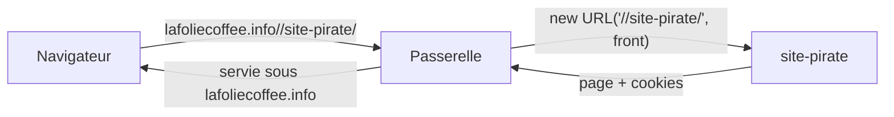

# Audit de sécurité du 2026-11-12

> Demandé par Hugo (« un audit de sécurité, hardcore », puis « la tenancy, les
> fuites de données et les fuites de mémoire »). Lecture du code par neuf
> passes, une par surface ; chaque constat grave a été rouvert à la main, et
> la faille de la passerelle éprouvée en production par deux `GET` inoffensifs
> vers `example.com`. Aucune requête n'a écrit quoi que ce soit.

## 1. En simple

Une seule faille grave, **corrigée le jour même** : la passerelle servait
n'importe quel site sous l'adresse de la boutique. Le reste du système tient :
un client ne voit pas les données d'un autre, les paiements ne font pas
confiance au navigateur, les fichiers envoyés sont vérifiés, et aucun cache ne
mélange deux clients.

Restent quelques points moyens à décider, listés au § 3, et une poignée de
fragilités faibles au § 4.

## 2. Corrigé

| Gravité     | Constat                                                                                                                                                                                                                                                                                                                                                                                                        | Correctif                                                                                                                                              |
| ----------- | -------------------------------------------------------------------------------------------------------------------------------------------------------------------------------------------------------------------------------------------------------------------------------------------------------------------------------------------------------------------------------------------------------------- | ------------------------------------------------------------------------------------------------------------------------------------------------------ |
| 🔴 critique | **La passerelle relayait un hôte arbitraire.** `https://lafoliecoffee.info//example.com/` rendait 200 avec la page d'example.com ; `/pro//example.com` rendait 302 vers `https://example.com/`. Chaque destination se fabrique par `new URL(chemin, origine)`, qui lit `//hôte` comme un autre hôte (`gateway/src/index.ts`, fronts et backends). Hameçonnage sous le vrai domaine, cookies posés sur la zone. | `resolveTarget` (`gateway/src/routes.ts`) ne route aucun chemin qui porte `//` : 404. Tests de régression dans `gateway/src/__tests__/routes.spec.ts`. |

## 3. À décider

| Gravité               | Constat                                                                                                                                                                                                                                                                                                                                                                                                              | Geste proposé                                                                                                                                                      |
| --------------------- | -------------------------------------------------------------------------------------------------------------------------------------------------------------------------------------------------------------------------------------------------------------------------------------------------------------------------------------------------------------------------------------------------------------------- | ------------------------------------------------------------------------------------------------------------------------------------------------------------------ |
| moyenne               | **La fiche racine peut être prise par un détenteur de `staff_access:write`** tant qu'elle ne s'est jamais connectée : `POST /admin/staff-users/:id/invitation` (`open-staff-access.service.ts`, seul `suspended` est refusé) puis `POST /admin/staff-access/pending/:id/link` (`issue-staff-password-link.handler.ts`), qui rend le lien de mot de passe dans la réponse. Ses actes paraissent alors sous la racine. | Refuser la racine dans les deux gestes ; plus largement, la remise en main d'un lien vaut prise de compte pour toute fiche non activée — à assumer ou à resserrer. |
| moyenne               | **Un site lit sur la pièce de son principal les bons de ses frères.** `prisma-company-invoices.reader.ts` rend une pièce dès qu'elle porte UN bon du site, et `invoice.mapper.ts` la rend entière (numéros de commande et de bon des autres sites, lignes cumulées). Les frères ne se voient nulle part ailleurs. Une pièce ne regroupe jamais deux sociétés sans lien (clé = payeur).                               | Décider ce qu'un site voit : la pièce réduite à ses bons, ou un renvoi vers le principal.                                                                          |
| moyenne               | **Un seul jeton machine (`RECOMPUTE_TOKEN`) ouvre une trentaine de routes**, dont l'exécution des remboursements dus, les lots de prélèvement et l'expiration des commandes ; lu sans longueur minimale (`app-config.ts`), comparé par `!==` (`recompute.guard.ts`).                                                                                                                                                 | Longueur minimale comme `ROUTE_PLANNER_TOKEN`, comparaison à temps constant ; un jeton par famille de routes si le coût le justifie.                               |
| moyenne               | **Aucun en-tête de sécurité sur les fronts servis** : ni CSP, ni `frame-ancestors`/`X-Frame-Options`, ni `nosniff`, ni `Referrer-Policy` (`public/_headers` des deux fronts, passerelle). Le back-office peut être encadré par un autre site (clic piégé).                                                                                                                                                           | Au minimum `frame-ancestors 'none'`, `nosniff` et `Referrer-Policy` ; la CSP ensuite, éprouvée sur l'aperçu qui en porte déjà une.                                 |
| moyenne               | **Un article `visible_locked` réservé à une société apparaît verrouillé (nom, photo, prix) au rayon de toute société pro** (`served-to-viewer.ts`, `shop-catalogue-view.ts`). Le réservataire n'est pas nommé.                                                                                                                                                                                                       | Décision produit : c'est le sens de `visible_locked`, mais « au rayon de tout pro » n'est écrit nulle part.                                                        |
| à vérifier hors dépôt | **Le mur staff/client tient sur l'audience Auth0 seule** : rien ne vérifie que le `sub` vient de la connexion staff (`admin-token.verifier.ts`). Si une application client peut obtenir un jeton pour l'audience admin, seule la fiche staff protège.                                                                                                                                                                | Vérifier dans Auth0 que l'audience admin n'est accordée qu'à l'application du back-office.                                                                         |

## 4. Faibles

- `POST /order-admission/guest` (public) dit si une adresse a une exemption quand la boutique est fermée aux particuliers : oracle d'adresses, borné à 10/min/IP.
- L'existence d'un SIRET se teste par le 409 de `POST /companies` (déjà à la carte : « l'oracle du SIRET »).
- Abonnements push du staff (`prisma-staff-push-subscriptions.ts`) : `upsert` et `forget` par `endpoint` sans contrôle du propriétaire.
- Une adresse vérifiée active une fiche staff `pending` jamais invitée (« premier contact », à confirmer).
- Photos de livraison et d'incident servies `private, max-age=31536000, immutable` (`step-photo-http.ts`) : elles restent dans le cache du navigateur après déconnexion.
- Liste des impayés d'un site (`prisma-detached-unpaid.reader.ts`) : toute la table est lue, le mur est appliqué en mémoire. Juste, mais contraire au § 3 du `CLAUDE.md`.
- Suppression d'un abonnement par `id` seul (`prisma-subscription.repository.ts`), précédée d'un chargement muré.
- La vue client d'une commande porte `placedByStaffId` et le booléen `pricing.floored` (un signal de marge, sans montant).
- L'objet d'un e-mail n'est assaini que par chaque gabarit (`sanitiseSubject`), pas au point d'envoi.
- Revendication d'une intention de paiement sans comparer le compte Stripe (`order-subject-settlement.ts`) : exploitable seulement avec un secret de signature.

## 5. Vérifié et tenu

- **Mur entre sociétés** : toutes les routes client qui prennent un identifiant (commandes, bons, factures, adresses, contacts, abonnements, mandat, RIB, KBIS, fidélité, signalements, demandes de modification, panier, devis, vitrine, export) filtrent par la société de l'appelant, résolue en base ; les frères ne se voient pas (`readCompanyStanding`), hors la pièce du § 3.
- **Authentification** : garde globale, `@Public()` seul la lève ; `/admin` exige l'audience admin et une fiche staff liée ; compte désactivé refusé à chaque requête ; contournements de dev refusés au démarrage en production (`NODE_ENV=production` posé par le `Dockerfile`).
- **Droits du staff** : ressource absente = 403 ; aucune écriture sous un droit de lecture ; aucune auto-attribution de rôle ni de dérogation sur l'annuaire ; le dernier titulaire de la racine ne se retire pas ; le livreur ne lit que sa tournée.
- **Paiements** : webhooks Stripe et Resend signés sur le corps brut, secret par compte ; montants recalculés au serveur ; remboursements idempotents, montant jamais pris du client ; une commande carte attendue ne se révise pas.
- **Injections et fichiers** : SQL brut sur noms en liste fermée ; type des fichiers lu dans les octets, pas de SVG ; clés de stockage jamais tirées d'un nom fourni ; appels sortants en `https` vers des adresses publiques, sans redirection ; gabarits d'e-mail échappés ; jetons de désinscription chiffrés et authentifiés ; aucune redirection pilotée par l'entrée côté API.
- **Passerelle** : `x-lfc-client-ip` et `x-lfc-request-time` toujours réécrits, `traceparent` validé ; l'API et le planificateur ne sont joignables que par la passerelle (`workers_dev = false`).
- **Fuites de données** : les caches (rayon, matériaux de prix, principal, accès staff) sont clés par société ou par sujet, ou ne portent rien de propre à un client ; la passerelle ne cache aucune réponse ; en production, une erreur technique rend un message neutre, sans pile ni SQL ; la trace de prix, le plancher et les noms de règles ne sortent pas des vues client.
- **Fuites de mémoire** : les vingt et un caches et compteurs de longue vie de l'API sont bornés (durée de vie, fenêtre glissante ou ensemble fini de clés), dont les vitals de la route publique. Seule broutille : `TileMetadataMemo` du planificateur ne purge pas ses entrées expirées (environ deux par jour).
- **Secrets** : aucun secret réel au dépôt ; le `whsec_` des tests est une valeur d'essai (confirmé par Hugo).

## 6. Ce qui n'a pas été lu

- La configuration Auth0, les règles Cloudflare et les connexions d'identité : hors dépôt.
- Les quelque deux cent cinquante contrôleurs `/admin` n'ont pas été lus méthode par méthode : la garde a été vérifiée par motif et par inventaire.
- Les dépendances (`pnpm-lock.yaml`) n'ont pas été passées au crible d'une base de vulnérabilités.
- Aucun test dynamique en dehors des deux `GET` du § 2.
