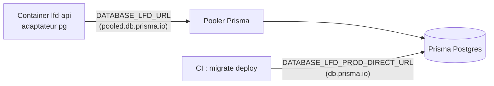

# La base de production — où elle est, comment l'API la joint

> ✅ **État vérifié le 2026-10-19** contre `prisma.service.ts`,
> `env-readers.ts`, `main.ts`, `persistence-errors.ts` et
> `.github/workflows/deploy_lfd_api.yml`. Remplace le plan et le TODO de la
> sortie d'Accelerate, retirés ce jour-là : la sortie est faite.

## 1. Quelle base, quel transport

La production est **une base Prisma Postgres** (espace « La Folie Coffee »,
compte `dev@lafoliedouce.com`), qui porte les schémas `public`, `growth`,
`ops`, `pim` et ceux des blocs (cf. `prisma/schema/datasource.prisma`).

Elle a **deux URL**, et chacune a un seul usage :

| URL                                         | Qui la lit                                   | Pourquoi                                                                                          |
| ------------------------------------------- | -------------------------------------------- | ------------------------------------------------------------------------------------------------- |
| **mutualisée** `…@pooled.db.prisma.io:5432` | le container de l'API                        | le pooler de Prisma partage les connexions entre instances                                        |
| **directe** `…@db.prisma.io`                | `prisma migrate deploy`, dans le déploiement | une migration tient des verrous et enchaîne des instructions sur une même session : pas de pooler |

L'API la joint par **un seul transport** : l'adaptateur `@prisma/adapter-pg`
(TCP), le même qu'en développement et dans les e2e
(`src/platform/database/prisma.service.ts`).

## 2. Les deux secrets, et qui les lit

Dans GitHub, il n'y en a que deux (état confirmé par Hugo le 2026-10-19) :

- **`DATABASE_LFD_PROD_URL`** — l'URL mutualisée. L'étape « Sync runtime
  secrets » de `deploy_lfd_api.yml` la relaie au container **sous le nom
  `DATABASE_LFD_URL`**, le seul que lit `AppConfig`.
- **`DATABASE_LFD_PROD_DIRECT_URL`** — l'URL directe. Seule l'étape « Migrer la
  base » la lit, **sans repli** : absente, la migration échoue en la nommant
  plutôt que de retomber sur l'URL du container.

L'ancien secret `DATABASE_LFD_URL` (valeur Accelerate) est **supprimé** de
GitHub. Aucun secret ne traverse une ligne de commande : les valeurs se posent
par l'interface GitHub. Inventaire complet :
[`secrets-et-variables.md`](secrets-et-variables.md).

## 3. Une URL Accelerate est refusée au démarrage

`AppConfig` lit `DATABASE_LFD_URL` par `postgresUrl()`
(`src/platform/config/env-readers.ts`) : tout ce qui ne commence pas par
`postgresql://` ou `postgres://` fait **échouer le démarrage**, avec un message
qui nomme Accelerate. Sans ce refus, une URL `prisma+postgres://` serait passée
telle quelle à l'adaptateur `pg`, qui échouerait à la première requête par un
message de pilote, loin de sa cause.

Conséquence : **revenir à Accelerate est impossible** sans changer le code, et
c'est voulu. Que l'image neuve réponde sur `/health` prouve qu'elle a démarré
sur un Postgres direct ; `/health` ne publie donc plus de champ `database`.

## 4. Le pool `pg`

Réglé dans `prisma.service.ts` (constante `POOL`), pas laissé aux défauts de
`pg-pool` (dix connexions, attente infinie) :

| Réglage                   | Valeur | Raison                                                                                                          |
| ------------------------- | ------ | --------------------------------------------------------------------------------------------------------------- |
| `max`                     | 5      | deux instances coexistent une à deux minutes à chaque déploiement : 10 au pire, sur 250 mutualisées (offre Pro) |
| `connectionTimeoutMillis` | 5 000  | une requête sans connexion libre ÉCHOUE en « base indisponible » au lieu de pendre                              |
| `idleTimeoutMillis`       | 30 000 | explicite plutôt qu'hérité                                                                                      |

S'y ajoutent :

- `app.enableShutdownHooks()` dans `main.ts` : au SIGTERM, le pool est vidé ;
- `P2037` (trop de connexions) compte parmi les codes « base indisponible »
  (`src/platform/shared/errors/persistence-errors.ts`) : une saturation se lit
  `persistence.database_unavailable`, pas une erreur inconnue.

Relever `max` ne se justifie que si des requêtes **attendent** une connexion.
Non éprouvé : ce que le pooler distant renvoie exactement à saturation.

## 5. Ce qui a disparu avec Accelerate

- **Le cache de requêtes** d'Accelerate. Le code ne s'en servait pas (aucun
  `cacheStrategy`), rien ne le remplace.
- La passerelle HTTP : `psql` et `pg_dump` joignent désormais la base par l'URL
  directe.

## 6. Les outils qui pourraient viser la production

En `postgres://`, le schéma de l'URL ne distingue plus la production d'un
conteneur local. Les outils de `prisma/` qui écrivent ou effacent lisent donc
aussi l'**hôte** (`prisma/local-target.ts`, `refuseNonLocalTarget`), comme le
rechargement de démo (`src/dev/dev-seed.service.ts`). La CLI Prisma
(`db:migrate`, `db:push`, `db:studio`) ne refuse rien : elle suit le `.env`,
qui ne contient **jamais** la production (`apps/lfd-api/.env.example`).

## 7. Historique de la sortie

| Date       | Fait                                                                                                                                              |
| ---------- | ------------------------------------------------------------------------------------------------------------------------------------------------- |
| 2026-09-15 | Courriel de Prisma : l'URL `prisma+postgres://accelerate.prisma-data.net` sera retirée le 1er décembre 2026 ; plan écrit et contredit (`vitruve`) |
| 2026-09-19 | Code de sortie (`529414d3`) puis **bascule** en production (`07fff0c4`) : `/health` publie `"database":"pg"`                                      |
| 2026-09-22 | **Resserrement** : `PrismaService` n'a plus que l'adaptateur `pg`, `postgresUrl()` refuse une URL Accelerate, `/health` ne publie plus `database` |
| 2026-10-19 | Ancien secret `DATABASE_LFD_URL` supprimé de GitHub ; plan et TODO retirés au profit de ce document                                               |

L'échéance de Prisma du **1er décembre 2026** est sans objet : la production
n'y passe plus depuis le 2026-09-19.

## 8. Reste à Hugo

- **Révoquer la clé Accelerate** dans la console Prisma — elle a fui, et plus
  rien ne l'utilise.
- Accessoire : relever la **région** de la base (latence depuis le container).
