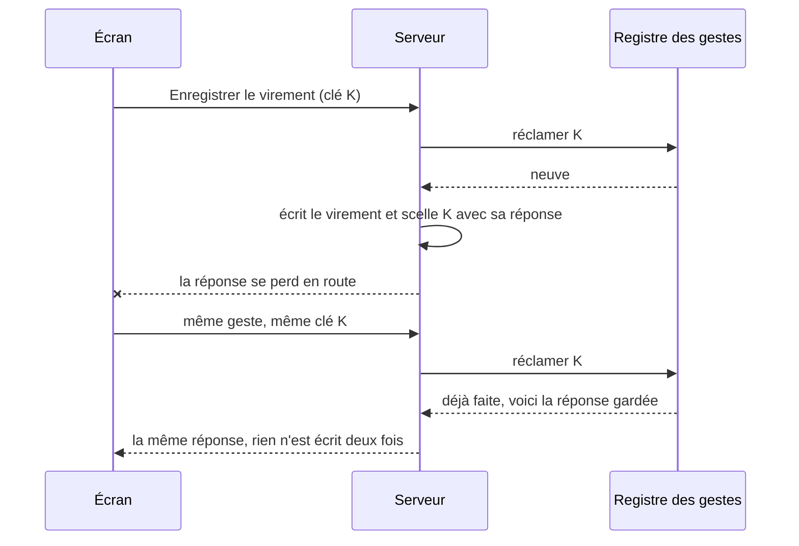

# L'idempotence des écritures

> ✅ **Doc d'état**, vérifiée dans le code le 2026-11-12 (après `97d638522`).
> Elle remplace le plan qui l'a bâtie (lots J0 à J5, corrections de `vitruve`,
> failles F1 à F4 de l'audit) ; le tableau des [repères](#7-les-repères-du-plan)
> renvoie chaque numéro que le code cite à la règle d'aujourd'hui.

## Partie 1 — en simple

### Le problème

Un double clic, un réseau qui coupe après l'envoi, un onglet qui renvoie sa
requête : la même écriture peut arriver **deux fois** au serveur. Selon le
geste, ce n'est rien (poser une couleur déjà posée) ou c'est un dégât (deux
clients créés, deux virements enregistrés, deux e-mails partis).

### La clé de geste

Quand quelqu'un ouvre un geste (un dialogue « Enregistrer un virement »),
l'écran fabrique une **clé** : un identifiant au hasard, propre à ce geste
voulu. Il l'envoie avec la requête, et la **renvoie telle quelle** à chaque
nouvel essai du même geste. Le serveur s'en sert comme nom du geste :

- la première fois qu'il voit la clé, il fait le geste et **garde sa
  réponse** ;
- s'il revoit la même clé, il ne refait rien et **rend la réponse gardée** ;
- si la même clé arrive pendant que le premier envoi travaille encore, il
  répond « déjà en cours » ;
- si la même clé arrive avec **d'autres valeurs** (un montant corrigé), il
  refuse : rendre l'ancienne réponse ferait croire que la correction est
  écrite.

Une fois le geste réussi, l'écran oublie la clé : le geste suivant en a une
neuve.

### Pourquoi le serveur, et pas l'écran

L'écran peut griser un bouton, il ne peut pas savoir si une requête partie
est arrivée. Seul le serveur voit les deux envois, et seule **la base** peut
arbitrer deux envois simultanés : la clé y est unique, donc le second envoi
se heurte au premier au lieu de le doubler. L'écran fabrique et garde la clé ;
le serveur décide.

### Les trois cases

Toutes les routes d'écriture n'ont pas besoin d'une clé. Chacune est rangée
dans une case, et une porte de CI refuse celle qui ne l'est pas :

| Case              | Ce qu'elle dit                                                                                  | Exemple                                              |
| ----------------- | ----------------------------------------------------------------------------------------------- | ---------------------------------------------------- |
| **Par intention** | la route lit la clé, et le geste est gardé par le registre                                      | créer un client, enregistrer un virement             |
| **Par nature**    | rejouer la même requête laisse le même état et ne déclenche rien de plus — la raison est écrite | poser des couleurs, une transition déjà faite        |
| **Risque assumé** | un rejeu peut refaire le geste, quelqu'un l'a décidé, et c'est écrit                            | les cinq gestes qui envoient un lien de mot de passe |

## Partie 2 — technique

### 1. Les décorateurs des trois cases

Chaque `@Post`, `@Put`, `@Patch`, `@Delete` d'un `*.controller.ts` de
`apps/lfd-api/src` porte l'un des trois :

| Case          | Décorateur                                                                                                                        | Effet à l'exécution                                                    |
| ------------- | --------------------------------------------------------------------------------------------------------------------------------- | ---------------------------------------------------------------------- |
| Par intention | `@IntentKey()` sur un paramètre (`platform/shared/http/intent-key.decorator.ts`), et le handler atteint passe par `OncePerIntent` | lit l'en-tête `Idempotency-Key` (UUID), sinon 400 `intent.key_missing` |
| Par nature    | `@Idempotent("raison")` (`platform/shared/http/idempotent.decorator.ts`)                                                          | aucun : la raison est pour la porte et le lecteur                      |
| Risque assumé | `@AcceptedReplay("raison", "décidé par … le …")` (`platform/shared/http/accepted-replay.decorator.ts`)                            | aucun : la porte liste ces routes à chaque exécution                   |

« Par nature » couvre aussi les routes idempotentes **par leur propre clé**
(passation : `OrderIdempotency`, `ShopOrderIdempotency` ; webhooks : identifiant
de l'événement de l'émetteur) et celles **appelées par la machine**
(`RecomputeGuard`, balayages et purges) : la raison nomme le mécanisme. La
raison est **déclarative** — la porte vérifie qu'elle existe, pas qu'elle est
vraie ; elle se relit en revue.

Au 2026-11-12 (`pnpm gate write-idempotence`) : **646** routes d'écriture,
**92** par intention, **549** par `@Idempotent` (dont 30 sous
`RecomputeGuard`), **5** en risque assumé, dette **0**.

Pas d'intercepteur qui garderait la réponse HTTP de toute écriture : il ne
saurait pas si un geste est rejouable, et masquerait ceux qui ne le sont pas.
C'est le handler qui sait.

### 2. `OncePerIntent` et le registre

`platform/intent/once-per-intent.ts`. Une intention est
`{ actorId, key, gesture, subject }` (`platform/intent/gesture-intent.ts`).

- **Le registre** : port `GestureIntentLedger` (`claim`, `resolve`, `release`),
  adaptateur `PrismaGestureIntentLedger`, table `platform.gesture_intent`
  (`prisma/schema/platform.prisma`, modèle `GestureIntent`). Index unique
  **`(actor_id, key)`** : c'est la base qui arbitre deux clics, jamais une
  lecture suivie d'une écriture. Une clé ne se partage pas entre deux acteurs.
- **L'acteur** : la fiche du staff ; pour la boutique, `customer:<id>` — le
  client résolu en base, jamais le `sub` ni une adresse
  (`lafoliecoffee/shared/intent/customer-intent-actor.ts`) ; pour le
  formulaire public « Nous écrire », le littéral `visitor:public`
  (`VISITOR_INTENT_ACTOR`), la clé étant fabriquée par la page. Les autres
  routes publiques sans compte n'ont pas d'acteur : par nature ou par leur
  propre clé, jamais par intention.
- **La réclamation** (`claim`) rend `claimed`, `replayed` (résultat gardé),
  `in_flight` (409 `intent.in_flight`) ou `mismatch` (409 `intent.key_reused`).
- **Le bail** : `GESTURE_INTENT_LEASE_MS`, deux minutes. Une intention réclamée
  et non résolue plus vieille que le bail est reprise par l'essai suivant.
- **Le résultat gardé** passe par un codec (`IntentCodec` : `NOTHING_TO_REPLAY`,
  `CREATED_ID_REPLAY`, `MAIL_SENT_REPLAY`…), relu et vérifié au rejeu, sans
  donnée personnelle.
- **Un secret montré une fois** (lien de mot de passe, secret d'un abonné de
  la vitrine, clé d'un paiement) : codec `shownOnceReplay`
  (`platform/intent/shown-once-replay.ts`). Rien de secret n'est gardé ; le
  rejeu de la même clé reçoit un 409 qui nomme le geste et la sortie, sans
  refaire l'effet.
- **Un échec** rend l'intention (`release`) : le réessai avec la même clé
  réexécute.

#### `run` contre `runSealed`

- **`runSealed`** — la règle pour tout geste qui écrit en base. Le geste reçoit
  `seal(result)`, qu'il appelle **dans sa propre unité de travail**, juste
  après son écriture : l'intention est résolue dans la même transaction que
  l'écriture. Une écriture validée a toujours son intention résolue.
  `seal` ne vaut que sous `UnitOfWork` ; sous un `prisma.$transaction(...)`
  direct, la résolution partirait hors transaction sans erreur (refus 4 de la
  porte).
- **Le scellement perdant** : si un premier appel dépasse le bail et qu'un
  second reprend l'intention et scelle d'abord, le `resolve` du premier ne
  touche aucune ligne, lève `IntentAlreadySealedError`, et sa transaction est
  annulée — le geste ne s'écrit qu'une fois.
- **`run`** — résout **après** le geste, hors de sa transaction : une panne
  entre les deux laisse le bail expirer, et un rejeu tardif refait le geste.
  Admis seulement pour un geste qui n'écrit pas en base (au 2026-11-12 :
  `resend-order-payment-link.handler.ts`), ou en risque assumé (§ 5).
- **La réclamation est interdite dans une transaction** : un refus d'unicité y
  annulerait tout, et la réclamation ne serait vue de personne avant la
  validation (« en vol » ne jouerait plus). `PrismaGestureIntentLedger.claim`
  lève `IntentClaimInsideTransactionError` si une transaction est ouverte.

#### Le sujet porte le contenu

Le sujet est **toujours** `intentSubject(cible, ...champs saisis)`
(`platform/intent/intent-subject.ts`) : la cible (identifiant opaque, ou le nom
de ce qu'on crée) et l'empreinte sha256 de tout ce que la commande dit, sans
l'acteur ni la clé. Le registre ne garde que l'empreinte — ni adresse, ni
texte, ni octets.

Sans elle, la même clé renvoyée avec un autre contenu rendait l'ancien
résultat : un virement dont la réponse s'était perdue, renvoyé avec un montant
corrigé, affichait un succès sans écrire la correction. Désormais :
409 `intent.key_reused` — « Ce geste a déjà été enregistré avec d'autres
valeurs, et ces nouvelles valeurs ne l'ont pas été : rechargez la page pour
relire ce qui est enregistré, puis recommencez si une correction reste à
faire. »

Un sujet sans contenu reste construit par `intentSubject` quand la commande
n'a que sa cible (renvoyer un avis, révoquer un mandat), ou quand le contenu
change à chaque essai par construction (la preuve d'identité de
`link-login-method`, commentée sur place).

#### La purge

`GESTURE_INTENT_RETENTION_DAYS = 7` (`platform/intent/gesture-intent-retention.ts`,
décidé par Hugo le 2026-11-12), par lots de 500. Route machine
`POST /admin/intents/purge` (`gesture-intent-purge.controller.ts`,
`RecomputeGuard`), appelée par le cron nocturne du worker avec les autres
purges ; handler `PurgeGestureIntentsHandler`, port `GestureIntentPruner`.

### 3. Les briques des écrans

| Front       | Fichier                                         | Ce qu'il porte                                                                                                      |
| ----------- | ----------------------------------------------- | ------------------------------------------------------------------------------------------------------------------- |
| Back-office | `src/app/shared/gesture-intents.ts`             | `GestureIntents` (`keyFor(sujet)`, `done`), `intentOptions`, `sentOnce`, `shownOnce`, `refusedIntentKeyInterceptor` |
| Back-office | `src/app/fiche-client/tarifs/sending-intent.ts` | `SendingIntent`, la clé d'un envoi de tarifs                                                                        |
| Boutique    | `src/app/client/gesture-intents.ts`             | `GestureIntents`, `intentOptions`, `withIntent`, `refusedIntentKeyInterceptor`                                      |

Une clé par **sujet** de geste, fabriquée à la première demande, renvoyée
jusqu'au succès, oubliée par `done`. Un échec ou « en vol » garde la clé.
`refusedIntentKeyInterceptor`, branché dans les deux `app.config.ts`, marque la
clé d'une requête refusée en `intent.key_reused` : le `keyFor` suivant en
fabrique une neuve, et le refus remonte à l'écran comme une erreur. `sentOnce`
sert les outils de l'agent qui créent (clé tirée de leurs arguments, oubliée
au succès).

### 4. Les portes

#### `pnpm gate write-idempotence`

`dev-toolbox/gates/write-idempotence.mjs`, avec `write-idempotence-paths.mjs`
(décorateurs, chemins), `write-idempotence-inventory.mjs` (`--inventory`),
`write-idempotence-effects.mjs` (refus 5), `write-idempotence-services.mjs`
(les services qui écrivent). Tests :
`node --test dev-toolbox/__tests__/write-idempotence.test.mjs` et
`write-idempotence-effects.test.mjs`.

**Le handler se résout sans liste** : `new X(...)` passé à `.execute(` du
contrôleur (méthode voisine comprise), l'import de X, puis la classe
`@CommandHandler(X)` qui importe X (repli : par le nom, s'il n'a qu'un handler).
Une requête de relecture (`new XQuery(...)`) ne compte pas.

**« N'écrit pas en base »** (ce qui admet `run`) : le handler n'injecte ni
`UnitOfWork`, ni `PrismaService`, ni un type en `*Repository` / `*Store` /
`*Writer`, n'appelle ni `.save(`, ni `$transaction(`, ni `.publishTraced(`, ni
un service `@Injectable()` qui écrit — lui-même ou par un service qu'il
injecte (point fixe).

**Ce qu'elle refuse :**

1. une route ni rangée ni inscrite dans `write-idempotence-debt.json` (vide :
   toute route non rangée échoue) ;
2. une route rangée ou disparue encore inscrite dans la dette ;
3. `@Idempotent` sans raison, `@AcceptedReplay` sans raison ou sans décision ;
4. `runSealed` dans un fichier qui ouvre `$transaction(` en direct ;
5. un `POST` `@Idempotent` dont le handler crée (`next(` sur un `IdGenerator`),
   envoie un e-mail (`send` / `sendAndAwaitReceipt` sur `Mail`) ou appelle le
   réseau (injection d'un type déclaré dans un fichier qui appelle
   `assertOutsideTransaction(`), hors des **exceptions datées**
   (`write-idempotence-exceptions.json`, 62 routes, chacune avec ses effets,
   sa raison et sa date de lecture : clé métier, transition refusée au rejeu
   sous verrou, réseau sans effet durable, machine). Une exception sans
   raison, sans date, ou qui ne désigne plus un tel `POST` échoue. `PUT`,
   `PATCH`, `DELETE` gardent la raison déclarative ;
6. un littéral `{ key, gesture, subject }` dont le sujet n'est pas un appel à
   `intentSubject(...)`, hors de `platform/intent/` et du client généré.

**L'inventaire** (`--inventory [fichier]`) : pour chaque route rangée, `route`
(`fichier#méthode`), `httpMethod`, `path`, `case` (`intent` / `nature` /
`accepted`), `handlers`. Lu par l'e2e du rejeu et par la porte des écrans.

#### `pnpm gate front-intent-keys`

`dev-toolbox/gates/front-intent-keys.mjs` (+ `front-intent-keys-calls.mjs`).
Lance l'inventaire à l'instant et lit les deux fronts (specs exclues). Refuse :
un appel `http.post|put|patch|delete` (ou `request('POST', …)`, ou une
enveloppe `this.post(…)`) vers une route « par intention » sans
`intentOptions(`, `withIntent(` ni `INTENT_KEY_HEADER` ; un `randomUUID()`
servant de clé hors des briques. Écarts admis, raison et date :
`front-intent-keys-admitted.json` (le réassort d'un site, § 6). Tests :
`node --test dev-toolbox/__tests__/front-intent-keys.test.mjs`.

#### `pnpm gate intent-key-gestures`

Plus ancienne et plus étroite : un geste du staff qui envoie un e-mail lit la
clé de l'écran.

### 5. Les tests

| Suite                                                | Ce qu'elle prouve, sur Postgres réel                                                                                                                                                                                                                                                                                                                   |
| ---------------------------------------------------- | ------------------------------------------------------------------------------------------------------------------------------------------------------------------------------------------------------------------------------------------------------------------------------------------------------------------------------------------------------ |
| `apps/lfd-api/test/write-replay.e2e-spec.ts`         | lit l'inventaire à l'instant ; pour chaque route « par intention » qui a un scénario (`test/write-replay/*-scenarios.ts`) : sème, relève toutes les tables (compte et md5 du contenu), envoie, relève, renvoie la même clé, relève. Une seule écriture, deux réponses identiques — ou, pour un secret montré une fois, un 409 sans écriture            |
| `test/write-replay/replay-debt.ts`                   | les routes sans scénario, **13**, sous `REPLAY_DEBT_CEILING = 13` : quatre du colisage, quatre de la livraison, `linkIdentity`, l'essai d'un abonné de la vitrine, le réassort d'un site, le remplacement d'une image, la réémission du référentiel. Une route sans scénario ni inscription, ou une inscription qui a gagné son scénario, fait échouer |
| `apps/lfd-api/test/intent-key-content.e2e-spec.ts`   | sur le virement reçu et l'ajout d'un véhicule : deux envois simultanés sous la même clé n'écrivent qu'une fois, la même clé sur un autre contenu reçoit `intent.key_reused` sans rien écrire                                                                                                                                                           |
| `apps/lfd-api/test/gesture-intent-lease.e2e-spec.ts` | un premier appel plus long que le bail : le scellement du second fait échouer celui du premier, dont la transaction est annulée ; une réclamation dans une unité de travail ouverte est refusée                                                                                                                                                        |
| `platform/intent/__tests__/`                         | `OncePerIntent`, `shownOnceReplay`, la purge, en doubles du port                                                                                                                                                                                                                                                                                       |

### 6. Ce qui échappe

- **Les écritures hors HTTP** : abonnés aux faits, `@DurableHandler`, tâches
  planifiées. Elles tiennent par la boîte d'envoi (identifiant de livraison)
  et leurs baux, pas par ce registre.
- **Les effets chez un tiers** : tenus par la clé du fournisseur (Stripe,
  `params.key`) ou par la clé de l'e-mail dans la boîte d'envoi du bloc `mail`.
- **Les risques assumés**, en `OncePerIntent.run` (`@AcceptedReplay`, décidés
  par Hugo le 2026-11-12) — leur e-mail porte un lien de mot de passe, que la
  boîte d'envoi rangerait en clair ; une panne entre l'écriture et la
  résolution, puis un rejeu après le bail, refait le geste :
  - `admin-companies.controller.ts#create` (client créé par l'équipe) ;
  - `admin-companies.controller.ts#attachHolder` (titulaire rattaché) ;
  - `admin-company-members.controller.ts#invite` (membre d'une société) ;
  - `me.controller.ts#requestPasswordLink` (le fait part au journal hors
    transaction ; `runSealed` n'y changerait rien) ;
  - `admin-staff-users.controller.ts#invite` (l'écriture vit dans
    `OpenStaffAccess`, et le résultat gardé n'est connu qu'après l'e-mail).
- **Deux clics simultanés sur un geste « par nature » sans verrou** : la raison
  tient en séquence. Les transitions inscrites en exception relisent sous
  verrou (promotions, sites, attestations, liens de paiement, suggestions de
  point d'adresse) ; les poses « en bloc » ne le font pas (§ 8).
- **Un rejeu après la purge** (7 jours) : la clé n'est plus reconnue, le geste
  se refait.
- **Les limites des portes** :
  - « par nature » est déclaratif, et le refus 5 ne regarde que les `POST` et
    le handler résolu ;
  - le refus 4 raisonne **par fichier** (une transaction directe ailleurs que
    dans le fichier du handler ne se voit pas) ;
  - l'inventaire laisse une constante importée en `{NOM}` (les routes du
    retrait, `HANDOVER_ROUTES`) et ne lit pas le préfixe d'un `RouterModule`
    (`/pim`) ;
  - la porte des écrans ne reconstitue un chemin que dans le fichier : un
    chemin sans morceau littéral, un verbe en variable, une fonction de chemin
    à deux `return` passent. Au 2026-11-12, 87 des 93 routes par intention sont
    reconnues dans un appel d'écran ; deux sont appelées par un chemin non lu
    et passent la clé (relu à la main), quatre ne sont appelées par aucun
    écran.

### 7. Les repères du plan

Des commentaires du code citent le plan par ses numéros. Ce qu'ils désignent
aujourd'hui :

| Repère            | Règle d'aujourd'hui                                                                                                    |
| ----------------- | ---------------------------------------------------------------------------------------------------------------------- |
| J0                | la porte `write-idempotence` et ses trois cases (§ 1, § 4)                                                             |
| J1, J2            | la dette des routes non rangées, aujourd'hui à zéro (refus 1 et 2)                                                     |
| J3                | l'inventaire et l'e2e du rejeu (§ 4, § 5)                                                                              |
| J4                | le refus 5 et ses exceptions datées (§ 4)                                                                              |
| J5                | la porte `front-intent-keys` et les briques des écrans (§ 3, § 4)                                                      |
| § 3 (les cases)   | les trois décorateurs (§ 1) ; `shownOnceReplay` (§ 2)                                                                  |
| § 4 (le bâti)     | § 4 ; la brique de la boutique (§ 3)                                                                                   |
| § 7 (corrections) | `runSealed` pour toute écriture, refus 4, l'acteur hors du staff, la case machine, les risques assumés (§ 1, § 2, § 6) |
| § 8               | J3 à J5 ci-dessus                                                                                                      |
| F1                | le sujet porte l'empreinte du contenu, 409 `intent.key_reused`, refus 6 (§ 2)                                          |
| F2                | le scellement perdant annule sa transaction, réclamation refusée dans une transaction (§ 2)                            |
| F3                | les transitions « par nature » à effet relisent sous verrou (§ 4, refus 5 ; § 6)                                       |
| F4                | les services qui écrivent sont suivis ; l'invitation d'un membre du staff est un risque assumé (§ 4, § 6)              |
| M1                | le compte des exceptions : 62                                                                                          |
| M2                | les e2e concurrents sur Postgres réel : `intent-key-content`, `gesture-intent-lease` (§ 5)                             |
| M3                | `mail-check` : à trancher (§ 8)                                                                                        |
| M4                | le refus 4 raisonne par fichier (§ 6)                                                                                  |

### 8. Reste à faire

- **Fermer les cinq risques assumés à lien** : le lien fabriqué à l'envoi
  (notre lien signé, le ticket Auth0 demandé au clic), avant le lancement
  commercial — [`../mail/plan-lien-fabrique-a-l-envoi.md`](../mail/plan-lien-fabrique-a-l-envoi.md).
  Ils passeront alors en `runSealed`.
- **`mail-check.controller.ts#check`**, à trancher par Hugo : inscrite en
  exception sans clé métier. Appelée par la machine après un déploiement, elle
  tire une clé d'e-mail neuve à chaque appel (`ops.deploy-check:<révision>:<id>`),
  et un rejeu envoie un essai de plus. Une clé tirée de la seule révision
  fermerait le rejeu, mais empêcherait un second contrôle voulu sur la même
  image. Ou un risque assumé nommé.
- **Le réassort d'un site, « +1 »** (`site-resupplies.store.ts`, admis par la
  porte des écrans) : chaque clic est un geste voulu, la clé est tirée par
  clic et ne protège que le renvoi réseau de la même requête. À reprendre si
  la brique gagne une clé « par geste » nommée ; sa route reste aussi dans la
  dette du rejeu.
- **Les poses en bloc sans verrou** — `admin-sites.controller.ts#setColors` et
  `#setRoles` (`set-site-colors.handler.ts`, `set-site-roles.handler.ts` : ni
  verrou ni `FOR UPDATE`, vérifié le 2026-11-12) : deux poses identiques
  simultanées lisent toutes deux l'ancien état et peuvent journaliser deux
  fois ; deux poses différentes, la dernière gagne.
- **La dette du rejeu** : 13 routes sans scénario (§ 5), plafond qui ne fait
  que baisser.
- **`e2e:rebalance`** (`pnpm --filter lfd-api e2e:rebalance`) : l'e2e du rejeu
  dure près de deux minutes ; les durées des trois suites de l'idempotence
  sont inscrites dans `test/e2e-durations.json`, mais un passage complet qui
  rééquilibre les tranches de la CI reste à lancer (pas en même temps qu'une
  autre chaîne e2e).
