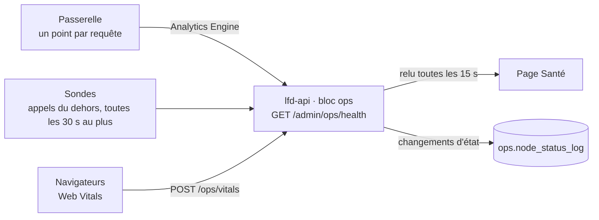

# La page Santé

## 1. En simple

La page **Santé** du back-office (`/sante`, droit `ops_health:read`) répond à
une question : **qu'est-ce qui va mal, en ce moment, et depuis quand ?** Elle
montre une carte des briques (fronts, passerelle, API, base, Auth0, Stripe,
Resend, R2), chacune verte, orange, rouge ou grise, et sous la carte des
tableaux de charge, de cache et de vitesse.

Elle ne fabrique rien : elle **rassemble trois sortes de preuves**.

- ce que la **passerelle** a vu passer (requêtes, erreurs, latence, rejets) ;
- ce que les **sondes** constatent du dehors (le front est-il servi, la base
  répond-elle, Auth0, Stripe, Resend, R2 sont-ils joignables) ;
- ce que les **navigateurs** rapportent de l'expérience réelle.

**Le bloc `ops` observe, il ne possède rien.** Il ne tient aucune donnée
métier, n'importe que `platform` (matrice de `CLAUDE.md` §3), et personne ne
l'importe. Si la page tombe, rien d'autre ne tombe : elle n'est dans le chemin
critique d'aucune requête.

## 2. Ce que la page montre

L'écran est `apps/lfd-backoffice-frontend/src/app/ops/sante-page/`. Deux onglets.

### Onglet « Carte » (relu toutes les 15 s)

De haut en bas :

| Bloc                     | Composant           | Source                                                                                               |
| ------------------------ | ------------------- | ---------------------------------------------------------------------------------------------------- |
| Bandeau « Répétition »   | `sante-page`        | affiché quand Analytics Engine n'est pas configuré : les chiffres sont fabriqués                     |
| Capacités bloquantes     | `capabilities/`     | `GET /admin/ops/capabilities/staff` — le bulletin de démarrage (canaux éteints)                      |
| Quatre jauges            | `sante-page`        | requêtes, taux d'erreurs serveur, p95, **rejets du limiteur** (comptés à part des erreurs)           |
| « À regarder »           | `sante-page`        | les briques non vertes, leur raison, **depuis quand**, le constat de la sonde                        |
| La carte                 | `ecosystem-map/`    | `GET /admin/ops/health` — nœuds, liens, courbe par nœud, usage du container                          |
| Caches de l'API          | `cache-outcomes/`   | même réponse (`caches`, `cacheCalls`)                                                                |
| Charge par requête       | `charge-table/`     | les fenêtres de trafic par backend et par module                                                     |
| Temps de calcul des prix | `pricing-probe/`    | `GET /admin/ops/health/pricing` — cf. [`sonde-calcul-des-prix.md`](sonde-calcul-des-prix.md)         |
| Vitesse des routes       | `route-timings/`    | `POST /admin/ops/route-timings`, bouton **Mesurer** — cf. [`mesures-privees.md`](mesures-privees.md) |
| Seuils de la médiathèque | `media-thresholds/` | `GET /admin/ops/media` — taille du fonds face aux limites des tris et filtres                        |
| Messages morts           | `dead-letters/`     | `GET /admin/outbox/dead-letters`, rejouables (`POST /admin/outbox/replay`)                           |

Sur la carte, la **couleur** d'un lien dit l'occupation de la brique visée —
sa proximité du plafond, jamais son volume —, la **vitesse** des pointillés
dit le débit. Le plafond n'est pas un débit : le container se paie au temps
allumé, et la saturation se lit sur la latence et les rejets
(`ops/occupancy.ts`).

### Onglet « Cache » (relu à l'ouverture)

`cache-board/`, sur `GET /admin/ops/caches?days=…` : les compteurs des objets
partagés (toute la flotte) et, à côté, ce que l'instance qui répond a mesuré.
Le détail des caches est dans
[`../caching-usage/carte-des-caches.md`](../caching-usage/carte-des-caches.md).

### Après déploiement

`/sante/apres-deploiement` (droit `ops_post_deploy:read`) liste les
opérations à simuler puis appliquer après un déploiement
(`/admin/ops/post-deploy`), et un bandeau les annonce en tête de la page
Santé. Cf. [`plan-operations-apres-deploiement.md`](plan-operations-apres-deploiement.md).

## 3. D'où viennent les données

Tout est dans `apps/lfd-api/src/ops/`.

### La topologie est déclarée

`topology/topology.ts` écrit les nœuds et leurs dépendances (« dépend de »).
Jamais devinée du trafic : une brique qui cesse d'être appelée doit rester sur
la carte, grise, plutôt que disparaître. La passerelle écrit sa clé de routage
(`lfd`) ; `GATEWAY_TRAFFIC_NODES` la traduit en nœud (`b2b`, libellé « API »).

### Le trafic — la passerelle

`gateway/src/traffic.ts` écrit un point par requête dans Analytics Engine
(jeu `lfc_gateway_traffic`, déclaré dans `gateway/wrangler.toml`) : backend,
statut, durée, rejet du limiteur. **Ni IP, ni identifiant client, ni chemin
complet.** Rien ne va en Postgres ; les points vivent trois mois chez
Cloudflare et s'agrègent à la lecture en SQL (`traffic/analytics-engine-traffic.reader.ts`).
Sans compte ni jeton (`CLOUDFLARE_ANALYTICS_TOKEN`), le lecteur de
**répétition** prend sa place au démarrage, et la page le dit.

### Les sondes — le dehors

`probes/` : `FrontendProbe` (le front est-il servi, pas seulement « 200 sur la
racine »), `PostgresB2bProbe`, `Auth0Probe`, `StripeProbe`, `ResendProbe`,
`R2Probe`. Un nœud ne passe `down` qu'après **deux échecs d'affilée**
(`FAILURES_BEFORE_DOWN`) ; les appels sortants sont mis en cache 30 s.

### Les relevés propres

En plus du trafic, chaque nœud porte ses relevés : base (`database-readings`),
Auth0, e-mails remis et en attente (`mail-readings`, `mail-backlog-readings`),
caches, usage CPU et mémoire du container (API GraphQL de Cloudflare,
`container/`), et pour les fronts les **Web Vitals** que les navigateurs
envoient (`@lfd/front-ops`, `POST /ops/vitals`, public), gardées en mémoire
30 minutes, 200 échantillons au plus par mesure — sans historique.

### Le verdict

`health/derive-health.ts`, pur et testé, décide :

1. **la preuve l'emporte sur la déclaration** — des erreurs mesurées au-delà
   de 2 % font un `degraded` ;
2. **le silence n'est pas la mort** — sans trafic ni sonde, un nœud est
   `unknown`, jamais `down` ;
3. **le rouge se désigne, il ne se propage pas** — un nœud dont une
   dépendance est tombée garde son statut et nomme la dépendance.

Chaque verdict porte sa **raison** (`probe-failed`, `error-rate`,
`deploy-broken`…) et son **depuis** (`since`).

### La mémoire

`journal/` écrit dans `ops.node_status_log` **une ligne par changement
d'état**, jamais un échantillon, sans attendre l'écriture. À la première
lecture après un redémarrage, l'état est relu du journal : « tombé depuis 6 h »
ne redevient pas « depuis à l'instant ».

## 4. Deux règles qui restent

- **Liveness ≠ readiness.** `GET /health` (public,
  `appBootstrap/app.controller.ts`) dit seulement que le process tourne, et
  quelle révision répond, avec le compte des capacités éteintes. Il reste
  `ok` même si Stripe n'est pas configuré : un orchestrateur ne doit pas
  redémarrer en boucle une instance saine. La disponibilité de la base se lit
  sur la carte, par la sonde Postgres.
- **La page lit, elle n'agit pas** — sauf deux gestes nommés et murés par
  leur propre droit : rejouer un message mort, appliquer une opération après
  déploiement.

Les erreurs des fronts partent chez Sentry (`@lfd/front-ops`, `sentry.ts`) ;
la page Santé ne les montre pas.

## 5. Ce que la page ne montre pas encore

- **Les battements.** Le contrat prévoit qu'un nœud déclare lui-même qu'il
  vit (`lastHeartbeatAt`, `HEARTBEAT_TTL_MS`), et `deriveHealth` sait le
  lire ; aucun émetteur n'existe, la valeur rendue est toujours `null`.
- **Une route de readiness distincte.** Aucune n'est exposée ; la sonde
  Postgres de la carte en tient lieu.
- **Le calcul routier** (`lfd-route-planner`) n'est pas un nœud de la carte :
  son trafic apparaît sous sa clé de passerelle dans le tableau de charge, sans
  sonde ni couleur. Cf. [`planificateur-de-tournees.md`](planificateur-de-tournees.md).
