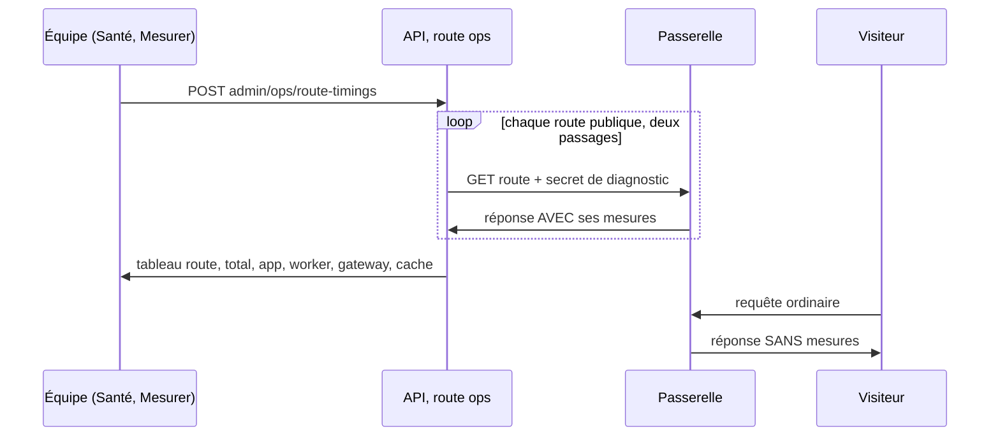

# Les mesures de chaque réponse, visibles par l'équipe seule

## 1. En simple

Chaque réponse de l'API sait dire comment elle a été fabriquée : le temps passé
dans Nest (`app`), dans le Worker (`worker`), dans la passerelle (`gateway`), et
si le rayon public est venu du cache (`X-Shelf-Cache`). Ces mesures
(`Server-Timing`) ne sortent que pour qui montre le **secret de diagnostic**.
Un visiteur ne les voit jamais.

On ne les lit pas dans un navigateur : la page **Santé** du back-office a un
bloc « Vitesse des routes » et un bouton **Mesurer**. L'API appelle alors
elle-même quelques routes publiques, à travers la passerelle et avec le secret,
deux fois chacune (cache froid, puis chaud), et rend un tableau.

Le secret vit dans **GitHub seulement** (`DIAGNOSTIC_SECRET`) ; chaque
déploiement de la passerelle et de l'API le recopie. Personne n'a à le voir.

**Ce que ça ne mesure pas** : la distance d'un visiteur jusqu'à Cloudflare (les
appels partent du conteneur de l'API, en Europe — les traces Cloudflare et les
vitals le disent), ni les routes du back-office, qui demandent une connexion.

## 2. Technique

### 2.1 Le tri, à la sortie de la passerelle

`gateway/src/diagnostic.ts`, appelé dans le `fetch` de `gateway/src/index.ts`
autour de `handle` — un seul point de tri pour toutes les sorties (réponse de
l'amont, refus de garde, fautes de la passerelle, redirections) :

- `isDiagnostic(request, env.DIAGNOSTIC_SECRET)` : vrai seulement si le secret
  est configuré et que `x-lfd-diagnostic` lui est égal. Les deux valeurs sont
  hachées (SHA-256) puis comparées sans s'arrêter à la première différence :
  rien ne fuit de la longueur ni du contenu. Secret absent : toujours faux.
- `withoutDiagnosticSecret` : la requête transmise ne porte jamais l'en-tête —
  le secret ne va ni à l'API, ni aux fronts, ni au planificateur.
- `sortDiagnosticHeaders` : sans diagnostic, `Server-Timing` et
  `X-Shelf-Cache` sont effacés ; avec, ils restent et la réponse devient
  `private, no-store`, pour qu'aucun cache en aval ne garde une copie mesurée.
  Une 101 (WebSocket) passe telle quelle. Si le tri levait, la passerelle rend
  une 502, jamais la réponse non triée.

Pourquoi à la **sortie** : un rayon public gardé 30 s par Workers Cache porte
les mesures de la requête qui l'a rempli. La passerelle est devant ce cache, et
rien ne la contourne — le Worker de l'API et le planificateur n'ont ni
`workers_dev` ni route (`apps/lfd-api/wrangler.jsonc`,
`apps/lfd-route-planner/wrangler.jsonc`, vérifié le 2026-11-14).

L'API, le Worker et le conteneur écrivent leurs marques sans condition
(`apps/lfd-api/src/platform/metrics/server-timing.ts`,
`apps/lfd-api/container/server-timing.ts`) : c'est la passerelle qui trie.

### 2.2 La mesure depuis la Santé

- Route : `POST admin/ops/route-timings`, `@AdminSurface("ops_health")`, droit
  `ops_health:read`, `@Idempotent` (rien ne s'écrit). Une **lecture**
  (`MeasureRouteTimingsQuery`) qui appelle le réseau : le contrôleur passe par
  le `QueryBus`.
- `apps/lfd-api/src/ops/route-timings/` : la liste fixe des routes
  (`measured-routes.ts` : rayon public, vitrine pro, textes de la boutique,
  `/health`), deux passages, le transport injecté
  (`fetch-route-timing.transport.ts`, `assertOutsideTransaction`, délai des
  sondes), l'analyse de `Server-Timing` (`server-timing-header.ts`, ne lève
  jamais).
- Contrat : `packages/ops-contract/src/route-timings.ts` (`RouteTimingsReport`,
  états `measured` / `secret-missing` / `base-url-missing`).
- Écran : `apps/lfd-backoffice-frontend/src/app/ops/route-timings/`, dans la
  page Santé. Pas de rafraîchissement automatique : chaque clic fait de vrais
  appels.

### 2.3 Le secret et l'adresse

| Nom                   | Où                       | Lu par            |
| --------------------- | ------------------------ | ----------------- |
| `DIAGNOSTIC_SECRET`   | secret GitHub            | passerelle, API   |
| `DIAGNOSTIC_BASE_URL` | variable GitHub, défaut¹ | API (`AppConfig`) |

¹ `https://lafoliecoffee.info/api/lfd` dans `deploy_lfd_api.yml` si la
variable n'existe pas. Absents, la Santé dit « secret non configuré » ou
« adresse non configurée » ; la passerelle efface tout.

Recopie : `deploy_lfd_gateway.yml` et `deploy_lfd_api.yml` (`wrangler secret
put`), puis `envVars` de `apps/lfd-api/container/worker.ts` pour Nest.

**Changer le secret** : `printf '%s' "$(openssl rand -hex 32)" | gh secret set
DIAGNOSTIC_SECRET`, puis redéployer la passerelle et l'API. Vider le secret
GitHub ne le retire pas des Workers : `wrangler secret delete
DIAGNOSTIC_SECRET` à la main.

### 2.4 Limites

- Sur un succès du cache du rayon, les marques de l'API sont celles de la
  requête qui a rempli le cache ; `X-Shelf-Cache` le dit.
- Les journaux et traces Cloudflare de la passerelle, privés au compte,
  peuvent garder les en-têtes des requêtes (non vérifié) : le secret n'ouvre
  que des durées, et se change d'une commande.
