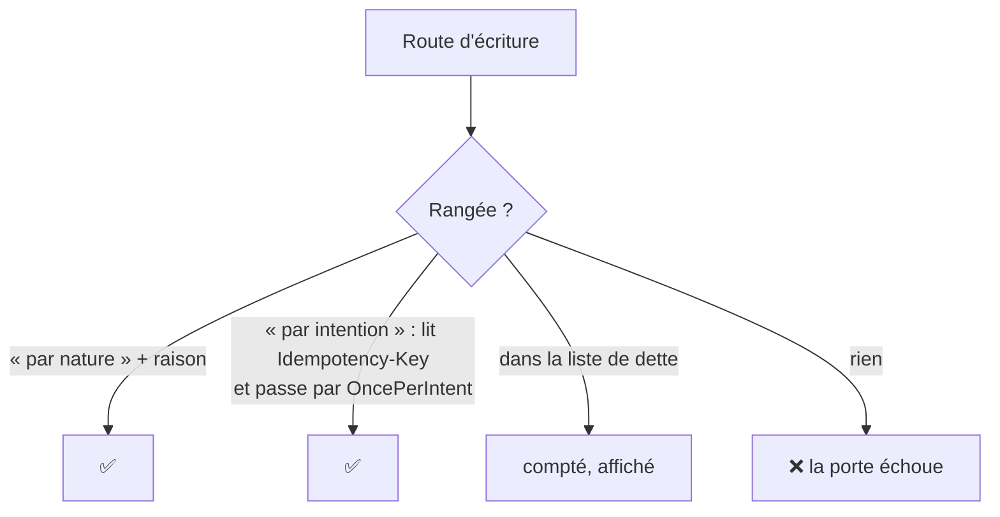

# Plan — chaque écriture dit pourquoi un rejeu ne la refait pas

> 📐 **Plan, 2026-11-12.** J0 bâti le 2026-11-12 (§ 4), J3 et J4 aussi (§ 8) ; J1, J2 et J5 restent à faire. Demande de Hugo : « est-ce qu'on a
> une porte pour garantir l'idempotence de toutes les actions d'écriture ? ».
> Réponse vérifiée ce jour-là : non. Touche une frontière transverse et, sur
> les routes de paiement, l'argent : passe par `vitruve` avant Hugo.

## 1. En simple

Un double clic, un réseau qui coupe après l'envoi, un onglet qui rejoue sa
requête : la même écriture peut arriver deux fois. Selon la route, ça ne
fait rien (poser un état déjà posé), ou ça crée deux fois la même chose
(deux clients, deux remboursements demandés, deux e-mails).

Le plan ne corrige pas tout d'un coup. Il pose une **porte** qui oblige
chaque route d'écriture à se ranger dans une case, et compte celles qui ne
le sont pas encore. La dette se voit à chaque exécution et ne peut que
décroître.

## 2. Ce qui existe (vérifié le 2026-11-12)

- **638 routes d'écriture** : `@Post`, `@Put`, `@Patch`, `@Delete` dans les
  `*.controller.ts` de `apps/lfd-api/src` (compte par `grep`, à refaire par
  la porte elle-même).
- **Un mécanisme commun, déjà là, pour les gestes du staff** :
  - `@IntentKey()` (`platform/shared/http/intent-key.decorator.ts`) lit
    l'en-tête `Idempotency-Key`, un UUID, et refuse sans lui (400,
    `intent.key_missing`) ;
  - `OncePerIntent` (`platform/intent/once-per-intent.ts`) réclame
    l'intention dans `GestureIntentLedger`, garde le résultat par un codec et
    le rend à tout rejeu ; bail de 2 minutes (`GESTURE_INTENT_LEASE_MS`) ;
    table `GestureIntent` (`prisma/schema/platform.prisma:75`), clé par
    acteur ;
  - côté back-office, `GestureIntents` et `intentOptions`
    (`apps/lfd-backoffice-frontend/src/app/shared/gesture-intents.ts`) : une
    clé par geste voulu, gardée jusqu'au succès.
  - 10 contrôleurs portent `@IntentKey()` et 15 handlers appellent `OncePerIntent` (§ 7) ; la porte `intent-key-gestures` l'impose aux
    seuls gestes du staff qui envoient un e-mail.
- **Des idempotences propres, hors de ce mécanisme** : la passation
  (`OrderIdempotency`, `ShopOrderIdempotency`, `orders.prisma:932, 993`),
  les appels Stripe (clé par `params.key`), la boîte d'envoi des e-mails
  (`mail.prisma:39`), et quelques tables à `idempotency_key` unique
  (`growth`, `vitrine`, `alerts`, `staff`).
- **Les webhooks** (Stripe, Resend) sont rejoués par l'émetteur ; leur
  idempotence tient à l'identifiant de l'événement.

## 3. Les cases

Chaque méthode d'écriture d'un contrôleur porte **un** décorateur que la
porte lit :

| Case              | Décorateur                                       | Ce qu'il affirme                                                         | Exemple                                                                                                                     |
| ----------------- | ------------------------------------------------ | ------------------------------------------------------------------------ | --------------------------------------------------------------------------------------------------------------------------- |
| Par nature        | `@Idempotent("raison")`                          | rejouer la même requête laisse le même état et ne déclenche rien de plus | `PUT` qui pose une valeur ; transition refusée si déjà faite (409) ; `DELETE` qui archive un objet déjà archivé sans erreur |
| Par intention     | `@IntentKey()` + `OncePerIntent` dans le handler | le rejeu de la même clé rend le résultat gardé                           | créer un client, demander un remboursement, envoyer un e-mail                                                               |
| Par sa propre clé | `@Idempotent("raison")` qui nomme le mécanisme   | une idempotence métier existante                                         | passation (`OrderIdempotency`), webhooks (identifiant d'événement)                                                          |

Une route qui **crée** (un identifiant neuf à chaque appel) ou qui
**déclenche un effet externe** (e-mail, Stripe, Auth0, stockage) ne peut pas
être « par nature » : la porte refuse une raison sur une telle route s'il
n'y a pas de clé. Ce que la porte sait voir : la méthode HTTP, `@IntentKey`
dans la signature, `OncePerIntent` dans le handler appelé (même lien
contrôleur → commande → handler que `intent-key-gestures`).

## 4. Le bâti

### J0 — la porte et l'inventaire ✅ bâti le 2026-11-12

- `dev-toolbox/gates/write-idempotence.mjs` (`pnpm gate write-idempotence`),
  inscrite dans `lint/lint-backend.json` et au compte du `CLAUDE.md` § 10.
  Tests : `node --test dev-toolbox/__tests__/write-idempotence.test.mjs`.
- `@Idempotent(reason)` (`apps/lfd-api/src/platform/shared/http/idempotent.decorator.ts`),
  sans effet à l'exécution : il porte la raison pour la porte et pour le
  lecteur. Il sert les cases « par nature », « par sa propre clé », « par la
  machine » et les webhooks ; la porte vérifie que la raison existe, pas
  qu'elle est vraie, et ne distingue pas ces cases entre elles (elle compte
  à part celles sous `RecomputeGuard`).
- La case « par intention » : `@IntentKey()` dans la signature, et le handler
  atteint appelle `runSealed` — ou `run` si le handler n'injecte ni
  `UnitOfWork`, ni `PrismaService`, ni un `*Repository` / `*Store` /
  `*Writer`, et n'appelle ni `.save(` ni `$transaction(`. Le handler se
  résout sans liste : `new X(...)` passé à `.execute(` (y compris dans une
  méthode voisine appelée par `this.x(`), l'import de X, puis la classe
  `@CommandHandler(X)` qui importe X du même fichier (repli : par le nom,
  s'il n'a qu'un handler).
- La liste de dette `dev-toolbox/gates/write-idempotence-debt.json` : chaque
  route non rangée, par fichier et méthode, régénérée par
  `node dev-toolbox/gates/write-idempotence.mjs --write-debt`. Une entrée
  rangée ou disparue qui reste inscrite échoue ; une route ni rangée ni
  inscrite échoue ; `@Idempotent` sans raison échoue ; `runSealed` dans un
  fichier qui ouvre `$transaction(` en direct échoue.
- Au 2026-11-12 : 638 routes d'écriture, 12 rangées par intention, 626 en
  dette. Rien ne change à l'exécution.

### J1 — les routes à risque d'abord

Dans cet ordre, une tranche par bloc, chacune avec son e2e « rejouer la
même clé ne refait rien » :

1. **L'argent** : remboursements, encaissements, lots de prélèvement,
   factures émises, avoirs, mandats.
2. **Les créations** visibles d'un tiers : clients, sites, contacts,
   invitations, commandes passées par l'équipe.
3. **Les effets externes** restants : e-mails, Auth0, stockage.

Côté écrans, le geste concerné passe par `GestureIntents` ; la boutique
reçoit la même brique (elle n'en a pas aujourd'hui).

### J2 — le reste, au fil des chantiers

Un fichier touché est un fichier rangé. La dette se lit à chaque exécution.

## 5. Questions pour `vitruve`

- **Q1** — la clé est par acteur (`actorId`) : pour les routes de la
  boutique (client connecté) et les routes publiques (commande sans compte,
  contact), quel acteur ? L'IP n'en est pas un.
- **Q2** — le bail de 2 minutes vaut-il pour un geste long (émission d'un lot
  de factures, export) ? Un geste qui dépasse le bail est réexécuté par le
  rejeu suivant.
- **Q3** — la porte peut-elle prouver qu'un `PUT` « par nature » ne crée rien
  ni n'appelle l'extérieur, ou seulement le croire sur la raison écrite ?
- **Q4** — `GestureIntent` grossit d'une ligne par geste : purge, et durée de
  rétention ?
- **Q5** — une transaction : `OncePerIntent` réclame, exécute, résout. Le
  résultat gardé et l'écriture du geste sont-ils dans la même transaction, ou
  un échec entre les deux laisse-t-il une écriture faite et une intention
  rendue ?

## 6. Ce qu'on ne fait pas

- Pas d'intercepteur qui rendrait toute écriture idempotente sans que le
  handler le sache : il garderait un résultat HTTP sans savoir s'il est
  rejouable, et masquerait les gestes qui ne doivent pas l'être.
- Pas de clé exigée des webhooks : leur idempotence est celle de l'émetteur.

## 7. Les corrections de `vitruve` (2026-11-12)

Elles font foi sur ce qui précède.

- **`OncePerIntent.run` n'est pas atomique** (vérifié) : le geste écrit, puis
  `resolve` part à part ; une panne entre les deux laisse le bail expirer, et
  le rejeu réexécute. `runSealed` résout dans la transaction de l'écriture,
  et seuls trois handlers de mercuriale l'utilisent. Donc : **`runSealed`
  obligatoire pour tout geste qui écrit en base** ; `run` ne reste admis que
  pour un geste sans écriture. La porte distingue les deux. **J1 commence par
  basculer les douze appelants de `run`** — dont `send-mandate.handler.ts:125`
  (argent), `create-company-by-staff.handler.ts:94`,
  `invite-company-member.handler.ts:57` — avant d'ajouter une seule route.
- **`runSealed` ne scelle que sous `UnitOfWork`** : sous un
  `prisma.$transaction(async (tx) => …)` direct, la résolution part hors de la
  transaction, sans erreur. La porte refuse `seal` dans un fichier qui ouvre
  une transaction directe.
- **La porte doit résoudre contrôleur → commande → handler** par
  `@CommandHandler`, sur toutes les routes. `intent-key-gestures` ne le fait
  pas (liste écrite à la main, `dev-toolbox/gates/intent-key-gestures.mjs:42`,
  et elle n'ouvre pas le handler). C'est le gros de J0 ; sans lui, la case
  « par intention » se réduit à « lit l'en-tête ».
- **Une quatrième case, « appelée par la machine »** : les routes sous
  `RecomputeGuard` (balayages, crons), rangées avec la raison de leur
  idempotence (bail, état relu).
- **L'acteur hors du staff** : pour la boutique, l'identifiant du client
  résolu en base ; `GestureIntent.actorId` devient « l'acteur opaque »,
  préfixé par sa nature. Les routes publiques sans compte n'ont pas d'acteur :
  « par nature » ou « par leur propre clé » (la passation), jamais « par
  intention ».
- **« Par nature » est déclaratif** : la porte vérifie que la raison existe,
  pas qu'elle est vraie ; elle se relit en revue. Le § 3 le demande, il ne
  l'interdit pas.
- **Les remboursements vont dans la case 3** (clé propre envoyée à Stripe,
  `card-refund-issuance-preparation.ts:92`, `stripe-refund-calls.ts:84`), les
  webhooks aussi, reconnus à leur contrôleur, listé.
- **Avant d'étendre `gesture_intent`** : une purge des intentions résolues de
  plus de 30 jours, son inscription au registre RGPD si `lint:rgpd-staff` la
  vise, et un bail par geste au lieu de deux minutes fixes (lot de factures).
- Comptes corrigés : 10 contrôleurs portent `@IntentKey()` ; 15 handlers
  appellent `OncePerIntent` (12 `run`, 3 `runSealed`).

### Risque assumé : quatre gestes restent en `run` (Hugo, 2026-11-12)

L'invitation d'un membre du staff, l'invitation d'un membre d'une société, la
création d'un client par l'équipe et le rattachement du titulaire gardent
`OncePerIntent.run`. Leur e-mail porte un lien de mot de passe, et le passer
par la boîte d'envoi le rangerait en clair ; la conception qui le permettrait
(notre lien signé, le ticket Auth0 demandé au clic) est un chantier à part
([`../mail/plan-lien-fabrique-a-l-envoi.md`](../mail/plan-lien-fabrique-a-l-envoi.md)).
Le risque : une panne entre l'écriture et la résolution de l'intention, puis
un rejeu après le bail, refait le geste. La fenêtre est de quelques
millisecondes, sur des gestes rares, faits par le staff, dont un doublon se
voit dans l'annuaire. À fermer avant le lancement commercial. La déclaration
d'un client par l'équipe s'écrit, elle, sous transaction depuis `c82028b72`.

Ces trois routes portent `@AcceptedReplay("raison", "décidé par Hugo le 2026-11-12")`
(`platform/shared/http/accepted-replay.decorator.ts`) : une case à part, que
la porte liste à chaque exécution. L'invitation d'un membre du staff, elle,
est rangée « par intention » par l'heuristique (limite ci-dessous). Une
quatrième route l'a rejointe le 2026-11-12 (J5) : la demande d'un lien de mot
de passe par le client (`me.controller.ts#requestPasswordLink`), même risque,
même fermeture (§ 8, J4).

### La dette à zéro (2026-11-12)

- Secret montré une fois (lien de mot de passe client et staff, déclaration et
  rotation d'un abonné de la vitrine, complément par carte) : `runSealed` avec
  `shownOnceReplay` (`platform/intent/shown-once-replay.ts`), qui ne garde
  aucun secret ; un rejeu de la même clé reçoit un 409 qui nomme le geste et
  la sortie, sans refaire l'effet.
- « Nous écrire » public : clé fabriquée par la page, acteur littéral
  `visitor:public`, sujet = empreinte de la clé et du contenu.
- Une requête de relecture exécutée par la route (`XQuery`) ne compte plus
  comme une commande non scellée (`linkIdentity`).
- `write-idempotence-debt.json` est vide : toute route non rangée échoue.

### Limite connue de J0 (2026-11-12)

L'heuristique « `run` admis si le handler n'écrit pas » ne lit que ce que le
handler injecte. `invite-staff-user.handler.ts` délègue à `OpenStaffAccess`,
qui écrit sous sa propre transaction : la porte le range « par intention »
alors qu'il n'est pas scellé. Les quatre gestes non scellés (invitation
staff, invitation d'un membre, création d'un client par l'équipe,
rattachement du titulaire) attendent la décision de Hugo sur l'e-mail par la
boîte d'envoi ; la porte les rendra justes en les basculant.

## 8. Les lots suivants : prouver plutôt que croire (Hugo, 2026-11-12)

Une fois la dette à zéro, la porte garantit que chaque route est rangée ;
elle ne prouve pas qu'elle résiste au rejeu. Trois lots ferment l'écart, dans
cet ordre.

### J3 — l'e2e de rejeu, généré depuis l'inventaire

La porte écrit son inventaire (`--inventory`, JSON : route, méthode HTTP,
case, handler). Un e2e unique le parcourt : pour chaque route « par
intention », il envoie deux fois la même requête avec la même clé, et vérifie
une seule écriture (compte des lignes de la table que le handler écrit,
avant et après) et deux réponses identiques. Une route « par intention »
sans scénario semé (corps valide, droits) est une dette comptée du test,
pas un oubli. C'est la seule preuve qu'un `runSealed` tient réellement.

**✅ Bâti le 2026-11-12** (non commité à l'écriture de ces lignes).

- **L'inventaire** : `node dev-toolbox/gates/write-idempotence.mjs --inventory
[fichier]` écrit, pour chaque route rangée, `route` (`fichier#méthode`),
  `httpMethod`, `path` (préfixe `@Controller` + chemin du verbe, constantes du
  fichier résolues), `case` (`intent` / `nature` / `accepted`) et `handlers`
  (`fichier#Classe`, case « par intention » seulement). La lecture des
  décorateurs et du chemin vit dans `dev-toolbox/gates/write-idempotence-paths.mjs`,
  l'inventaire dans `dev-toolbox/gates/write-idempotence-inventory.mjs`. Limites : une constante importée
  reste `{NOM}` (les quatre routes du retrait, `HANDOVER_ROUTES`) ; le préfixe
  d'un `RouterModule` (`/pim`) n'est pas lu, l'e2e le connaît.
- **L'e2e** : `apps/lfd-api/test/write-replay.e2e-spec.ts`, ses scénarios dans
  `apps/lfd-api/test/write-replay/*-scenarios.ts` (un fichier par bloc), ses
  doublures dans `apps/lfd-api/test/write-replay/doubles.ts`. Il lit l'inventaire à l'instant (la porte est
  lancée par le test), et pour chaque route « par intention » qui a un
  scénario : sème, relève **toutes** les tables (compte et empreinte md5 du
  contenu, pas seulement la table du handler — une mise à jour se voit aussi),
  envoie, relève, renvoie avec la même clé, relève. Le premier envoi doit
  écrire, le second ne rien changer, et les deux réponses être identiques
  (statut et corps) — ou, pour un secret montré une fois, un 409 sans
  écriture. Entre l'envoi et le relevé, une lecture `/me` de l'appelant laisse
  la résolution faire ses écritures d'entrée (l'acceptation du rattachement du
  créateur d'une société), qui sont l'effet d'une requête, pas du rejeu.
- **Couverture au 2026-11-12** : 80 routes sur 93 « par intention », dont
  toutes celles de l'argent (comptabilité, paiements, `card-payment`,
  tarification, la commande saisie par l'équipe, la hausse par carte, les
  liens de paiement). Aucun rejeu n'a écrit deux fois.
- **La dette** : 13 routes, listées avec leur raison dans
  `apps/lfd-api/test/write-replay/replay-debt.ts`, sous un plafond que le test vérifie
  (`REPLAY_DEBT_CEILING`) : les quatre gestes du colisage et quatre de la
  livraison (semis d'une journée ou d'une tournée), la liaison d'une identité
  tierce et l'essai d'un abonné de la vitrine (frontières pas encore
  doublées), le réassort d'un site, le remplacement d'une image, la
  réémission du référentiel. Une route « par intention » sans scénario ni
  inscription fait échouer le test ; une inscription qui a gagné son scénario
  ou qui ne désigne plus rien aussi.

### J4 — « par nature » resserré

La porte refuse `@Idempotent` sur un `POST` dont le handler atteint appelle
`ids.next()` (création), `mail.send` / `mail.sendAndAwaitReceipt`, ou un port
réseau gardé par `assertOutsideTransaction`. Une telle route porte une clé.
`PUT`, `PATCH` et `DELETE` gardent la raison déclarative.

**✅ Bâti le 2026-11-12** (non commité à l'écriture de ces lignes).

- **La porte** : `dev-toolbox/gates/write-idempotence-effects.mjs`, appelé par
  `write-idempotence.mjs` (faute 5). Elle lit le handler résolu par
  l'inventaire, et lui seul : `next(` sur un champ `IdGenerator`, `send(` /
  `sendAndAwaitReceipt(` sur un champ `Mail`, ou l'injection d'un type que
  déclare (classe, `implements`, `extends`) un fichier qui appelle
  `assertOutsideTransaction(`. Elle ne suit pas les services qu'un handler
  injecte (`OpenStaffAccess`, § 7) : la porte ne sait pas encore les suivre.
  Tests : `node --test dev-toolbox/__tests__/write-idempotence-effects.test.mjs`.
- **Les exceptions** : `dev-toolbox/gates/write-idempotence-exceptions.json`,
  62 routes au 2026-11-12, chacune avec ses effets, sa raison et la date de
  la lecture du code. Une exception sans raison, sans date, ou qui ne désigne
  plus un `POST` « par nature » à effet échoue. Ce qu'elles couvrent :
  - **une clé métier** : un index unique sur un nom ou un code (types de bac,
    scénarios, candidats d'achat, appellations, ingrédients, raccourcis,
    destinataires d'un dossier, ensembles, empreinte d'un compte bancaire,
    exemption, facture unique par bon), l'identifiant de l'émetteur
    (webhooks Resend et liens de paiement), l'adresse du contenu (dépôt
    d'image), une clé d'e-mail tirée du sujet (retard, lettre de manque) ;
  - **une transition refusée au rejeu** (409 avant toute écriture, sous
    verrou) : l'identifiant tiré est celui de la trace ou de la ligne du
    geste, et le rejeu n'arrive pas jusqu'à lui. Attestations, retours de
    prélèvement, reports de décisions tarifaires, annulation d'un bon,
    promotions, archivage d'un site, publication des textes ;
  - **un réseau sans effet durable** : lecture (géocodage, annuaire public),
    purge d'un cache, réveil du moteur d'itinéraires ; la porte voit le port
    injecté, pas ce qu'il fait ;
  - **la machine** (`RecomputeGuard`) : rattrapage des paiements, balayages.
- **Basculée** : la simulation d'une opération après déploiement
  (`admin-post-deploy.controller.ts#simulate`) rangeait un passage de plus à
  chaque rejeu. Elle porte `@IntentKey()`, son handler `runSealed` (passage
  et intention dans la même transaction), l'écran envoie la clé par
  `GestureIntents`, et l'e2e du rejeu la rejoue (`apps/lfd-api/test/write-replay/ops-scenarios.ts`).
- **À trancher par Hugo** : `mail-check.controller.ts#check` est inscrite
  sans clé métier. Appelée par la machine après un déploiement, elle tire
  une clé d'e-mail neuve à chaque appel (`ops.deploy-check:<révision>:<id>`),
  et un rejeu envoie un essai de plus à l'administrateur. Une clé tirée de la
  seule révision fermerait le rejeu, mais changerait le contrôle (un second
  contrôle voulu sur la même image ne partirait plus).
- **Rangé en risque assumé (J5, 2026-11-12)** : `RequestPasswordResetHandler`
  (`me.controller.ts#requestPasswordLink`). L'heuristique de `run` lit
  désormais `publishTraced(` comme une écriture, la route a quitté « par
  intention » et porte `@AcceptedReplay`, sans changement de comportement ;
  son scénario a quitté l'e2e du rejeu. Ce qui suit dit pourquoi. Il écrit pourtant : le fait
  `PasswordResetRequestedEvent` part au journal hors transaction, ce que
  l'heuristique de `run` ne voit pas (elle ne lit pas `publishTraced`). Une
  panne entre l'envoi du lien et la résolution laisse un rejeu tardif
  renvoyer un lien et une trace. `runSealed` n'y changerait rien : sceller
  le fait avant l'envoi perdrait le lien sur une panne d'après validation,
  sceller après revient à `run`. La fermeture est celle des quatre gestes du
  § 7 ([`../mail/plan-lien-fabrique-a-l-envoi.md`](../mail/plan-lien-fabrique-a-l-envoi.md)).
  Hors de ce lot : le fichier est dans `lafoliecoffee/account`, en chantier.

### J5 — la porte côté écrans

Back-office et boutique : tout appel HTTP vers une route « par intention »
(lue dans l'inventaire de J3) passe par `intentOptions(...)` d'une
`GestureIntents`, jamais une clé tirée au clic. La boutique reçoit la même
brique ; l'acteur côté serveur est le client résolu en base (§ 7).

**✅ Bâti le 2026-11-12** (non commité à l'écriture de ces lignes).

- **La porte** : `pnpm gate front-intent-keys`
  (`dev-toolbox/gates/front-intent-keys.mjs`, la lecture des fichiers dans
  `dev-toolbox/gates/front-intent-keys-calls.mjs`). Elle lance l'inventaire de
  `write-idempotence` à l'instant et lit `apps/lfd-backoffice-frontend/src` et
  `apps/lfc-ecommerce-frontend/src` (specs exclues). Refusés : un appel
  `http.post|put|patch|delete` (ou `request('POST', …)`, ou une enveloppe
  `this.post(…)` de la classe) dont le verbe et le chemin désignent une route
  « par intention » sans `intentOptions(`, `withIntent(` ni
  `INTENT_KEY_HEADER` dans ses options ; un `randomUUID()` qui sert de clé
  d'intention hors des briques (`shared/gesture-intents.ts`,
  `fiche-client/tarifs/sending-intent.ts`, `client/gesture-intents.ts`).
  Tests : `node --test dev-toolbox/__tests__/front-intent-keys.test.mjs`.
- **Le chemin** se reconstitue dans le fichier seul : constantes, champs,
  fonctions de chemin (`this.url(…)`, arguments liés), un joker par segment
  inconnu ; le joker de tête vaut l'origine de l'API ou `/pim`. Limites :
  un chemin sans morceau littéral, un verbe en variable, une fonction de
  chemin à deux `return` (`floorPath`) ne désignent rien et passent. Au
  2026-11-12, 87 des 93 routes « par intention » sont reconnues dans un appel
  d'écran. Des six autres, deux sont appelées par un chemin que la porte ne
  lit pas et passent la clé (confirmation d'une limite de prix, création
  d'une suggestion — relu à la main) ; quatre ne sont appelées par aucun
  écran (`POST /admin/pickup-addresses`, `POST /admin/pricing/commitments`,
  `POST /admin/mail-copy/trials`, `PUT /admin/mail-senders/:space`).
- **Corrigés** : `PriceTemplatesService.compose` partait sans clé — la route
  l'exige, l'enregistrement d'un gabarit neuf était refusé (400) depuis les
  deux écrans ; il envoie la clé d'une `GestureIntents` tenue par le service,
  le sujet étant la grille envoyée. Les cinq outils de l'agent qui créent
  (fiche, série d'images, réémission, suggestion, véhicule) tiraient une clé
  par appel : ils envoient la clé de leurs arguments par `sentOnce`
  (`shared/gesture-intents.ts`), oubliée au succès.
- **Admis** (`dev-toolbox/gates/front-intent-keys-admitted.json`, raison et date) : le réassort
  d'un site (`site-resupplies.store.ts`), où chaque « +1 » est un geste voulu
  et où une clé par sujet fondrait le second clic dans le premier.

Restent hors de ces lots, et dits : les écritures hors HTTP (abonnés aux
faits, `@DurableHandler`, tâches planifiées), tenues par la boîte d'envoi et
les baux ; et les effets chez un fournisseur, tenus par sa clé (Stripe) ou
par la résolution à l'envoi ([`../mail/plan-lien-fabrique-a-l-envoi.md`](../mail/plan-lien-fabrique-a-l-envoi.md)).
