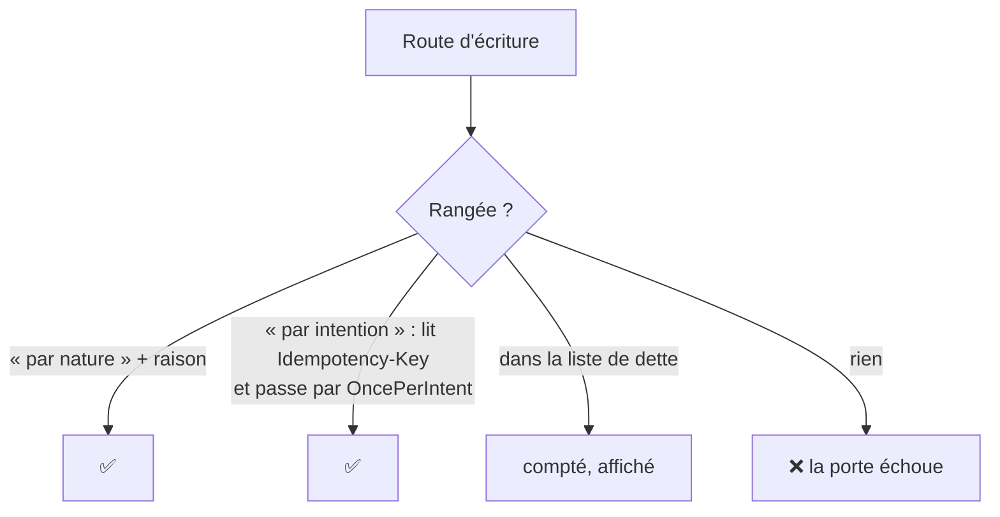

# Plan — chaque écriture dit pourquoi un rejeu ne la refait pas

> 📐 **Plan, 2026-11-12.** Rien n'est bâti. Demande de Hugo : « est-ce qu'on a
> une porte pour garantir l'idempotence de toutes les actions d'écriture ? ».
> Réponse vérifiée ce jour-là : non. Touche une frontière transverse et, sur
> les routes de paiement, l'argent : passe par `vitruve` avant Hugo.

## 1. En simple

Un double clic, un réseau qui coupe après l'envoi, un onglet qui rejoue sa
requête : la même écriture peut arriver deux fois. Selon la route, ça ne
fait rien (poser un état déjà posé), ou ça crée deux fois la même chose
(deux clients, deux remboursements demandés, deux e-mails).

Le plan ne corrige pas tout d'un coup. Il pose une **porte** qui oblige
chaque route d'écriture à se ranger dans une case, et compte celles qui ne
le sont pas encore. La dette se voit à chaque exécution et ne peut que
décroître.

## 2. Ce qui existe (vérifié le 2026-11-12)

- **638 routes d'écriture** : `@Post`, `@Put`, `@Patch`, `@Delete` dans les
  `*.controller.ts` de `apps/lfd-api/src` (compte par `grep`, à refaire par
  la porte elle-même).
- **Un mécanisme commun, déjà là, pour les gestes du staff** :
  - `@IntentKey()` (`platform/shared/http/intent-key.decorator.ts`) lit
    l'en-tête `Idempotency-Key`, un UUID, et refuse sans lui (400,
    `intent.key_missing`) ;
  - `OncePerIntent` (`platform/intent/once-per-intent.ts`) réclame
    l'intention dans `GestureIntentLedger`, garde le résultat par un codec et
    le rend à tout rejeu ; bail de 2 minutes (`GESTURE_INTENT_LEASE_MS`) ;
    table `GestureIntent` (`prisma/schema/platform.prisma:75`), clé par
    acteur ;
  - côté back-office, `GestureIntents` et `intentOptions`
    (`apps/lfd-backoffice-frontend/src/app/shared/gesture-intents.ts`) : une
    clé par geste voulu, gardée jusqu'au succès.
  - 16 contrôleurs l'utilisent ; la porte `intent-key-gestures` l'impose aux
    seuls gestes du staff qui envoient un e-mail.
- **Des idempotences propres, hors de ce mécanisme** : la passation
  (`OrderIdempotency`, `ShopOrderIdempotency`, `orders.prisma:932, 993`),
  les appels Stripe (clé par `params.key`), la boîte d'envoi des e-mails
  (`mail.prisma:39`), et quelques tables à `idempotency_key` unique
  (`growth`, `vitrine`, `alerts`, `staff`).
- **Les webhooks** (Stripe, Resend) sont rejoués par l'émetteur ; leur
  idempotence tient à l'identifiant de l'événement.

## 3. Les cases

Chaque méthode d'écriture d'un contrôleur porte **un** décorateur que la
porte lit :

| Case              | Décorateur                                       | Ce qu'il affirme                                                         | Exemple                                                                                                                     |
| ----------------- | ------------------------------------------------ | ------------------------------------------------------------------------ | --------------------------------------------------------------------------------------------------------------------------- |
| Par nature        | `@Idempotent("raison")`                          | rejouer la même requête laisse le même état et ne déclenche rien de plus | `PUT` qui pose une valeur ; transition refusée si déjà faite (409) ; `DELETE` qui archive un objet déjà archivé sans erreur |
| Par intention     | `@IntentKey()` + `OncePerIntent` dans le handler | le rejeu de la même clé rend le résultat gardé                           | créer un client, demander un remboursement, envoyer un e-mail                                                               |
| Par sa propre clé | `@Idempotent("raison")` qui nomme le mécanisme   | une idempotence métier existante                                         | passation (`OrderIdempotency`), webhooks (identifiant d'événement)                                                          |

Une route qui **crée** (un identifiant neuf à chaque appel) ou qui
**déclenche un effet externe** (e-mail, Stripe, Auth0, stockage) ne peut pas
être « par nature » : la porte refuse une raison sur une telle route s'il
n'y a pas de clé. Ce que la porte sait voir : la méthode HTTP, `@IntentKey`
dans la signature, `OncePerIntent` dans le handler appelé (même lien
contrôleur → commande → handler que `intent-key-gestures`).

## 4. Le bâti

### J0 — la porte et l'inventaire

- `dev-toolbox/gates/write-idempotence.mjs`, inscrite dans
  `lint/lint-backend.json` (`pnpm gate write-idempotence`) et au compte du
  `CLAUDE.md` §10.
- Le décorateur `@Idempotent(reason: string)` dans
  `platform/shared/http/`, sans effet à l'exécution : il porte la raison
  pour la porte et pour le lecteur.
- La liste de dette `dev-toolbox/gates/write-idempotence-debt.json` : chaque
  route non rangée, par fichier et méthode. Une entrée rangée qui reste
  inscrite échoue ; une route nouvelle non rangée échoue.
- Rien ne change à l'exécution.

### J1 — les routes à risque d'abord

Dans cet ordre, une tranche par bloc, chacune avec son e2e « rejouer la
même clé ne refait rien » :

1. **L'argent** : remboursements, encaissements, lots de prélèvement,
   factures émises, avoirs, mandats.
2. **Les créations** visibles d'un tiers : clients, sites, contacts,
   invitations, commandes passées par l'équipe.
3. **Les effets externes** restants : e-mails, Auth0, stockage.

Côté écrans, le geste concerné passe par `GestureIntents` ; la boutique
reçoit la même brique (elle n'en a pas aujourd'hui).

### J2 — le reste, au fil des chantiers

Un fichier touché est un fichier rangé. La dette se lit à chaque exécution.

## 5. Questions pour `vitruve`

- **Q1** — la clé est par acteur (`actorId`) : pour les routes de la
  boutique (client connecté) et les routes publiques (commande sans compte,
  contact), quel acteur ? L'IP n'en est pas un.
- **Q2** — le bail de 2 minutes vaut-il pour un geste long (émission d'un lot
  de factures, export) ? Un geste qui dépasse le bail est réexécuté par le
  rejeu suivant.
- **Q3** — la porte peut-elle prouver qu'un `PUT` « par nature » ne crée rien
  ni n'appelle l'extérieur, ou seulement le croire sur la raison écrite ?
- **Q4** — `GestureIntent` grossit d'une ligne par geste : purge, et durée de
  rétention ?
- **Q5** — une transaction : `OncePerIntent` réclame, exécute, résout. Le
  résultat gardé et l'écriture du geste sont-ils dans la même transaction, ou
  un échec entre les deux laisse-t-il une écriture faite et une intention
  rendue ?

## 6. Ce qu'on ne fait pas

- Pas d'intercepteur qui rendrait toute écriture idempotente sans que le
  handler le sache : il garderait un résultat HTTP sans savoir s'il est
  rejouable, et masquerait les gestes qui ne doivent pas l'être.
- Pas de clé exigée des webhooks : leur idempotence est celle de l'émetteur.
