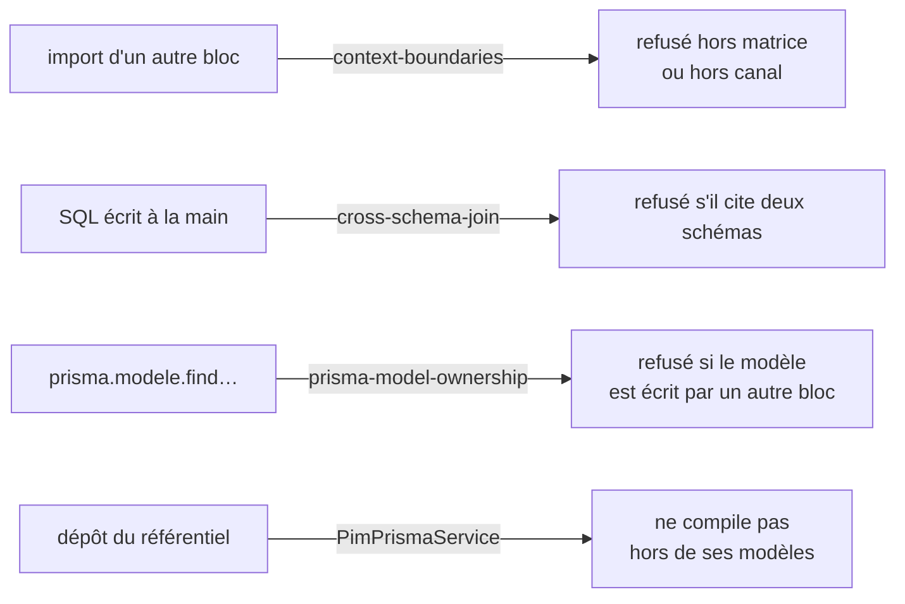

# Qui lit quelle table

## 1. En simple

L'API n'a qu'**une base**, qu'**une URL** et qu'**un client Prisma**. Les tables
y sont rangées en **schémas Postgres**, un par bloc ou presque. Rien dans la
base n'empêche un bloc de lire la table d'un autre : la frontière est tenue par
**un mur au compilateur** (le référentiel seul) et par **trois portes de CI**,
qui regardent chacune une chose différente.

Aucune des quatre ne rend la frontière **impossible** : elles la rendent
visible. Ce qu'elles laissent passer est écrit plus bas.

## 2. Les schémas

Déclarés dans `apps/lfd-api/prisma/schema/datasource.prisma` :

`public`, `growth`, `ops`, `pim`, `production`, `media`, `delivery`,
`platform`, `packing`, `handover`, `mail`, `card_payment`.

Le dossier `prisma/schema/` range un fichier (ou un dossier, pour `public/`,
`pim/` et `media/`) par schéma ; `@@schema("…")` reste obligatoire sur chaque
modèle, et `pnpm gate prisma-schema-layout` vérifie que le rangement dit vrai.
`public` reste le bac commun : sociétés, commandes, personnes, staff.

## 3. Le mur du référentiel — `PimPrismaService`

`apps/lfd-api/src/pim/infra/database/pim-prisma.service.ts` est une classe
abstraite qui **énumère** les délégués que le référentiel atteint (28 modèles
du schéma `pim`, plus `$queryRaw`). Le module la fait pointer par
`useExisting` sur l'unique `PrismaService` : une seule connexion, une surface
rétrécie. Un dépôt du référentiel qui écrit `prisma.company` ne compile pas.

Deux frontières distinctes :

- **qui peut injecter** — `PimDatabaseModule` n'est pas `@Global` ;
- **quoi on atteint** — la liste des délégués.

Deux trous connus, assumés dans le fichier :

- `$transaction` n'est déclaré qu'en **forme tableau** : la forme callback
  rendrait un client complet dans `tx` ;
- `$queryRaw` peut viser n'importe quel schéma — c'est `cross-schema-join` qui
  le relit.

Les autres blocs reçoivent le `PrismaService` complet.

## 4. Les trois portes

| Porte                    | Fichier                                        | Ce qu'elle vérifie                                                                                                                                                                                                                                  | Ce qu'elle laisse passer                                                                                                                                                                                                                                                                                                  |
| ------------------------ | ---------------------------------------------- | --------------------------------------------------------------------------------------------------------------------------------------------------------------------------------------------------------------------------------------------------- | ------------------------------------------------------------------------------------------------------------------------------------------------------------------------------------------------------------------------------------------------------------------------------------------------------------------------- |
| `context-boundaries`     | `dev-toolbox/gates/context-boundaries.mjs`     | Chaque **import relatif** de `apps/lfd-api/src` : le bloc visé est permis par `ALLOWED`, et par le canal nommé dans `PORT_SURFACE` quand il y en a un. Un dossier de premier niveau absent de `BLOCK_OF` fait échouer. `KNOWN` est vide.            | Tout ce qui n'est pas un import : une table d'un autre bloc lue par `PrismaService`, une valeur copiée. Les imports de paquets (`@lfd/…`).                                                                                                                                                                                |
| `cross-schema-join`      | `dev-toolbox/gates/cross-schema-join.mjs`      | Le littéral passé à `$queryRaw` / `$executeRaw` (et `…Unsafe`) ne cite pas **deux** schémas (`schema.` lu dans le `datasource`, liste jamais recopiée).                                                                                             | Une requête brute qui ne cite qu'**un** schéma étranger ; un SQL construit hors gabarit littéral ; la même jointure faite en deux appels Prisma typés.                                                                                                                                                                    |
| `prisma-model-ownership` | `dev-toolbox/gates/prisma-model-ownership.mjs` | Le propriétaire d'un modèle est **le bloc qui l'écrit** (`prisma.<modele>.create/update/upsert/delete…`). Un modèle écrit par deux blocs échoue ; un autre bloc qui le lit (`find…`, `count`, `aggregate`, `groupBy`) échoue. Dérogations : aucune. | Un modèle que **personne n'écrit** n'a pas de propriétaire : la porte se tait. Elle raisonne **par bloc** — deux contextes d'un même bloc partagent librement. Elle ne lit que la forme `prisma.<modele>.…` : un accès par `tx.<modele>` lui échappe. `ops/`, `dev/`, `appBootstrap/` et les `__tests__` sont hors champ. |

`ops/` est hors champ de la troisième porte par construction — il lit pour
surveiller (`documentation/ops/la-sante.md`) — mais sa ligne de la matrice
(`ops → platform` seulement) l'empêche d'importer un bloc métier.

## 5. À lire aussi

- `CLAUDE.md` §1 et §3 — la matrice des blocs et ses canaux.
- [`la-sante.md`](la-sante.md) — ce que `ops/` lit, et pourquoi il ne possède rien.
