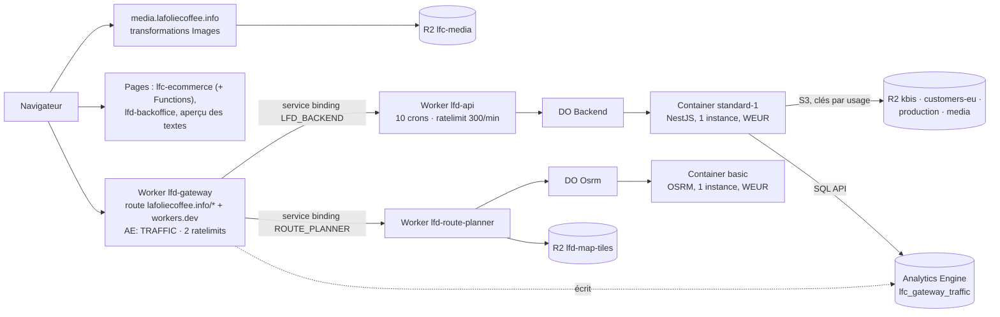

# Ce que nous consommons chez Cloudflare — inventaire, plafonds, mesures

> **État au 2026-10-19.** Inventaire relu dans les fichiers de configuration du
> dépôt ce jour-là (chaque affirmation cite son fichier). Les plafonds et prix
> ont été relus sur `developers.cloudflare.com` le **2026-10-19** ; chaque
> tableau cite sa page. Les tarifs Cloudflare bougent : une valeur vieille de
> plus de trois mois se relit avant de décider.
>
> Ce document ne décrit **que** la consommation. Le chemin d'une requête est
> dans [`../ci-cd/architecture-deploiement.md`](../ci-cd/architecture-deploiement.md),
> les images dans [`cloudflare-images.md`](cloudflare-images.md), le stockage
> dans [`architecture-stockage-r2.md`](architecture-stockage-r2.md).

## 1. La synthèse

| Ressource                                               | Plafond / quota (Workers Paid)                                                                                 | Ce qu'on mesure aujourd'hui                                        | Où le voir                         |
| ------------------------------------------------------- | -------------------------------------------------------------------------------------------------------------- | ------------------------------------------------------------------ | ---------------------------------- |
| Requêtes Workers (passerelle, entrées, Pages Functions) | 10 M/mois inclus, puis 0,30 $/M                                                                                | requêtes **par la passerelle** seulement (Analytics Engine)        | Santé → trafic, carte              |
| Temps CPU Workers                                       | 30 M ms/mois inclus ; 30 s par requête (défaut), 15 min par cron horaire                                       | **rien**                                                           | — (§5.1)                           |
| Container API `standard-1` (½ vCPU, 4 GiB, 8 Go)        | inclus : 375 vCPU-min, 25 GiB-h, 200 Go-h / mois ; mémoire et disque facturés tant que l'instance est éveillée | latence p95 → « occupation » (**pression de latence, pas du CPU**) | Santé → carte, jauge du nœud `b2b` |
| CPU et mémoire du container API                         | ½ vCPU, 4 GiB                                                                                                  | 🟡 **en cours** (lot du 2026-10-19, GraphQL)                       | —                                  |
| Container planificateur `basic` (¼ vCPU, 1 GiB, 4 Go)   | même enveloppe incluse, partagée                                                                               | **rien** (absent de la topologie)                                  | —                                  |
| Durable Objects (un par container)                      | 1 M requêtes/mois, 400 000 Go-s/mois inclus                                                                    | rien                                                               | —                                  |
| R2 — stockage                                           | 10 Go-mois gratuits, puis 0,015 $/Go-mois                                                                      | nombre d'images au fonds (pas d'octets)                            | Santé → seuils média               |
| R2 — opérations A / B                                   | 1 M A et 10 M B gratuits / mois                                                                                | **rien** (bloqué sur un jeton)                                     | —                                  |
| Transformations Images                                  | 5 000 uniques/mois gratuites                                                                                   | **estimées** : images × 4                                          | Santé → seuils média               |
| Analytics Engine                                        | 10 M points écrits, 1 M lectures / mois (non facturé à ce jour)                                                | rien sur le volume ; c'est lui qui porte le trafic                 | —                                  |
| Limites de débit (`ratelimits`)                         | 300/min (API), 120/min et 1 200/min (planificateur), par IP                                                    | les `429` par la passerelle                                        | Santé → trafic (« rejets »)        |
| Cron Triggers                                           | 250 par compte                                                                                                 | **10** déclarés, aucun suivi d'exécution                           | —                                  |

## 2. Le plan Cloudflare

Le dépôt ne l'écrit nulle part comme un **fait relevé** : il l'écrit comme une
exigence de plan ([`../suite/architecture-suite-gateway-scaling.md`](../suite/architecture-suite-gateway-scaling.md),
§11 : « Workers Paid $5/mo requis », relevé le 2026-07-31). Il se **déduit**
pourtant sans ambiguïté : Containers n'existe que sur Workers Paid (la page de
prix l'indique « N/A » en Free — [Containers pricing](https://developers.cloudflare.com/containers/pricing/), lu le 2026-10-19),
et deux Workers à container sont déployés. Les colonnes « Free » ci-dessous ne
servent donc qu'à situer ; **à confirmer d'un coup d'œil** dans le tableau de
bord (Workers & Pages → Plans), ce que personne n'a noté dans le dépôt.

L'offre **Images & Stream n'est pas souscrite** ([`cloudflare-images.md`](cloudflare-images.md), tableau de l'état).

## 3. Ce qui tourne chez Cloudflare

### 3.1 La passerelle `lfd-gateway` (Worker)

- Config : `gateway/wrangler.toml`. Route de zone `lafoliecoffee.info/*`
  (l. 91-93) **et** `workers_dev = true` (l. 53).
- Bindings : `LFD_BACKEND` → `lfd-api` (l. 115-117), `ROUTE_PLANNER` →
  `lfd-route-planner` (l. 134-136), limites `ROUTE_PLANNER_RATE_LIMITER`
  120/min (l. 150-153) et `ROUTE_PLANNER_TILES_RATE_LIMITER` 1 200/min
  (l. 165-168), dataset Analytics Engine `TRAFFIC` / `lfc_gateway_traffic`
  (l. 187-189).
- Aucun cron. Chaque requête entrante — API **et** pages de la boutique servies
  par la zone — est une invocation de ce Worker, plus une invocation du Worker
  appelé derrière un service binding.

### 3.2 L'API `lfd-api` (Worker d'entrée + container)

- Config : `apps/lfd-api/wrangler.jsonc` ; Worker `apps/lfd-api/container/worker.ts`.
- Container `Backend` : `instance_type: "standard-1"` (l. 61, depuis le
  2026-10-12 — la jauge restait vers 40 % en `basic`), `max_instances: 1`
  (l. 56), contraint en `WEUR` (l. 79). Tenu éveillé : `sleepAfter = "1h"`
  (`worker.ts:169`) et le cron `*/5` le sollicite plus souvent. **Il ne dort donc
  jamais** : mémoire et disque provisionnés courent 24 h/24.
- Durable Object `BACKEND` (SQLite, l. 83-86) — l'enveloppe du container.
- Limite `RATE_LIMITER` 300/min par IP (l. 121-127). ⚠️ [`README.md`](README.md)
  dit encore la limite d'edge « inerte » ; le commentaire de la config dit
  qu'elle l'était sous `unsafe.bindings` et ne l'est plus en premier niveau.
  Non tranché ici.
- `workers_dev: false` (l. 104), `observability.enabled` (l. 218-220).
- **Dix crons** (l. 189-202) : `*/5` (chauffe, boîte d'envoi, expiration des
  commandes boutique), `0 3`, `0 11`, `0 19` (recompute), `30 3` (visuels
  orphelins), `0 2` (fidélité), `0 *` (rappels de règlement), `45 3` (photos de
  contrôle), `15 *` (prélèvement automatique), `55 21,22` (facture du mois).
  Soit environ **288 + 24 + 24 + 8 ≈ 344 invocations par jour**, ≈ 10 400 par
  mois, chacune un aller-retour vers le container.

### 3.3 Le planificateur `lfd-route-planner` (Worker + container)

- Config : `apps/lfd-route-planner/wrangler.jsonc`. Container `Osrm`
  `instance_type: "basic"` depuis le 2026-10-14 (l. 30), une instance (l. 33),
  `WEUR` (l. 35). Durable Object `OSRM` (l. 39-42).
- R2 `MAP_TILES` → bucket `lfd-map-tiles` (l. 48), lu par le Worker seul :
  une tuile ne réveille pas le container (`src/worker.ts:18`).
- **Aucun cron** Cloudflare (l. 56-58) : endormi, il n'est pas facturé. Le
  cron `17 2 3 * *` de `.github/workflows/deploy_lfd_route_planner.yml:56` est
  un cron **GitHub** (refaire la carte), pas une invocation Cloudflare.
- ⚠️ L'index ([`../README.md`](../README.md)) le dit « jamais déployé » ; le
  commentaire du 2026-10-14 (l. 27-29) décrit des délais observés. À confirmer.

### 3.4 Les fronts (Pages)

| Projet            | Workflow                                                                                                | Functions                                                                                         |
| ----------------- | ------------------------------------------------------------------------------------------------------- | ------------------------------------------------------------------------------------------------- |
| `lfc-ecommerce`   | `.github/workflows/deploy_lfc_boutique.yml`                                                             | **oui** : `apps/lfc-ecommerce-frontend/functions/` (`confidentialite`, `suppression-des-donnees`) |
| `lfd-backoffice`  | `.github/workflows/deploy_lfd_backoffice.yml`                                                           | aucune (statique)                                                                                 |
| aperçu des textes | `.github/workflows/deploy_lfc_apercu_textes.yml` (projet en variable `LFC_APERCU_TEXTES_PAGES_PROJECT`) | non vérifié ici                                                                                   |

Le statique Pages est gratuit et illimité ; une requête qui invoque une
Function compte comme une requête Workers
([Pages Functions pricing](https://developers.cloudflare.com/pages/functions/pricing/), lu le 2026-10-19).

### 3.5 R2

Cinq buckets : `lfc-b2b-kbis` et `lfc-customers-eu` (juridiction EU),
`lfc-media`, `lfc-production`
([`architecture-stockage-r2.md`](architecture-stockage-r2.md), tableau des
juridictions), et `lfd-map-tiles` (planificateur, ci-dessus). L'API les joint en
S3 avec une clé par usage (`worker.ts:80-107`), pas par binding.

### 3.6 Images, Analytics Engine, et ce qu'il n'y a pas

- **Images** : transformations sur la zone (`/cdn-cgi/image/…`), devant
  `lfc-media` — [`cloudflare-images.md`](cloudflare-images.md).
- **Analytics Engine** : un seul dataset, écrit par la passerelle
  (`gateway/src/traffic.ts:32`), lu par l'API en SQL
  (`apps/lfd-api/src/ops/traffic/analytics-engine-traffic.reader.ts:23`).
- **Ni KV, ni D1, ni Queues** dans les trois configurations. Les seuls
  Durable Objects sont les deux enveloppes de container.

## 4. Les plafonds, ressource par ressource

### 4.1 Workers

Source : [Workers limits](https://developers.cloudflare.com/workers/platform/limits/) et
[Workers pricing](https://developers.cloudflare.com/workers/platform/pricing/), lues le 2026-10-19.

| Limite                       | Free           | Paid                                    |
| ---------------------------- | -------------- | --------------------------------------- |
| Requêtes                     | 100 000 / jour | 10 M / mois inclus, puis 0,30 $/M       |
| CPU par requête HTTP         | 10 ms          | 30 s par défaut, jusqu'à 5 min          |
| CPU par cron                 | 10 ms          | 30 s (intervalle < 1 h), 15 min (≥ 1 h) |
| CPU au mois                  | —              | 30 M ms inclus, puis 0,02 $/M ms        |
| Mémoire                      | 128 Mo         | 128 Mo                                  |
| Sous-requêtes par invocation | 50             | 10 000                                  |
| Crons par compte             | 5              | 250                                     |
| Taille du Worker             | 64 Mio         | 64 Mio                                  |
| Durée (wall time)            | —              | ni facturée ni limitée                  |

Les dix crons de l'API dépasseraient à eux seuls le plafond Free (5).

### 4.2 Containers

Source : [Containers pricing](https://developers.cloudflare.com/containers/pricing/), lue le 2026-10-19.

| Type         | vCPU | Mémoire | Disque | Qui l'utilise       |
| ------------ | ---- | ------- | ------ | ------------------- |
| `lite`       | 1/16 | 256 Mio | 2 Go   | —                   |
| `basic`      | 1/4  | 1 Gio   | 4 Go   | `lfd-route-planner` |
| `standard-1` | 1/2  | 4 Gio   | 8 Go   | `lfd-api`           |
| `standard-2` | 1    | 6 Gio   | 12 Go  | —                   |

Inclus par mois (Paid) : **375 vCPU-minutes, 25 Gio-heures de mémoire,
200 Go-heures de disque**. Au-delà : 0,000020 $/vCPU-s, 0,0000025 $/Gio-s,
0,00000007 $/Go-s. Le CPU est facturé **à l'usage actif**, mémoire et disque
**au provisionné** tant que l'instance est éveillée. Sortie réseau : 1 To
inclus en Amérique du Nord et Europe, puis 0,025 $/Go.

Ordre de grandeur (calcul, pas une facture) : l'API éveillée 730 h/mois en
`standard-1` provisionne 4 × 730 = 2 920 Gio-h, soit ≈ 2 895 Gio-h au-delà
des 25 inclus ≈ **26 $** de mémoire, plus 8 × 730 = 5 840 Go-h de disque
≈ **1,4 $**. Cohérent avec l'estimation « ≈ 30 $/mois » écrite dans
`apps/lfd-api/wrangler.jsonc:60`. **La mémoire réservée est le poste
principal** ; le CPU réel, lui, n'est pas mesuré.

### 4.3 Durable Objects

Paid : 1 M requêtes/mois et 400 000 Go-s inclus ; SQLite 5 Go-mois
([Workers pricing](https://developers.cloudflare.com/workers/platform/pricing/), lu le 2026-10-19).
Chaque requête vers un container passe par son Durable Object.

### 4.4 R2

Source : [R2 pricing](https://developers.cloudflare.com/r2/pricing/), lue le 2026-10-19.
Gratuit par mois : 10 Go-mois, 1 M opérations A, 10 M opérations B ; au-delà
0,015 $/Go-mois, 4,50 $/M (A), 0,36 $/M (B). Sortie vers Internet gratuite.
Les tuiles de la carte sont des lectures B : chaque déplacement de carte en
coûte des dizaines (`gateway/wrangler.toml:155-164`).

### 4.5 Images

5 000 transformations uniques gratuites par mois, puis 1 $ les 2 000 — relu
le 2026-10-10 dans [`cloudflare-images.md`](cloudflare-images.md) §5, avec la
question ouverte de ce qui se passe au-delà sans offre souscrite. Non relu ici.

### 4.6 Analytics Engine

Source : [Analytics Engine pricing](https://developers.cloudflare.com/analytics/analytics-engine/pricing/), lue le 2026-10-19.

| Plan | Points écrits               | Requêtes de lecture     |
| ---- | --------------------------- | ----------------------- |
| Paid | 10 M / mois (puis 0,25 $/M) | 1 M / mois (puis 1 $/M) |
| Free | 100 000 / jour              | 10 000 / jour           |

La page précise que Cloudflare **ne facture pas encore** Analytics Engine.
Un point par requête de passerelle (`gateway/src/traffic.ts:144-157`) : le
volume écrit égale le trafic de la passerelle.

## 5. Ce qu'on mesure aujourd'hui

### 5.1 Le trafic, par la passerelle

La passerelle écrit un point par requête : nœud en index, classe de statut et
origine de la faute en blobs, durée en double (`gateway/src/traffic.ts:144-157`).
L'API le relit par l'API SQL d'Analytics Engine
(`analytics-engine-traffic.reader.ts:23`) avec le jeton
`CLOUDFLARE_ANALYTICS_TOKEN` (`worker.ts:117-118`) : requêtes pondérées par
`_sample_interval`, `5xx` amont, `429`, fautes de passerelle et **p95 de
latence** (`apps/lfd-api/src/ops/traffic/traffic-query.ts:59-65`).

Ce que ça ne voit pas : les crons (ils ne passent pas par la passerelle), les
Pages Functions servies par `pages.dev`, et **le coût** — une durée vue de la
passerelle n'est pas du CPU.

### 5.2 L'« occupation » est une pression de latence

`apps/lfd-backoffice-frontend/src/app/ops/occupancy.ts` colore un nœud de la
carte à partir du **p95** : 0 sous `P95_CALM_MS = 120` (l. 26), 1 à
`P95_SATURATED_MS = 1000` (l. 23), linéaire entre les deux ; ou à partir de la
part de `429`. **Ce n'est ni du CPU ni de la mémoire.** Le seuil de 1 000 ms est
choisi, pas étalonné
([`../suite/architecture-ops-ecosystem-health.md`](../suite/architecture-ops-ecosystem-health.md), reste à faire).

### 5.3 Les autres lectures de la page Santé

- **Vitals** des fronts : en mémoire de l'instance, 30 min, 200 points par
  métrique (`apps/lfd-api/src/ops/vitals/vitals.store.ts:18`, `:28`).
- **Seuils média** : images au fonds × `TRANSFORMATIONS_PER_IMAGE = 4` contre
  `FREE_TRANSFORMATIONS_PER_MONTH = 5_000`
  (`apps/lfd-api/src/ops/media/media-thresholds.ts:31`, `:37`). Une
  **estimation** tirée de notre base, pas un compteur Cloudflare.
- **Capacités** éteintes au démarrage (`apps/lfd-api/src/ops/capabilities/`),
  sondes externes Auth0, Resend, Stripe (`probes/external.probes.ts`), sonde de
  front (`probes/frontend.probe.ts`), sonde du calcul des prix
  ([`sonde-calcul-des-prix.md`](sonde-calcul-des-prix.md)).
- **Topologie** : fronts, passerelle, `b2b`, Postgres, Auth0, Stripe, Resend,
  R2 (`apps/lfd-api/src/ops/topology/topology.ts:35-82`). Le planificateur n'y
  est **pas** un nœud.

### 5.4 En cours (2026-10-19)

🟡 **CPU et mémoire du container API**, lus par GraphQL
`containersMetricsAdaptiveGroups`
([tutoriel](https://developers.cloudflare.com/analytics/graphql-api/tutorials/querying-container-metrics/), lu le 2026-10-19).
Lot en construction, non commité au moment de cette relecture : son code
n'est pas décrit ici, sa doc viendra avec lui.

### 5.5 Ce qui manque

Temps CPU des Workers, invocations et erreurs des crons, usage facturé des
containers, opérations et volume R2, transformations Images réelles, volume
Analytics Engine, le planificateur entier.

## 6. Ce qu'on pourrait mesurer ensuite

Toutes ces sources passent par l'API GraphQL Analytics
(`https://api.cloudflare.com/client/v4/graphql`). Droit du jeton : **Account ·
Account Analytics · Read**
([authentification](https://developers.cloudflare.com/analytics/graphql-api/getting-started/authentication/api-token-auth/), lu le 2026-10-19).
Le jeton actuel `CLOUDFLARE_ANALYTICS_TOKEN` sert l'API SQL d'Analytics
Engine ; **son périmètre exact n'est pas consigné dans le dépôt** — à vérifier
dans le tableau de bord avant de supposer qu'il ouvre GraphQL.

Classé par utilité pour Hugo — coût et plafonds d'abord :

| #   | Source GraphQL                                          | Ce qu'elle rend                                                                                                                                                                                                                  | Pourquoi                                                               | Place proposée sur la page Santé                             |
| --- | ------------------------------------------------------- | -------------------------------------------------------------------------------------------------------------------------------------------------------------------------------------------------------------------------------- | ---------------------------------------------------------------------- | ------------------------------------------------------------ |
| 1   | `containersUsageAdaptiveGroups`                         | `cpuTimeSec`, `allocatedMemory`, `allocatedDisk`, `txBytes` (sommes)                                                                                                                                                             | **l'usage facturé** des deux containers, à comparer aux inclus du §4.2 | un bloc « Coût du mois » par container                       |
| 2   | `containersMetricsAdaptiveGroups`                       | `cpuUtilization`, `memory`, `diskUsage`, `containerUptime`                                                                                                                                                                       | 🟡 en cours pour l'API ; à étendre au planificateur                    | jauge du nœud, à côté de la latence                          |
| 3   | `workersInvocationsAdaptive`                            | `requests`, `errors`, `subrequests`, `cpuTimeP50`/`P99`, par `scriptName` et `status` ([tutoriel](https://developers.cloudflare.com/analytics/graphql-api/tutorials/querying-workers-metrics/), lu le 2026-10-19)                | requêtes contre les 10 M, CPU contre les 30 M ms, **crons en erreur**  | un compteur mensuel par Worker ; un témoin « cron en échec » |
| 4   | `r2OperationsAdaptiveGroups`, `r2StorageAdaptiveGroups` | opérations par `actionType` et `bucketName`, `objectCount`, `payloadSize` ([métriques R2](https://developers.cloudflare.com/r2/platform/metrics-analytics/), lu le 2026-10-19 ; 31 jours max, préfixe `eu_` pour les buckets EU) | A/B et Go contre le gratuit — déjà nommé comme bloqué sur ce jeton     | ligne par bucket dans « Seuils »                             |
| 5   | Transformations Images                                  | compteur réel du mois                                                                                                                                                                                                            | remplacer l'estimation × 4 du §5.3                                     | « Seuils média », en lieu de l'estimé                        |
| 6   | Analytics Engine (volume)                               | points écrits, lectures                                                                                                                                                                                                          | gratuit aujourd'hui ; utile le jour où Cloudflare facture              | aucune tant que non facturé                                  |

⚠️ Non vérifié : le nom du dataset GraphQL des transformations Images et le
droit qu'il demande — à relire avant d'ouvrir le lot 5.

## 7. Ce qui reste à confirmer

- Le **plan** du compte (Workers Paid par déduction, §2).
- Le **périmètre** du jeton `CLOUDFLARE_ANALYTICS_TOKEN`.
- Le déploiement effectif du planificateur (§3.3).
- La limite d'edge de l'API : active ou inerte (§3.2).
- Le contenu du projet Pages de l'aperçu des textes (Functions ou non).
