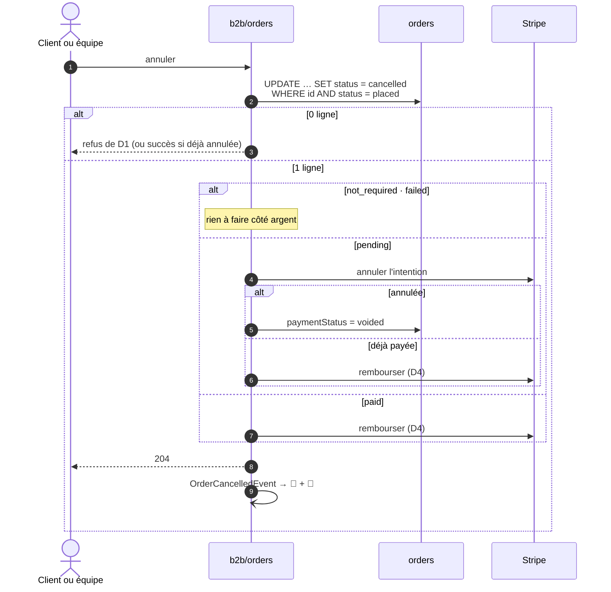

# Plan — annuler une commande

**Statut** : 📐 plan, 2026-09-17, **révisé le 2026-10-12** — le lot C3
(annulation par le staff, sans remboursement, sans le compte) est écrit en tête,
sur les décisions de Hugo du jour, dont l'option (a) : la carte non payée
s'annule en fermant l'intention chez Stripe. Attend `vitruve`. Le reste du
document (§1 à §9) est l'état du 2026-09-17, et le §1 est en partie périmé
(C3.1). **Rien n'est bâti.** Touche **l'argent**
(annulation d'une intention Stripe, remboursement). 🔴 **Contredit par
`vitruve` le même jour : 4 BLOQUANT, 7 SÉRIEUX.** Les décisions D1, D2, D3, D5
et D6 ne tiennent pas en l'état — le §9 dit pourquoi et dans quelle direction
les reprendre. **Ne pas bâtir avant la refonte** — l'état et les décisions attendues sont
suivis dans [`todo-annulation-de-commande.md`](todo-annulation-de-commande.md).
**Portée** : la transition `placed → cancelled`, ce qu'elle fait de l'argent, et
ce qu'elle dit au client. Ni l'avenant (modifier une commande), ni l'annulation
d'une commande déjà dans le plan.

## 0. La demande

> « c'est vrai que `cancelled` n'existe pas, on devrait peut-être le faire,
> règle : tant qu'on n'est pas `confirmed` on peut cancel » — Hugo, 2026-09-17.
>
> « envoi d'un mail de confirmation d'annulation, n'ira pas dans le plan de prod
> du jour » — Hugo, même jour.

## Lot C3 — annulation par le staff (2026-10-12)

> 📐 **Plan, rien n'est bâti.** Réduit le même jour sur les décisions de Hugo
> (C3.0) et les objections de `vitruve` (C3.9), puis **élargi** le même jour
> par l'option (a) de Hugo : l'annulation ferme l'intention chez Stripe pour
> une carte non payée (C3.2, C3.4 bis). Le remboursement vient juste après
> (« Suite immédiate », fin de section).
> Numérotation : celle de [`plan-page-commandes.md`](plan-page-commandes.md)
> (C1 liste, C2 écran).

### C3.0 Les décisions de Hugo (2026-10-12)

> « on doit pouvoir annuler une commande tant qu'elle n'est pas ajoutée au
> compte à produire »
>
> « commençons par le faire en staff »

1. **Le critère** est B1 (§9.3, point 1) : **le fournil ne l'a pas inscrite**,
   et non plus le statut `placed`.
2. **Le staff d'abord** : un bouton dans `/commandes/:orderId`, une route
   admin. Le client vient après ; S2 (« qui, dans une société ») est reporté.
3. **Les commandes au compte : plus tard.** Ce lot ne vise que les commandes
   réglées par carte (boutique ou pro carte) non payées ; une commande au
   compte est **refusée** avec une phrase qui nomme le cas.
4. **Paiement carte en cours : refusé** — `pending`, et `failed` dont
   l'intention reste vivante.
5. **Payée par carte : refusée jusqu'à C4** ; l'équipe rembourse dans Stripe
   si besoin.
6. **Une permission à part** pour annuler : une ressource `StaffResource`
   neuve, ajoutée par migration, **accordée à l'écran**.
7. **Option (a), tranchée plus tard le même jour** : l'annulation staff
   **ferme l'intention de paiement chez Stripe** pour une commande carte non
   payée (`pending` ou `failed`), comme `AbandonOrderHandler` le fait déjà —
   **sans remboursement**. Elle **remplace la décision 4** : une carte en
   cours ne se refuse plus d'office, elle se ferme. C4 (le remboursement)
   suit juste après, en lot à part : « je pense que souvent l'annulation aura
   lieu post paiement » (Hugo).
8. **Le total nul (`free`) reste annulable, et le bon utilisé est rendu** :
   « si un bon a été utilisé remboursement du bon » (Hugo, même jour).

### C3.1 L'existant qui a bougé depuis le §1 (ouvert le 2026-10-12)

Le §1 date du 2026-09-17 ; plusieurs de ses phrases sont **fausses** aujourd'hui.

- **`cancelled` s'écrit déjà, par trois chemins** : l'abandon de carte d'un
  particulier (`PrismaOrderRepository.markAbandoned`), l'expiration des
  impayés de la boutique (`UnsettledShopOrderExpiryService`, 30 min) et
  l'échec à l'arrêt (`failAtClosing`, par `PendingSettlementSweeper` au début
  de chaque clôture). Les trois écrivent `cancelled` + `failed` sous
  `status = placed`, et les deux premiers **annulent l'intention chez Stripe
  d'abord**.
- **Le webhook ne rouvre plus une annulée** : `settle()` porte
  `status <> cancelled` (2026-09-26) ; un encaissement tardif publie
  `OrderPaidAfterCancellationEvent`, que `RingRefundDue` écoute en durable
  (2026-10-10) pour sonner « à rembourser ».
- **`GET /orders/:id/payment` refuse une annulée**.
- **Le bon de fidélité** engagé est libéré dans la transaction de
  `markAbandoned`.
- **`markFulfilled` n'a toujours aucune condition de statut** (S1).
- **Le JSDoc du contrôleur admin dit l'inverse de ce lot** (« l'annuler [est
  une décision] de production, pas [un bouton] d'écran ») : à réécrire dans le
  même commit.

### C3.2 Ce qui est annulable — vérifié dans le code

Le régime de règlement est une déduction figée à la passation
(`settlementRegimeOf`, `b2b/orders/domain/services/settlement-regime.ts`) :
`account` (`not_required`, total > 0), `free` (`not_required`, total nul),
`due` (`pending` ou `failed`), `paid` (`paid`, `refunded`).

**`failed` veut toujours dire « intention vivante »** (lu le 2026-10-12) :

- `PAID_FROM = [pending, failed]` : un encaissement l'emporte sur un refus
  antérieur — l'intention d'un `failed` est **payable** par construction ;
- le webhook d'échec (`markPaymentFailed`) laisse l'intention chez Stripe en
  `requires_payment_method`, réessayable ;
- l'abandon d'un **pro** écrit `failed` et laisse l'intention vivante
  exprès (Q8 du plan d'abandon, 2026-09-26) ;
- les seuls chemins qui **tuent** l'intention (abandon d'un particulier,
  expiration de la boutique) écrivent en même temps `cancelled` : il n'existe
  aucune commande `placed` + `failed` dont l'intention soit morte.

| Régime    | Décision                             | Annulable ?                                              |
| --------- | ------------------------------------ | -------------------------------------------------------- |
| `account` | plus tard (C3.0, 3)                  | non                                                      |
| `due`     | **intention fermée chez Stripe (7)** | **oui**, si Stripe confirme qu'elle est morte (C3.4 bis) |
| `paid`    | refusée jusqu'à C4 (5)               | non                                                      |
| `free`    | —                                    | oui, si non inscrite au fournil                          |

Sans la décision 7, le lot ne rendait annulable que le total nul : c'est ce
constat qui a fait trancher (a).

**Une commande `due` n'est jamais inscrite au fournil** (lu le 2026-10-12) :
`planWhere()` (`b2b/orders/infrastructure/plan-filter.ts:47`) exclut les
règlements refusés et en attente (`settlementWhere`, `:64`). Elle n'y entre
qu'en devenant `paid` — ce que la fermeture de l'intention interdit. Le
retrait au fournil (C3.4) reste écrit pour elle, uniformément, mais ne peut
pas y rendre `inscribed`.

### C3.3 Le critère, et où il se lit

| #   | Refus, dans cet ordre                            | Où il se lit                                                             |
| --- | ------------------------------------------------ | ------------------------------------------------------------------------ |
| 1   | déjà `cancelled`                                 | `orders.status`                                                          |
| 2   | `draft`, `ready`, `fulfilled`                    | `orders.status`                                                          |
| 3   | au compte                                        | `settlementRegimeOf` = `account`                                         |
| 4   | payée                                            | régime `paid`                                                            |
| 5   | **inscrite par le fournil**                      | ligne `production.production_order (service_day, order_id)`, par un port |
| 6   | `due` : Stripe ne confirme pas l'intention morte | issue de `cancelIntent` (C3.4 bis)                                       |

Le statut seul ne suffit pas (B1, confirmé ce jour) : la clôture enregistre
l'instantané puis le commerce passe `confirmed` dans un abonné durable ;
entre les deux, ou pour toujours si l'abonné tombe, une inscrite reste
`placed`. Le retirage inscrit des `placed` sans rien publier au commerce.

### C3.4 La course avec la clôture et le retirage

**Prendre le verrou de journée ne suffit pas** : clôture et retirage lisent
`DayOrdersReader.producibleFor` **avant** `ProductionDayLock`. Séquence
perdante : la clôture lit O ; l'annulation verrouille, voit O non inscrite,
annule, valide ; la clôture verrouille et inscrit O.

**La forme retenue** :

- `production/channels/commerce/` gagne un port **déclaré et implémenté par
  le fournil**, `OrderWithdrawalDesk.withdraw(day, orderId): "withdrawn" |
"inscribed"`, exécuté **dans l'unité de travail de l'appelant**
  (précédent : `BinDesk`). Il prend `ProductionDayLock.lock(day)`, lit
  `production_order`, et sinon écrit `production.order_withdrawal
(service_day, order_id, at)` — table neuve, migration additive.
- 🔴 **La règle d'écartement vit dans l'agrégat du fournil, pas dans les
  handlers** (`vitruve`) : `ProductionDay.close(producible, withdrawn, …)` et
  `ProductionDay.retake(producible, withdrawn, …)` **reçoivent** les retraits
  et les écartent eux-mêmes. Les handlers les chargent **sous le verrou**,
  après le rechargement de la journée et avant l'appel à l'agrégat :
  avant `current.close(...)` (`close-production-day.handler.ts:180`) et avant
  `locked.retake(...)` (`retake-production-day.handler.ts:109`). Lecture de
  LEURS tables : permise sous verrou.
- **Les autres lecteurs de `producibleFor` ne sont pas sous verrou et n'en
  ont pas besoin** — ils disent, ils n'inscrivent pas : l'alerte de
  l'arrêt automatique (`run-auto-close-round.handler.ts:101` et `:144`) et
  la fiche (`production-worksheet-reading.service.ts:63`). Une annulée y
  disparaît d'elle-même : `producibleFor` lit `planWhere()` (`status =
placed`). Pas de retrait à leur faire lire.
- **Puis**, dans la même transaction, côté commerce : `updateMany where { id,
status: placed, OR: [{ paymentStatus in (pending, failed) }, {
paymentStatus: not_required, totalCents: 0 }] }` → `cancelled` ; un `due`
  passe aussi `paymentStatus = failed`, comme `markAbandoned`. `0` ligne →
  relire, rendre le refus exact, **et annuler toute la transaction**, retrait
  du fournil compris.
- Ordre des verrous : ligne `orders` **puis** journée — celui de C3.4 ter,
  qui fait foi.

Écriture nue justifiée (CLAUDE.md §3.1), comme `absorbIntoPlan`. La phrase de
refus reste une règle pure, `cancellationBlocker(state)`, sur le modèle de
`packingBlocker`.

**MINEURS de `vitruve`, assumés et dits** :

- **le balayage tourne avant le verrou** (`settlements.sweep(day)`, première
  ligne de la clôture) : il peut annuler une commande `due` pendant qu'on
  l'annule. `status = placed` dans les deux `where` ne laisse franchir qu'un
  des deux ; si le balayage gagne, l'annulation staff relit et rend « déjà
  annulée » (l'intention est morte des deux côtés) ;
- **`ProductionDayRetakenEvent` est écouté par la livraison** (CA6b) : il
  porte les `orderIds` absorbés ; une commande retirée n'est pas absorbée,
  donc n'y figure pas — rien à changer, à éprouver en e2e ;
- **une journée close ne recalcule pas** (la réannonce republie
  l'instantané) : une commande retirée après l'arrêt n'y était pas, la
  réannonce ne l'y fait pas entrer.

### C3.4 bis L'ordre des gestes avec Stripe (décision 7)

**Stripe d'abord, la transaction ensuite** — l'ordre de l'abandon. Ce qui en
est repris, lu le 2026-10-12 :

| Repris                                                                                                                                   | D'où                                                                                                                                                 |
| ---------------------------------------------------------------------------------------------------------------------------------------- | ---------------------------------------------------------------------------------------------------------------------------------------------------- |
| l'appel `cancelIntent` sur l'intention de la commande, **hors transaction**                                                              | `orders/application/commands/abandon-order.handler.ts:94-97`                                                                                         |
| les cinq issues et leur sort : `cancelled` / `already_cancelled` laissent écrire ; `already_paid`, `in_progress`, `unavailable` refusent | `abandon-order.handler.ts:150-163` (`ensureIntentDead`) ; `payments/domain/payment-gateway.ts:50`                                                    |
| le port ne lève jamais ; un refus d'annuler relit l'intention pour dire pourquoi                                                         | `payments/infrastructure/stripe-payment-gateway.ts:81-104`                                                                                           |
| l'écriture, le bon libéré et le fait durable dans UNE unité de travail                                                                   | `abandon-order.handler.ts:119-133`                                                                                                                   |
| les erreurs `OrderPaymentAlreadyReceivedError`, `OrderPaymentInProgressError`, `OrderAbandonUnavailableError`                            | `orders/domain/errors/order-abandon-errors.ts` — reprises pour leur **sens** ; leurs phrases parlent au client, celles du staff sont à écrire (C3.7) |

**Ce qui n'est PAS repris** :

- la condition « seul un particulier touche Stripe »
  (`abandon-order.handler.ts:94`, `owned.clientele === "public"`) : l'abandon
  garde l'intention d'un pro vivante pour qu'il puisse repayer ; une
  **annulation** la ferme pour toutes les clientèles — c'est la décision 7 ;
- le mur client (`ensureOrderVisible`, `ensureOrderAuthor`) : la route est
  staff ;
- `markAbandoned` : sa branche pro n'écrit que `failed` ; l'annulation a sa
  propre écriture (C3.4).

**Pourquoi Stripe AVANT la transaction** : pas d'appel réseau sous le verrou
de journée ; et annuler chez nous puis échouer chez Stripe laisserait une
**annulée payable** — ce que l'abandon refuse déjà.

**La séquence** :

1. lire la commande ; `cancellationBlocker` (statut, compte, `paid`) — refus
   immédiats, aucun appel ;
2. si `due` et une intention existe : `cancelIntent` —
   `cancelled` / `already_cancelled` → continuer ; `already_paid` → refus
   « payée par carte » ; `in_progress` → refus « en cours de traitement » ;
   `unavailable` → refus « Stripe ne répond pas », journalisé en `warn`.
   Dans les trois refus, l'appel à Stripe n'a rien fermé et la base n'est
   pas touchée ;
3. la transaction de C3.4, dans l'ordre exact de C3.4 ter (ligne `orders`
   verrouillée et relue, retrait au fournil, `updateMany`, bon, fait durable).

**La course webhook `paid` contre l'annulation** :

- **encaissé avant l'appel** : Stripe refuse d'annuler une intention réussie,
  le port relit et rend `already_paid` → refus. Le webhook en vol passe la
  commande `paid` normalement : payée, non annulée, cohérent ;
- **encaissé après l'appel** : impossible, une intention annulée ne
  s'encaisse plus ;
- **`processing`** : `in_progress`, refus — on ne ferme pas ce qui peut
  encore aboutir.

**Les trous, et qui les tient** :

- **Stripe a fermé, puis notre transaction échoue** : voir C3.4 ter
  (rejeu dans la requête, puis erreur technique, puis risque résiduel
  assumé).
- **Un `paid` tardif sur une annulée** ne peut plus venir d'une intention
  fermée ; s'il venait d'ailleurs, `settle()` refuse de rouvrir une annulée et
  `RingRefundDue` sonne (C3.1).

### C3.4 ter Double clic, et transaction qui échoue après Stripe (`vitruve`, 2ᵉ et 3ᵉ passages, 2026-10-12)

**À quoi sert `production.order_withdrawal` en C3** : au **seul régime
`free`**. Une `due` n'est jamais inscrite au fournil (`plan-filter.ts:47`,
`:64`), le retrait ne peut rien lui refuser ; il est écrit pour elle aussi,
uniformément, parce qu'une seule écriture coûte moins que deux chemins. La
table servira pleinement au lot « au compte » (C3.9).

**Sa clé** : `order_id` en **clé primaire** (une commande n'a qu'un jour de
service), plus `service_day` et `withdrawn_at`. `withdraw` est **idempotent** :
`INSERT … ON CONFLICT (order_id) DO NOTHING`, issue `withdrawn` dans les deux
cas — un retrait déjà posé n'est pas une erreur.

**Deux clics, deux staffs** — la transaction, dans cet ordre :

1. `SELECT … FROM orders WHERE id = $1 FOR UPDATE` puis relire le statut :
   `cancelled` → refus « déjà annulée » (409), sans écriture. Le
   second clic attend le premier sur cette ligne, puis voit `cancelled`.
2. `OrderWithdrawalDesk.withdraw` : verrou de journée, `production_order`,
   insertion idempotente.
3. `updateMany` conditionné (C3.4) ; `count === 1` seulement libère le bon
   (comme `abandon-order.handler.ts:124-126`) et publie le fait.

Ordre des verrous : ligne `orders` **puis** journée. La clôture prend la
journée sans toucher `orders` ; son abonné `absorbIntoPlan` touche `orders`
sans la journée. Aucun preneur ne tient la journée en attendant `orders` :
pas de cycle.

**L'unité de travail imbriquée** (lu dans `platform/database/unit-of-work.ts:50`) :
déjà dans une transaction, `run` **rejoint** celle en cours, et les rappels
d'après validation s'accrochent à la plus externe. Le port du fournil appelé
dans la transaction du commerce y écrit donc pour de bon, et tout s'annule
ensemble.

**La transaction échoue après la fermeture chez Stripe.** Pas de marque
locale : une première version écrivait une « demande d'annulation » avant
Stripe ; le 3ᵉ passage de `vitruve` l'a cassée (marque survivant à un
`paid` par webhook, expiration boutique oubliée, effacement non nommé selon
l'issue, deux demandes concurrentes). Décision du 2026-10-12 :

1. `cancelled_by`, `cancellation_reason` et `cancelled_at` ne s'écrivent
   **que dans la transaction finale**, avec le statut.
2. Si cette transaction échoue après une fermeture réussie chez Stripe, le
   handler la **rejoue une fois** dans la même requête (la relecture sous
   `FOR UPDATE` de l'étape 1 rend le rejeu sûr).
3. Si elle échoue encore : `TechnicalError` (500) dont la phrase dit au
   staff « Le paiement est fermé chez Stripe, mais l'annulation n'a pas pu
   être enregistrée. Relancez l'annulation. » Le rejeu du staff obtient
   `already_cancelled` de Stripe et écrit.
4. **Risque résiduel, assumé** : si personne ne relance, la commande reste
   `placed` + `due` avec une intention morte. Elle n'est jamais producible
   (`planWhere`) ; la page de règlement refuse une intention morte ; la
   clôture (`failAtClosing`) ou l'expiration des impayés boutique
   (`UnsettledShopOrderExpiryService`) finit par l'annuler comme
   **« paiement non abouti »** — mauvais courriel, aucun auteur ni motif. Rare
   (deux échecs de base de suite dans la même requête), et **aucun argent en
   jeu** : rien n'a été encaissé. Le balayage n'est pas modifié.

**Le webhook d'échec tardif sur une annulée** : `markPaymentFailed` passe par
`settle()`, dont le `where` porte `status <> cancelled`
(`prisma-order.repository.ts:248`) — il n'écrit rien et ne publie rien (lu le
2026-10-12).

**Une commande n'a qu'une intention** (vérifié le 2026-10-12, à garder vrai
en C4) : `createIntent` n'est appelé qu'à la passation —
`place-shop-order.handler.ts:245`, `place-order-for-customer.handler.ts:136`
et `order-settlement.ts:50` (`settleOrder`, appelé par
`place-order.handler.ts` et `place-order-for-customer.handler.ts`). La
consigne transmise n'en nommait que deux ; aucun des trois ne crée une
seconde intention pour une commande existante. Fermer
`stripePaymentIntentId` ferme donc tout ce qui peut encaisser.

**Les issues Stripe, complétées** : `requires_capture` ne se présente pas
chez nous (capture automatique, `stripe-intent-translation.ts:15`) ; s'il
apparaissait, l'argent n'est pas pris et Stripe accepte d'annuler : issue
`cancelled`. **Une `due` sans intention** (`stripePaymentIntentId` nul) :
aucun appel, la transaction écrit directement.

### C3.5 Ce que devient la commande

- **`status = cancelled`**, règlement inchangé.
- **Colonnes neuves, additives et nullables** : `cancelled_at`,
  `cancelled_by`, `cancellation_reason` — tous écrits dans la seule
  transaction finale (C3.4 ter). 🔴 **`cancelled_by` est l'id staff
  interne** (le `staffUserId` que le contrôleur reçoit par `@StaffUserId()`),
  **jamais un `sub`** — `lint:auth0-id-readers` et `lint:subject-readers`
  tiennent la liste de ses lecteurs, une colonne neuve n'y entre pas. Les
  trois annulations automatiques laissent ces colonnes vides ; on ne rattrape
  rien.
- **Motif obligatoire**, borné, jamais montré au client.
- **Le bon de fidélité utilisé est rendu** (Hugo, 2026-10-12 : « si un bon a
  été utilisé remboursement du bon ») dans la même transaction, **seulement
  si l'`updateMany` rend `count === 1`** (`LoyaltyVoucherRedemption.release`,
  comme l'abandon) — un rejeu ne le rend pas deux fois. Vaut pour `free`
  (c'est souvent lui qui a fait le total nul) comme pour `due`.
- **Le fait `OrderCancelledEvent`, durable**, écrit dans l'unité de travail.
  Abonnés :
  - **le journal** `order.cancelled` (D10) : sujet = le client, charge = qui
    (id staff), motif, régime ; idempotent par commande ; visible dans
    l'historique du détail ;
  - **la croissance** soustrait (S5), à côté de `OnOrderAbandoned` ;
  - **le courriel** (D9) : « votre commande X pour le jour J a été annulée
    par notre équipe », sans QR ni motif ; `free` : « Rien ne vous sera
    facturé pour cette commande. » ; `due` : « Aucun paiement n'a été
    prélevé. » ; **si un bon a été utilisé** : « Votre bon de fidélité vous
    est rendu : vous pourrez l'utiliser sur une prochaine commande. » ; clé `order.cancelled:<orderId>` ;
    gabarit fr, en, it, distinct de celui de l'abandon.
- **Répétition** : refus nommé « déjà annulée », rien n'est republié.

### C3.6 Effets sur les autres blocs

| Bloc        | Effet                                                                                                                                                                                                                                                                                                                                                                  | Vérifié le 2026-10-12                               |
| ----------- | ---------------------------------------------------------------------------------------------------------------------------------------------------------------------------------------------------------------------------------------------------------------------------------------------------------------------------------------------------------------------- | --------------------------------------------------- |
| fournil     | une ligne `order_withdrawal`, écartée par l'agrégat à la clôture et au retirage                                                                                                                                                                                                                                                                                        | `production_order` unique `(service_day, order_id)` |
| colisage    | aucun : la liste naît de l'instantané (`packing_list_drawn`)                                                                                                                                                                                                                                                                                                           | publié par clôture et retirage seulement            |
| livraison   | `LocateOnOrderPlaced` géocode l'adresse à la passation, rien de plus : un point de carnet et de cache, pas un arrêt. Le prévisionnel et le départ relisent le statut (`prisma-delivery-order-states.reader.ts`, `prisma-delivery-orders.reader.ts` marquent `cancelled`). **Décision : ne rien défaire** — l'adresse géocodée reste valable pour la prochaine commande | handler et lecteurs ouverts                         |
| retrait     | `markFulfilled` gagne `status <> cancelled` (S1)                                                                                                                                                                                                                                                                                                                       | sans condition ce jour                              |
| facturation | aucun dans ce lot : le compte est refusé                                                                                                                                                                                                                                                                                                                               | —                                                   |

### C3.7 Les refus nommés

| Cas                    | Phrase (`BusinessError`, 409)                                                                                                                               |
| ---------------------- | ----------------------------------------------------------------------------------------------------------------------------------------------------------- |
| déjà annulée           | « Cette commande est déjà annulée (le JJ/MM à HH:mm). »                                                                                                     |
| au compte              | « Cette commande est passée au compte de la société. L'annulation des commandes au compte n'existe pas encore : voyez avec la comptabilité. »               |
| payée par carte        | « Cette commande a été payée par carte en ligne. L'annulation avec remboursement n'existe pas encore : remboursez depuis Stripe, puis prévenez le client. » |
| paiement en traitement | « Un paiement par carte est en cours de traitement sur cette commande. Réessayez dans quelques minutes : s'il aboutit, la commande sera payée. »            |
| Stripe injoignable     | « Le prestataire de paiement ne répond pas : rien n'a été annulé. Réessayez dans un instant. »                                                              |
| inscrite au fournil    | « Le fournil a déjà inscrit cette commande au compte à produire du JJ/MM : elle sera fabriquée. Voyez avec le fournil. »                                    |
| prête / retirée        | « Cette commande est déjà prête » / « déjà retirée ».                                                                                                       |
| motif vide             | `DomainError` (400) « Indiquez pourquoi la commande est annulée. »                                                                                          |

La commande refusée reste **non annulée** : aucun état « annulée + payée »
fabriqué à la main.

### C3.8 La route, le droit, l'écran, les tests

**La route** : `POST /admin/orders/:id/cancel`, corps `{ reason }` (Zod),
`204`. `CancelOrderCommand` + handler séparés. `GET /admin/orders/:id` gagne
`cancellability: { cancellable: true } | { cancellable: false, reason }`,
calculée par la même `cancellationBlocker` (sans verrou : un affichage).

**Le droit** : ressource neuve **`b2b_cancel_order`**, action `write`. Le
nommage suit le seul précédent de geste commerce, `b2b_place_order` (« sorti
de `b2b_orders` », `prisma/schema/public/staff.prisma`, lu le 2026-10-12) :
`b2b_<verbe>_<objet>`. La migration n'ajoute que la valeur à l'énuméré, sa
ligne de libellé (`STAFF_RESOURCE_LABELS`) suit dans le code ; **aucune ligne
dans `staff_role_definitions` ni `staff_permission_overrides`**
(`lint:no-role-grants-in-migrations`) — Hugo l'accorde à
`/admin/staff-roles`. `ROLE_GRANTS` (graine dev/e2e) peut la porter. La
route : `@RequirePermission("b2b_cancel_order:write")`, comme le `POST` de
passation.

**L'écran** (`/commandes/:orderId`) : bouton « Annuler la commande » (fold,
destructif) visible avec le droit ; confirmation **en ligne** (motif
obligatoire, phrase que le client recevra, « Confirmer l'annulation » /
« Garder la commande ») ; **désactivé avec la raison du serveur** sinon ;
relecture après succès.

**Les tests** :

- domaine : `cancellationBlocker` par statut × régime × inscrite ;
  `ProductionDay.close` / `retake` écartent un retrait (agrégat, sans double) ;
- application : retrait du fournil puis écriture ; `inscribed` n'écrit rien ;
  `0` ligne annule tout ; bon libéré ; fait durable publié une fois ;
- e2e : **la course** (clôture lancée, lecture d'avant-verrou faite,
  annulation validée → absente de `production_order`), même chose au
  retirage, et `ProductionDayRetakenEvent` sans l'annulée ; inscrite mais
  `placed` → refus ; au compte, `paid` → refus nommés ; `pending` et
  `failed`, pro et particulier → annulées, intention fermée sur le double
  du prestataire ; les cinq issues de `cancelIntent` ; Stripe ferme puis la
  **transaction rejouée après fermeture Stripe** (premier essai en échec
  forcé → le rejeu dans la requête écrit ; deux échecs → 500 avec la phrase,
  puis un second appel staff obtient `already_cancelled` et écrit) ; **double clic** et **deux staffs** simultanés → une annulation,
  un courriel, l'autre « déjà annulée » (409, jamais 500) ; `withdraw` deux
  fois → une ligne ; bon rendu une fois ; `due` sans intention → annulée
  sans appel ; webhook d'échec tardif sur une annulée → rien ;
  deux annulations concurrentes → un seul courriel ; `markFulfilled` sur une
  annulée → `false` ; sans `b2b_cancel_order:write` → 403 ;
- front : bouton absent sans droit, désactivé avec raison, motif obligatoire.

### C3.9 Prérequis du lot « au compte », à venir

Sortis de C3 (décision 3), à reprendre avant d'ouvrir le compte — avec le
blocage de `vitruve` :

- **une commande au compte se facture et se prélève avant d'être produite** :
  l'assiette se borne par `created_at` (`billableOrderWhere`), pas par le jour
  de production ;
- **le refus « facturée / dans un lot » ne se lit pas où le plan le cherchait** :
  l'appartenance d'une commande à un lot est dans `order_collection`, pas dans
  `collection_batch_line` ;
- **un verrou partagé avec la facturation est nécessaire** : l'émission des
  factures mensuelles (`issue-monthly-invoices.handler.ts:137`, `:143`,
  `:235`) et la constitution des lots (`constitute-collection-batches.handler.ts:108`,
  `:111`) lisent l'assiette puis écrivent ; une annulation entre les deux
  ferait facturer ou prélever une annulée. Le dépôt la refuse déjà
  (`CancelledOrdersReader`), l'émission non.

### C3.10 Sort des objections de `vitruve` (§9) pour ce lot

| #   | Sort                         | Comment                                                                                                                                                         |
| --- | ---------------------------- | --------------------------------------------------------------------------------------------------------------------------------------------------------------- |
| B1  | **réglée**                   | critère « non inscrite », retraits écartés par l'agrégat sous le verrou (C3.4)                                                                                  |
| B2  | **réglée pour la fermeture** | Stripe AVANT l'écriture : un échec Stripe n'écrit rien ; le trou inverse est celui de l'abandon, tenu par ses filets (C3.4 bis). Le remboursement revient en C4 |
| B3  | contournée                   | pas de filet à construire ; `RingRefundDue` existe                                                                                                              |
| B4  | **réglée**                   | « déjà payée » : `already_paid` refuse sans rien écrire ; aucun remboursement, donc pas de double                                                               |
| S1  | **réglée**                   | `markFulfilled` conditionné, test de régression                                                                                                                 |
| S2  | reportée                     | lot client                                                                                                                                                      |
| S3  | reportée                     | C4                                                                                                                                                              |
| S4  | reportée                     | l'expiration existe déjà (C3.1)                                                                                                                                 |
| S5  | partielle                    | croissance soustraite ; le déjà-prélevé passe au lot « au compte » (C3.9)                                                                                       |
| S6  | assumée                      | l'invité passe par la demande ; l'équipe annule                                                                                                                 |
| S7  | sans objet                   | aucune valeur ajoutée à `OrderStatus` / `PaymentStatus` ; `StaffResource` gagne `b2b_cancel_order`                                                              |

**Plus de question ouverte pour Hugo** : (a) tranché le 2026-10-12. Reste
le passage à `vitruve` (argent, frontière `b2b → production`).

### Suite immédiate — C4, le remboursement

Lot à part, qui suit C3 sans attendre : Hugo pense que l'annulation aura
souvent lieu **après** le paiement. C4 rendra annulable une commande `paid`
non inscrite au fournil, et reprendra ce que le §2 (D4, D5) et le §9 (B2,
B3, S3, S5) disent de l'argent à rendre. Il n'est pas conçu ici ; il partira
du mécanisme de C3 (retrait au fournil, transaction, fait durable, droit,
écran), pas de l'ancien D3.

## 1. L'existant (ouvert et vérifié le 2026-09-17)

- **`cancelled` est dans l'énuméré `OrderStatus`, et aucun chemin ne l'écrit.**
  `production-day.ts` et `orders.seed.ts` le disent en toutes lettres.
- **Tous les lecteurs savent déjà l'écarter** — c'est ce qui rend le lot court :

  | Lecteur                                                 | Fichier                                                           | Effet d'une commande annulée |
  | ------------------------------------------------------- | ----------------------------------------------------------------- | ---------------------------- |
  | le plan du soir, la fiche, le prévisionnel, le compteur | `planWhere()` — `status = placed`                                 | exclue                       |
  | le dossier du jour                                      | `prisma-order.reader.ts` `listForProduction`                      | exclue                       |
  | le colisage                                             | `packingBlocker`                                                  | refusé, avec sa phrase       |
  | le retrait                                              | `handoverBlocker`                                                 | refusé, avec sa phrase       |
  | la file du comptoir                                     | `get-handover-queue.handler.ts`                                   | **gardée**, marquée annulée  |
  | le chiffre d'affaires                                   | `REVENUE_ORDER_STATUSES`                                          | exclue                       |
  | les volumes du tarif                                    | `prisma-sku-volume.reader.ts`, `prisma-customer-volume.reader.ts` | exclue                       |
  | l'assiette de prélèvement                               | `prisma-billable-orders.reader.ts`                                | exclue                       |
  | les normes et l'historique des alertes                  | `prisma-product-norm.store.ts`, `prisma-order-history.reader.ts`  | exclue                       |
  | la frise client                                         | `order-timeline.ts`                                               | « Commande annulée »         |

- **Le fournil ne détient aucune copie d'une commande `placed`.** Il s'inscrit
  les commandes à l'arrêt de la journée, par `DayOrdersReader.producibleFor`,
  qui lit `planWhere()`. Une commande annulée avant l'arrêt n'y entrera jamais ;
  une commande restée `placed` après l'arrêt (passée trop tard, ou visiteur en
  attente de paiement) n'y est pas non plus. **Il n'y a rien à propager au
  fournil**, et c'est la règle de Hugo qui le garantit.
- **Le règlement** : `paymentStatus` vaut `not_required`, `pending`, `paid`,
  `failed` ou `refunded` ; `refunded` n'est écrit par aucun chemin.
  `PaymentGateway` sait créer et relire une intention, et lire un webhook
  `succeeded` / `failed`. Il ne sait **ni annuler une intention, ni rembourser**.
- **Le webhook** `markPaid` bascule sous la seule condition
  `paymentStatus = pending` — il ne regarde pas `status`. Une commande annulée
  dont l'intention serait encore vivante deviendrait `paid` si le client payait.
- **Reprendre un paiement** (`GET /orders/:id/payment`) ne vérifie que
  `paymentStatus = pending` : une commande annulée resterait payable.
- **Précédent de forme** : le colisage — une règle pure qui rend une phrase
  (`packingBlocker`), puis une écriture conditionnée en base (`markReady`).

## 2. Décisions

**D1 — Seule une commande `placed` s'annule** (Hugo). `confirmed`, `ready`,
`fulfilled` et `cancelled` refusent. Règle pure `cancellationBlocker(status)`,
sur le modèle de `packingBlocker`, qui rend une phrase :

| État        | Refus                                                           |
| ----------- | --------------------------------------------------------------- |
| `confirmed` | « Cette commande est déjà dans le plan de production. »         |
| `ready`     | « Cette commande est déjà prête. »                              |
| `fulfilled` | « Cette commande a déjà été retirée. »                          |
| `cancelled` | aucun — **l'annulation répétée réussit sans rien refaire** (D6) |
| `draft`     | « Cette commande n'est pas encore passée. »                     |

⚠️ Une commande `placed` **après** l'arrêt de sa journée s'annule aussi. C'est
voulu : elle n'est dans aucun plan, et c'est exactement le cas de la carte
abandonnée ([règlement, §4.1](architecture-reglement-et-compte-de-production.md)).

**D2 — La base tranche la course avec l'arrêt de la journée.** L'écriture est
`updateMany where { id, status: placed }`, comme `absorbIntoPlan` l'est de son
côté. Si l'arrêt gagne, l'annulation rend `0` ligne et le refus de D1 ; si
l'annulation gagne, l'arrêt ne la voit plus. **Aucun état intermédiaire.**
Écriture nue justifiée au sens de `CLAUDE.md` §3.1 : une `load → save` perdrait
l'atomicité face à la clôture pour zéro invariant de plus.

**D3 — L'ordre des gestes : la base d'abord, Stripe ensuite.**

Pourquoi la base d'abord : c'est elle qui tranche contre l'arrêt (D2). Annuler
l'intention avant, puis perdre la course, laisserait une commande **pro**
`confirmed` et `pending` — donc fabriquée — dont plus personne ne peut payer
l'intention.

Le prix de cet ordre : entre les deux gestes, une commande annulée a une
intention vivante. D5 ferme ce trou.

**D4 — Une commande payée est remboursée, en entier, automatiquement.** Avant
l'arrêt de la journée, rien n'a été fabriqué ni réservé : il n'y a rien à
retenir. `PaymentGateway` gagne `refund(paymentIntentId, amountCents)` ; le
webhook `charge.refunded` n'est pas nécessaire — l'appel synchrone suffit, et
`paymentStatus = refunded` s'écrit sous condition `paymentStatus = paid`.
Montant = `totalCents`, le TTC encaissé.

**D5 — Aucune annulation ne laisse d'intention payable.**

- `PaymentGateway` gagne `cancelIntent(paymentIntentId)`, qui rend `voided` ou
  `already_succeeded` (Stripe refuse d'annuler une intention réussie).
- **Nouvelle valeur `PaymentStatus.voided`** — « intention annulée, rien
  encaissé ». Migration **additive** (`ALTER TYPE … ADD VALUE`). Ni `failed`
  (le client n'a rien raté) ni `not_required` (il y avait bien quelque chose à
  payer) ne disent le vrai.
- **Le webhook `succeeded` sur une commande annulée rembourse.** Filet pour le
  trou de D3 et pour une annulation d'intention qui aurait échoué (Stripe
  indisponible) : `markPaid` bascule toujours, puis un abonné voit
  `status = cancelled` et appelle D4.
- **`GET /orders/:id/payment` refuse une commande annulée**, avant de regarder
  le règlement.

**D6 — Idempotente.** Annuler une commande déjà annulée rend `204` et ne
refait rien — ni Stripe, ni courriel. Le courriel ne part qu'au franchissement
(D2 rend `1` ligne).

**D7 — Qui peut annuler** — une route client et une route admin, journalisées
(Hugo, 2026-09-17).

- **le client**, sur ses propres commandes, sous le mur habituel
  (`ensureOrderVisible`) — `POST /orders/:id/cancel` ;
- **l'équipe**, sur toute commande — `POST /admin/orders/:id/cancel`, surface
  `b2b_orders`, avec un **motif obligatoire** (une annulation staff sans raison
  écrite devient un geste que personne n'explique) ;
- **le système**, pour l'expiration des impayés
  ([règlement, §4.1](architecture-reglement-et-compte-de-production.md)) — même
  commande applicative, motif fixe.

**D8 — Trois colonnes, additives et nullables.** `cancelledAt`,
`cancelledBy` (le `sub` qui a annulé, **figé** — une attestation, comme
`handedOverBy`), `cancellationReason` (texte, vide pour le client).
`cancelledByKind` (`customer` · `staff` · `system`) évite de deviner à quelle
population appartient l'identifiant — même raison qu'`order_idempotency` pour
refuser une colonne à deux populations.

**D9 — Le courriel de confirmation d'annulation** (Hugo). Il part sur
`OrderCancelledEvent`, hors de la requête (`BackgroundWork`), clé
d'idempotence déterministe par commande. Il dit :

- le numéro et le jour qui était prévu ;
- **ce qui arrive à l'argent**, et c'est la phrase qui compte :

  | Règlement à l'annulation | Phrase                                                         |
  | ------------------------ | -------------------------------------------------------------- |
  | `not_required`           | « Rien ne vous sera facturé pour cette commande. »             |
  | `pending` → `voided`     | « Aucun paiement n'a été prélevé. »                            |
  | `paid` → `refunded`      | « Nous vous remboursons X € ; comptez quelques jours ouvrés. » |
  | `failed`                 | « Aucun paiement n'a été prélevé. »                            |

- **aucun QR** — une commande annulée ne se retire pas.

⚠️ L'expiration automatique (D7, système) passe par le même courriel : un
visiteur dont la carte a été abandonnée apprend enfin ce qu'il est advenu de sa
commande. C'est le point 1 que Hugo avait à trancher au §4.1 du règlement.

**D10 — Le journal.** `order.cancelled`, sujet = le client, charge = qui, par
quel canal, motif, règlement résultant. Idempotent par commande.

**D11 — La dérogation d'heure limite consommée n'est pas rendue.** Elle visait
une journée ; la rendre rouvrirait une porte que l'équipe a accordée pour UNE
commande. Si le client recommande, l'équipe en accorde une autre.

## 3. Ce que ce plan ne fait pas

- Annuler après `confirmed` — la commande est dans le plan, le fournil la
  fabrique ; c'est un geste avec propagation, hors périmètre.
- Un remboursement **partiel**, ou retenir des frais.
- Rendre `fulfilled` terminal par l'agrégat (le cycle de vie, §6).
- Libérer un créneau de retrait public : aucune réservation n'existe encore
  ([`plan-creneaux-de-retrait.md`](plan-creneaux-de-retrait.md) est doc-first).
  Le jour où elle existera, l'annulation devra la rendre.

## 4. Les lots

**A — le domaine et l'écriture** : `cancellationBlocker` (pure, testée sur
chaque état) ; `OrderRepository.cancel(id, at, by, kind, reason)` conditionnée
sur `placed` ; migration `cancelled_at`, `cancelled_by`, `cancelled_by_kind`,
`cancellation_reason` ; `CancelOrderCommand` + handler ; `OrderCancelledEvent`.

**B — l'argent** : `PaymentGateway.cancelIntent` et `refund` (Stripe + double
de test) ; valeur `voided` (migration additive, `@lfd/contracts`, libellé de la
frise) ; écritures `markVoided` / `markRefunded` conditionnées ; abonné
« payé alors qu'annulée → rembourser » ; refus dans `GetOrderPaymentHandler`.

**C — les portes** : `POST /orders/:id/cancel`, `POST /admin/orders/:id/cancel`
(motif obligatoire) ; e2e : mur tenant, course avec l'arrêt de la journée, les
quatre règlements, la répétition.

**D — ce que le client apprend** : gabarit du courriel (fr, en, it), abonné,
`order.cancelled` au journal.

**E — les écrans** : bouton « Annuler » sur le détail client tant que
`placed` ; bouton + motif au back-office ; file du comptoir déjà prête.

`packages/contracts` change : `pnpm test` à la RACINE avant de conclure.

## 5. À trancher par Hugo

~~Le client peut-il annuler seul ?~~ **Oui** — tranché (D7).

1. **Le remboursement automatique** (D4) — ou un remboursement déclenché à la
   main par l'équipe, la commande restant `paid` jusque-là ?
2. **Une borne horaire en plus de `placed`** ? Aujourd'hui, une commande pour
   demain s'annule jusqu'à l'arrêt de la journée, quelle que soit l'heure.

## 9. La contradiction de `vitruve` (2026-09-17)

Chaque objection a été rouverte dans le code avant d'être reportée ici. Le plan
ci-dessus n'est **pas encore corrigé** : les BLOQUANTS changent sa forme, et deux
d'entre eux demandent une décision de Hugo (§9.3).

### 9.1 Les bloquants

**B1 — « `placed` » ne veut pas dire « pas encore au fournil ».** Le §1 et D2
sont faux. La clôture se fait en DEUX temps : `CloseProductionDayHandler` lit
`producibleFor` puis enregistre l'instantané du fournil ; la commande ne passe
`confirmed` qu'ensuite, dans un abonné de fond (`OnProductionDayClosed`).
Entre les deux, une commande est au fournil et encore `placed`. Le **retirage**
(`RetakeProductionDayHandler`) inscrit aussi des `placed` sans rien publier —
vérifié : « un retirage n'inscrit aucune commande NOUVELLE au commerce ». Et un
abonné tombé laisse des `placed` sur une journée close (`pendingInCommerce`).

→ **Direction** : le critère vrai est « **le fournil ne l'a pas inscrite** »,
lu chez lui par un port (`b2b → production`, permis par la matrice), et tenu
contre la clôture et le retirage par un **verrou de journée** partagé — sans
quoi la course lecture/instantané reste ouverte. `production-day.ts` le disait
déjà : « le jour où l'annulation existera, elle devra se propager jusqu'ici ».

**B2 — Un échec Stripe après l'écriture en base n'a pas de reprise.** Commande
`cancelled`, intention vivante ou argent non rendu ; le rejeu rend `204` (D6) ;
l'événement n'est publié qu'après Stripe, donc ni courriel ni journal.

**B3 — Le filet de D5 n'en est pas un.** Il tourne en `BackgroundWork`, dont
les échecs sont journalisés puis avalés ; le webhook a déjà répondu 200 et
`markPaid` ne rejouera plus (la ligne n'est plus `pending`). Un seul échec de
remboursement, et la commande reste `cancelled` + `paid` pour toujours.

→ **Direction commune à B2 et B3** : l'argent à rendre devient un **état
persisté** — écrit dans la même transaction que l'annulation — et pas un effet
de bord. L'annulation publie son fait tout de suite ; le règlement est une tâche
qu'on peut reprendre, avec un écran « à régulariser ». L'API n'a pas de
planificateur : la reprise se déclenche par un geste staff, ou au prochain
webhook de la commande.

**B4 — « Déjà payée » : double remboursement et état final faux.** Webhook
encore en vol, `cancelIntent` dit `already_succeeded`, on rembourse ;
`markRefunded` (conditionné sur `paid`) n'écrit rien ; le webhook passe la
ligne à `paid`, le filet rembourse une seconde fois. État final
`cancelled` + `paid` sur de l'argent rendu — et `OrderPaymentSettledEvent`
envoie l'accusé « votre commande entre dans la fournée », QR compris, à une
commande annulée (`OrderPlacedMail` ne regarde pas le statut).

→ **Direction** : croire Stripe, pas la base. Sur `already_succeeded`, écrire
d'abord `pending → paid` nous-mêmes, puis rembourser sous `paid → refunded` ; le
webhook tardif ne trouve plus de `pending` et ne publie rien. Et **tout
courriel d'accusé refuse une commande annulée**.

### 9.2 Les sérieux

| Objection                                                                                                                                                                                                                                                                                     | Vérifié                    | Sort proposé                                                                                                                                                                                                             |
| --------------------------------------------------------------------------------------------------------------------------------------------------------------------------------------------------------------------------------------------------------------------------------------------- | -------------------------- | ------------------------------------------------------------------------------------------------------------------------------------------------------------------------------------------------------------------------ |
| **S1** un retrait écrase une annulation : `handoverBlocker` laisse passer `placed`, `markFulfilled` n'a pas de condition de statut                                                                                                                                                            | oui                        | `markFulfilled` conditionné sur `status <> cancelled` ; test de course                                                                                                                                                   |
| **S2** le mur client laisse **tout membre** de la société annuler — et se faire rembourser — la commande d'un collègue                                                                                                                                                                        | oui (`ensureOrderVisible`) | à trancher (§9.3)                                                                                                                                                                                                        |
| **S3** Stripe a plus de deux issues (`processing`, intention déjà annulée) ; pas de clé d'idempotence sur le remboursement ; `totalCents` au lieu du montant encaissé                                                                                                                         | —                          | `cancelIntent` rend aussi `processing` (refus d'annuler, « réessayez ») ; clé d'idempotence `refund:<orderId>` ; rembourser le montant encaissé lu chez Stripe                                                           |
| **S4** contredit le §4.1 du règlement (« Stripe d'abord ») ; aucun lot ne bâtit le déclencheur système                                                                                                                                                                                        | oui                        | l'expiration sort de ce plan ; le §4.1 sera réaligné sur la forme retenue                                                                                                                                                |
| **S5** lecteurs oubliés : la croissance lit `order.placed` au journal ; le prélèvement ne garde pas le fichier déposé ; aucun `refundedAt` ni identifiant de remboursement ; `PAYMENT: Record<PaymentStatus,…>` dans `order-format.ts` casse un onglet ouvert avant le déploiement des fronts | —                          | `order.cancelled` soustrait côté croissance ; `refundedAt` + `stripeRefundId` ; déployer les fronts **avant** la valeur `voided` ; l'annulation d'une commande au compte **déjà prélevée** est refusée ou traitée à part |
| **S6** un invité (sans identité de connexion) ne peut pas annuler ; `order.cancel` existe déjà comme sujet de demande                                                                                                                                                                         | —                          | assumé en V1 : l'invité écrit par le formulaire de demande, l'équipe annule                                                                                                                                              |
| **S7** `ALTER TYPE … ADD VALUE` ne se retire pas                                                                                                                                                                                                                                              | —                          | le dire ; `IF NOT EXISTS` ; aucune utilisation de `voided` dans la même migration                                                                                                                                        |

**Mineurs** — `in_production` manque au tableau de D1 ; clé d'idempotence du
courriel à nommer (`order.cancelled:<id>`) ; le motif staff ne doit pas
remonter dans la vue client ; `voided` à classer dans `production-plan.ts`.

### 9.3 Ce que Hugo doit trancher avant la refonte

1. **Le critère d'annulation** : « le fournil ne l'a pas inscrite » (B1) — ce
   qui interdit d'annuler une commande qu'un retirage a prise, même `placed`.
2. **Qui, dans une société, peut annuler** (S2) : tout membre, l'auteur seul,
   ou les rôles qui peuvent passer commande au nom de la société ?
3. **Le remboursement automatique** (§5.1) reste ouvert ; B2/B3 rendent
   l'alternative « l'équipe rembourse depuis l'écran à régulariser » moins
   coûteuse qu'elle n'en avait l'air.
