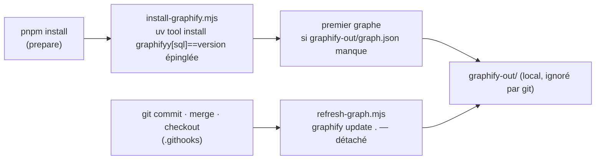

# Le graphe du dépôt — graphify

> **Doc d'état**, écrite le 2026-10-12 à la mise en place (Hugo : « je veux
> que ça s'installe automatiquement si un dev prend le repo »).

graphify lit le dépôt et en fait un graphe : fichiers, symboles, imports,
appels, et des **groupes** de nœuds très liés entre eux. On s'en sert pour
s'orienter — où vit un concept, qui dépend de quoi — avant d'ouvrir les
fichiers.

## Le seul prérequis : uv

`brew install uv` (ou l'installeur d'astral.sh), une fois par poste — c'est
écrit dans les prérequis de CLAUDE.md §10. **Python n'est pas un prérequis** :
uv télécharge le Python épinglé (`GRAPHIFY_PYTHON`, 3.12) et le garde à part,
sans toucher à celui du système. uv lui-même n'est PAS installé
automatiquement : son installeur s'exécute depuis le réseau sans version
épinglée, ce qu'un `pnpm install` ne doit jamais faire en silence.

## Ce qui se passe tout seul



| Fichier                                                | Rôle                                                                           |
| ------------------------------------------------------ | ------------------------------------------------------------------------------ |
| `dev-toolbox/graphify/graphify-version.mjs`            | la version épinglée — la monter est un commit                                  |
| `dev-toolbox/graphify/install-graphify.mjs`            | installe si absent ou d'une autre version, puis le premier graphe              |
| `dev-toolbox/graphify/refresh-graph.mjs`               | `graphify update .` détaché, journal dans `refresh.log` (dans `graphify-out/`) |
| `.githooks/post-commit`, `post-merge`, `post-checkout` | appellent le rafraîchissement, jamais bloquants                                |

- **Rien ne fait échouer** `pnpm install` ni un geste git : sans `uv`, le
  script dit la commande à lancer ; une erreur est ignorée.
- **Rien en CI** (`CI` posé) ; `LFD_SKIP_GRAPHIFY=1` désactive tout sur un poste.
- **Le code est lu localement, sans IA** (analyse syntaxique) : rien ne sort
  du poste. L'extraction des docs et des images, elle, passe par un modèle
  et coûte des tokens : elle n'est pas automatique (`/graphify --update` à
  la demande).

## Mesuré au premier graphe (2026-10-12)

- ≈ 9 200 fichiers, **≈ 66 000 nœuds, 203 000 liens, 918 groupes**, en
  ≈ 1 minute ; le fichier du graphe ≈ 106 Mo.
- **Les 353 `.sql` n'apportaient rien** : l'extracteur SQL est une option.
  Depuis le même jour, l'installation porte `graphifyy[sql]` ; un poste déjà
  équipé sans l'option est réinstallé et son cache d'extraction jeté (le
  témoin `~/.cache/lfd/graphify-spec` dit ce qui est installé, puisque
  `graphify --version` ne dit pas les extras).
- Au-delà de 5 000 nœuds, la vue HTML montre les **groupes**, pas les
  nœuds ; le détail se lit par `graphify query/explain/path`.

## Mesuré le 2026-10-12 — `explain` contre grep, 5 symboles

| Symbole                   | `graphify explain`    | grep (fichiers .ts/.md)  |
| ------------------------- | --------------------- | ------------------------ |
| `invoiceDueDay`           | 3,9 s · 7 liens typés | 3,1 s · 5 fichiers       |
| `PayerTimeline`           | 4,2 s · 21 liens      | 1,4 s · 11 fichiers      |
| `assertWritableLegalForm` | 3,6 s · 7 liens       | 1,6 s · 6 fichiers       |
| `frozenCollectionDay`     | 3,9 s · 10 liens      | 1,2 s · 9 fichiers       |
| `CollectionBatch`         | 3,5 s · 29 liens      | 1,1 s · **123 fichiers** |

- **Pas plus rapide** : ~4 s contre 1 à 3 s.
- **Plus précis** : chaque lien dit sa nature et sa ligne (qui importe, qui
  appelle — jusqu'à la méthode —, quel test, quelle section de doc), là où
  grep rend des fichiers à ouvrir. L'écart est net sur un symbole central :
  123 fichiers d'un côté, 29 liens typés de l'autre.
- **Frais** : `invoiceDueDay`, commité quelques minutes avant, y était avec
  son appelant — les hooks rafraîchissent bien.
- `query` en langage naturel reste faible (essai du même jour, CLAUDE.md
  §10 bis).

Verdict : s'en servir pour « qui dépend de X » sur un symbole central ;
grep reste meilleur pour retrouver un nom exact.

## Comment s'en servir

```bash
graphify query "où se décide la clôture d'un lot de prélèvement ?"
graphify explain "CollectionBatch"
graphify path "OrderCollection" "Invoice"
```

Le rapport (GRAPH_REPORT, dans `graphify-out/`) : nœuds centraux, liens inattendus entre
groupes, questions suggérées.

🔴 **Le graphe oriente, il ne prouve pas** (CLAUDE.md §10 bis) : une
affirmation sur le code se vérifie en ouvrant le fichier.

## Ce qui n'est pas fait

- **La commande `/graphify` dans Claude Code** (`graphify install --platform
claude --project`) : elle écrit dans `.claude/`, à faire par Hugo et à
  commiter. Les commandes `graphify query/explain/path` suffisent sans elle.
- **Le hook qui pousse Claude vers le graphe avant de lire** (`graphify
claude install`) : pas installé, il contredit « on ouvre avant
  d'affirmer ». À reconsidérer sur une mesure.
- **Obsidian** : voir ci-dessous — ce n'est pas graphify, mais le même
  usage (s'orienter par les liens).

## Obsidian sur `documentation/`

**`pnpm docs`** ouvre `documentation/` dans Obsidian et l'enregistre comme
coffre au premier appel (`dev-toolbox/obsidian/open-docs.mjs`, lien
`obsidian://open?path=`). Obsidian lui-même s'installe une fois
(`brew install --cask obsidian`) : une application de bureau ne s'installe
pas en silence au `pnpm install`.
Trois réglages sont partagés par le dépôt, le reste de `.obsidian/` reste à
chaque poste (ignoré par git) :

- `app.json` — **liens Markdown relatifs** (chemin relatif entre parenthèses), la forme que
  `lint:doc-references` lit ; un renommage dans Obsidian met les liens à
  jour ;
- `core-plugins.json` — graphe, rétroliens, liens sortants, aperçu ;
- `graph.json` — les notes orphelines visibles : une doc sans lien entrant
  est une doc que personne ne retrouvera, comme une doc absente de l'index.

⚠️ **Jamais de `[[lien wiki]]`** dans `documentation/` : la porte ne le lit
pas, et GitHub non plus.
