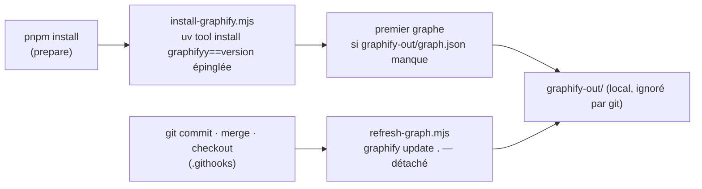

# Le graphe du dépôt — graphify

> **Doc d'état**, écrite le 2026-10-12 à la mise en place (Hugo : « je veux
> que ça s'installe automatiquement si un dev prend le repo »).

graphify lit le dépôt et en fait un graphe : fichiers, symboles, imports,
appels, et des **groupes** de nœuds très liés entre eux. On s'en sert pour
s'orienter — où vit un concept, qui dépend de quoi — avant d'ouvrir les
fichiers.

## Ce qui se passe tout seul



| Fichier                                                | Rôle                                                                           |
| ------------------------------------------------------ | ------------------------------------------------------------------------------ |
| `dev-toolbox/graphify/graphify-version.mjs`            | la version épinglée — la monter est un commit                                  |
| `dev-toolbox/graphify/install-graphify.mjs`            | installe si absent ou d'une autre version, puis le premier graphe              |
| `dev-toolbox/graphify/refresh-graph.mjs`               | `graphify update .` détaché, journal dans `refresh.log` (dans `graphify-out/`) |
| `.githooks/post-commit`, `post-merge`, `post-checkout` | appellent le rafraîchissement, jamais bloquants                                |

- **Rien ne fait échouer** `pnpm install` ni un geste git : sans `uv`, le
  script dit la commande à lancer ; une erreur est ignorée.
- **Rien en CI** (`CI` posé) ; `LFD_SKIP_GRAPHIFY=1` désactive tout sur un poste.
- **Le code est lu localement, sans IA** (analyse syntaxique) : rien ne sort
  du poste. L'extraction des docs et des images, elle, passe par un modèle
  et coûte des tokens : elle n'est pas automatique (`/graphify --update` à
  la demande).

## Mesuré au premier graphe (2026-10-12)

- ≈ 9 200 fichiers, **≈ 66 000 nœuds, 203 000 liens, 918 groupes**, en
  ≈ 1 minute ; le fichier du graphe ≈ 106 Mo.
- **Les 353 `.sql` n'apportent rien** : l'extracteur SQL est une option
  (`graphifyy[sql]`) non installée. Les migrations et le schéma ne sont donc
  pas dans le graphe.
- Au-delà de 5 000 nœuds, la vue HTML montre les **groupes**, pas les
  nœuds ; le détail se lit par `graphify query/explain/path`.

## Comment s'en servir

```bash
graphify query "où se décide la clôture d'un lot de prélèvement ?"
graphify explain "CollectionBatch"
graphify path "OrderCollection" "Invoice"
```

Le rapport (GRAPH_REPORT, dans `graphify-out/`) : nœuds centraux, liens inattendus entre
groupes, questions suggérées.

🔴 **Le graphe oriente, il ne prouve pas** (CLAUDE.md §10 bis) : une
affirmation sur le code se vérifie en ouvrant le fichier.

## Ce qui n'est pas fait

- **La commande `/graphify` dans Claude Code** (`graphify install --platform
claude --project`) : elle écrit dans `.claude/`, à faire par Hugo et à
  commiter. Les commandes `graphify query/explain/path` suffisent sans elle.
- **Le hook qui pousse Claude vers le graphe avant de lire** (`graphify
claude install`) : pas installé, il contredit « on ouvre avant
  d'affirmer ». À reconsidérer sur une mesure.
- **Obsidian** : ouvrir `documentation/` comme coffre ; config partagée à
  ajouter.
