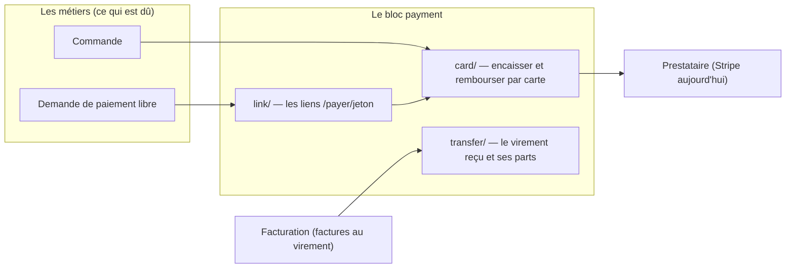

# Le paiement — comment l'argent arrive

> Dossier ouvert le 2026-11-22, à la demande de Hugo : y réunir ce qui
> concerne le bloc `payment` et les prestataires. Les docs d'un geste du
> commerce qui se trouve encaisser ou rembourser (annuler, modifier une
> commande) restent chez leur métier ; ce qui encaisse au compte
> (prélèvement, virement) reste en comptabilité. Les liens sont plus bas.

# Partie 1 — L'explication simple

Le bloc `payment` (`apps/lfd-api/src/payment/`) **encaisse et rembourse pour
un sujet qu'il ne connaît pas** : une commande, une demande de paiement
libre, demain une facture ou un acompte. Il ne sait ni pour quelle
application il encaisse, ni chez quel prestataire, sauf dans un seul
adaptateur.

- **La page de paiement est à nous** ; le prestataire ne fournit que le champ
  de carte. Changer de prestataire, c'est écrire un adaptateur, pas reprendre
  les métiers.
- **Un métier ne parle jamais au prestataire** : il passe par
  `payment/channels/`, et une porte le vérifie.
- **Le virement reçu** (`transfer/`) : le staff saisit un virement lu sur le
  relevé ; la facturation juge quelles factures il règle, le bloc enregistre
  le virement et une part par facture. Pas de clé étrangère entre les deux :
  le même identifiant est écrit des deux côtés par un seul geste, et un
  contrôle de nuit compare les deux côtés et sonne au premier écart
  ([`le-paiement-par-virement.md`](../comptabilite/le-paiement-par-virement.md), § 5).
- **Une nouvelle raison de payer** (un acompte, une régularisation) est une
  nature d'une demande libre, ou un type de sujet à elle : la porte ne change
  pas.

# Partie 2 — Les docs

## Ici

| Doc                                                                                                  | Ce que c'est                                                                                                                                                                                                 |
| ---------------------------------------------------------------------------------------------------- | ------------------------------------------------------------------------------------------------------------------------------------------------------------------------------------------------------------ |
| [`feuille-de-route.md`](feuille-de-route.md)                                                         | **Où va le bloc**, et dans quel ordre : les lots à venir, les chantiers de fond (rapprochement, litiges…), les recettes pour une deuxième application, un deuxième prestataire, un nouveau moyen de paiement |
| [`prelevement-et-virement-dans-payment.md`](prelevement-et-virement-dans-payment.md)                 | **Analyse** : ce qui, du prélèvement et du virement, devrait rejoindre le bloc (la mécanique bancaire) et ce qui reste en facturation (le métier) ; le modèle mouvement → parts ; l'ordre proposé            |
| [`plan-le-virement-recu-dans-payment.md`](plan-le-virement-recu-dans-payment.md)                     | **Plan D1**, ✅ bâti le 2026-11-22 : le virement reçu rejoint `payment/transfer/`, la facturation garde le jugement et sa trace sur les bons, un contrôle de nuit compare les deux côtés                     |
| [`plan-b-balayage-des-paiements-en-attente.md`](plan-b-balayage-des-paiements-en-attente.md)         | **Plan B**, contredit par `vitruve` : relire chez le prestataire les paiements restés en attente, pour ne pas dépendre du seul webhook ; corrige l'ordre des verrous de `settleFromProvider`                 |
| [`todo-controles-en-production.md`](todo-controles-en-production.md)                                 | **TODO** : les contrôles à faire en production après chaque déploiement du paiement (V, F1, P1b et P1c, le tableau de bord Stripe)                                                                           |
| [`liens-de-paiement/les-liens-de-paiement.md`](liens-de-paiement/les-liens-de-paiement.md)           | **Doc d'état** des liens de paiement : le lien d'une commande, la demande de paiement libre, le lien vers un sujet, leurs webhooks                                                                           |
| [`liens-de-paiement/plan-le-lien-vers-un-sujet.md`](liens-de-paiement/plan-le-lien-vers-un-sujet.md) | **Le plan du bloc agnostique** : lots Z, P0, P1, V et F1 bâtis ; P1b, F2, I0 à I2, P2, W et les nouvelles raisons à venir                                                                                    |
| [`plan-m2-historique-de-transactions.md`](plan-m2-historique-de-transactions.md)                     | **Le plan M2**, qui a créé le bloc qui encaisse par carte (alors `card-payment`) et y a déménagé le remboursement                                                                                            |
| [`relecture-paiement-et-remboursement.md`](relecture-paiement-et-remboursement.md)                   | La relecture du paiement et du remboursement contre le code, qui a fondé M2                                                                                                                                  |

## Ailleurs, et pourquoi

| Doc                                                                                                    | Où                                              | Pourquoi pas ici                                                                      |
| ------------------------------------------------------------------------------------------------------ | ----------------------------------------------- | ------------------------------------------------------------------------------------- |
| prélèvement SEPA, mandats, lots                                                                        | [`../comptabilite/`](../comptabilite/README.md) | leur mécanique vit encore dans la facturation (`lafoliecoffee/accounting`)            |
| [`le-paiement-par-virement.md`](../comptabilite/le-paiement-par-virement.md)                           | `comptabilite/`                                 | le geste et son jugement sont à la facturation ; le bloc n'enregistre que le virement |
| [`facture-carte-et-remboursements.md`](../comptabilite/facturation/facture-carte-et-remboursements.md) | `comptabilite/facturation/`                     | la facture est un document comptable, pas un mouvement d'argent                       |
| annuler, modifier, abandonner une commande ; le reliquat remboursé                                     | [`../commandes/`](../commandes/README.md)       | ce sont des gestes du commerce qui demandent un paiement ou un remboursement au bloc  |
| déployer le vocabulaire du paiement (lot V), le virement reçu dans `payment` (lot D1)                  | [`../ops/runbook.md`](../ops/runbook.md)        | un runbook réunit les gestes d'exploitation de tous les sujets                        |
