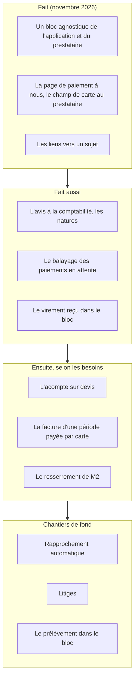

# Feuille de route du paiement

> 📐 **Feuille de route**, écrite le 2026-11-22 avec Hugo. Ce qui est bâti
> est décrit dans [`le-bloc-payment.md`](le-bloc-payment.md) et
> [`les-liens-de-paiement.md`](les-liens-de-paiement.md).
> Ce document dit **où va le bloc**, et dans quel ordre. Il se met à jour à
> chaque lot terminé.

# Partie 1 — L'explication simple

Le bloc `payment` **encaisse et rembourse pour un sujet qu'il ne connaît
pas**, quel que soit le prestataire et l'application. Aujourd'hui : la carte
(Stripe), et les liens de paiement `/payer/<jeton>`.

**Ce qui guide l'ordre** : d'abord ce qui sert dès les premiers vrais
paiements (savoir qu'on a été payé, le dire à la comptabilité), ensuite ce
qui ouvre de nouveaux usages (acompte, facture par carte), enfin les pièces
lourdes que seul le volume justifiera (rapprochement, litiges, plusieurs
prestataires).

**Ce qu'on ne fait pas d'avance** : plusieurs prestataires en même temps, un
grand livre en partie double, le routage d'un paiement selon son coût. Les
construire avant d'en avoir besoin coûterait sans rien rapporter.

# Partie 2 — La technique

## 1. Où en est le bloc (2026-11-22, soir)

L'état bâti est décrit dans [`le-bloc-payment.md`](le-bloc-payment.md) et
[`les-liens-de-paiement.md`](les-liens-de-paiement.md).

| Lot    | Contenu                                                                                                                                                                              | État             |
| ------ | ------------------------------------------------------------------------------------------------------------------------------------------------------------------------------------ | ---------------- |
| M2     | le bloc qui encaisse par carte, le remboursement déménagé, la hausse et la baisse d'une commande payée                                                                               | ✅ en production |
| Z      | le bloc s'appelle `payment` : `card/`, `link/`, `shared/`, `channels/`                                                                                                               | ✅ en production |
| P0     | la page reçoit une instruction de collecte neutre, plus un secret Stripe                                                                                                             | ✅ en production |
| P1     | les liens vers un sujet, leur page `/payer/<jeton>`                                                                                                                                  | ✅ en production |
| V      | le vocabulaire du schéma : `payment`, tables `card_*`                                                                                                                                | ✅ en production |
| F1     | la demande de paiement libre passe par le lien                                                                                                                                       | ✅ en production |
| P1b    | l'avis à la comptabilité d'un paiement encaissé par un lien                                                                                                                          | ✅ en production |
| P1c    | les natures d'une demande libre                                                                                                                                                      | ✅ en production |
| N      | les destinataires des avis, réglés à l'écran                                                                                                                                         | ✅ en production |
| —      | les champs dépréciés de P0 retirés des contrats (`clientSecret`, `publishableKey`)                                                                                                   | ✅ en production |
| F2     | la sortie de Stripe Checkout : un seul webhook, les anciens liens en lignes historiques                                                                                              | ✅ en production |
| B      | le balayage des paiements en attente, et l'ordre des verrous de `settleFromProvider`                                                                                                 | ✅ en production |
| D1     | le virement reçu dans `payment/transfer/`, sans clé entre les blocs, et le contrôle de cohérence de nuit                                                                             | ✅ en production |
| —      | le schéma Prisma dit la base                                                                                                                                                         | ✅ en production |
| ~~D2~~ | ~~le compte d'encaissement dans le bloc~~ — **retiré** : il reste avec l'entité (décision de Hugo du 2026-11-22, [`le-prelevement-dans-payment.md`](le-prelevement-dans-payment.md)) | —                |

## 2. La suite, dans l'ordre

| #   | Lot                                                    | Ce qu'il apporte                                                                                                                                                                                                                                                    | Condition                                                                                                        |
| --- | ------------------------------------------------------ | ------------------------------------------------------------------------------------------------------------------------------------------------------------------------------------------------------------------------------------------------------------------- | ---------------------------------------------------------------------------------------------------------------- |
| 1   | **L'acompte sur devis**                                | un type de sujet à lui : facture d'acompte, rattachement au devis puis à la commande, déduction sur la facture finale                                                                                                                                               | **avis du cabinet** sur la facture d'acompte et la TVA                                                           |
| 2   | **I0 → I2** — la facture d'une période payée par carte | « la carte par lien », troisième moyen du paiement au compte, à côté du prélèvement et du virement                                                                                                                                                                  | **avis du cabinet** sur le code Factur-X d'une facture à payer par carte                                         |
| 3   | **Le resserrement de M2**                              | retirer `orders.stripe_payment_intent_id` (ses lecteurs passent par `positionOf`), les anciennes tables `public.order_refund` et `order_refund_request`, le rattrapage `first-payments/replay` et son témoin, et `POST /payments/webhook` sans compte               | **après** avoir repointé l'endpoint Stripe des cartes vers `/payments/webhook/lfc-stripe`                        |
| 4   | **P2** — relancer un paiement mort                     | révoquer et rouvrir un lien dont l'intention est morte chez le prestataire                                                                                                                                                                                          | rare avec Stripe                                                                                                 |
| 5   | **W** — les abonnés du commerce en `lfc.`              | vocabulaire, sans changement de comportement                                                                                                                                                                                                                        | —                                                                                                                |
| 6   | **Le prélèvement dans le bloc**                        | les mandats et le compte du débiteur (D3), puis les lots et le `pain.008` (D4) : [`le-prelevement-dans-payment.md`](le-prelevement-dans-payment.md) ; le plan des mandats est **suspendu** ([`plan-les-mandats-dans-payment.md`](plan-les-mandats-dans-payment.md)) | une **question de conception** d'abord : un mandat connaît la société, le bloc ne connaît que des sujets opaques |

**Ce qui reste de M2**, sans plan écrit (vérifié dans le code le
2026-11-22) :

- **« Vérifier chez le prestataire »** : une commande d'équipe qui relit les
  paiements et remboursements d'un sujet chez le prestataire et les compare,
  sans rien écrire. Non bâtie.
- **La veille** : des cloches horaires sans appel au prestataire (demande
  `issued` depuis plus de 7 jours, `stopped` depuis plus de 24 heures,
  `to_issue` en retard ; commande payée dont la référence diverge du bloc).
  Non bâtie.
- **Les écrans et courriels** : l'historique daté des paiements et
  remboursements d'une commande, et le courriel `customer.order-modified`.
  Le courriel d'échec (`customer.order-modification-failed`) et les gestes
  « Relancer » et « Rendu autrement » existent.
- **C-2b, le bon sous la différence** : une baisse sous la part du bon de
  fidélité imputé reste refusée (`RevisionBelowVoucherError`), au compte
  comme par carte. Deux obstacles connus : un bon de modification ne
  s'insère pas sous les `CHECK` actuels de `loyalty_vouchers`, et le
  reliquat différé du bon d'origine rendrait la différence une seconde fois.
  Plan à écrire dans `loyalty`.

La règle qui décide où va une **nouvelle raison de payer** est dans
[`les-liens-de-paiement.md`](les-liens-de-paiement.md) (§ 3) : sans conséquence au-delà de l'encaissement, c'est une **nature** ;
avec une conséquence (un document, un rattachement, une déduction), c'est un
**type de sujet** à elle. La porte du bloc ne change jamais.

## 3. Les chantiers de fond

Ce que les grosses bases de paiement ont et que le bloc n'a pas encore. Ce
qu'elles ont publié (Airbnb, Uber, Booking ; des produits comme Spreedly,
Primer ou Hyperswitch) décrit une couche de la même forme que la nôtre,
avec ces pièces en plus.

| Chantier                                                   | Ce qu'il fait                                                                                                                                                                                                                                                                   | Quand                                                                                           |
| ---------------------------------------------------------- | ------------------------------------------------------------------------------------------------------------------------------------------------------------------------------------------------------------------------------------------------------------------------------- | ----------------------------------------------------------------------------------------------- |
| **Rapprochement automatique**                              | chaque jour, comparer ce qui a été encaissé, versé et facturé, avec les relevés du prestataire et de la banque, et signaler chaque écart — première pièce bâtie (D1) : le contrôle de nuit du virement reçu, facturation contre bloc                                            | **le premier**, dès que l'argent réel circule : c'est lui qui détecte l'argent perdu sans bruit |
| **Litiges** (rétrofacturations)                            | réception, preuves, issue, écriture comptable — avec un délai de réponse imposé par la banque                                                                                                                                                                                   | **le second**, avant le premier litige réel                                                     |
| **Le prélèvement dans le bloc**                            | le virement reçu y est (D1, `payment/transfer/`) ; la suite de la mécanique bancaire (mandats, `pain.008`, rejets) quitte la facturation ; la facturation garde « ce qui est dû » — le tri pièce par pièce : [`le-prelevement-dans-payment.md`](le-prelevement-dans-payment.md) | quand une deuxième application doit prélever, ou quand la facturation en souffre                |
| **Un mouvement réparti sur plusieurs sujets**              | un prélèvement ou un virement règle plusieurs factures d'un coup ; le port des sujets doit le savoir                                                                                                                                                                            | avec le chantier précédent                                                                      |
| **Plusieurs prestataires en même temps**                   | routage selon le pays, le coût ou la disponibilité, bascule en cas de panne                                                                                                                                                                                                     | quand un second prestataire est réellement contracté                                            |
| **Grand livre en partie double**                           | chaque mouvement d'argent est une écriture débit/crédit, la balance est toujours vérifiable                                                                                                                                                                                     | quand le volume ou la comptabilité l'exigent                                                    |
| **Paiements partiels, cartes enregistrées, multi-devises** | courants à grande échelle ou à l'étranger                                                                                                                                                                                                                                       | sur besoin                                                                                      |
| **Exploitation**                                           | alertes sur le retard des webhooks et les taux de refus, tableau de bord, tests de contrat contre le bac à sable de chaque prestataire                                                                                                                                          | progressivement, dès les premiers vrais clients                                                 |

## 4. Les recettes

### 4.1 Une deuxième application qui encaisse

1. Son **origine** au registre (`apps/lfd-api/src/platform/config/pay-link-origins.ts`) : nom, libellé, racine publique.
2. Ses **sujets** : pour chaque chose qu'elle fait payer, une classe qui implémente `LinkableSubject` et `SubjectSettlement` (`payment/channels/subjects/`), reliée dans `appBootstrap/`.
3. Le **compte** qui encaisse ses types de sujets (`CardAccountDefaults`), le même ou le sien.
4. Sa **page `/payer/:jeton`**, montée avec le service de collecte. À ce moment-là, le service quitte la boutique de La Folie Coffee (`apps/lfc-ecommerce-frontend/src/app/client/payment-collection/`) pour un paquet de `packages/`.

Elle n'écrit ni code de prestataire, ni webhook, ni formulaire de carte.

### 4.2 Un deuxième prestataire (une banque traditionnelle, par exemple)

1. Un **adaptateur** dans `payment/card/infrastructure/`, à côté de celui de Stripe : créer, relire et annuler un paiement, rembourser, vérifier et lire ses notifications.
2. Une entrée au **registre des comptes** (`CARD_ACCOUNTS`), ses secrets, et le `CHECK` des comptes élargi par une migration (la porte `card-accounts` vérifie l'accord).
3. Son **affichage** dans le service de collecte : formulaire intégré, ou redirection et page de retour (« nous vérifions votre paiement »).
4. Des **tests contre son bac à sable**.

⚠️ Le port du prestataire a été dessiné à partir de Stripe (intention préparée
avant le paiement, notifications par événement, remboursement par API). Une
banque traditionnelle n'a souvent de paiement qu'à la redirection, notifie
par un appel signé et rembourse parfois à la main. **Avant de choisir**,
relire sa documentation technique contre le port, pour savoir ce qu'il faudra
assouplir. Un lot à part, contredit par `vitruve`.

### 4.3 Un nouveau moyen de paiement chez Stripe (paiement en plusieurs fois…)

1. Le vérifier dans le tableau de bord Stripe : les moyens offerts dépendent du pays et du compte.
2. L'ajouter à la liste acceptée (la constante `ACCEPTED_PAYMENT_METHOD_TYPES` de `apps/lfd-api/src/payment/card/infrastructure/stripe/stripe-card-provider.ts`) et aux options du formulaire (`apps/lfc-ecommerce-frontend/src/app/client/commande/payment-element-options.ts`). Aujourd'hui : la carte, Apple Pay et Google Pay seulement (décision de Hugo du 2026-10-09).
3. Pour un moyen qui **redirige** : la page de retour, qui manque aujourd'hui.
4. Pour un moyen **non immédiat** : un état « en cours de confirmation » dans les écrans, qui disent aujourd'hui « payé » ou « refusé ».
5. Pour un moyen **qui n'est pas une carte** : décider s'il vit dans `payment/card/` ou dans un sous-dossier à lui.

## 5. Les questions ouvertes

| Question                                                                                  | À qui                     | Bloque                    |
| ----------------------------------------------------------------------------------------- | ------------------------- | ------------------------- |
| La facture d'acompte : obligation, exigibilité de la TVA, déduction sur la facture finale | le cabinet comptable      | l'acompte (#1)            |
| Le code Factur-X d'une facture à payer par carte (48 ou un autre)                         | le cabinet comptable      | I1 (#2)                   |
| Un reçu de paiement envoyé au client après un paiement par lien                           | Hugo                      | rien ; à décider avec P1b |
| Les moyens de paiement en plusieurs fois disponibles sur le compte Stripe français        | le tableau de bord Stripe | §4.3                      |
