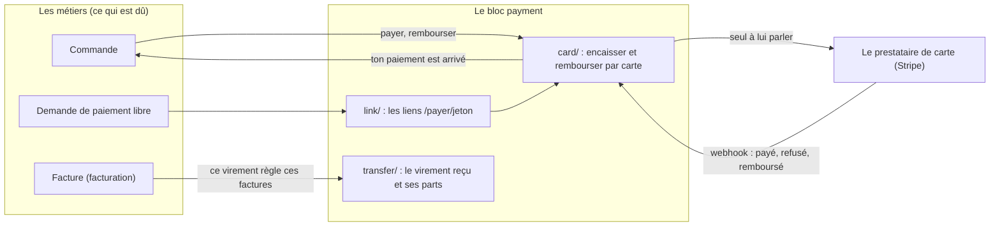
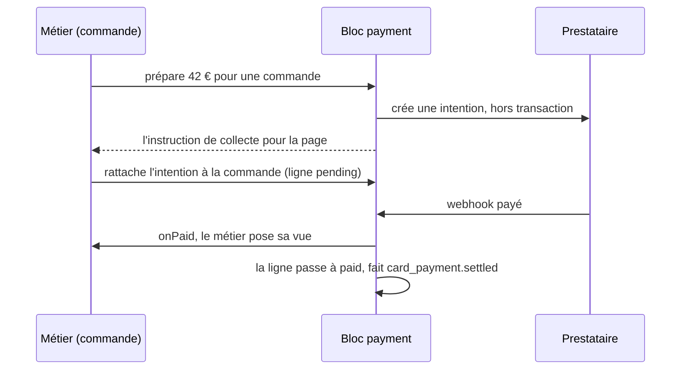
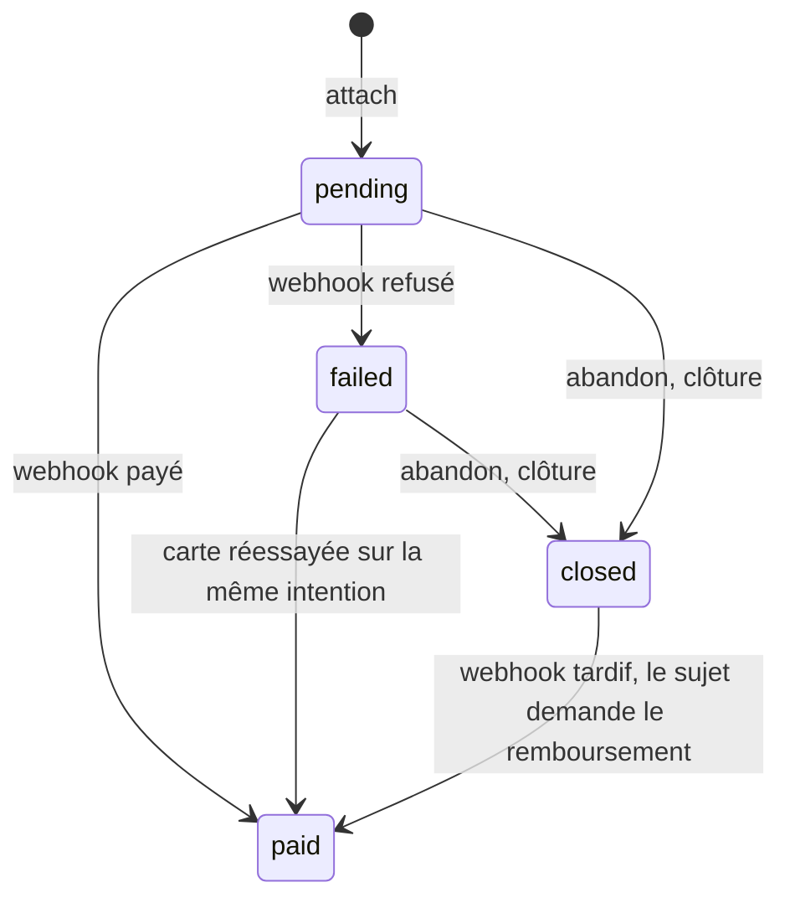
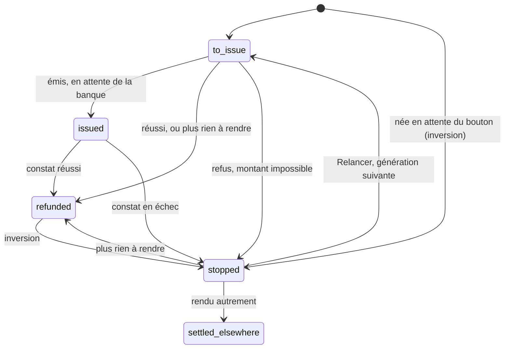

# Le bloc `payment` — encaisser, rembourser, recevoir un virement

> ✅ **Doc d'état, relue dans le code le 2026-11-22.** Elle décrit le bloc
> `apps/lfd-api/src/payment/` : la carte (`card/`), le remboursement, les
> balayages, le virement reçu (`transfer/`). Les liens de paiement ont leur
> doc : [`les-liens-de-paiement.md`](les-liens-de-paiement.md). La suite est
> dans [`feuille-de-route.md`](feuille-de-route.md).

# Partie 1 — L'explication simple

Le bloc `payment` **fait bouger l'argent pour un sujet qu'il ne connaît
pas**. Un sujet, c'est « ce qui est dû » chez un métier : une commande, une
demande de paiement libre, une facture. Le bloc n'en connaît que le type et
l'identifiant (`order`, `01J…`). Il ne sait pas ce qu'est une commande, ni
pour quelle application il encaisse.



Ce qu'il faut retenir :

- **Un métier ne parle jamais au prestataire.** Il demande au bloc
  (« prépare un paiement de 42 € pour cette commande », « rends 12 € »), par
  la porte `payment/channels/`. Changer de prestataire, c'est écrire un
  adaptateur dans le bloc, pas reprendre les commandes.
- **Le bloc tient l'état de l'argent** : chaque paiement, chaque demande de
  remboursement, chaque remboursement constaté. Le métier tient **sa vue**
  (« commande payée », « remboursée ») et ses propres faits.
- **Le prestataire prévient par webhook** ; un balayage relit chez lui ce
  qui reste en attente, au cas où un webhook se perdrait.
- **Le virement reçu** est un constat que le staff saisit, lu sur le relevé
  de la banque. La facturation juge quelles factures il règle ; le bloc
  enregistre le virement et une part par facture. Chaque nuit, un contrôle
  compare les deux côtés.

Le cycle d'un paiement par carte :



# Partie 2 — La technique

## 1. Le bloc et sa place

`payment` est un bloc de premier niveau de `src/`, sans métier propre,
agnostique de l'application et du moyen. Décidé par Hugo le 2026-11-22 sous
ce nom (le bloc s'appelait `card-payment`) ; `CLAUDE.md` § 3 en tient la
ligne et la colonne :

- **il n'importe que** `platform`, `staff` (l'autorisation) et le canal
  `mail/channels/` (l'avis à la comptabilité d'un paiement par lien) ;
- **les blocs métier ne l'atteignent que par `payment/channels/`** — aujourd'hui
  le seul `lafoliecoffee`, d'où la case « port uniquement » ;
- il **déclare** `payment/channels/subjects/`, que chaque bloc sujet
  implémente et qu'`appBootstrap/card-payment-feed.module.ts` relie.

```
payment/
├── card/       la carte : paiements, remboursements, webhook, balayages
├── link/       les liens de paiement (doc à part)
├── transfer/   le virement reçu et ses parts
├── shared/     le verrou de ligne (`row-lock.ts`, `SELECT … FOR UPDATE`)
└── channels/
    ├── requests/  ce que les métiers appellent : CardPayments, CardRefunds,
    │              CardSettlementReader, BankTransfers, PayLinks…
    ├── subjects/  ce que les métiers implémentent : SubjectSettlement,
    │              LinkableSubject, MovementSubject
    └── facts/     les faits durables card_payment.*
```

Le schéma Postgres est `payment` ; les valeurs écrites `card_payment.*`
(faits, journal) gardent leur nom.

## 2. La carte — `payment/card/`

### 2.1 Le paiement : l'agrégat `CardPayment`

Table `payment.card_payment`, agrégat
`card/domain/entities/card-payment.ts`. Une ligne par intention chez le
prestataire : sujet (`subject_type`, `subject_id`, opaques), compte
(`account`), référence (`provider_ref`, `pi_…` chez Stripe, unique **par
compte**), rôle (`first` ou `complement`), montant en centimes, état,
`paid_at`, le lien d'où il naît (`pay_link_id`) et le curseur du balayage
(`provider_checked_at`).

Pas d'état `created` : une intention naît hors transaction, et n'a de ligne
qu'une fois rattachée à son sujet (`attach`). Les six transitions
(`card-payment-state.ts`, et le même tableau dans le déclencheur) :



`(x, x)` n'est pas une transition : c'est un rejeu sans effet. Un événement
périmé (`failed` après `paid`, `paid` rejoué) est ignoré, rend 200 et laisse
une trace ; il n'est jamais refusé, sans quoi le prestataire le rejouerait
des jours durant.

La base le tient aussi (migration
`20261109030000_le_schema_de_l_encaissement_par_carte`, noms posés par
`20261122110000_le_vocabulaire_du_paiement`) : déclencheur
`card_payment_guard` (`BEFORE UPDATE` — transitions hors liste refusées ;
`subject_*`, `account`, `role`, `amount_cents` immuables, `provider_ref` une
fois posé), `card_payment_no_delete` (`BEFORE DELETE` refusé sauf
`SET LOCAL payment.purge = 'on'`), unique `(account, provider_ref)`, un seul
`first` par sujet.

### 2.2 Le compte d'encaissement — `CARD_ACCOUNTS`

Un compte est un contrat chez un prestataire. Le registre a deux moitiés :

- **dans le dépôt**, `apps/lfd-api/src/platform/config/card-accounts.ts` :
  nom, type de prestataire, préfixe des variables. Aujourd'hui un seul,
  `lfc-stripe`, type `stripe`, préfixe `STRIPE` (`STRIPE_SECRET_KEY`,
  `STRIPE_PUBLISHABLE_KEY`, `STRIPE_WEBHOOK_SECRET`) ;
- **dans l'environnement**, les trois secrets, lus par `AppConfig`.

Le nom est **persisté sur chaque paiement** : relire, annuler, rembourser
lisent le compte sur la ligne, jamais un défaut. La base n'admet que les
noms connus (`CHECK payment_account_known`), et la porte `card-accounts`
compare ce `CHECK` au registre. Le domaine ne vérifie que la forme du nom
(`PaymentAccount`).

**Le compte se choisit par type de sujet** (`CardAccountDefaults`) : la
forme est dans le registre, la valeur (`order → lfc-stripe`) est posée par
`appBootstrap`, seul à connaître les deux mots. Aucun bloc métier ne nomme un
compte.

`CardProviders` (`registry-card-providers.ts`) instancie un adaptateur par
compte, à partir du registre ; c'est ce jeton que les e2e doublent.

Ajouter un compte : une entrée au registre, une migration qui élargit le
`CHECK`, et les trois listes de clés que `container/__tests__/runtime-keys.spec.ts`
confronte (`env-readers.ts`, `RUNTIME_KEYS` du Worker, le workflow).

### 2.3 Le prestataire et l'instruction de collecte

Le port `CardProvider` (`card/domain/ports/card-provider.ts`) : créer,
relire, annuler une intention, la clé publique, lire un webhook, rembourser
(avec ou sans montant), retrouver un remboursement. L'adaptateur Stripe vit
dans `card/infrastructure/stripe/` (`stripe-card-provider.ts`,
`stripe-intent-translation.ts`, `stripe-event-reduction.ts`,
`stripe-refund-calls.ts`) ; aucun `import Stripe` hors de ce dossier. Chaque
appel porte la garde `assertOutsideTransaction`.

`CardPayments.prepare(subjectType, amountCents, tag)` rend, **hors
transaction**, l'intention préparée et une **instruction de collecte**
neutre (`CardCollection`) :

- `{ kind: "embedded", provider, publishableKey, token }` — un formulaire
  intégré (Stripe aujourd'hui) ;
- `{ kind: "redirect", provider, url }` — une page du prestataire.

La page de paiement est la nôtre ; le prestataire n'en fournit que le champ
de carte. Les moyens acceptés sont la carte, Apple Pay et Google Pay
(`ACCEPTED_PAYMENT_METHOD_TYPES`, décision de Hugo du 2026-10-09).

### 2.4 La porte : `CardPayments`, `CardRefunds`, `CardSettlementReader`

Déclarées et implémentées par le bloc, dans `payment/channels/requests/` :

| Port                   | Gestes                                                                                                                                                                                                            |
| ---------------------- | ----------------------------------------------------------------------------------------------------------------------------------------------------------------------------------------------------------------- |
| `CardPayments`         | `prepare` (hors transaction), `attach` (dans la transaction de l'appelant : la ligne naît `pending`), `release` (la transaction a échoué : annuler au mieux), `retrieve`, `cancel`, `settleFromProvider`, `adopt` |
| `CardRefunds`          | `requestRemainder` (tout le reste d'un paiement, ou de chaque paiement encaissé d'un sujet), `requestAmount` (un montant), `retry` — dans la transaction de l'appelant                                            |
| `CardSettlementReader` | par lot : `positionOf` (paiements, encaissé, remboursé par nature, demandes en cours), `succeededRefundsOf`, `refundsOf`, `refundRequestsOf`, `remainderOf`                                                       |

`cancel` rend `cancelled | already_cancelled | already_paid | in_progress |
unavailable` : un métier qui abandonne une commande sait si l'argent est déjà
parti.

### 2.5 Le port des sujets — `SubjectSettlement`

Déclaré par le bloc (`payment/channels/subjects/subject-settlement.ts`),
implémenté par chaque type de sujet, relié dans `appBootstrap/` :

| Implémenteur             | Sujet         |
| ------------------------ | ------------- |
| `OrderSubjectSettlement` | `order`       |
| `FreeChargeSettlement`   | `free_charge` |

(`lafoliecoffee/orders/application/services/order-subject-settlement.ts`,
`lafoliecoffee/payments/application/free-charge/free-charge-settlement.ts`.)

Ce que le bloc demande au sujet : `onPaid` → `applied | refused |
already_applied` ; `onPaymentFailed` ; `lockSubject` (le sujet prend **son**
verrou) ; `onRefundOutcome` (une union discriminée par `kind` :
`recorded`, `succeeded`, `failed`, `reversed`, `rejected`,
`settled_elsewhere`, `attempted`, `issued` — chacune porte la position
recalculée, d'où le sujet tire sa vue et publie ses propres faits) ;
`isCancelled` ; `describe` (le libellé et le lien des cloches du bloc) ;
`claim(account, providerRef)` (« ce paiement est-il à toi ? ») ;
`referencesSince` (pour le rattrapage, § 5).

Un `refused` n'est pas une erreur : c'est une commande annulée qu'on a
encaissée quand même. Le paiement passe `paid` chez le bloc, et le commerce,
au canal, publie `order.paid_after_cancellation` ; son abonné demande le
remboursement.

### 2.6 L'ordre des verrous : le sujet, puis la ligne

Une seule règle, partout : **le sujet d'abord**, puis les lignes du bloc,
puis l'écriture, puis le canal avec la position recalculée. Les appels au
prestataire sont hors transaction.

- **Le paiement** (webhook et balayage) : la ligne relue **sans verrou** par
  sa référence, `onPaid` (le sujet prend son verrou), puis
  `IntentOutcomeRecorder` verrouille la ligne et l'écrit, et publie
  `card_payment.settled`. `settleFromProvider` suit le même chemin
  (`block-card-payments.ts`, `recordPaid`) : un test de non-régression tient
  l'ordre, qui s'inversait autrefois et pouvait s'interbloquer avec le
  webhook.
- **Le remboursement** (constat, exécuteur, « Relancer », « rendu
  autrement ») : `lockSubject`, puis les lignes du bloc, la décision relue
  sous verrou, l'écriture, puis `onRefundOutcome`.

`UnitOfWork.run` rejoint la transaction ambiante : un geste appelé dans la
transaction d'un métier y reste.

### 2.7 Le webhook — un par compte

`POST /payments/webhook/:account` (`card-payments-webhook.controller.ts`),
vérifié avec le secret **de ce compte**, sur le corps brut. Le contrôleur
n'injecte que le bus : le webhook est une commande
(`RecordProviderEventCommand`). Un compte inconnu ou une signature invalide
rendent 400 ; tout le reste rend 200, pour que le prestataire cesse de
réessayer. `POST /payments/webhook`, sans compte, vaut `lfc-stripe`
(`UNNAMED_WEBHOOK_ACCOUNT`) : c'est l'adresse que l'endpoint Stripe connaît.

L'événement est réduit dans l'adaptateur (payé, refusé, remboursement,
ignoré). Un paiement dont aucune ligne ni aucun sujet ne se réclame est
publié `card_payment.unmatched`, sans autre effet.

### 2.8 Les faits `card_payment.*`

Les faits **durables** publiés par le bloc (`payment/channels/facts/`), clés
par paiement : `card_payment.settled`, `card_payment.failed`,
`card_payment.refund_succeeded`, `card_payment.refund_failed`,
`card_payment.refund_reversed`, `card_payment.fully_refunded`,
`card_payment.unmatched`.

**Un seul abonné hors du bloc** (relu le 2026-11-22) :
`OnRefundWithoutOrder` (`lafoliecoffee/payments/`, `@DurableHandler`) écoute
`card_payment.unmatched` et sonne la cloche quand c'est un remboursement
qu'aucune commande ne réclame. Le reste se dit au sujet par le canal, de
façon synchrone : le commerce publie ses propres faits (`order.paid`,
`order.refund_succeeded`…) depuis `onPaid` et `onRefundOutcome`, et ce sont
eux qu'écoutent ses abonnés et la facturation.

Le **journal** du bloc (sujet `card_payment`, phrases dans
`packages/contracts/src/journal-facts/card-payment.ts`) :
`card_payment.issued`, `attempt_failed`, `retried`, `stopped`,
`settled_elsewhere`, `unmatched`.

## 3. Le remboursement

### 3.1 La demande — `CardRefundRequest`

Table `payment.card_refund_request`, agrégat
`card/domain/entities/card-refund-request.ts`. L'argent à rendre est un
**état écrit**, pas déduit :

- **forme** : `remainder` (tout le reste du paiement) ou `amount` (un
  montant) ;
- **nature** : `return` (la vente n'a pas lieu) ou `adjustment` (le montant
  dû a baissé) — la seule connaissance métier du bloc, et elle est
  agnostique ;
- **motif** opaque donné par le sujet (`cancellation`, `revision`…) ;
- montant annoncé, montant émis, génération, round, essais, bail.



La base : déclencheur `card_refund_request_guard` (transitions,
`payment_id`, `form`, `amount_cents`, `nature`, `reason` immuables), index
unique partiel `card_refund_request_remainder_in_progress_key` (une seule
`remainder` en cours par paiement), `settled_elsewhere` ⇔ motif et fiche
staff, `provider_ref` et `issued_at` posés ensemble, pas de `DELETE`.

### 3.2 L'exécuteur et la clé d'idempotence

L'exécuteur (`card/application/refunds/`) : un **bail** pris hors
transaction (`CardRefundRequestLease.claim`, à l'horloge murale), la
préparation sous `lockSubject` puis le verrou du paiement, **l'appel au
prestataire hors transaction**, puis l'issue écrite dans une transaction
courte. Clé d'idempotence chez le prestataire :
`lfd-card-refund:<requestId>:<generation>:<round>`. Un remboursement émis et
perdu est retrouvé par sa métadonnée (`findRefund`), jamais réémis.

| Issue                   | Ce que devient la demande                                       |
| ----------------------- | --------------------------------------------------------------- |
| émis, en attente        | `issued`                                                        |
| réussi dès la création  | `refunded`                                                      |
| plus rien à rendre      | `remainder` : `refunded` ; `amount` : `stopped`, cloche         |
| refusé, montant > reste | `stopped`, cloche                                               |
| prestataire injoignable | round + 1, prochaine échéance sur la courbe (`next_attempt_at`) |

Lancé **après validation** de la transaction qui a créé la demande, et
repris par le balayage (§ 3.5).

### 3.3 Le carnet — `CardRefundLedger`

Table `payment.card_refund`, une ligne par remboursement chez le prestataire
(`source = provider`, son `re_…`) ou par « rendu autrement »
(`source = manual`). Statut recopié du prestataire (`pending`,
`requires_action`, `succeeded`, `failed`, `canceled`) ; seul `succeeded`
compte. Rien ne s'efface. La clé composée `(payment_id, account)` vers
`card_payment (id, account)` garantit qu'un remboursement porte le compte de
son paiement.

**Le constat** (le webhook d'un remboursement) retrouve le paiement par
`(account, provider_ref)`, prend les verrous dans l'ordre du § 2.6, écrit le
carnet, la demande et le fait, puis appelle `onRefundOutcome`. Une
**inversion** (`succeeded → failed`) repasse la demande à `stopped` et sonne ;
un `re_…` sans demande est constaté et sonne « hors plateforme ».

L'avoir qui constate un remboursement n'est pas ici : c'est
`public.refund_credit`, à la facturation. `RefundReconciler` n'émet pas
d'avoir pour la nature `adjustment` (la facture n'a jamais porté le
trop-perçu) et le rapproche quand même.

### 3.4 Les issues vers le sujet, et qui demande

Qui crée une demande, côté commerce (relu le 2026-11-22) :

| Geste                                    | Appel                                                        |
| ---------------------------------------- | ------------------------------------------------------------ |
| annuler une commande payée               | `requestRemainder`, nature `return`                          |
| encaissée après l'annulation             | `requestRemainder` (abonné `refund-paid-after-cancellation`) |
| baisser une commande payée par carte     | `requestAmount`, nature `adjustment`                         |
| le reste d'une commande payée (reliquat) | `requestAmount` (`shortfall-refunding.ts`)                   |
| refuser ou annuler une hausse            | `card-increase-refund.ts`, `card-increase-cancellation.ts`   |

Le sujet pose sa vue (`refunded` quand le remboursé égale l'encaissé et
qu'il était `paid`) et publie ses faits `order.refund_*` depuis
`onRefundOutcome`.

### 3.5 Les gestes de l'équipe, et le balayage

`admin/card-payments/refund-requests` (`admin-card-refunds.controller.ts`),
surface et droit `card_payments:write`, **par demande** :

- `POST :requestId/retry` — « Relancer » : une `stopped` repart en
  génération suivante ; une `to_issue` déjà tentée repart tout de suite ;
- `POST :requestId/settle-elsewhere` — « Rendu autrement » : l'argent a été
  rendu hors plateforme ; une ligne `manual` au carnet, sans appel au
  prestataire.

Le bandeau du back-office est servi par le commerce, qui lit
`refundRequestsOf` ; le bloc ne sert pas de vue.

**Le balayage des remboursements** : `POST admin/card-payments/sweep`
(`sweep-card-refunds.handler.ts`), au plus 20 demandes `to_issue` à échéance
par passage (`CARD_REFUND_SWEEP_LIMIT`). Il reprend ce que l'exécuteur n'a
pas mené au bout (prestataire injoignable, processus mort) ; le bail exclut
deux appels simultanés.

## 4. Le balayage des paiements en attente

Le filet d'un webhook perdu : `POST admin/card-payments/pending/sweep`
(`sweep-pending-card-payments.handler.ts`).

**La sélection** (`PendingCardPaymentsReader`,
`provider-check-schedule.ts`) :

- état `pending` ou `failed` (une intention refusée peut encore être payée),
  référence posée, **hors rôle `complement`** — les hausses relisent leurs
  compléments avec leur propre logique ;
- née il y a plus de **5 minutes** et moins de **7 jours** ;
- due selon son âge : toutes les **5 minutes** la première heure, toutes les
  **heures** jusqu'à 24 heures, toutes les **6 heures** ensuite ;
- au plus **50** par passage, les moins récemment relues d'abord.

**Le traitement**, un par un, hors transaction, un échec n'arrêtant pas les
suivants : poser le curseur `provider_checked_at` (écriture technique
nommée, `markProviderChecked`, conditionnée à `pending | failed`), puis
`settleFromProvider` :

- **payé** : le chemin du webhook (§ 2.6) — le sujet, la ligne, le fait,
  l'avis ;
- **annulé** : la ligne passe `closed`, le sujet n'est pas prévenu (comme au
  webhook : un paiement mort n'annule pas ce qui est dû) ;
- **en attente** : rien, la date avance.

Le rapport rendu au cron : `examined`, `settled`, `replayed`,
`refusedBySubject`, `closed`, `pending`, `failedChecks`. L'index partiel
`card_payment_provider_check_idx` porte la file (migration
`20261122170000_la_relecture_des_paiements_en_attente`).

## 5. Le rattrapage des premiers paiements

`POST admin/card-payments/first-payments/replay`
(`replay-first-payments.handler.ts`) compare nos lignes à ce que chaque
sujet déclare, **sans** relire le prestataire. Il demande à chaque
`SubjectSettlement` ses références créées depuis la date du témoin de
reprise (`payment.card_takeover`, lot `P0`) moins une heure, et pour
chacune : absente, la ligne est insérée à l'état du sujet ; en retard, elle
avance (jamais en arrière) ; autrement différente, elle est signalée au
journal technique. Sans témoin (une base de test vidée), il ne fait rien et
le dit.

Il couvre le temps où la commande portait encore sa référence de paiement
(`orders.stripe_payment_intent_id`) : il disparaît avec elle (feuille de
route, « le resserrement de M2 »). Le balayage du § 4 et lui peuvent toucher la même ligne
`first` ; chacun passe par la machine de la ligne, idempotente.

## 6. Le virement reçu — `payment/transfer/`

### 6.1 Le partage

| Reste en facturation (`lafoliecoffee/accounting`)                                          | Est au bloc (`payment/transfer/`)                                                |
| ------------------------------------------------------------------------------------------ | -------------------------------------------------------------------------------- |
| juger : factures de l'entité, au virement, non réglées, un seul payeur, reste dû = montant | le virement : montant, jour, référence, qui l'a saisi, l'entité qui reçoit       |
| l'aperçu, les routes, l'écran                                                              | ses **parts** : un sujet opaque et un montant chacune                            |
| régler les bons (`OrderCollection.settleByTransfer`)                                       | ses invariants : parts > 0, somme = montant, un sujet réglé une fois, ajout seul |
| le fait `bank_transfer.received`                                                           | les lectures publiées : `allocationsOf`, `recordedSince`                         |

Le geste reste un geste de la facturation
([`../comptabilite/le-paiement-par-virement.md`](../comptabilite/le-paiement-par-virement.md)).
`RecordBankTransferHandler` juge avec l'agrégat `ReceivedBankTransfer`, tire
**une fois** l'identifiant du virement, appelle `BankTransfers.record` **dans
sa transaction** (aucun réseau), puis règle les bons avec le même
identifiant. Le bloc ne rappelle pas la facturation : un virement n'a pas de
webhook.

### 6.2 Le canal — `BankTransfers` et `MovementSubject`

`payment/channels/requests/bank-transfers.ts`, déclaré et implémenté par le
bloc (`transfer/application/block-bank-transfers.ts`) :

- `record(transfer)` — le virement et ses parts, dans la transaction de
  l'appelant. Refuse une part non positive, un sujet cité deux fois, une
  somme différente du montant (`InvalidReceivedTransferError`, 400), un
  sujet déjà réglé par un virement (`SubjectAlreadySettledByTransferError`, 409) ;
- `allocationsOf(subjects)` — par lot, pour chaque sujet réglé : le
  virement, la part et le jour de réception ;
- `recordedSince(since)` — les virements enregistrés depuis, avec leurs
  parts.

Le sujet d'une part est un **`MovementSubject`** (`{ type, id }`,
`payment/channels/subjects/movement-subject.ts`), distinct de `CardSubject` :
un sujet de virement n'a pas à être un sujet que la carte sait régler. Les
tables de lecture sont clés par `movementSubjectKey` (`type/id`).

La facturation garde ses propres refus, plus précis (le nom de la facture,
le payeur) ; le bloc refuse ce qui contredit sa propre règle. Défense en
profondeur : un test d'application vérifie qu'une saisie qui passe le
jugement de la facturation passe le bloc.

### 6.3 Le domaine et les tables

Agrégat `ReceivedTransfer` (`transfer/domain/entities/received-transfer.ts`) :
montant > 0, jour bien formé, référence non vide d'au plus 140 caractères
(`TRANSFER_REFERENCE_MAX`), au moins une part, chacune > 0, pas deux fois le
même sujet, somme des parts = montant.

- `payment.transfer_received` : `id`, `received_into` (opaque : l'entité
  qui reçoit), `payer_ref` (opaque), `amount_cents`, `received_on`,
  `reference`, `recorded_at`, `recorded_by_staff_id` ;
- `payment.transfer_allocation` : `transfer_id`, `subject_type`
  (`CHECK transfer_allocation_subject_type_known` : `invoice` seul),
  `subject_id`, `amount_cents` ; unique `(subject_type, subject_id)`.

Les deux sont en **ajout seul** (fonction `payment.transfer_append_only`).
**Aucune clé étrangère ne sort du schéma** (décidé par Hugo le 2026-11-22) :
l'entité, le payeur et la facture sont opaques, et la facturation garde sa
propre trace, `order_collection.bank_transfer_id` (posée ⇔
`settled_by_transfer`). Migration
`20261122180000_le_virement_recu_dans_payment`, par renommage des tables de
`public`.

### 6.4 Le contrôle de cohérence de nuit

Ce qui remplace les clés étrangères : `POST
admin/accounting/bank-transfers/consistency`
(`check-bank-transfer-consistency.handler.ts`, côté facturation). Sur les
**trois dernières nuits** (`CONSISTENCY_LOOKBACK_MS`), dans les deux sens :

- chaque bon réglé par virement trouve-t-il, au bloc
  (`allocationsOf`, par lots de 500), la part de son virement sur sa
  facture ?
- chaque virement enregistré (`recordedSince`) tombe-t-il sur des factures
  connues, dont tous les bons sont réglés par lui ?

Un écart : une ligne au journal technique et la cloche de la facturation
(`BankTransferGapFoundEvent`), qui nomme le virement, la facture et l'écart.
Rien n'est corrigé tout seul. Une nuit manquée est rattrapée par les
suivantes ; un écart déjà sonné ne sonne pas deux fois (clé de la cloche).

## 7. Les tables du schéma `payment`

| Table                 | Propriétaire       | Ce qu'elle porte                                        |
| --------------------- | ------------------ | ------------------------------------------------------- |
| `card_payment`        | `payment/card`     | un paiement par carte (§ 2.1)                           |
| `card_takeover`       | `payment/card`     | le témoin d'une reprise, pour le rattrapage (§ 5)       |
| `card_refund_request` | `payment/card`     | une demande de remboursement (§ 3.1)                    |
| `card_refund`         | `payment/card`     | le carnet (§ 3.3)                                       |
| `pay_link`            | `payment/link`     | un lien vers un sujet ([doc](les-liens-de-paiement.md)) |
| `transfer_received`   | `payment/transfer` | un virement reçu (§ 6.3)                                |
| `transfer_allocation` | `payment/transfer` | une part d'un virement (§ 6.3)                          |

Schéma Prisma : `apps/lfd-api/prisma/schema/payment/` (`card.prisma`,
`link.prisma`, `transfer.prisma`). Ce que Prisma ne sait pas écrire (`CHECK`,
index partiels, déclencheurs) vit dans les `migration.sql`, nommés dans le
commentaire de tête de chaque fichier. Les clés **à l'intérieur** du schéma
sont réelles ; aucune n'en sort, aucune n'y entre.

Les anciennes tables du remboursement, `public.order_refund` et
`public.order_refund_request`, restent en base sans écrivain
(`prisma/schema/public/order-refund.prisma`).

## 8. Les crons du Worker

Tous dans `apps/lfd-api/container/worker.ts`, par `RECOMPUTE_TOKEN` et le
`RecomputeGuard` ; chaque échec s'écrit dans les logs du Worker.

| Cron                            | Route                                         | Ce qu'il fait                   |
| ------------------------------- | --------------------------------------------- | ------------------------------- |
| rafraîchissement, `*/5 * * * *` | `admin/card-payments/sweep`                   | les remboursements dus (§ 3.5)  |
| rafraîchissement, `*/5 * * * *` | `admin/card-payments/pending/sweep`           | les paiements en attente (§ 4)  |
| horaire, `0 * * * *`            | `admin/card-payments/first-payments/replay`   | le rattrapage (§ 5)             |
| nuit, `45 3 * * *` (UTC)        | `admin/accounting/bank-transfers/consistency` | le contrôle du virement (§ 6.4) |

Les hausses par carte ont leurs propres balayages, côté commerce
(`admin/orders/card-increases/sweep` et `/expire`, même cron de
rafraîchissement).

## 9. Les portes et les tests

Les portes qui tiennent le bloc :

- `context-boundaries` — les blocs métier n'atteignent `payment` que par
  `payment/channels/` ;
- `prisma-model-ownership`, `cross-schema-join` — les modèles du schéma
  `payment` ne sont lus que par le bloc ;
- `prisma-schema-layout` — ses modèles sous `prisma/schema/payment/` ;
- `card-accounts` — le registre et le `CHECK payment_account_known`
  d'accord ;
- `network-outside-transaction` — aucun appel au prestataire dans une
  transaction ;
- `durable-cross-block` — l'abonné de `card_payment.unmatched` est durable ;
- `journal-tracked` — les gestes du bloc tracent au journal ;
- `write-idempotence`, `controller-buses` — chaque route dit pourquoi un
  rejeu ne la refait pas, les contrôleurs n'injectent que des bus ;
- `rgpd-staff` — `recorded_by_staff_id`, `requested_by`,
  `settled_by_staff_id` au registre.

E2E (`apps/lfd-api/test/`) : `card-payment-schema`, `card-refund-schema`
(les déclencheurs, paire par paire), `card-refunds`, `order-refunds`,
`order-staff-cancel-refund` (et ses courses, son balayage),
`payment-row-lock`, `order-payment-reprise`, `order-payment-retry`,
`card-payment-pending-sweep`, `refund-credit-credit-note`,
`shortfall-card-refund*`, `order-revision-card-refund*`,
`card-increase-*`, `bank-transfer-received`, `bank-transfer-reads`,
`bank-transfer-in-payment`.

## 10. Ce qui reste

La suite et son ordre sont dans [`feuille-de-route.md`](feuille-de-route.md) :
le resserrement de M2 (la référence de paiement retirée de la commande, le
webhook sans compte, les anciennes tables, le rattrapage), ce qui reste de
la modification par carte (« Vérifier chez le prestataire », la veille,
l'historique daté à l'écran, le bon sous la différence), le prélèvement
([`le-prelevement-dans-payment.md`](le-prelevement-dans-payment.md)), et les
chantiers de fond (rapprochement, litiges).
