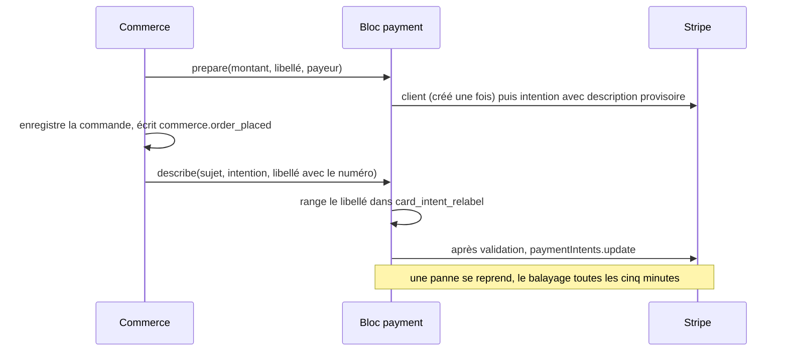

# Le pointage Stripe — chaque ligne dit sa commande, son application, son client

> ✅ **En production** depuis le 2026-11-26 (`b60ed2572`).

## L'essentiel

Dans le Dashboard Stripe, chaque paiement, complément et remboursement se
rapproche sans ambiguïté d'une **commande** (son numéro lisible), de
l'**application** d'origine, du **type de mouvement** et du **client** qui a
payé. C'est ce que Hugo appelle « pointer ».

Ce que montre une ligne Stripe :

| Champ Stripe  | Exemple                                                                  |
| ------------- | ------------------------------------------------------------------------ |
| Description   | `LFD · La Folie Coffee boutique · Commande n° 2026-01234 · paiement`     |
| Client        | `cus_…`, au nom et à l'adresse du payeur — un par personne et par compte |
| Métadonnées   | `app=la-folie-coffee`, `channel`, `kind`, `subject_id`, `order_number`   |
| Remboursement | le client de son paiement, plus `app` et `order_number` en métadonnées   |

Deux règles tiennent l'ensemble :

- **Stripe n'envoie jamais de reçu** (décidé par Hugo le 2026-11-26) : l'adresse
  part sur le client Stripe et en métadonnées, jamais en `receipt_email`. Les
  e-mails restent ceux de la plateforme.
- **Le bloc `payment` ne sait pas ce qu'est une commande** : il reçoit un
  libellé composé par l'appelant, et le pose tel quel.

Le numéro de commande n'existe pas encore quand le paiement est préparé : la
description arrive donc en deux temps — un libellé provisoire à la création,
le libellé définitif quelques secondes après l'enregistrement de la commande.

**Ce qui n'est pas couvert** : les paiements faits avant le 2026-11-26 n'ont
pas été rattrapés, et un lien de paiement n'a pas de client Stripe (son payeur
est anonyme).

## 1. Le format

`LFD · <application> <canal> · Commande n° <numéro> · <type>` (décidé par Hugo le
2026-11-26), composé par `order-card-label.ts`
(`lafoliecoffee/orders/application/services/`).

- **Application** : `La Folie Coffee` ; métadonnée `app = la-folie-coffee`, la
  valeur `providerApp` du registre `pay-link-origins.ts` pour un lien.
- **Canal** : `staff` pour une commande d'origine `back_office`, sinon `pro` ou
  `shop` selon la société ; métadonnée `channel`.
- **Type** (`kind`) : `paiement`, `complément`, `lien`.

Un seul filtre `app` réunit commandes, compléments, liens et remboursements.

## 2. La création du paiement

`CardPayments.prepare(subjectType, amountCents, tag, label)`
(`payment/channels/requests/card-payments.ts`) prend un `CardPaymentLabel` :
`description`, `metadata`, et `payer?: { userId, name, email }`.

- **Les métadonnées** sont bornées par `IntentLabel`
  (`payment/card/domain/value-objects/intent-label.ts`) : `companyId` et les clés
  `lfd_*` sont réservées au bloc, 49 clés au plus pour l'appelant, une valeur
  tronquée à 500 caractères (limites de Stripe : 50 clés, 40 caractères par
  clé).
- **Le client Stripe** est posé dès la création — une intention déjà payée ne
  se voit pas garantir l'ajout d'un client. `card-customer-resolution.ts` lit
  `payment.card_customer` (`(compte, user_id) → cus_…`, un par compte
  d'encaissement : un client Stripe n'appartient qu'à un compte) et, à défaut,
  le crée avec la clé d'idempotence `lfd-customer:<compte>:<userId>`. Aucune
  recherche `customers.search` : elle relit avec une minute de retard, et deux
  commandes rapprochées feraient deux clients.
- **Un échec** de création du client laisse le paiement partir sans client, et
  se journalise par identifiants seuls.

## 3. Le libellé définitif

`DescribeCardPaymentOnOrderPlaced` (`lafoliecoffee/orders/application/handlers/`)
est un `@DurableHandler` de `commerce.order_placed`, côté commerce : la matrice
interdit `payment → lafoliecoffee`. Il relit la commande, ne fait rien sans
intention (différée, au compte, gratuite, au comptoir), compose le libellé et
appelle `CardPaymentLabels.describe(sujet, providerRef, libellé)` — un port à
part de `CardPayments`.

Le bloc range le libellé dans `payment.card_intent_relabel` (un par paiement,
clé vers `card_payment` en `CASCADE`), seulement si l'intention est bien un
paiement de ce sujet. Après validation, `IntentRelabelPoster` appelle
`CardProvider.describeIntent` hors transaction (`paymentIntents.update` :
description et métadonnées, que Stripe fusionne ; ni montant ni client).

L'agrégat `IntentRelabel` porte les règles :

- un libellé identique ne relance rien ; un libellé différent monte la
  **révision**, et chaque écriture se conditionne à la révision lue ;
- une panne (`unavailable`) se reprend après 5 min, doublées jusqu'à 6 h,
  huit essais au plus ;
- un refus (intention inconnue, requête invalide) ou les essais épuisés :
  `abandoned`, journalisé par identifiants, le paiement jamais touché.

Le balayage `admin/card-payments/labels/sweep` (cron du Worker, toutes les cinq
minutes, rejoué en dev par `dev-sweeps.mjs`) reprend ce qui n'a pas abouti.

Un `payment_intent.updated` reçu en écho est réduit en `other`
(`stripe-event-reduction.ts`) : une ligne de journal, aucun paiement ne bouge.

## 4. Les remboursements

Ils portent `order_number` et `app` en plus des clés `lfd_*`, qui ne bougent
pas (`isOurs` et la réduction des événements les lisent). `lfd_order_id` porte
le **sujet** (`order:ord_…`), `order_number` le **numéro lisible**.

Le numéro vient du sujet, opaque pour le bloc : `SubjectDescription`
(`payment/channels/subjects/`) porte des `metadata` facultatives que la commande
remplit. L'exécuteur les lit sous ses verrous, les borne par `IntentLabel` et
les passe dans `RefundParams.labelMetadata` ; l'adaptateur les pose avant les
clés `lfd_*`, qui ne peuvent pas être recouvertes. Un sujet qui ne se décrit
pas : le remboursement part sans clés de pointage, jamais bloqué. Le canal n'y
est pas.

## 5. Le navigateur

`card-collector.ts` (boutique) envoie au plus le **nom** du payeur dans
`confirmParams.payment_method_data.billing_details.name`, tiré de
`ClientIdentity.fullName()`. L'adresse ne part pas du navigateur : une seule
source, le serveur. La page du lien de paiement n'envoie aucun nom.

## 6. RGPD

- Les deux colonnes de `payment.card_customer` sont au registre
  (`../legal/rgpd-registre.json`) ; leur durée de conservation reste à décider.
- La politique de confidentialité le dit (`../legal/texte-politique-de-confidentialite.md`,
  « Qui reçoit vos données »).
- À la suppression d'un compte, le client Stripe de **chaque** compte est
  supprimé par le port `CardCustomerErasure` (`payment/channels/requests/`) —
  ⚠️ le parcours « supprimer mon compte » n'est pas bâti (vérifié le 2026-11-26),
  le port n'a encore aucun appelant ni adaptateur
  (`../legal/plan-supprimer-mon-compte.md`).

## 7. Qui est le payeur

| Appelant                             | Payeur nommé chez Stripe                                   |
| ------------------------------------ | ---------------------------------------------------------- |
| passation pro, boutique, complément  | l'acheteur connecté (ou l'invité qui vient de se déclarer) |
| saisie staff (`StaffOrderPlacement`) | le client de la commande                                   |
| lien de paiement                     | aucun : payeur anonyme, seulement numéro et application    |

Un journal n'écrit jamais le nom ni l'adresse : identifiants seuls.

## Reste à faire

- Décider la durée de conservation des deux entrées du registre.
- Brancher `CardCustomerErasure` quand la suppression de compte existera.
- Le rattrapage des paiements antérieurs au 2026-11-26 n'est pas prévu.
