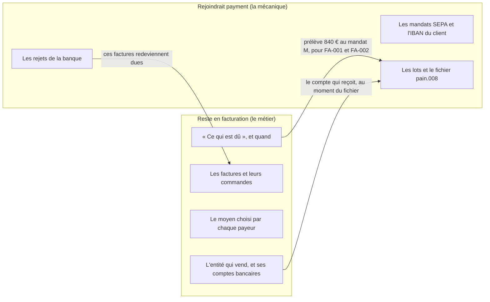

# Le prélèvement : ce qui devrait rejoindre `payment`

> 📐 **Analyse**, écrite le 2026-11-22 à la demande de Hugo, relue dans le
> code le même jour (`apps/lfd-api/src/lafoliecoffee/accounting/`,
> `lafoliecoffee/payments/`, les schémas Prisma de `public`). Le
> déménagement n'est ni planifié ni bâti ; le plan de sa première marche,
> les mandats, est **suspendu** :
> [`plan-les-mandats-dans-payment.md`](plan-les-mandats-dans-payment.md).
> La doc d'état du prélèvement reste en comptabilité :
> [`../comptabilite/prelevement/prelevement-sepa.md`](../comptabilite/prelevement/prelevement-sepa.md).
>
> **Le virement reçu est fait** : il vit dans `payment/transfer/`, décrit
> dans [`le-bloc-payment.md`](le-bloc-payment.md), § 6.

# Partie 1 — L'explication simple

Aujourd'hui, la carte et le virement reçu vivent dans le bloc `payment`,
mais le **prélèvement SEPA** vit dans la **facturation** de La Folie Coffee.
Il y mélange deux choses de nature différente :

- **le métier** : ce qui est dû, quand, par quel moyen ce client a choisi de
  payer, quelle facture porte quelle commande ;
- **la mécanique bancaire** : un mandat signé, un fichier envoyé à la banque,
  un rejet qui revient.

La règle de tri est celle du reste du bloc : **le métier dit ce qui est dû et
par quel moyen ; `payment` dit comment l'argent arrive.**

**Pourquoi le faire un jour** : une deuxième application pourrait prélever
ses clients sans recopier les mandats ni le fichier bancaire ; un changement
de banque toucherait le bloc, pas la facturation ; et la facturation
redeviendrait lisible.

**Pourquoi pas maintenant** : c'est le chantier le plus lourd du paiement
(des tables d'argent réel, des mandats signés, des fichiers déjà déposés), et
rien ne le réclame tant qu'une seule application prélève. Il se déclenche
quand une deuxième application doit prélever, ou quand la banque change.

# Partie 2 — La technique

## 1. Qui possède quoi

Trois décisions de Hugo du 2026-11-22, toutes « pour le moment » :

- **L'entité juridique reste en facturation.** Raison sociale, SIREN/SIRET,
  TVA, adresse, logo, numérotation : c'est l'identité de qui facture.
- **Le compte d'encaissement reste avec l'entité.** L'IBAN, le BIC, l'ICS et
  leur confirmation aux quatre yeux sont une donnée de l'entité
  (`LegalEntity`, aujourd'hui en facturation ; demain un socle partagé entre
  les applications, si plusieurs en ont besoin) — la forme la plus courante
  dans les ERP. `payment` **ne les stocke pas** : pour un prélèvement, il les
  reçoit de l'entité au moment de construire le fichier (lecture publiée, ou
  dans la demande). `payment.transfer_received.received_into` garde donc
  l'identifiant de l'entité. Les comptes de **carte** (`CARD_ACCOUNTS`)
  restent dans `payment` : ce sont des réglages du prestataire, pas des
  comptes bancaires de l'entité. Réversible sans casse tant que le
  prélèvement n'a pas déménagé.
- **Une application vend au nom d'une seule entité.** L'entité est une
  configuration de l'application, pas un choix fait à chaque vente : le jour
  où plusieurs applications existent, chacune déclare la sienne, et la
  facture et le paiement la lisent de l'application. Si une même application
  devait un jour vendre au nom de plusieurs entités, l'entité deviendrait une
  donnée de la vente, et la numérotation des factures resterait par entité.

|               | Possédé par l'application (la facturation)                       | Possédé par `payment`                                                                                 |
| ------------- | ---------------------------------------------------------------- | ----------------------------------------------------------------------------------------------------- |
| Côté émetteur | l'entité juridique **et** ses comptes bancaires (IBAN, BIC, ICS) | rien : il reçoit le compte au moment du fichier                                                       |
| Côté client   | la société cliente, son moyen choisi, ses factures               | le **mandat** et l'IBAN du client, dans un coffre, et la vie du mandat (RUM, `FRST`/`RCUR`, caducité) |
| La demande    | « prélève 840 € au mandat M, pour FA-001 et FA-002, le 5 »       | le lot, le `pain.008`, le calendrier, les rejets, puis chaque sujet prévenu                           |

**Pourquoi le mandat et l'IBAN du client iraient au bloc**, plutôt que
d'être renvoyés par l'application à chaque demande : le prélèvement a une
mémoire imposée (séquence, modification signalée à la banque, rejet rattaché
au débit d'origine, caducité). Sans elle dans le bloc, chaque application
réécrirait ces règles. C'est la forme de Stripe, GoCardless ou Adyen : un
coffre de moyens de paiement, et le commerçant n'envoie qu'une référence.

⚠️ C'est aussi ce qui a suspendu le plan des mandats : un mandat connaît
aujourd'hui la **société** cliente, et le bloc ne connaît que des sujets
opaques. Cette question de conception se tranche avant toute marche.

## 2. Le tri, pièce par pièce

### 2.1 Rejoindrait `payment` — la mécanique bancaire

| Pièce                                                                                | Où aujourd'hui                                                                                                                      |
| ------------------------------------------------------------------------------------ | ----------------------------------------------------------------------------------------------------------------------------------- |
| **Le mandat SEPA** : agrégat `PaymentMandate`, la RUM, sa preuve, ses gestes         | `lafoliecoffee/payments/` ; `public.payment_mandates`                                                                               |
| **Le compte du débiteur** : `CompanyBankAccount`, l'IBAN et le BIC du client         | `lafoliecoffee/payments/` ; `public.company_bank_accounts`                                                                          |
| **Le lot de prélèvement** : `CollectionBatch`, ses lignes, son état, son attestation | `accounting/domain/entities/collection-batch*` ; `public.collection_batch`, `collection_batch_line`, `collection_batch_attestation` |
| **Le fichier bancaire** `pain.008` et son audit                                      | `accounting/domain/services/pain008*.ts`                                                                                            |
| **Le calendrier bancaire** (TARGET2)                                                 | `accounting/domain/services/target2-calendar.ts`                                                                                    |
| **Les rejets et retours** : `CollectionReturn`, leur contrôle                        | `accounting/domain/entities/collection-return.ts` ; `public.collection_return`, `bank_return_check`                                 |
| **Le prélèvement d'essai**                                                           | `public.collection_test`, `collection_test_file`                                                                                    |
| **Les exports de mandats vers la banque**                                            | `accounting/…mandate-bank-export*`                                                                                                  |

### 2.2 Reste en facturation — le métier

| Pièce                                                              | Pourquoi                                                                                                                                                           |
| ------------------------------------------------------------------ | ------------------------------------------------------------------------------------------------------------------------------------------------------------------ |
| **Les factures**, leurs numéros, leurs mentions, Factur-X, Chorus  | des documents comptables                                                                                                                                           |
| **L'entité et ses comptes bancaires**                              | § 1                                                                                                                                                                |
| **Le moyen d'encaissement d'un payeur** (`payer_collection_means`) | ce que **ce client** a choisi : prélèvement, virement, demain carte par lien                                                                                       |
| **L'état d'encaissement d'une commande** (`order_collection`)      | la vue du **sujet** sur son règlement : `due`, `collected`, `settled_by_transfer`…                                                                                 |
| **Le jugement « prélevable ou non »** (`collection-verdict.ts`)    | il croise le moyen du payeur, la facture et l'état de la commande ; il **demande** au bloc si le mandat peut débiter, il ne le décide pas                          |
| **La pré-notification** (`collection_notice`)                      | ⚖️ à trancher : obligation SEPA, donc mécanique ; mais son contenu vient du métier. Proposition : le bloc tient l'obligation et la date, la facturation le contenu |

**Ce qui se coupe en deux** : `collection-assembly.ts` (constituer un lot).
La facturation choisit **ce qui** est prélevé (les factures dues, leurs
montants) ; le bloc **constitue** le lot (regrouper par mandat, vérifier les
plafonds, écrire le fichier).

## 3. Un mouvement, plusieurs parts

Une ligne de lot règle plusieurs factures d'un coup
(`collection_batch_line_invoice`). Le modèle existe déjà pour le virement
reçu : un mouvement et ses parts, chacune sur un `MovementSubject` opaque
(`payment/channels/subjects/movement-subject.ts`,
[`le-bloc-payment.md`](le-bloc-payment.md), § 6.2). Le prélèvement le
reprendrait, avec ce que le virement n'a pas :

- chaque part est acceptée ou refusée par **son** sujet, comme `onPaid` pour
  la carte ;
- un **rejet** de la banque défait toutes les parts du mouvement, et chaque
  sujet redevient dû.

La carte n'a pas à changer : un paiement par carte est déjà un mouvement à
une part.

## 4. L'ordre, le jour venu

| Lot | Contenu                                                                   | Risque                                    |
| --- | ------------------------------------------------------------------------- | ----------------------------------------- |
| D3  | **Les mandats et le compte du débiteur** rejoignent `payment/sepa-debit/` | élevé : des mandats signés, leurs preuves |
| D4  | **Les lots, le fichier `pain.008`, le calendrier, les rejets, l'essai**   | élevé : des lots déjà déposés à la banque |

Il n'y a pas de D2 : le compte d'encaissement reste avec l'entité (§ 1).
Chaque lot passe par `vitruve` (argent, migration de données) et par
`lecteur-de-migrations`, et finit au runbook. Les tables déménagent de
`public` vers le schéma `payment` par **renommage**, jamais par copie, comme
le virement reçu.

Un sous-dossier par moyen de paiement, comme `card/` et `transfer/` (décidé
par Hugo le 2026-11-22) : le prélèvement irait dans `payment/sepa-debit/`,
ses tables avec le préfixe de leur moyen dans le schéma `payment`.

## 5. Les questions ouvertes

| Question                                                                                                                           | À qui                |
| ---------------------------------------------------------------------------------------------------------------------------------- | -------------------- |
| Un mandat connaît la société cliente ; le bloc ne connaît que des sujets opaques : qui porte le lien ?                             | Hugo, puis `vitruve` |
| Quand le faire : à la deuxième application qui prélève, au changement de banque, ou plus tôt pour alléger la facturation ?         | Hugo                 |
| La pré-notification : obligation tenue par le bloc, contenu par la facturation (§ 2.2) ?                                           | Hugo, puis `vitruve` |
| Le dossier `lafoliecoffee/payments/` (mandats et demandes libres) : que deviennent les demandes libres quand les mandats partent ? | avec D3              |
