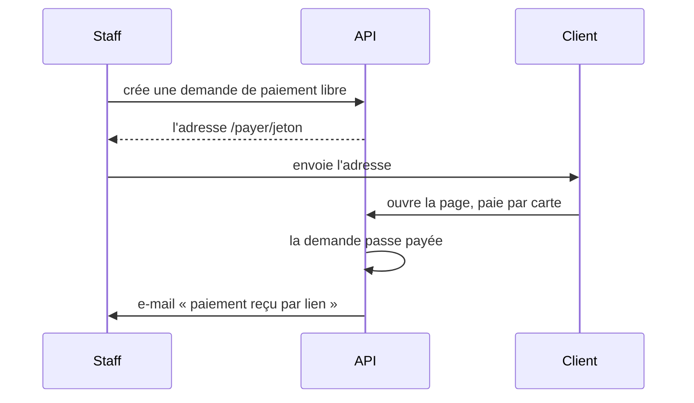
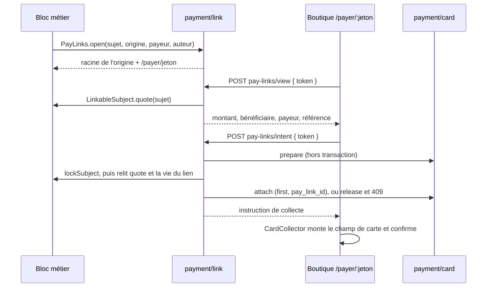

# Les liens de paiement

> ✅ **Doc d'état, relue dans le code le 2026-11-22.** Elle décrit ce qui
> existe : le lien d'une commande, la porte du bloc `payment` vers un sujet,
> la demande de paiement libre, l'avis à la comptabilité. La suite (l'acompte,
> la facture d'une période par carte) est dans
> [`feuille-de-route.md`](feuille-de-route.md). Le blocage du prélèvement a sa
> doc : [`../comptabilite/prelevement/blocage-du-prelevement.md`](../comptabilite/prelevement/blocage-du-prelevement.md).

# Partie 1 — L'explication simple

Un **lien de paiement** est une adresse qu'on envoie à un client pour qu'il
paie **par carte**, sans passer par la caisse ni par le prélèvement.

**Un lien est une porte, pas une dette.** Ce qu'on doit s'appelle le
**sujet** : une commande, une demande de paiement libre, demain une facture.
Le lien dit seulement « ici, on paie ce sujet-là ».

Il en existe deux sortes :

| Sorte                         | Pour payer quoi                               | Où le client paie                               | Qui le crée                                                                        |
| ----------------------------- | --------------------------------------------- | ----------------------------------------------- | ---------------------------------------------------------------------------------- |
| **Lien d'une commande**       | une commande pas encore payée                 | notre page de l'espace client, `/reglement/:id` | personne : il existe dès que la commande attend son paiement ; le staff le renvoie |
| **Demande de paiement libre** | une somme hors commande, choisie par le staff | notre page `/payer/<jeton>`, **sans connexion** | le staff, dans Comptabilité › Liens de paiement                                    |

Ce qu'il faut retenir :

- **L'adresse est la nôtre**, jamais celle du prestataire. Seul le champ de
  carte vient de lui. Changer de banque change un adaptateur du bloc
  `payment` ; les liens déjà envoyés restent bons.
- **Le bloc `payment` ne sait pas ce qu'il encaisse** : celui qui possède le
  sujet dit combien, pour qui, et ce qu'un paiement règle.
- **Le client n'a pas besoin de compte** : le comptable d'un client paie avec
  le seul lien.
- **Chaque paiement encaissé par un lien envoie un e-mail à l'équipe** :
  combien, par quel canal, pour quel client, pour quelle application.
- **Annuler une demande libre** rend son lien introuvable. Si le client avait
  déjà payé, l'argent est gardé et l'équipe est prévenue.
- **Une demande libre n'est pas une commande** : elle ne compte ni au chiffre
  d'affaires ni au prélèvement, et le rapprochement avec ce qu'elle
  régularise se fait à la main.
- **Une facture ne se paie pas encore par lien** : elle se règle par
  prélèvement ou par virement.

# Partie 2 — La technique

Le bloc `payment` range un sous-dossier par moyen — `card/` (la carte, son
webhook), `link/` (les liens), `transfer/` (le virement reçu) — et
`channels/`, ce que les autres blocs atteignent : `requests/` (`CardPayments`,
`PayLinks`…) et `subjects/` (les ports que les blocs métier implémentent).

Décidé par Hugo le 2026-11-22 : le lien ne dépend pas du prestataire (« si je
passe sur Caisse d'Épargne, les deux marchent ») ; il est créé **par le staff
ou par le système**, jamais par le client ; le bloc est agnostique du
prestataire **et** de l'application qui demande à encaisser.

## 1. Le lien d'une commande

- **La liste** : les commandes au règlement `pending` ou `failed`, non
  annulées (`list-orders-awaiting-payment.handler.ts`), avec l'adresse de leur
  page de règlement. Sans `CLIENT_BASE_URL`, `paymentUrl` vaut `null` : pas de
  lien affiché, et le renvoi est refusé en le disant.
- **Le renvoi par e-mail** à l'acheteur : `resend-order-payment-link.handler.ts`.
- **La page** `/reglement/:id` (boutique, `client/commande/reglement-page/`)
  relit le paiement par le bloc `payment` et n'en crée jamais un nouveau ;
  une carte refusée se règle encore tant que l'intention vit. **Qui entre**
  (`settle.guard.ts`) : le visiteur qui vient de passer la commande (son
  paiement est en mémoire, `HeldOrderPayment`), sinon un client connecté,
  sinon la connexion d'abord.
- **Commande saisie par l'équipe** (`place-order-for-customer.handler.ts`) :
  le client la règle lui-même par ce lien ; jamais un numéro de carte dicté.

| Route                                                        | Geste                       |
| ------------------------------------------------------------ | --------------------------- |
| `GET admin/accounting/payment-links/orders`                  | les commandes à régler      |
| `POST admin/accounting/payment-links/orders/:orderId/resend` | renvoyer le lien par e-mail |

(`lafoliecoffee/orders/http/admin-order-payment-links.controller.ts`)

## 2. La porte : un lien vers un sujet

### 2.1 Les ports du canal

- **`PayLinks`** (`payment/channels/requests/pay-links.ts`), déclaré et
  implémenté par `payment` (`block-pay-links.ts`), appelé par les blocs
  métier — **dans la transaction de l'appelant, sans réseau** :
  - `open(sujet, { origin, payerLabel, by, byLabel })` → `{ linkId, url }` ;
    un sujet qui a déjà un lien vivant rend celui-là. Refuse une origine hors
    registre, une racine publique absente, un type de sujet qu'aucun
    `LinkableSubject` ne sert (pas de lien mort). `by` est la fiche staff ou
    `system` (`SYSTEM_PAY_LINK_AUTHOR`) ; `byLabel` le nom de l'auteur, lu par
    l'appelant dans son annuaire — `payment` ne lit pas l'annuaire du staff —,
    `null` pour le système ou une fiche introuvable ;
  - `revoke(sujet, motif)` : la page rend alors 404 ;
  - `urlOf(sujet)` pour recopier ; `urlsOf(sujets)` en **une** lecture pour
    une page de liste, une adresse qui ne se compose pas étant journalisée et
    omise, sans faire tomber la liste.
- **`LinkableSubject`** (`payment/channels/subjects/linkable-subject.ts`),
  implémenté par le bloc qui possède le sujet : `quote(sujet)` →
  `{ payable: true, amountCents, payeeName, payerName, reference, dueOn }` ou
  `{ payable: false, reason: "settled" | "cancelled" }`. Lu à chaque
  ouverture, jamais figé. **Aucune ligne de facture, aucune adresse** :
  le détail reste dans l'espace authentifié. Un port à part de
  `SubjectSettlement` (ISP) : la commande, qui a sa page à elle, ne
  l'implémente pas.

### 2.2 Le lien — `payment.pay_link`

| Colonne                          | Rôle                                                                                                        |
| -------------------------------- | ----------------------------------------------------------------------------------------------------------- |
| `subject_type`, `subject_id`     | le sujet, opaque ; **un seul lien vivant par sujet** (index unique partiel `pay_link_live_per_subject_key`) |
| `origin`                         | l'application qui l'a demandé, une valeur du registre des origines                                          |
| `payer_label`                    | le nom du payeur, figé à l'ouverture                                                                        |
| `token_hash`                     | l'empreinte du jeton, unique : la page publique cherche par elle                                            |
| `token_sealed`                   | le jeton scellé, pour que le staff puisse recopier le lien                                                  |
| `created_by`, `created_by_label` | la fiche staff ou `system` ; le nom de l'auteur, figé, nullable                                             |
| `revoked_at`, `revoked_reason`   | posés ensemble (`CHECK pay_link_revoked_pair`) ; un lien révoqué ne se ranime pas                           |

- **Le jeton** : 32 octets aléatoires (port `TokenGenerator` — l'ULID est
  prévisible), jamais gardé en clair. L'empreinte est un HMAC-SHA-256 sous
  `payLinkTokenKey()`, dérivée de `FIELD_ENCRYPTION_KEY` ; le scellé passe
  par le chiffreur de champ commun (`FieldCipher`). Aucune variable
  d'environnement propre. Une rotation de `FIELD_ENCRYPTION_KEY` tue les liens
  déjà envoyés, comme les liens d'annulation.
- **Pas d'expiration** : le lien meurt quand le sujet est réglé ou annulé, ou
  quand il est révoqué. Ni DELETE (refusé par déclencheur, `pay_link_no_delete`),
  ni modification des colonnes immuables (`pay_link_guard`).
- **Le paiement sait qu'il vient d'un lien** : `payment.card_payment.pay_link_id`,
  posée par `attach`, immuable, indexée ; nulle pour un paiement de la
  boutique. C'est la trace qui fait foi : un relevé des paiements par lien est
  une lecture de cette colonne.
- **Le registre des origines** (`platform/config/pay-link-origins.ts`, comme
  `CARD_ACCOUNTS`) : une origine par application, son libellé et sa racine
  publique. Aujourd'hui `lafoliecoffee` (« La Folie Coffee »), racine
  `CLIENT_BASE_URL`. Le nom est une valeur écrite en base : il ne se renomme pas.

### 2.3 La page publique

- **Les routes** (`payment/link/http/pay-links.controller.ts`, `@Public()`) :
  `POST pay-links/view` et `POST pay-links/intent`. **Le jeton voyage dans le
  corps**, jamais dans un chemin de l'API, pour ne pas finir dans un journal.
  Limite de débit par route (`@Throttle` : 20 et 10 par minute), `no-store`,
  `@Idempotent`. Un jeton inconnu et un lien révoqué rendent le même 404.
- **L'intention naît à l'ouverture de la page, pas du lien** : l'ouverture du
  lien tourne en transaction, où le réseau est interdit
  (`assertOutsideTransaction`), et un lien jamais ouvert ne crée rien chez le
  prestataire.
- **La course avec une annulation** (`start-pay-link-payment.handler.ts`) :
  un `first` existant est relu (`retrieve`) ; sinon l'intention se prépare
  hors transaction, puis, sous le verrou du sujet (`lockSubject`), la porte
  relit le devis et la vie du lien. Non payable ou révoqué : l'intention est
  libérée (`release`) et la page reçoit un 409. L'annulation prend le même
  verrou : elle passe avant (le rattachement refuse) ou après (son abonné
  annule le premier paiement). Un seul `first` par sujet (index
  `payment_first_per_subject_key`) : une carte refusée revient « en attente »
  et se repaie sur la même intention. Une intention relue close rend 409 et la
  page dit « lien à renouveler ».
- **La page** `/payer/:jeton` (boutique, `client/pay-link/`) : sans
  connexion, dans le cadre de la boutique sans menu d'espace, `noindex`. Elle
  dit chaque phase : introuvable, réglé, annulé, à renouveler, indisponible,
  prêt, payé. Elle appartient à l'application d'origine du lien : chaque
  application monte la sienne avec le service de collecte.

### 2.4 L'instruction de collecte, neutre du prestataire

Le serveur ne rend jamais un secret propre à Stripe : il rend une union
fermée, `CardCollection` (`packages/contracts/src/card-collection.ts`), que
l'adaptateur de chaque prestataire remplit
(`payment/card/domain/ports/card-provider-types.ts`).

`embedded` donne le prestataire, sa clé publique et le jeton de CE paiement
(Stripe aujourd'hui) ; `redirect` donne l'adresse de la page du prestataire.

- Elle est portée par la page du lien, la passation, le règlement d'une
  commande et le complément d'une hausse, sous le seul champ `collection`.
- **Côté boutique**, un seul service connaît un prestataire : `CardCollector`
  (`client/payment-collection/card-collector.ts`) — il monte le champ, suit la
  langue, confirme ou redirige. Écrit sans rien de propre à La Folie Coffee,
  il rejoindra un paquet de `packages/` le jour où une deuxième application
  encaisse.
- **Le résultat** arrive toujours par le webhook du compte qui encaisse,
  jamais par la page.
- **Une vraie redirection** demandera une adresse de retour à `prepare`, qui
  ne la prend pas encore, et une page de retour qui relit l'état.

## 3. Les sujets branchés, et comment en brancher un

| Type de sujet | Bloc            | `SubjectSettlement` | `LinkableSubject`   | Compte       |
| ------------- | --------------- | ------------------- | ------------------- | ------------ |
| `order`       | `lafoliecoffee` | oui                 | non (sa page à lui) | `lfc-stripe` |
| `free_charge` | `lafoliecoffee` | oui                 | oui                 | `lfc-stripe` |

Le `subject_type` de `payment.card_payment` est un `TEXT` sans `CHECK` : un
type de plus ne demande **aucune migration** du bloc. Pour brancher un sujet :

1. une classe qui implémente `SubjectSettlement` (et `LinkableSubject` s'il se
   paie par lien), dans le bloc qui possède le sujet ;
2. son inscription dans `appBootstrap/` : `card-payment-feed.module.ts` (le
   registre `RegisteredSubjectSettlements`, qui refuse un doublon, et le
   compte par type, `CardAccountDefaults`) et `pay-link-feed.module.ts`
   (`LinkableSubjects`) ;
3. l'appel à `PayLinks.open` là où le sujet naît, dans sa transaction.

La porte du bloc `payment` ne change pas. Une **deuxième application** ajoute
en plus son origine au registre et sa page `/payer/:jeton` (recette complète :
[`feuille-de-route.md`](feuille-de-route.md), § 4.1).

### Une nature, ou un type de sujet

Décidé par Hugo le 2026-11-22 : « je veux que la mécanique de lien de
paiement puisse accueillir de nouvelles raisons, régularisation, acompte, au
fur et à mesure que les besoins vont augmenter ». Pour chaque raison
nouvelle, une seule question : _ce paiement a-t-il une conséquence au-delà
d'être encaissé ?_

- **non**, on encaisse et on trace : c'est une **nature** de la demande de
  paiement libre, une ligne du registre (§ 4.2) — régularisation, supplément
  convenu, solde après litige ;
- **oui**, un document à émettre, un sujet à rattacher, un montant à
  déduire : c'est un **type de sujet** à lui, qui porte sa conséquence dans
  `onPaid` — l'acompte sur devis automatisé, la facture d'une période.

## 4. La demande de paiement libre — sujet `free_charge`

Écran : Comptabilité › Liens de paiement
(`apps/lfd-backoffice-frontend/src/app/comptabilite/liens-de-paiement/`),
onglets « Commandes à régler » (`orders-to-settle/`) et « Liens libres »
(`free-links/`, création dans `new-link-panel/`). Contrat :
`packages/contracts/src/payment-link.ts`.

### 4.1 L'agrégat et sa table

- **`PaymentLink`** (`lafoliecoffee/payments/domain/entities/payment-link.ts`) :
  société, montant en centimes (> 0), libellé (1 à 140 caractères, la
  référence que lit le client), nature, états `open → paid | cancelled |
expired`. Table `public.payment_links`, sans suppression.
- **Son canal**, fermé (`PaymentLinkChannel`) : `door` pour toute demande
  créée aujourd'hui, `checkout` pour une ligne historique (§4.6).
  `stripe_session_id` et `url` sont nuls ensemble (`door`) ou posés ensemble
  (`checkout`) — `CHECK payment_links_checkout_pair`.
- **Plafond** : `accounting_settings.payment_link_max_cents` (`null` = aucun),
  lu à la création ; au-delà, un refus qui nomme le plafond. Réglage :
  `admin/accounting/settings`.

### 4.2 La nature

Obligatoire à la création : pourquoi on demande ce paiement. Le registre est
`freeChargeNatureSchema` / `FREE_CHARGE_NATURES`
(`packages/contracts/src/payment-link.ts`) :

`regularization` (Régularisation), `agreed_supplement` (Supplément convenu),
`balance_after_dispute` (Solde après litige), `deposit` (Acompte), `other`
(Autre).

- **Une nature de plus est une ligne**, sans migration : la colonne `nature`
  n'a pas de `CHECK` ; le domaine refuse une clé hors registre
  (`free-charge-nature.ts`).
- **Une nature ne se retire jamais** : une clé inconnue relue en base est une
  donnée corrompue (`PaymentLinkNatureCorruptError`, 500). Les demandes d'avant
  le registre ont `nature = NULL`, affichée « Non précisée ».
- Elle figure dans la liste, le fait `payment_link.created`, le journal et
  l'avis à la comptabilité ; **pas** sur la page `/payer/…` : c'est un
  classement interne.
- **L'acompte en nature encaisse seulement** : la facture d'acompte, le
  rattachement au devis et la déduction restent à la main.

### 4.3 Créer

`create-payment-link.handler.ts`, dans **une** transaction, sans réseau : le
plafond et les termes, la ligne (canal `door`), puis `PayLinks.open` du sujet
`free_charge` (origine `lafoliecoffee`, payeur = nom de la société, auteur =
la fiche staff et son nom). Rend `{ id, url }`. Une fois par intention
(`runSealed`) : le scellé ne garde que `{ id }`, puisque l'URL porte le jeton ;
un rejeu relit l'adresse par `PayLinks.urlOf`, et une demande payée ou annulée
depuis répond 409.

### 4.4 Le sujet, côté commerce

`lafoliecoffee/payments/application/free-charge/` :

| Méthode                     | Réponse                                                                                                                                                                                              |
| --------------------------- | ---------------------------------------------------------------------------------------------------------------------------------------------------------------------------------------------------- |
| `quote`                     | payable si `open` : montant, libellé en référence, société en payeur, « La Folie Coffee » en bénéficiaire, sans échéance ; sinon `settled` ou `cancelled`                                            |
| `lockSubject`               | le `FOR UPDATE` de sa ligne, le même verrou que l'annulation (`loadLocked`)                                                                                                                          |
| `onPaid`                    | `applied`, `already_applied` au rejeu ; **payée après annulation** : `applied` aussi, l'argent est gardé et la cloche `payment_link.paid_after_cancel` sonne — à l'équipe de rembourser ou d'imputer |
| `onPaymentFailed`           | rien, le client réessaie                                                                                                                                                                             |
| `isCancelled`               | vrai si annulée et pas payée depuis                                                                                                                                                                  |
| `onRefundOutcome`           | journal `payment_link.refunded`, l'état ne change pas ; cloche `payment_link.refund_failed` si l'argent n'a pas été rendu                                                                            |
| `describe`                  | « <nature> — <libellé> » (« Paiement libre — <libellé> » sans nature), avec l'écran des liens                                                                                                        |
| `claim` / `referencesSince` | `null` / rien : tout paiement d'un lien naît par `attach`                                                                                                                                            |

### 4.5 Annuler, lister

- **Annuler** (`cancel-payment-link.handler.ts`), sous `loadLocked` : dans la
  transaction, `PaymentLink.cancel`, `PayLinks.revoke` (la page rend 404) et
  le fait durable `payment_link.cancelled`. Son abonné `OnPaymentLinkCancelled`
  (`b2b.payments.cancel-payment-link-intent`) annule le premier paiement chez
  le prestataire s'il existe ; une panne lève et la boîte d'envoi rejoue ;
  `already_paid` fait sonner la cloche « payé après annulation ».
- **Lister** (`list-payment-links.handler.ts`) : `url` vaut `null` sauf pour
  une demande ouverte — `PayLinks.urlsOf` pour les demandes `door`, la colonne
  pour une ligne historique.
- **Pas de geste de remboursement** au back-office : un remboursement fait
  chez le prestataire est observé et rattaché par `onRefundOutcome`.

| Route                                            | Geste               |
| ------------------------------------------------ | ------------------- |
| `GET admin/accounting/payment-links`             | les demandes libres |
| `POST admin/accounting/payment-links`            | créer               |
| `POST admin/accounting/payment-links/:id/cancel` | annuler             |

(`lafoliecoffee/payments/http/admin-payment-links.controller.ts`)

### 4.6 Les anciennes lignes `checkout`

Une demande d'avant la porte a été ouverte sur une page Stripe Checkout. Plus
aucune ne se crée et **aucun chemin ne la règle** : il n'y a plus de webhook
des liens. Gardés : la ligne, `stripe_session_id`, `url`, leur `CHECK`, et la
lecture du canal (reconstitution, liste). Une ligne relue encore ouverte
s'annule sans appeler Stripe. Un remboursement d'une telle ligne n'a pas de
paiement au bloc `payment` : il arrive « hors commande »
(`on-refund-without-order.handler.ts`).

## 5. L'avis à la comptabilité

Chaque paiement encaissé par un lien demande l'e-mail
`staff.link-payment-received` à l'équipe. Le bloc `payment` le déclare
(`LinkPaymentNotice`, `payment/card/domain/ports/`) et l'implémente côté liens
(`LinkPaymentMailNotice`, `payment/link/application/link-payment-mail-notice.ts`).

- **Quand** : dans `IntentOutcomeRecorder` (`payment/card/application/`),
  après la réponse du sujet et l'écriture du paiement, dans la même
  transaction, si la ligne porte un `pay_link_id`. La demande part au bloc
  `mail` par sa boîte d'envoi : envoyée après validation, relancée en cas
  d'échec. Un encaissement rejoué ne repasse pas `paid` et n'envoie rien ; la
  clé `mail:payment.link_paid:<paiement>` ferme le reste.
- **Ce qu'il dit** : le montant ; le canal (le compte et son prestataire) ; le
  client (`payer_label`) ; l'application (le libellé de l'origine) ; ce qui
  est réglé (`describe`, avec le bouton vers l'écran) ; la provenance (« créé
  par <nom> », « créé par un membre de l'équipe » quand le nom manque, « créé
  automatiquement par le système ») ; l'issue (encaissé, ou encaissé puis
  refusé par le sujet, remboursement demandé).
- Un paiement de la boutique, sans lien, n'envoie pas cet avis.

### 5.1 Ses destinataires

Décidé par Hugo le 2026-11-22 : l'avis part « soit à un rôle que je définis,
soit à des membres du staff spécifiques ». Seul cet avis passe par ce
mécanisme ; la demande d'aide et l'alerte de compte gardent la boîte de
l'équipe.

- **Le réglage appartient au staff** : `public.staff_notice_audience`, une
  ligne par modèle et par rôle (`role_key`) ou par membre (`staff_user_id`),
  l'un des deux exactement (`CHECK staff_notice_audience_one_target`), clé
  étrangère vers le membre en `RESTRICT`, pas de clé vers les rôles. Écran
  Admin › Destinataires des avis (`admin/notice-audiences/`), droit
  `staff_notice_audiences`, routes `GET admin/staff-notice-audiences` et
  `PUT admin/staff-notice-audiences/:template`. Le geste est journalisé
  (`staff.notice_audience_changed`).
- **La lecture publiée** : `StaffNoticeRecipients`
  (`staff/notifications/domain/ports/staff-notice-recipients.ts`) — les
  membres non suspendus et avec une adresse des rôles réglés, et les membres
  nommés aux mêmes conditions, une fois chacun, triés par identifiant.
- **L'envoi** : `StaffAudienceMail.sendToStaffAudience`
  (`mail/channels/requests/staff-audience-mail.ts`, une porte à part de
  `Mail`) écrit **une demande par membre**, clé
  `mail:payment.link_paid:<paiement>:<membre>`. Personne de joignable : **une**
  demande à la boîte de l'équipe (`mailerConfig().staffInbox`), clé `…:inbox`,
  et un avertissement sans adresse. Sans boîte non plus : rien ne part, et un
  avertissement.
- **Les destinataires sont choisis au moment du paiement** et figés dans les
  demandes : un membre suspendu juste après reçoit l'avis, c'est assumé. Pas de
  cloche.

## 6. Le webhook des cartes et le balayage

- **Un seul webhook** : `POST /payments/webhook/:account`
  (`payment/card/http/card-payments-webhook.controller.ts`), vérifié avec le
  secret du compte. Un paiement par lien y arrive comme tout paiement par
  carte. Un `checkout.session.*` qui arriverait encore est réduit et rangé
  `card_payment.unmatched`, sans effet.
- **Le filet d'un webhook perdu** (`sweep-pending-card-payments.handler.ts`,
  `POST admin/card-payments/pending/sweep`, appelé par le cron) : tout paiement
  `pending | failed` hors rôle `complement`, né depuis plus de cinq minutes,
  est relu chez le prestataire — toutes les 5 minutes la première heure,
  toutes les heures jusqu'à 24 heures, toutes les 6 heures jusqu'à 7 jours,
  puis plus du tout (`provider-check-schedule.ts`, 50 par passage). Payé, il
  suit le chemin du webhook (le sujet, la ligne, le fait, l'avis) ; annulé, la
  ligne se ferme et le sujet reste ouvert.

## 7. Les tables

| Table                                               | Propriétaire             | Ce qu'elle porte                                                             |
| --------------------------------------------------- | ------------------------ | ---------------------------------------------------------------------------- |
| `payment.pay_link`                                  | `payment/link`           | le lien vers un sujet (§2.2)                                                 |
| `payment.card_payment.pay_link_id`                  | `payment/card`           | le lien d'où naît un paiement, immuable                                      |
| `public.payment_links`                              | `lafoliecoffee/payments` | la demande de paiement libre ; `stripe_session_id`, `url` historiques (§4.6) |
| `public.accounting_settings.payment_link_max_cents` | `lafoliecoffee/payments` | le plafond                                                                   |
| `public.staff_notice_audience`                      | `staff/notifications`    | les destinataires des avis                                                   |

Migrations : `20261122100000_les_liens_vers_un_sujet` à
`20261122170000_la_relecture_des_paiements_en_attente`.

## 8. Les portes et les tests

Les portes qui tiennent ces règles : `context-boundaries` (les blocs métier
n'atteignent `payment` que par `payment/channels/`, `payment → mail` par port),
`prisma-model-ownership` (`pay_link` lu par `payment` seul, `payment_links` par
le commerce seul), `card-accounts` (le registre des comptes et le `CHECK` de la
base d'accord), `network-outside-transaction` (aucun appel au prestataire en
transaction), `cache-control` (les routes publiques en `no-store`),
`write-idempotence`, `mail-key-no-pii` (aucune clé d'avis ne porte une
adresse), `durable-cross-block` et `no-role-grants-in-migrations` (le droit
`staff_notice_audiences` s'accorde à l'écran).

E2E : `test/pay-links.e2e-spec.ts` (la porte),
`test/free-charge-links.e2e-spec.ts` (la demande libre par la porte),
`test/payment-links.e2e-spec.ts` (lecture et annulation des lignes
historiques, route retirée), `test/staff-notice-audiences.e2e-spec.ts`,
`test/card-payment-pending-sweep.e2e-spec.ts`.

## 9. Ce qui reste

La suite et son ordre sont dans [`feuille-de-route.md`](feuille-de-route.md) :

- **l'acompte sur devis**, un type de sujet à lui, après l'avis du cabinet ;
- **I0 → I2**, la facture d'une période payée par carte, troisième moyen du
  paiement au compte : le moyen `card_link`, le sujet `invoice`, le lien émis
  avec la facture. Le code Factur-X est à demander au cabinet avant tout, et
  aujourd'hui « pas virement » veut dire « prélèvement » dans la facturation :
  ce piège se défait avant d'ajouter un troisième moyen ;
- **P2**, relancer un paiement mort : révoquer et rouvrir un lien dont
  l'intention est morte chez le prestataire ;
- **W**, les abonnés du commerce en `lfc.<contexte>.<geste>`.

Hors du dépôt, chez Stripe et Cloudflare : supprimer la destination « lfd-api
production — liens de paiement », décocher les `checkout.session.*` de
l'endpoint des cartes, retirer `STRIPE_LINKS_WEBHOOK_SECRET` chez Cloudflare
et dans GitHub. Le dépôt ne l'atteste pas. À corriger aussi : le `tag` d'un
lien (`pay-link:<id>`) atterrit chez Stripe dans une métadonnée nommée
`companyId` (`stripe-card-provider.ts`).

Ni lettrage automatique d'une demande libre avec des commandes, ni paiement
partiel, ni lien créé par le client.
