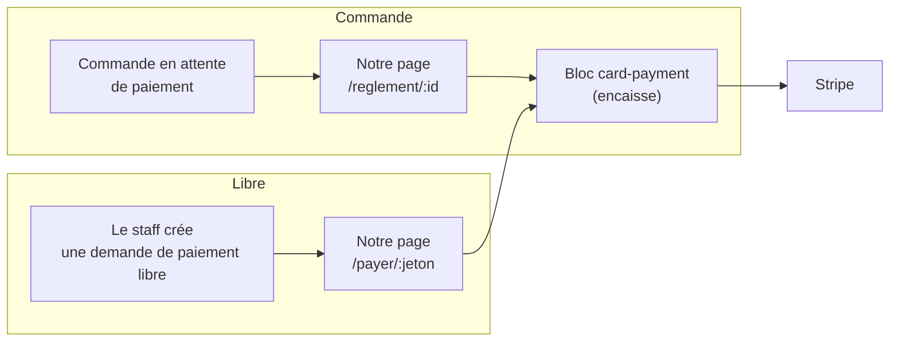
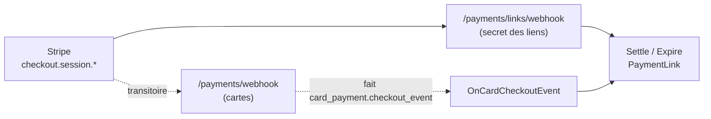
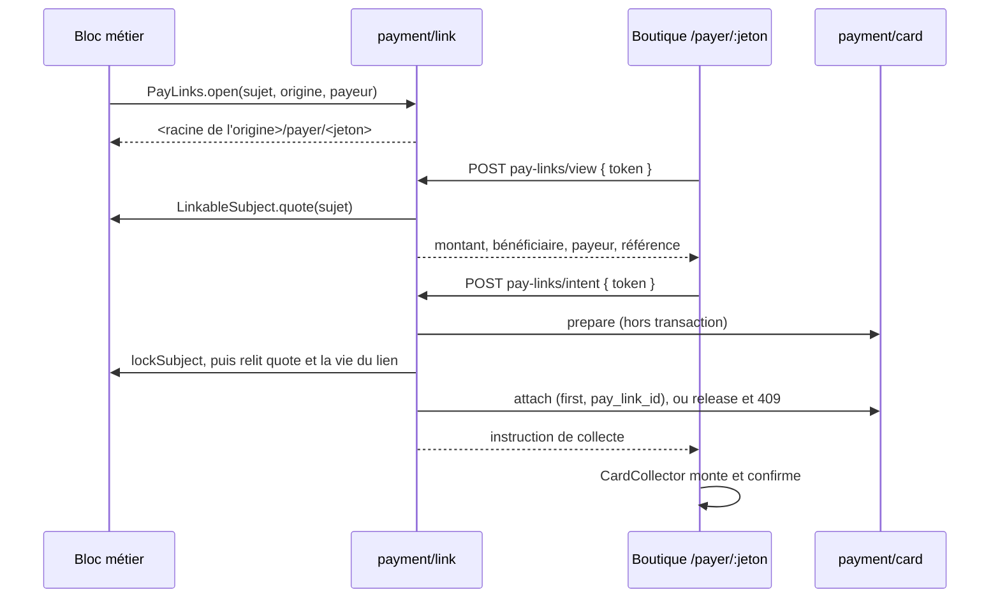

# Les liens de paiement

> ✅ **Doc d'état, relue dans le code le 2026-11-22** (demande de paiement libre par la
> porte comprise, lot F1). Elle décrit ce qui existe. La suite envisagée (la
> facture d'une période, la fermeture des anciens liens Stripe) est dans
> [`plan-le-lien-vers-un-sujet.md`](plan-le-lien-vers-un-sujet.md).
> Le blocage du prélèvement, longtemps décrit dans la même page, a sa doc :
> [`../../comptabilite/prelevement/blocage-du-prelevement.md`](../../comptabilite/prelevement/blocage-du-prelevement.md).

# Partie 1 — L'explication simple

Un **lien de paiement** est une adresse qu'on envoie à un client pour qu'il
paie **par carte**, sans passer par la caisse ni par le prélèvement.

Il en existe **deux sortes** aujourd'hui, qui ne marchent pas pareil :

| Sorte                                    | Pour payer quoi                               | Où le client paie                                       | Qui le crée                                                                                    |
| ---------------------------------------- | --------------------------------------------- | ------------------------------------------------------- | ---------------------------------------------------------------------------------------------- |
| **Lien d'une commande**                  | une commande pas encore payée                 | **notre** page, dans l'espace client (`/reglement/:id`) | personne : il existe dès que la commande attend son paiement ; le staff le copie ou le renvoie |
| **Lien libre** (« Régularisation août ») | une somme hors commande, choisie par le staff | **notre** page de paiement, sans connexion (`/payer/…`) | le staff, dans Comptabilité › Liens de paiement                                                |

Ce qu'il faut retenir :

- **Les deux passent par le bloc `payment`**, celui qui encaisse toutes les
  cartes : changer de prestataire de carte les ferait suivre.
- **Les anciens liens libres**, créés avant le 2026-11-22 et encore
  ouverts, gardent leur page Stripe Checkout jusqu'à leur clôture. Aucun
  nouveau lien n'en ouvre.
- **Annuler un lien libre** le rend introuvable : sa page répond « ce lien
  n'existe pas ou n'est plus valable ». Si le client avait déjà payé, l'argent
  est gardé et l'équipe est prévenue.
- **Un lien libre n'est pas une commande** : il ne compte ni au chiffre
  d'affaires, ni au prélèvement, et ne règle aucune commande tout seul. Le
  rapprochement avec ce qu'il régularise se fait à la main.
- **On ne peut pas encore payer une facture** (une période de bons) par
  lien : une facture se règle par prélèvement ou par virement.

# Partie 2 — La technique

Écran : Comptabilité › Liens de paiement
(`apps/lfd-backoffice-frontend/src/app/comptabilite/liens-de-paiement/`),
deux onglets — « Commandes à régler » (`orders-to-settle/`) et « Liens
libres » (`free-links/`, panneau de création `new-link-panel/`).
Contrat : `packages/contracts/src/payment-link.ts`.

## 1. Le lien d'une commande

- **La liste** : les commandes au règlement `pending` ou `failed`, non
  annulées (`list-orders-awaiting-payment.handler.ts`), avec l'adresse de la
  page de règlement de l'espace client. Sans `CLIENT_BASE_URL`, `paymentUrl`
  vaut `null` : pas de lien affiché, et le renvoi est refusé en le disant.
- **Le renvoi par e-mail** à l'acheteur :
  `resend-order-payment-link.handler.ts`, modèle d'e-mail « lien de
  règlement d'une commande ».
- **La page** `/reglement/:id` (boutique, `client/commande/reglement-page/`),
  la seule page de règlement — `/commandes/:id/regler` a été retirée le
  2026-11-22, aucun e-mail ne l'ayant jamais portée en production. Le lien
  se génère dans `payment-link.ts`. La page relit le paiement par le bloc
  `payment` (`get-order-payment.handler.ts`) et n'en crée jamais un nouveau ;
  une carte refusée se règle encore tant que l'intention vit. Le formulaire
  de carte se monte par le service de collecte (`CardCollector`), qui lit
  l'instruction neutre du prestataire.
- **Qui entre** (`settle.guard.ts`) : le visiteur qui vient de passer la
  commande (son paiement est en mémoire, `HeldOrderPayment`, compte ou non) ;
  sinon un client connecté ; sinon la connexion d'abord, puis retour sur la
  page.
- **Commande saisie par l'équipe** (`place-order-for-customer.handler.ts`) :
  le règlement se fait par ce lien, que le client suit lui-même ; jamais un
  numéro de carte dicté. Non réglée à l'heure limite, elle fait sonner la
  cloche ; un rappel part au client (`order-settlement-reminders.e2e-spec`).

| Route                                                        | Geste                       |
| ------------------------------------------------------------ | --------------------------- |
| `GET admin/accounting/payment-links/orders`                  | les commandes à régler      |
| `POST admin/accounting/payment-links/orders/:orderId/resend` | renvoyer le lien par e-mail |

(`lafoliecoffee/orders/http/admin-order-payment-links.controller.ts`)

## 2. Le lien libre — la demande de paiement libre

- **Agrégat** `PaymentLink`
  (`lafoliecoffee/payments/domain/entities/payment-link.ts`) : société,
  montant en centimes (> 0), libellé (1 à 140 caractères, la référence que
  lit le client), états `open → paid | cancelled | expired`. Table
  `payment_links` (`prisma/schema/public/accounting.prisma`), sans
  suppression : un lien se clôt par son statut.
- **Son canal**, fermé (`PaymentLinkChannel`) : `door` pour une demande de paiement libre
  payée par la porte du bloc `payment` (toute création), `checkout` pour un
  lien d'avant la porte, qui garde sa session Stripe. `stripe_session_id` et
  `url` sont nuls ensemble (`door`) ou posés ensemble (`checkout`) — `CHECK
payment_links_checkout_pair`, migration
  `20261122120000_la_regularisation_par_la_porte`. L'expiration, la recherche
  par session et la fermeture de session ne valent que pour `checkout`.
- **Créer** (`create-payment-link.handler.ts`), dans UNE transaction, sans
  réseau : le plafond, la ligne, puis `PayLinks.open` du sujet
  `free_charge` (origine `lafoliecoffee`, payeur = nom de la société, auteur =
  la fiche staff). Rend `{ id, url }`, l'URL `/payer/…`. Une fois par
  intention : le scellé ne garde que `{ id }` (l'URL porte le jeton) ; un
  rejeu relit l'adresse par `PayLinks.urlOf`, et une demande de paiement libre payée ou
  annulée depuis répond 409.
- **Le sujet `free_charge`** (`application/free-charge/`), relié par
  `appBootstrap/` (`card-payment-feed.module.ts` : compte `lfc-stripe` et
  `SubjectSettlements` ; `pay-link-feed.module.ts` : `LinkableSubjects`) :
  - `quote` : payable si `open` — montant, libellé en référence, société en
    payeur, « La Folie Coffee » en bénéficiaire, sans échéance ; sinon
    `settled` (payée) ou `cancelled` (annulée, expirée) ;
  - `lockSubject` : le `FOR UPDATE` de sa ligne, le même que l'annulation ;
  - `onPaid` : `applied` (passe à `paid`), `already_applied` au rejeu ;
    **payée après annulation** : `applied` aussi, l'argent est gardé et la
    cloche `payment_link.paid_after_cancel` sonne ;
  - `onPaymentFailed` : rien, le client réessaie ;
  - `isCancelled` : vrai si annulée (et pas payée depuis) ;
  - `onRefundOutcome` : journal `payment_link.refunded` sur la société,
    l'état ne change pas ; cloche `payment_link.refund_failed` quand un
    remboursement n'a pas rendu l'argent ;
  - `describe` : « Paiement libre — <libellé> », l'écran des liens ;
  - `claim` / `referencesSince` : `null` / rien — tout paiement d'un lien
    naît par `attach`.
- **Annuler** (`cancel-payment-link.handler.ts`), sous `loadLocked` :
  - `door` : dans la transaction, `PaymentLink.cancel`, `PayLinks.revoke`
    (la page rend 404) et le fait durable `payment_link.cancelled` ; son
    abonné `OnPaymentLinkCancelled` (`b2b.payments.cancel-payment-link-intent`)
    annule le premier paiement chez le prestataire, s'il existe. Une panne
    lève et la boîte d'envoi rejoue ; `already_paid` fait sonner la cloche
    « payé après annulation », sans relancer ;
  - `checkout` : après la transaction, la session Stripe est fermée ; un
    refus est journalisé.
- **La liste** (`list-payment-links.handler.ts`) : `url` vaut `null` sauf
  pour un lien ouvert — la colonne pour un ancien lien, `PayLinks.urlsOf`
  (une lecture pour la page) pour une demande de paiement libre. Une adresse qui ne se
  compose pas (racine publique absente) laisse sa ligne à `null` et se
  journalise, sans faire tomber la liste.
- **Plafond** : `accounting_settings.payment_link_max_cents` (`null` =
  aucun), lu à la création ; au-delà, refus qui nomme le plafond. Réglage :
  `admin/accounting/settings`.

| Route                                            | Geste            |
| ------------------------------------------------ | ---------------- |
| `GET admin/accounting/payment-links`             | les liens libres |
| `POST admin/accounting/payment-links`            | créer            |
| `POST admin/accounting/payment-links/:id/cancel` | annuler          |

(`lafoliecoffee/payments/http/admin-payment-links.controller.ts`)

## 3. Le webhook des anciens liens libres

Un lien d'avant la porte (canal `checkout`) se règle encore par Stripe
Checkout, par deux chemins :

- **Payé** seulement sur `checkout.session.completed` avec
  `payment_status = paid`, ou sur `async_payment_succeeded` ; **expiré** sur
  `checkout.session.expired`. Un paiement qui arrive sur un lien annulé le
  passe quand même à `paid` et fait sonner la cloche.
- **L'endpoint des liens** : `POST /payments/links/webhook`
  (`payment-links-webhook.controller.ts`), signé avec
  `STRIPE_LINKS_WEBHOOK_SECRET`. Sans secret ou avec une signature fausse :
  400, rien n'est traité, Stripe réessaie.
- **Le relais** : tant que l'endpoint des cartes reçoit les
  `checkout.session.*`, `payment` les relaie au commerce par le fait
  durable `card_payment.checkout_event`
  (`on-card-checkout-event.handler.ts`). Un même événement peut arriver par
  les deux chemins : régler ou expirer un lien déjà réglé ne réécrit rien.
- **Un remboursement** d'un ancien lien n'a pas de ligne au bloc `payment` :
  il arrive « hors commande » (`on-refund-without-order.handler.ts`).
- **Les tests** : `test/payment-links.e2e-spec.ts` (endpoint des liens,
  vraie vérification de signature, et relais) ; `test/free-charge-links.e2e-spec.ts`
  pour la demande de paiement libre par la porte.

## 4. Le lien vers un sujet — la porte du bloc `payment`

Servie depuis le 2026-11-22 par la demande de paiement libre (`free_charge`) ; la
facture d'une période (I2) suivra
([`plan-le-lien-vers-un-sujet.md`](plan-le-lien-vers-un-sujet.md)).

- **Le lien** (`payment/link/`) : table `payment.pay_link`, un seul lien
  vivant par sujet, aucun DELETE, révocation posée une fois. Le jeton (32
  octets) n'est jamais gardé en clair : une empreinte HMAC sous
  `payLinkTokenKey()` (dérivée de `FIELD_ENCRYPTION_KEY`) pour le retrouver,
  un scellé (`FieldCipher`) pour le recopier.
- **Le paiement sait qu'il vient d'un lien** : `payment.card_payment.pay_link_id`,
  immuable, indexé.
- **La course avec une annulation** (`start-pay-link-payment.handler.ts`) :
  l'intention se prépare hors transaction, puis, sous le verrou du sujet,
  la porte relit le devis et vérifie que le lien est toujours vivant. Non
  payable ou révoqué : l'intention est libérée et la page reçoit un 409
  (`pay_link.subject.not_payable`, `pay_link.withdrawn`). L'annulation prend
  le même verrou : elle passe avant (le rattachement refuse) ou après (son
  abonné voit le premier paiement et l'annule).
- **Les ports** (`payment/channels/`) : `PayLinks` (ouvrir, révoquer,
  recopier, `urlsOf` pour une page de liste) pour les blocs métier ;
  `LinkableSubject` (`quote`), que chaque bloc sujet implémente.
- **Le registre des origines** (`platform/config/pay-link-origins.ts`) : une
  origine par application, avec sa racine publique ; `lafoliecoffee` prend
  `CLIENT_BASE_URL`.
- **Les routes publiques** : `POST pay-links/view` et `POST pay-links/intent`,
  le jeton dans le corps, limite de débit par route, `no-store`. Un jeton
  inconnu et un lien révoqué rendent le même 404.
- **La page** `/payer/:jeton` (`client/pay-link/`) : sans connexion, dans le
  cadre de la boutique sans menu d'espace, `noindex`. Elle fait payer par le
  service de collecte (`CardCollector`) et dit chaque phase (introuvable,
  réglé, annulé, à renouveler, indisponible, prêt, payé).

## 5. Ce qui reste ouvert

- **La bascule chez Stripe n'est pas attestée par le dépôt.** La destination
  « lfd-api production — liens de paiement » a été créée désactivée le
  2026-11-09. Le plan
  [`plan-le-lien-vers-un-sujet.md`](plan-le-lien-vers-un-sujet.md)
  propose de ne **pas** la faire : les nouveaux liens n'utiliseraient plus
  Stripe Checkout, et le relais suffit pour les derniers liens ouverts.
- Pas de lettrage automatique entre un lien libre et des commandes.
- Pas de paiement d'une facture par lien (voir le plan).
- Les anciens liens Stripe Checkout encore ouverts ne sont pas fermés
  d'office : c'est le lot F2 du plan, au moins 24 h après le déploiement.
- Aucun geste de remboursement d'une demande de paiement libre au back-office : un
  remboursement se fait chez le prestataire, et il est observé et rattaché.
