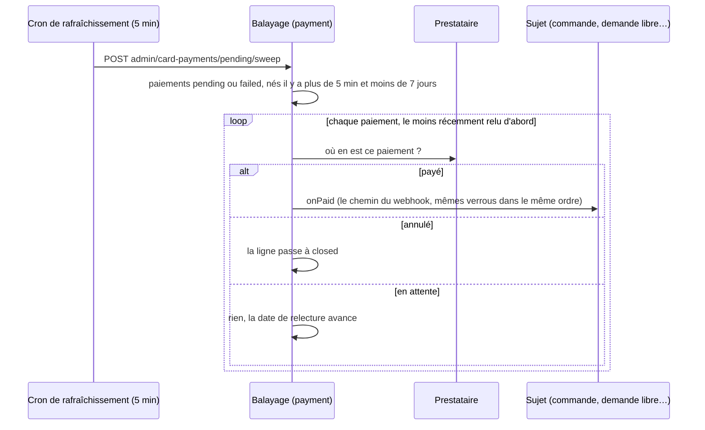

# Plan B — le balayage des paiements en attente

> 📐 **Plan**, écrit le 2026-11-22 à la demande de Hugo (« fais B après
> F2 »). Lot 4 bis de la [`feuille-de-route.md`](feuille-de-route.md). Il
> touche à l'encaissement : contredit par `vitruve` avant le bâti.

# Partie 1 — L'explication simple

Aujourd'hui, le bloc `payment` apprend qu'un client a payé **par le webhook
du prestataire**, et par lui seul, sauf pour le complément d'une
modification de commande. Si ce message se perd, la commande reste « en
attente de paiement » alors que l'argent est encaissé. Stripe relance ses
webhooks pendant trois jours, donc le risque est faible ; une banque qui
notifie une seule fois le rendrait réel.

Le lot B ajoute un **filet** : toutes les cinq minutes, le bloc prend les
paiements encore en attente et **demande au prestataire où ils en sont**.
Payé : il fait exactement ce qu'aurait fait le webhook. Annulé : il clôt la
ligne. En attente : il repassera plus tard.

Le webhook reste le chemin principal ; le balayage ne fait que le rattraper.

# Partie 2 — La technique

## 1. Ce qui existe (ouvert le 2026-11-22)

- `CardPayments.settleFromProvider(paymentId)`
  (`apps/lfd-api/src/payment/card/application/block-card-payments.ts`) : relit
  l'intention par `CardProvider.retrieveIntent`, **hors transaction** ; si
  `succeeded`, rejoue `outcomes.paid` dans une transaction (le chemin du
  webhook, idempotent par la machine de la ligne relue sous verrou) ; si
  `canceled`, clôt la ligne ; sinon rend `pending`.
- Ses seuls appelants : les deux balayages des hausses du commerce
  (`sweep-card-increases.handler.ts`, `expire-card-increases.handler.ts`),
  pour les paiements `complement` d'un projet `awaiting_payment`.
- `CardPaymentRepository.unsettledCreatedBefore(subjectType, before)` :
  `pending | failed` d'un type de sujet, sans borne basse ni limite — fait
  pour le rattrapage de reprise (`replay-first-payments`), pas pour un cron.
- Le cron de **rafraîchissement** du Worker (`apps/lfd-api/container/worker.ts`,
  toutes les cinq minutes) présente déjà le jeton du `RecomputeGuard` à
  `admin/card-payments/sweep` (remboursements) et aux autres balayages.

**Pas couverts aujourd'hui** : le premier paiement d'une commande (`first`)
et le paiement d'un lien (`/payer/…`, sujet `free_charge` et suivants).

## 2. Ce que le lot ajoute

### 2.1 La sélection

Les paiements :

- `state IN ('pending', 'failed')` — `failed` parce qu'une intention
  refusée peut encore être payée (`failed → paid`, nouvel essai du client) ;
  `closed` et `paid` jamais ;
- **rattachés** à une référence chez le prestataire (`provider_ref` posée) ;
- nés il y a **plus de 5 minutes** (laisser au webhook le temps d'arriver) et
  **moins de 7 jours** (au-delà, un paiement oublié n'est plus un retard de
  notification, c'est un abandon : il reste à la relecture humaine) ;
- **tous types de sujet**, sans en connaître aucun, **sauf le rôle
  `complement`** : les balayages des hausses le relisent déjà avec leur
  propre logique (délai, compte `provider_checks`, cloche). Le rôle est une
  colonne du bloc, pas une donnée du sujet ;
- **dus** : jamais relus, ou relus depuis plus longtemps que l'intervalle de
  leur âge — **5 minutes** pendant la première heure, **1 heure** jusqu'à
  24 heures, **6 heures** ensuite. Une ligne restée en attente sept jours est
  relue une soixantaine de fois, pas deux mille ;
- au plus **50 par passage**, les moins récemment relus d'abord.

### 2.2 La colonne de curseur (migration additive)

`payment.card_payment.provider_checked_at timestamptz NULL` — l'instant de
la dernière relecture par le balayage, lu du `Clock`. Index partiel
`(provider_checked_at NULLS FIRST, created_at) WHERE state IN ('pending',
'failed')`. Aucune ligne réécrite : `NULL` pour toutes, ce qui les met en
tête une fois.

La date avance **à chaque relecture**, qu'elle ait réussi ou non : une
intention que le prestataire refuse de relire ne doit pas bloquer la file.

Le curseur s'écrit par une méthode de dépôt nommée,
`CardPaymentRepository.markProviderChecked(id, at)`, et non par `save` : c'est
une **écriture technique sans invariant** (aucune règle ne peut la refuser,
§3.1 de `CLAUDE.md`), sans fait journalisé, conditionnée à
`state IN ('pending', 'failed')`. L'index partiel s'écrit dans le
`migration.sql` et se nomme dans le commentaire de tête de
`prisma/schema/payment/card.prisma`.

### 2.3 Le traitement

Un par un, **hors transaction**, un échec n'arrête pas les suivants :

1. poser `provider_checked_at = now` (écriture courte, conditionnée à
   `state IN ('pending', 'failed')`) ;
2. `settleFromProvider(paymentId)` ;
3. compter l'issue : `paid`, `closed`, `pending`, `failed_check` (exception
   du prestataire ou du sujet, journalisée avec l'identifiant du paiement,
   jamais une donnée personnelle).

Le rapport rendu au cron : `{ examined, settled, replayed, refusedBySubject,
closed, pending, failedChecks }`. `settleFromProvider` rend pour cela une
issue plus fine qu'aujourd'hui : `paid` devient `settled` (le sujet l'a
appliqué), `replayed` (la ligne était déjà payée) ou `refused_by_subject`
(le sujet a refusé, par exemple une commande annulée : son remboursement part
par le chemin existant). Les deux balayages des hausses ignorent l'issue :
leur comportement ne change pas.

### 2.3 bis 🔴 L'ordre des verrous (corrige un défaut existant)

Le webhook prend **le sujet d'abord** (`onPaid` verrouille la commande),
puis la ligne de paiement (`IntentOutcomeRecorder.paid` → `lock`).
`settleFromProvider` prend aujourd'hui **la ligne d'abord** : dans `uow.run`,
`attached()` → `load()` pose `lockRow` dès qu'une transaction est ouverte
(`prisma-card-payment.repository.ts`), puis `onPaid` verrouille la commande.
Deux transactions sur la même commande peuvent alors s'attendre
mutuellement, et Postgres en abat une. Le défaut existe déjà pour les
compléments (vérifié le 2026-11-22).

**Correctif** : dans la transaction, `settleFromProvider` relit la ligne
**sans verrou** (comme le webhook, par sa référence) et laisse
`IntentOutcomeRecorder` la verrouiller après le sujet. Test de non-régression
nommé d'après le symptôme : l'ordre des verrous de `settleFromProvider` est
celui du webhook.

### 2.3 ter Pas d'appel réseau dans une transaction

`retrieveIntent` est appelé avant toute `uow.run`, et l'adaptateur porte
`assertOutsideTransaction`. Un test unitaire du balayage vérifie qu'aucun
appel au prestataire n'a lieu pendant une unité de travail ouverte (le
double de `UnitOfWork` le signale).

### 2.4 La route

`POST admin/card-payments/pending/sweep`, `@Public()` +
`RecomputeGuard`, `@Idempotent` (raison : `settleFromProvider` est
idempotent par la machine de la ligne ; deux passages simultanés relisent
deux fois, ne règlent jamais deux fois). Branchée sur le cron de
rafraîchissement dans `container/worker.ts`, à côté de
`admin/card-payments/sweep`.

### 2.5 Ce qui ne change pas

- Le webhook reste le chemin principal.
- Les balayages des hausses gardent leur relecture des compléments.
- Le rattrapage horaire `admin/card-payments/first-payments/replay` reste :
  il compare nos tables à celles du sujet, sans relire le prestataire. Les
  deux peuvent toucher la même ligne `first` : chacun passe par la machine de
  la ligne, idempotente.
- **Un paiement annulé chez le prestataire** clôt la ligne sans prévenir le
  sujet, exactement comme le webhook `payment_intent.canceled` aujourd'hui.
  Pour une commande, l'expiration du commerce l'a déjà annulée ; pour un
  lien, la demande reste ouverte et une nouvelle ouverture de la page crée
  une nouvelle intention. C'est voulu : un paiement mort n'annule pas ce qui
  est dû.
- `failed` est relu mais jamais posé par le balayage : une intention revenue
  à « en attente de carte » est rendue `pending`. Seul le webhook distingue
  les deux.
- Aucun sujet n'est modifié. Le seul port du canal qui change est l'issue de
  `settleFromProvider`, élargie.

## 3. Le coût chez le prestataire

**Chez le prestataire** : un appel `retrieve` par paiement relu. Une ligne
qui reste en attente sept jours est relue 12 fois la première heure, 23 fois
jusqu'à 24 heures, 24 fois ensuite : une soixantaine d'appels. Plafond : 50
appels toutes les cinq minutes, très en dessous des limites de Stripe.

**En base de production** (facturée à l'opération) : une requête de
sélection par passage (288 par jour, indexée, vide en régime normal), puis
par ligne relue une écriture du curseur et une lecture de la ligne. Une
ligne payée ajoute le chemin du webhook, qu'elle aurait coûté de toute
façon. Les commandes de la boutique sont annulées à 30 minutes par leur
expiration ; les liens n'expirent pas, ce sont eux qui peuplent la file. Les
lignes de plus de sept jours sortent de la sélection par `created_at`, que
l'index porte en second.

## 4. Tests

- domaine / application : sélection (bornes 5 min et 7 jours, états,
  rattachement), ordre du curseur, un échec n'arrête pas la suite, la date
  avance même en échec, l'issue comptée ;
- e2e : un paiement `pending` que le prestataire factice dit payé est réglé
  par le balayage (la commande passe à payée), un second passage ne refait
  rien ; un paiement de lien idem ; un paiement de 8 jours n'est pas relu.

## 5. Ce que `vitruve` a contredit (2026-11-22), et les décisions

| #   | Objection                                                                                                          | Décision                                                                                     |
| --- | ------------------------------------------------------------------------------------------------------------------ | -------------------------------------------------------------------------------------------- |
| 1   | BLOQUANT — `settleFromProvider` verrouille la ligne avant le sujet, à l'inverse du webhook : interblocage possible | corrigé (§2.3 bis), avec un test de non-régression ; le défaut touchait déjà les compléments |
| 2   | SÉRIEUX — sans espacement, une ligne en attente est relue 288 fois par jour                                        | intervalle selon l'âge (§2.1), coût en base chiffré (§3)                                     |
| 3   | SÉRIEUX — les compléments sont relus deux fois, et leurs échecs ne comptent pas chez les hausses                   | `complement` exclu (§2.1)                                                                    |
| 4   | SÉRIEUX — un paiement annulé chez le prestataire ne prévient pas le sujet                                          | assumé et écrit (§2.5) : même comportement que le webhook                                    |
| 5   | SÉRIEUX — le compte `paid` mêle règlements, rejeux et refus                                                        | issue élargie de `settleFromProvider` (§2.3)                                                 |
| 6   | SÉRIEUX — le curseur est une écriture ciblée                                                                       | nommée et justifiée (§2.2)                                                                   |
| 7   | SÉRIEUX — « hors transaction » sans mécanisme                                                                      | test unitaire (§2.3 ter)                                                                     |
| —   | MINEURS — le rattrapage de reprise, `failed`, l'index en SQL, les lignes de plus de 7 jours                        | écrits (§2.2, §2.5, §3)                                                                      |

## 6. Questions ouvertes

- Faut-il une **cloche** quand un paiement reste `pending` plusieurs jours
  alors que le prestataire le dit payé ? Le balayage le règle : la question
  ne se pose que si le règlement lui-même échoue. Proposé : journal d'erreur
  seulement, la cloche si le cas se présente.
