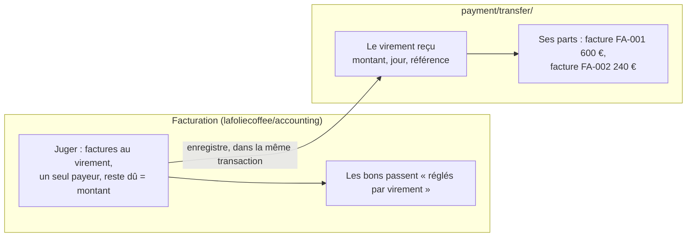

# Plan — le virement reçu rejoint `payment`

> 📐 **Plan**, écrit le 2026-11-22 à la demande de Hugo (« attaque la
> relecture et le plan du virement »). Lot D1 de l'analyse
> [`prelevement-et-virement-dans-payment.md`](prelevement-et-virement-dans-payment.md)
> (§3.2), qui le fondait de mémoire : ce plan la vérifie contre le code et la
> corrige (§1). Argent et migration de données : contredit par `vitruve`
> avant Hugo.
>
> ✅ **Bâti le 2026-11-22** (non commité à l'écriture de cette ligne). La doc
> d'état est [`le-paiement-par-virement.md`](../comptabilite/le-paiement-par-virement.md),
> § 5 ; le déploiement est au runbook (« Déployer le virement reçu dans
> `payment` »). Ce que le bâti a tranché là où le plan se taisait :
>
> - **la fenêtre du contrôle** (§3.6 dit « depuis le dernier passage », sans
>   dire où le passage se garde) : aucune table de curseur ; le contrôle
>   relit les **trois dernières nuits** à l'horloge
>   (`CONSISTENCY_LOOKBACK_MS`), une nuit manquée est rattrapée, un écart déjà
>   sonné ne sonne pas deux fois (clé de la cloche) ;
> - **la cloche** n'a pas d'audience : le fil partagé, comme les autres
>   cloches de la facturation ;
> - un index de plus, `transfer_received_recorded_at_idx`, pour la lecture
>   `recordedSince` ;
> - la clé de `allocationsOf` est `paymentSubjectKey` (`type/id`), pas l'id
>   seul.

# Partie 1 — L'explication simple

Aujourd'hui, quand un client paie ses factures par virement, le staff lit le
relevé de la banque et saisit le virement au back-office : le montant, le
jour, la référence, et les factures qu'il règle. Tout cela vit dans la
**facturation** — l'argent reçu comme les factures.

Après ce lot, le **virement reçu** (« 840 € reçus le 3 décembre, référence
FA-001 ») vit dans le bloc **`payment`**, et la facturation garde ce qui est
à elle : **quelles factures** ce virement règle, et la règle qui le juge (un
seul payeur, le reste dû égal au montant).



**Rien ne change à l'écran ni pour le client.** Le geste « Virement reçu »,
son aperçu et ses refus restent les mêmes ; seules les tables déménagent, par
renommage, sans copie.

**Ce que ça prépare** : la lecture automatique des relevés bancaires (le bloc
constatera lui-même les virements), et le prélèvement, qui viendra au même
endroit avec le même modèle « un mouvement, plusieurs parts ».

# Partie 2 — La technique

## 1. Ce qui existe (ouvert le 2026-11-22)

### 1.1 Les tables (`prisma/schema/public/bank-transfer.prisma`)

- `public.received_bank_transfer` : `id`, `legal_entity_id` (**FK** vers
  `legal_entities`), `payer_company_id` (opaque), `amount_cents` (`CHECK > 0`),
  `received_on` (date), `reference` (`CHECK` non vide), `recorded_at`,
  `recorded_by_staff_id`. Index `(legal_entity_id, payer_company_id)`.
- `public.received_bank_transfer_invoice` : `transfer_id` (FK), `invoice_id`
  (**FK** vers `invoice`, **unique** : une facture n'est réglée que par un
  virement), `amount_cents` (`CHECK > 0`).
- Les deux sont en **ajout seul** : déclencheur
  `received_bank_transfer_append_only` (fonction `public.`), migration
  `20261112170100_le_virement_recu`, retour arrière dans `prisma/rollback/`.
- `public.order_collection.bank_transfer_id` : **FK** vers le virement, et
  `CHECK order_collection_settled_by_transfer_cites_it` (posé ⇔
  `state = 'settled_by_transfer'`).

### 1.2 Le code (`apps/lfd-api/src/lafoliecoffee/accounting/`)

- **Agrégat** `ReceivedBankTransfer` (`domain/entities/received-bank-transfer.ts`) :
  `record()` juge tout — forme de la saisie (montant, jour pas dans le futur,
  référence ≤ 140), factures de l'entité, au virement (code BG-16
  `SEPA_CREDIT_TRANSFER`), pas d'avoir, pas déjà réglées, **un seul payeur**,
  **reste dû total = montant au centime**. `previewBankTransfer` partage le
  même jugement.
- **Saisie** `record-bank-transfer.handler.ts` : une intention scellée ; une
  transaction qui verrouille les bons (`OrderInvoicingLock`, ordre des ids),
  lit les factures, construit l'agrégat, règle chaque bon
  (`OrderCollection.settleByTransfer`), `ReceivedBankTransferRepository.add`,
  publie `BankTransferReceivedEvent` (journal, sujet : le payeur).
- **Lecteurs Prisma** qui traversent vers les tables du virement :
  - `prisma-received-bank-transfer.repository.ts` (écriture) ;
  - `prisma-transfer-invoices.reader.ts` : relation `invoice.bankTransfer`
    pour `settledByTransferId` ;
  - `prisma-invoice-settlement-facts.reader.ts` :
    `receivedBankTransferInvoice.findMany` → `transfer.receivedOn` ;
  - `prisma-invoice-transfer-settlement.reader.ts` : idem, une facture.
- **Routes** (`http/admin-bank-transfers.controller.ts`) : `POST
legal-entities/:id/bank-transfers`, `GET …/bank-transfers/preview`,
  `GET transfer-invoices/unpaid`.
- Aucun lecteur ne lit `payer_company_id` en base ; le fait de journal le
  prend de l'agrégat en mémoire.

### 1.3 Ce que l'analyse disait de faux ou d'incomplet

- Elle ne nommait pas les **trois clés étrangères** qui traversent (vers
  `invoice`, vers `legal_entities`, depuis `order_collection`). Dans le
  schéma `payment`, aucune ne peut rester (§3 du `CLAUDE.md` : une référence
  croisée est un identifiant opaque, jamais une jointure).
- Elle ne nommait pas les **trois lecteurs** de la facturation qui suivent
  des relations Prisma vers ces tables : ils doivent passer par une lecture
  publiée du bloc.
- Elle proposait un lot **D0** (le modèle « mouvement → parts » d'abord pour
  la carte). **Retiré** : un paiement par carte est déjà un mouvement à une
  part, et le réécrire n'apporte rien. Le modèle vit dans le canal pour le
  virement ; le prélèvement le reprendra.

## 2. Le partage

| Reste en facturation (le métier)                                                          | Rejoint `payment/transfer/` (la mécanique)                                                          |
| ----------------------------------------------------------------------------------------- | --------------------------------------------------------------------------------------------------- |
| juger les factures : au virement, de l'entité, non réglées, un payeur, reste dû = montant | le virement : montant, jour, référence, qui l'a saisi, sur quel compte il est arrivé                |
| l'aperçu (`previewBankTransfer`)                                                          | ses **parts** : un sujet opaque (`invoice`, id) et un montant chacune                               |
| régler les bons (`OrderCollection.settleByTransfer`)                                      | ses invariants : parts > 0, somme des parts = montant, un sujet n'est réglé qu'une fois, ajout seul |
| le fait de journal `bank_transfer.received` (sujet : le payeur)                           | la lecture publiée « ces sujets sont-ils réglés par virement, et quel jour ? »                      |
| les routes et l'écran                                                                     | —                                                                                                   |

**Le geste reste un geste de la facturation.** Elle juge, puis appelle le
bloc **dans sa transaction** (aucun réseau) pour enregistrer le virement et
ses parts. Le bloc ne rappelle pas la facturation : il n'y a rien à
confirmer de l'extérieur, contrairement à la carte (pas de webhook).

## 3. Le bloc

### 3.1 Le canal — payment/channels/requests/bank-transfers.ts (à créer)

```ts
/** Un mouvement d'argent reçu par virement et sa répartition sur des sujets. */
export abstract class BankTransfers {
  /** Dans la transaction de l'appelant. Refuse une répartition fausse. */
  abstract record(transfer: TransferToRecord): Promise<void>;
  /** Par lot : pour chaque sujet réglé par virement, le virement et son jour. */
  abstract allocationsOf(
    subjects: readonly CardSubject[],
  ): Promise<ReadonlyMap<string, TransferAllocationView>>;
}
```

`TransferToRecord` : `id`, `receivedInto` (opaque : l'entité qui reçoit),
`payerRef` (opaque : le payeur déclaré par l'appelant), `amountCents`,
`receivedOn` (`AAAA-MM-JJ`), `reference`, `recordedAt`, `recordedBy`, et
`parts: { subject: { type, id }, amountCents }[]`.

Le type de sujet est celui du port des sujets existant (`CardSubject` sera
renommé `PaymentSubject` au lot W s'il y a lieu ; le plan ne le renomme pas).

### 3.2 Le domaine — `payment/transfer/domain/`

Agrégat `ReceivedTransfer.record(input)` : montant > 0, jour bien formé,
référence non vide ≤ 140, au moins une part, chaque part > 0, pas deux fois
le même sujet, **somme des parts = montant** (le comportement d'aujourd'hui ;
la lecture automatique des relevés demandera un jour un virement reçu non
encore réparti — elle desserrera cette règle par un état explicite, pas par
défaut). Port `ReceivedTransferRepository.add` (ajout seul) et lecteur
`TransferAllocationsReader`. Adaptateurs Prisma dans
`payment/transfer/infrastructure/`. Erreurs dans `payment/transfer/domain/errors/`.

La facturation garde ses propres refus, plus précis (le nom de la facture,
le payeur) : le bloc ne refuse que ce qui contredit sa propre règle, et ne
le fera jamais avant elle tant que la facturation juge la même somme.

### 3.3 Les tables — migration `20261122180000_le_virement_recu_dans_payment`

Par **renommage**, jamais par copie (la règle du lot V) :

```sql
ALTER TABLE public.received_bank_transfer SET SCHEMA payment;
ALTER TABLE payment.received_bank_transfer RENAME TO transfer_received;
ALTER TABLE payment.transfer_received RENAME COLUMN legal_entity_id TO received_into;
ALTER TABLE payment.transfer_received RENAME COLUMN payer_company_id TO payer_ref;

ALTER TABLE public.received_bank_transfer_invoice SET SCHEMA payment;
ALTER TABLE payment.received_bank_transfer_invoice RENAME TO transfer_allocation;
ALTER TABLE payment.transfer_allocation RENAME COLUMN invoice_id TO subject_id;
ALTER TABLE payment.transfer_allocation ADD COLUMN subject_type TEXT NOT NULL DEFAULT 'invoice';
ALTER TABLE payment.transfer_allocation ALTER COLUMN subject_type DROP DEFAULT;
-- unique (subject_type, subject_id) à la place de l'unique sur invoice_id
```

- **Clés étrangères retirées** : `…_legal_entity_id_fkey`,
  `…_invoice_invoice_id_fkey`, `order_collection_bank_transfer_id_fkey`. La
  colonne `order_collection.bank_transfer_id` **reste**, opaque, avec son
  `CHECK` (posée ⇔ réglée par virement) : la facturation garde la trace.
  Ce qu'on perd : la base ne refuse plus un `bank_transfer_id` ou un
  `subject_id` inconnu ; ce qui le tient désormais : la même transaction
  écrit les deux côtés (le bloc puis les bons), et l'agrégat de la
  facturation ne pose un `bank_transfer_id` que reçu de l'agrégat du virement.
- La FK interne `transfer_allocation.transfer_id → transfer_received` reste
  (même schéma, même bloc).
- Les **contraintes et index** suivent la table ; ils sont renommés au
  vocabulaire neuf (`transfer_received_amount`…), comme au lot V.
- L'**ajout seul** : la fonction est recréée dans `payment`
  (`payment.transfer_append_only`), les deux déclencheurs y sont rebranchés,
  l'ancienne fonction `public.` supprimée.
- prisma/schema/payment/transfer.prisma (à créer) : les deux modèles, `@@schema("payment")` ;
  leurs relations vers `Invoice`, `LegalEntity` et `OrderCollection` sortent
  des modèles de la facturation.
- **Retour arrière** : prisma/rollback/20261122180000_le_virement_recu_dans_payment.sql (à créer),
  l'inverse exact, valable tant qu'aucun sujet autre que `invoice` n'a été
  écrit.

### 3.4 La facturation, après

- `RecordBankTransferHandler` : même jugement par l'agrégat
  `ReceivedBankTransfer` (qui reste, renommé ou non, comme **jugement** de la
  facturation et non plus comme ligne écrite), puis `BankTransfers.record`
  au lieu de `ReceivedBankTransferRepository.add`, toujours avant les bons.
  Le port et l'adaptateur `ReceivedBankTransferRepository` sont retirés.
- Les trois lecteurs passent par `BankTransfers.allocationsOf` (une lecture
  par lot, la même requête qu'avant sur la table) :
  `settledByTransferId` et `transferReceivedOn` s'en déduisent. Plus aucune
  relation Prisma de la facturation vers le virement.
- Le fait de journal `bank_transfer.received` ne change pas.

### 3.6 Le contrôle de cohérence (décision de Hugo du 2026-11-22)

Ce qui remplace les clés étrangères, comme dans un service de paiement à
part : une comparaison régulière des deux côtés, qui alerte.

- **Chaque nuit**, sur le cron de nuit du Worker, une route machine de la
  facturation (`RecomputeGuard`) : pour ses bons `settled_by_transfer`, elle
  demande au bloc (`BankTransfers.allocationsOf`, par lots) si le virement
  cité existe et règle bien la facture du bon ; pour les virements que le
  bloc a enregistrés depuis le dernier passage (lecture publiée
  `BankTransfers.recordedSince`), elle vérifie que chaque facture citée
  existe et que ses bons sont réglés par ce virement.
- **Un écart** : une ligne au journal technique et **la cloche** du
  back-office (comptabilité), qui nomme le virement, la facture et l'écart.
  Rien n'est corrigé tout seul : un écart d'argent se regarde.
- En régime normal, aucun écart : la requête ne lit que ce qui a bougé
  depuis le dernier passage (curseur sur `recorded_at`), plus les bons
  réglés le même jour.
- C'est la première pièce du rapprochement de la feuille de route
  ([`feuille-de-route.md`](feuille-de-route.md), §3) : le jour où les relevés
  arriveront tout seuls, la même mécanique comparera aussi la banque.

### 3.5 Les portes

- `lint:prisma-model-ownership` : les deux modèles appartiennent à
  `payment/transfer/` ; la facturation ne les lit plus.
- `lint:cross-schema-join` et `lint:context-boundaries` : la facturation
  atteint le virement par `payment/channels/` seulement.
- `lint:prisma-schema-layout` : transfer.prisma sous `payment/`.
- `lint:network-outside-transaction` : rien de réseau.
- `lint:rgpd-staff` : `recorded_by_staff_id` déménage, le registre suit.

## 4. Le déploiement

Un seul déploiement (pré-release, décision de Hugo du 2026-10-04 : un
contrat peut se casser dans le même déploiement). Comme au lot V, la
migration renomme avant que la nouvelle image démarre : pendant la fenêtre,
l'ancienne image ne trouverait plus `public.received_bank_transfer`. Seul
le geste « Virement reçu » et les vues de facture qui lisent le jour de
règlement en souffriraient, quelques minutes. **Ne pas saisir de virement
pendant le déploiement** : une ligne au runbook.

Avant : compter les lignes en production (Hugo)

```sql
SELECT count(*) FROM public.received_bank_transfer;
SELECT count(*) FROM public.received_bank_transfer_invoice;
```

Après : les mêmes comptes sur `payment.transfer_received` et
`payment.transfer_allocation`, et une facture réglée par virement qui
s'affiche toujours « réglée le … ».

## 5. Tests

- domaine `ReceivedTransfer` : chaque refus, la somme des parts ;
- application facturation : la saisie appelle `BankTransfers.record` avec
  les parts dans l'ordre saisi, avant les bons ; un refus du bloc annule
  tout ;
- e2e existants `bank-transfer-received`, `bank-transfer-reads`,
  `intent-key-content` (virement) : verts sans changer leurs attentes ;
- e2e neuf : la base refuse une mise à jour d'un virement déménagé (ajout
  seul tenu après le renommage) ;
- les migrations rejouées sur la base de test, puis le retour arrière.

## 6. Ce que le plan ne fait pas

- Le compte créancier, le prélèvement, les mandats (D2 à D4).
- La lecture automatique des relevés.
- Un fait durable `transfer.received` : personne ne l'écouterait ; il
  viendra avec le premier abonné.
- Renommer l'agrégat de jugement de la facturation : il garde son nom tant
  qu'il ne trompe pas.

## 7. Ce que `vitruve` a contredit (2026-11-22), et les décisions

**Fait établi** : Hugo a compté **0** virement reçu en production le
2026-11-22. La migration ne déplace aucune donnée réelle.

| #   | Objection                                                                                                                                                                                                | Décision                                                                                                                                                                                                                                                                                                                                                                                                                                                                                                                   |
| --- | -------------------------------------------------------------------------------------------------------------------------------------------------------------------------------------------------------- | -------------------------------------------------------------------------------------------------------------------------------------------------------------------------------------------------------------------------------------------------------------------------------------------------------------------------------------------------------------------------------------------------------------------------------------------------------------------------------------------------------------------------- |
| 1   | BLOQUANT — un **quatrième lecteur** oublié : `prisma-unpaid-transfer-invoices.reader.ts` fait une anti-jointure `bankTransfer: null` que le canal ne sait pas servir sans « tout charger puis filtrer »  | **La facturation lit sa propre trace.** Elle sait déjà quelle facture elle a réglée : ses bons portent `order_collection.bank_transfer_id` (état `settled_by_transfer`). « À régler » et `settledByTransferId` se lisent sur cette trace, dans le schéma `public`, en une requête (SQL écrit à la main si la relation Prisma `invoice → bons` n'existe pas). Seul le **jour de réception** se lit au bloc, par lot d'identifiants (`allocationsOf`)                                                                        |
| 2   | BLOQUANT — les e2e lisent les modèles renommés                                                                                                                                                           | ils sont **réécrits** : `bank-transfer-received` (l. 63, 64, 101, 119), `bank-transfer-reads` (l. 52), `intent-key-content` (l. 101, 112), plus `bank-transfer-doubles.ts` et `bank-transfer.providers.ts`. Leurs attentes métier ne changent pas                                                                                                                                                                                                                                                                          |
| 3   | BLOQUANT — le SQL du §3.3 est incomplet                                                                                                                                                                  | le `migration.sql` écrit **tout** : `DROP INDEX received_bank_transfer_invoice_invoice_id_key`, la clé primaire `(transfer_id, subject_type, subject_id)`, l'unique `(subject_type, subject_id)`, chaque contrainte et index renommés aux noms que Prisma attend, `DROP TRIGGER` ×2 avant `DROP FUNCTION public.received_bank_transfer_append_only`. Le lot V n'est pas un précédent (aucune FK n'y traversait) : cette migration est relue par `lecteur-de-migrations` et `prisma migrate diff` doit être vide après elle |
| 4   | SÉRIEUX — trois refus en base disparaissent (FK)                                                                                                                                                         | **Tranché par Hugo le 2026-11-22 : « le pro »** — aucune clé entre les blocs, comme un service de paiement à part ; la cohérence tient par (a) le même identifiant écrit des deux côtés par un seul geste (n° 8), (b) l'ajout seul des deux côtés, (c) **un contrôle de cohérence** (§3.6) qui compare chaque nuit les deux côtés et sonne au premier écart. `CHECK subject_type IN ('invoice')`                                                                                                                           |
| 5   | SÉRIEUX — le retour arrière remet des FK qui peuvent échouer                                                                                                                                             | le fichier de retour arrière porte d'abord les **requêtes d'orphelins** (aucune ligne attendue), puis les FK. Avec 0 ligne aujourd'hui, le risque ne naît qu'avec les premières saisies                                                                                                                                                                                                                                                                                                                                    |
| 6   | SÉRIEUX — `CardSubject` est le type du port de la carte                                                                                                                                                  | le canal reçoit un type à lui, **`PaymentSubject`** (`{ type, id }`), dans `payment/channels/subjects/` ; `CardSubject` n'est pas touché. `CHECK subject_type IN ('invoice')`                                                                                                                                                                                                                                                                                                                                              |
| 7   | SÉRIEUX — « somme des parts = montant » et la référence ≤ 140 jugées deux fois                                                                                                                           | **défense en profondeur, nommée** : la facturation juge en premier avec ses mots ; le bloc refuse ce qui contredirait sa propre règle. Un test d'application vérifie que la saisie qui passe le jugement de la facturation passe le bloc                                                                                                                                                                                                                                                                                   |
| 8   | SÉRIEUX — l'identifiant du virement, seul lien restant                                                                                                                                                   | il est tiré **une fois** par la saisie et passé aux deux (`BankTransfers.record` et `settleByTransfer`) ; un test le vérifie                                                                                                                                                                                                                                                                                                                                                                                               |
| 9   | SÉRIEUX — la fenêtre de déploiement casse plus que le geste                                                                                                                                              | pendant la fenêtre, l'ancienne image rend 500 sur `POST admin/accounting/legal-entities/:id/bank-transfers`, `GET …/bank-transfers/preview`, `GET admin/accounting/transfer-invoices/unpaid`, et sur les vues de facture qui lisent le jour de règlement. Une ligne de runbook les nomme ; avec 0 virement, l'écran est encore inutilisé                                                                                                                                                                                   |
| —   | MINEURS — relations Prisma à retirer (`LegalEntity.receivedBankTransfers`, `Invoice.bankTransfer`, `OrderCollection.bankTransfer`), registre RGPD (`recorded_by_staff_id` → `payment.transfer_received`) | intégrés au lot                                                                                                                                                                                                                                                                                                                                                                                                                                                                                                            |

## 8. Questions ouvertes

| Question                                                                                                                   | À qui |
| -------------------------------------------------------------------------------------------------------------------------- | ----- |
| Accepter que la base ne refuse plus un identifiant de virement, de facture ou d'entité inconnu entre les deux blocs (n° 4) | Hugo  |
