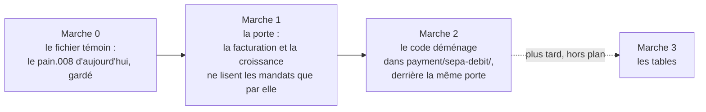

# Plan — les mandats SEPA rejoignent `payment` (marches 0 à 2)

> 📐 **Plan**, écrit le 2026-11-22 à la demande de Hugo (« fais un plan, en
> lisant le code »). Il couvre les **marches 0 à 2** du déménagement des
> mandats (lot D3 de
> [`prelevement-et-virement-dans-payment.md`](prelevement-et-virement-dans-payment.md)) :
> le **code** déménage, **les tables ne bougent pas**. La marche 3 (les
> tables) et D4 (les lots, le `pain.008`) sont hors de ce plan. Argent et
> frontière : contredit par `vitruve` avant Hugo. **Rien n'est décidé ni
> planifié dans le temps** : Hugo a demandé le plan, pas le bâti.

# Partie 1 — L'explication simple

Le prélèvement SEPA a deux moitiés :

- **les mandats** — l'autorisation signée par le client de prélever son
  compte, avec son IBAN (scellé) et sa référence unique (RUM) ;
- **les lots** — ce qu'on prélève chaque mois, et le fichier `pain.008`
  envoyé à la banque.

Les deux vivent dans le commerce. Ce plan ne déplace **que le code des
mandats**, en trois marches où **aucune donnée ne bouge** :

**Ce qui protège le prélèvement** : avant de commencer, on enregistre le
fichier `pain.008` que le système produit aujourd'hui pour un lot de test.
Après chaque marche, la CI refait le même lot et **refuse la marche si un
seul octet du fichier change** (hors date de création). Une marche qui ne
touche que des branchements ne peut pas passer en changeant ce que la banque
reçoit.

**Le risque restant**, dit franchement : une erreur de branchement qui
ferait échouer un geste du staff (signer, révoquer, envoyer un mandat) sans
changer le fichier. Les e2e existants des mandats la verraient ; la CI les
lance tous.

# Partie 2 — La technique

## 1. Ce qui existe (ouvert le 2026-11-22)

### 1.1 Le contexte

`apps/lfd-api/src/lafoliecoffee/payments/` : environ 9 700 lignes hors
tests, dont les **demandes de paiement libres** (`free-charge/`,
`payment-link*`, à ne pas déplacer) et, pour le reste, **les mandats et le
compte du débiteur** : agrégats `PaymentMandate` (`domain/entities/payment-mandate.ts`,
404 lignes) et `CompanyBankAccount` ; les gestes frapper, signer, envoyer,
révoquer, joindre une preuve, régler les options ; le document du mandat ;
les contrôleurs `admin-mandates`, `company-mandate`, `admin-company-bank-account`,
`company-bank-account` ; les réglages de comptabilité (`accounting-settings`,
qui portent aussi le plafond des liens libres).

### 1.2 Ce que les mandats prennent à la facturation

Imports de `lafoliecoffee/payments` vers `lafoliecoffee/accounting`
(décomptés le 2026-11-22, hors tests) :

| Symbole                                   | Nature                                                           | Où il doit aller                                                                                                                                                              |
| ----------------------------------------- | ---------------------------------------------------------------- | ----------------------------------------------------------------------------------------------------------------------------------------------------------------------------- |
| `Iban`, `Bic`, `InvalidIbanError`         | objets-valeurs bancaires                                         | **`payment`** : ce sont des formes bancaires ; la facturation les importera par le canal                                                                                      |
| `Rum`, `SepaScheme`, `MandatePaymentType` | objets-valeurs du mandat                                         | **`payment`**                                                                                                                                                                 |
| `LegalAddress`                            | adresse légale                                                   | reste à la facturation (identité) ; le mandat reçoit une adresse par un type du canal                                                                                         |
| `CreditorReader`, `CreditorSnapshot`      | le créancier : IBAN, ICS, nom de l'entité                        | **reste avec l'entité** (décision de Hugo du 2026-11-22) : `payment` **déclare** le port, la facturation l'implémente (`prisma-creditor.reader.ts`), `appBootstrap` les relie |
| `LegalEntityLogoReader`, `readEntityLogo` | le logo imprimé sur le document du mandat                        | idem : port déclaré par `payment`, implémenté par la facturation                                                                                                              |
| `FirstMandateLedger`                      | « ce mandat a-t-il déjà été prélevé ? » (séquence `FRST`/`RCUR`) | port déclaré par `payment`, implémenté par la facturation (`prisma-first-mandate-ledger.ts`), qui tient les lots                                                              |
| `printOptionalZones`, `bankExportBicOf`   | services de mise en forme                                        | à trier à la lecture : ils suivent l'objet-valeur qu'ils servent                                                                                                              |
| `NoIssuerError`                           | erreur de la facturation                                         | remplacée par une erreur du bloc                                                                                                                                              |
| `AccountingModule`                        | import de module Nest                                            | disparaît : les ports se relient dans `appBootstrap`                                                                                                                          |

### 1.3 Ce que la facturation et la croissance prennent aux mandats

- **Quatre ports déclarés par la facturation, implémentés par les mandats**,
  reliés dans `appBootstrap/` (`debtor-mandate.module.ts`,
  `issued-mandates.module.ts`…) : `DebtorMandateReader`,
  `MandatesForBankExportReader`, `AccountsForBankExportReader`,
  `IssuedMandatesReader`. **La forme est déjà celle d'un canal**, mais à
  l'envers : c'est le lecteur qui déclare. Dans `payment`, c'est le bloc qui
  publie ses lectures (« le propriétaire parle de ce qui est à lui », §3 du
  `CLAUDE.md`).
- **Une lecture Prisma directe hors du propriétaire** :
  `lafoliecoffee/growth/infrastructure/sales-sheet-steps.batch.ts:51-52` lit
  `companyBankAccount` et `paymentMandate`. Aujourd'hui aucune porte ne la
  voit (même bloc). Dans `payment`, `lint:prisma-model-ownership` la
  refuserait : elle passe par une lecture publiée.
- `appBootstrap/site-mandate-revocation.module.ts`, `card-payment-feed.module.ts`,
  `pay-link-feed.module.ts` et trois semis de `dev/` importent le contexte.

### 1.4 Le chiffrement des IBAN — vérifié, pas de piège

`AesGcmFieldCipher` (`platform/crypto/aes-gcm-field-cipher.ts`) chiffre avec
la clé globale `FIELD_ENCRYPTION_KEY`, sans donnée associée (`setAAD`
n'apparaît pas) : le scellé ne dépend ni de la table ni de la colonne.
Déplacer le code — et plus tard les tables — ne rend aucun IBAN illisible.

### 1.5 Les tests qui produisent un `pain.008`

Le document est éprouvé **par morceaux** : `pain008.spec.ts`,
`pain008-xsd.spec.ts` (validation au schéma), `pain008-audit.spec.ts`,
`pain008-document-bounds.spec.ts`, et les e2e du prélèvement d'essai
(`collection-test-generate`, `collection-test-file`). **Aucun fichier
témoin** d'un lot complet n'existe. Le dépôt a le modèle à copier :
`test/pricing-golden-master*.ts` et son `pricing-golden-master.snapshot.json`.

## 2. Les marches

### Marche 0 — le fichier témoin (avant tout le reste)

- Un e2e `test/collection-golden-master.e2e-spec.ts` : il sème par les
  **vrais handlers** un créancier confirmé, trois clients (un `FRST`, un
  `RCUR`, un sous-compte rattaché au mandat du principal), leurs mandats
  signés, des factures au prélèvement ; il constitue un lot par le geste
  réel ; il capte le XML `pain.008` et le normalise (date de création,
  identifiants tirés au hasard remplacés par des jetons stables).
- Le XML normalisé est rangé dans `test/collection-golden-master.snapshot.xml`
  et comparé **au caractère près**. Un changement du fichier exige de
  réécrire le témoin dans un commit à part, qui le dit.
- Le même e2e capte aussi les **exports bancaires** (comptes et mandats) et
  le document PDF d'un mandat (texte extrait), pour que la marche 2 ne puisse
  pas changer ce que le client signe.
- **Livrée seule**, sans rien toucher d'autre : elle doit être verte sur le
  code d'aujourd'hui.

### Marche 1 — la porte, sans déplacer le code

Le code des mandats reste dans `lafoliecoffee/payments/`. On change **qui
déclare quoi** :

1. Les objets-valeurs bancaires et du mandat (`Iban`, `Bic`, `Rum`,
   `SepaScheme`, `MandatePaymentType` et leurs erreurs) passent dans
   `payment/sepa-debit/domain/value-objects/`, exportés par
   `payment/channels/`. La facturation et les mandats les importent de là.
   Le code est **déplacé tel quel**, sans un caractère changé hors imports.
2. `payment/channels/` **déclare** les ports dont les mandats ont besoin
   (`CreditorReader`, `LegalEntityLogoReader`, `FirstMandateLedger`) ; la
   facturation garde ses implémentations, reliées dans `appBootstrap/`.
3. Les quatre lecteurs aujourd'hui déclarés par la facturation deviennent
   des **lectures publiées** de `payment/channels/` ; leurs implémentations
   restent où elles sont jusqu'à la marche 2.
4. La croissance lit par une lecture publiée au lieu de Prisma.
5. Les mandats n'importent plus rien de l'intérieur de la facturation, ni
   `AccountingModule`.

À la fin : le fichier témoin est identique, et une **porte** (la carte des
sous-contextes du commerce, ou une entrée de `context-boundaries`) refuse
tout nouvel import de l'intérieur de la facturation depuis les mandats.

### Marche 2 — le code déménage

1. Le code des mandats et du compte du débiteur passe de
   `lafoliecoffee/payments/` à `payment/sepa-debit/`, par `git mv`, imports
   seulement. Les demandes de paiement libres et les réglages de
   comptabilité **restent**.
2. Les contrôleurs : leurs routes ne changent pas (`admin/…/mandate`,
   `companies/…/mandate`) — un contrat servi ne bouge pas pour un
   déménagement de dossier.
3. `lint:prisma-model-ownership` : les modèles `PaymentMandate` et
   `CompanyBankAccount` appartiennent désormais à `payment/sepa-debit/`.
4. Les tables restent dans `public`, avec leurs clés étrangères vers
   `companies` et `legal_entities` : la marche 3 les traitera.
5. À la fin : fichier témoin identique, e2e des mandats verts.

## 3. Ce qui reste à trier à la lecture du bâti

- Le droit d'accès des écrans (`StaffResource` des mandats) : il ne change
  pas de nom (une valeur écrite ne se renomme pas).
- Les faits de journal des mandats (`payment_mandate.*`) : valeurs écrites,
  inchangées.
- Les cloches (`mandate-staff-bell.ts`) : elles suivent le code.
- Les e-mails envoyés par les mandats : le bloc `payment` a déjà droit au
  canal `mail/channels/` (matrice du `CLAUDE.md`).
- Les droits RGPD (`rgpd-registre.json`) : les colonnes ne bougent pas, la
  « finalité » peut citer le nouveau dossier.

## 4. Le déploiement

Chaque marche est **un déploiement à part**, sans migration. Fenêtre :
juste **après** un dépôt de lot à la banque, loin du suivant, jamais pendant
qu'un lot attend son échéance. Après chaque déploiement, Hugo vérifie :
ouvrir un mandat au back-office, son document, et la liste des mandats à
exporter.

## 5. Questions ouvertes

| Question                                                                                                                                                                         | À qui              |
| -------------------------------------------------------------------------------------------------------------------------------------------------------------------------------- | ------------------ |
| Le calendrier : maintenant, ou quand une deuxième application prélèvera ?                                                                                                        | Hugo               |
| Les réglages de comptabilité (`accounting-settings`) : ils portent le plafond des liens libres et des réglages de prélèvement ; les couper en deux à la marche 2, ou plus tard ? | à trancher au bâti |
