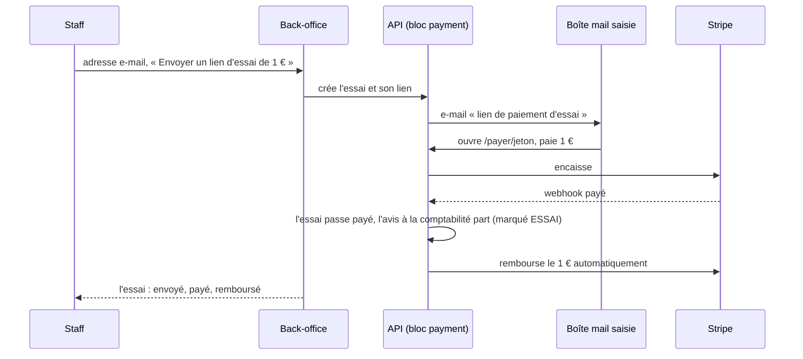

# Plan — le lien de paiement d'essai

> ✅ **Bâti le 2026-11-24** (côté serveur ; l'écran est bâti à part). Doc
> d'état : [`les-liens-de-paiement.md`](les-liens-de-paiement.md), § 4 bis.

> 📐 **Plan**, écrit le 2026-11-24 à la demande de Hugo : « comme on a fait
> test prélèvement, j'ai besoin d'une page test lien de paiement, où je peux
> mettre une adresse mail libre, montant 1 euro ». Argent réel (1 € encaissé
> par Stripe en production) : contredit par `vitruve` avant Hugo. Rien n'est
> bâti.

# Partie 1 — L'explication simple

Le pendant du prélèvement d'essai, pour la carte : une page du back-office
où l'on saisit **une adresse e-mail**, et qui **envoie un vrai lien de
paiement de 1 €** à cette adresse. On l'ouvre, on paie avec une vraie
carte, et on vérifie tout le parcours en production :

Ce que l'essai éprouve, de bout en bout : la page `/payer/…`, le formulaire
de carte, le webhook, l'avis à la comptabilité et ses destinataires, le
remboursement. Ce qu'il **ne** touche pas : aucune commande, aucune facture,
aucune société, aucun chiffre d'affaires.

Le 1 € est **remboursé tout seul** dès qu'il est encaissé. Le coût réel est
la commission Stripe, qu'un remboursement ne rend pas (quelques centimes).

# Partie 2 — La technique

## 1. Ce qui existe (ouvert le 2026-11-24)

- Le **prélèvement d'essai** : écran `comptabilite/prelevement-d-essai`
  (`apps/lfd-backoffice-frontend/src/app/comptabilite/comptabilite.routes.ts:110-122`),
  sous son droit à lui `collection_test:read` / `collection_test:write`,
  commandes `generate-collection-test` et `mark-collection-test-refunded`
  dans `lafoliecoffee/accounting`.
- Les **liens vers un sujet** : un sujet s'inscrit en implémentant
  `LinkableSubject` (« combien, pour qui ? ») et `SubjectSettlement` (« ce
  qu'un paiement règle »), reliés dans `appBootstrap/pay-link-feed.module.ts`
  et `card-payment-feed.module.ts` ; aujourd'hui `free_charge` (et `order`
  pour la carte). Doc : [`les-liens-de-paiement.md`](les-liens-de-paiement.md).
- L'**avis à la comptabilité** part après chaque paiement encaissé par un
  lien (`payment/link/application/link-payment-mail-notice.ts`).
- Le **remboursement** par carte passe par la demande de remboursement du
  bloc (`payment/card/`, doc [`le-bloc-payment.md`](le-bloc-payment.md)).

## 2. Où vit l'essai : dans le bloc `payment`, pas dans une application

L'essai éprouve **la mécanique du bloc**, pas un métier : il n'a ni société,
ni facture, ni commande. Le placer dans le commerce lui donnerait un
propriétaire qui n'en sait rien, et une deuxième application devrait le
refaire. Il vit donc dans **`payment/link/test/`**, et le bloc implémente
lui-même le sujet `payment_test` (`LinkableSubject` et `SubjectSettlement`).
C'est la seule exception à « le bloc ne connaît que des sujets opaques » :
ce sujet-là est **à lui**, parce qu'il n'est rien d'autre qu'un essai du
bloc.

## 3. Le modèle

Table `payment.pay_link_test` (migration additive) :

| Colonne                             | Contenu                                                                                         |
| ----------------------------------- | ----------------------------------------------------------------------------------------------- |
| `id`                                | ULID                                                                                            |
| `amount_cents`                      | toujours `100` — `CHECK amount_cents = 100` : l'essai ne peut pas devenir un encaissement libre |
| `state`                             | `sent` → `paid` → `refunded` ; `refund_failed` ; `expired`                                      |
| `created_at`, `created_by_staff_id` | l'auteur                                                                                        |
| `paid_at`, `refunded_at`            | les instants                                                                                    |

**L'adresse e-mail n'est pas rangée dans la table.** Elle est passée à la
demande d'e-mail et n'existe ensuite que dans le suivi du bloc `mail` (qui
a sa durée de conservation). L'écran montre l'essai sans l'adresse.

Le lien est un `payment.pay_link` ordinaire, sujet `payment_test`,
origine d'essai au registre des origines (libellé « Essai La Folie
Coffee »), compte de carte `lfc-stripe`.

## 4. Les gestes

- **Envoyer un lien d'essai** (`POST admin/payment/link-tests`, droit
  `pay_link_test:write`, clé d'intention de l'écran) : adresse e-mail
  (validée par le value object d'adresse existant). Dans une transaction :
  l'essai `sent`, `PayLinks.open` du sujet `payment_test`, `mail.send` du
  modèle « lien de paiement d'essai » (nouveau, dans le bloc `mail`). Rend
  l'identifiant et l'adresse `/payer/…`, que l'écran affiche aussi (copier).
- **Le paiement** : `onPaid` du sujet passe l'essai à `paid` et **demande
  le remboursement intégral** par le port de remboursement du bloc, dans la
  même transaction. L'avis à la comptabilité part comme pour tout lien, avec
  « ESSAI » dans l'objet et le libellé.
- **L'issue du remboursement** : `onRefundOutcome` passe l'essai à
  `refunded` ou `refund_failed` (la cloche sonne : un euro est resté
  encaissé).
- **Lister** (`GET admin/payment/link-tests`, droit `pay_link_test:read`) :
  les essais, leur état, leurs instants, l'auteur.
- **Plafond** : au plus **5 essais par jour** (un essai coûte une commission
  Stripe) ; au-delà, un refus qui le dit.

## 5. Le back-office

Comptabilité › **Lien de paiement d'essai** (à côté du prélèvement d'essai),
garde `pay_link_test:read` : un champ adresse e-mail, le bouton « Envoyer un
lien d'essai de 1 € », puis la liste des essais (envoyé, payé, remboursé,
remboursement échoué) avec « Copier le lien » tant qu'il est ouvert.

## 6. Ce qu'il faut ajouter ailleurs

- `StaffResource` `pay_link_test` (migration qui ajoute la ressource, jamais
  un droit : il s'accorde à l'écran des rôles).
- Le modèle d'e-mail, son texte dans le dictionnaire, le manifeste régénéré
  (`pnpm tool mail-copy:digest`), le spécimen sur la planche des e-mails.
- Le registre des origines (`platform/config/pay-link-origins.ts`) et le
  compte par défaut du type `payment_test`.
- Les portes concernées : `card-accounts` (aucun compte neuf),
  `write-idempotence`, `intent-key-gestures`, `mail-subject-declared`,
  `rgpd-staff` (l'auteur), `prisma-model-ownership`, `schema-drift`.

## 7. Tests

Domaine (l'essai : transitions, montant fixe), application (envoi, paiement
→ remboursement demandé, issues), e2e (envoyer, payer par le webhook
factice, remboursement demandé, avis marqué ESSAI, plafond du jour, droit).

## 8. Ce que `vitruve` a contredit (2026-11-24), et les décisions

Ces décisions **l'emportent** sur les §3 à §6.

| #   | Objection                                                                                                                                                                                                                               | Décision                                                                                                                                                                                                                                                                                                                                                                                                                    |
| --- | --------------------------------------------------------------------------------------------------------------------------------------------------------------------------------------------------------------------------------------- | --------------------------------------------------------------------------------------------------------------------------------------------------------------------------------------------------------------------------------------------------------------------------------------------------------------------------------------------------------------------------------------------------------------------------- |
| 1   | BLOQUANT — le remboursement ne peut pas être demandé dans `onPaid` : le sujet est appelé **avant** que la ligne `card_payment` soit `paid` (`intent-outcome-recorder.ts:60-71`), et la demande lèverait `CardRefundPaymentNotPaidError` | le remboursement suit le chemin qui existe déjà pour une commande payée après annulation (`refund-paid-after-cancellation.handler.ts`) : un **`@DurableHandler` du bloc sur `card_payment.settled`**, filtré sur `subject.type = 'payment_test'`, qui demande le remboursement intégral (`requestRemainder`, `schedule: "now"`) dans sa propre transaction. **Tout** paiement d'un essai est remboursé, y compris un second |
| 2   | BLOQUANT — `expired` n'a aucun mécanisme : un lien n'expire pas (`pay-link.ts:121`)                                                                                                                                                     | **pas d'état `expired`** : le « combien ? » du sujet (`LinkableSubject.quote`) répond **non payable** pour un essai de plus de 24 h. Le lien reste en base mais la page dit « plus valable ». L'écran affiche « expiré », calculé                                                                                                                                                                                           |
| 3   | BLOQUANT — `PayLinks.open` exige un `payerLabel`, recopié dans l'avis à la comptabilité                                                                                                                                                 | un **libellé fixe** : « Essai du paiement par lien ». L'adresse n'est rangée nulle part dans le bloc `payment`                                                                                                                                                                                                                                                                                                              |
| 4   | SÉRIEUX — « ESSAI dans l'objet » n'a pas de mécanisme : l'objet vient du modèle d'e-mail                                                                                                                                                | l'objet ne change pas ; l'essai se lit dans le **corps** : origine « Essai — La Folie Coffee » (le libellé de l'application) et `describe()` = « ESSAI — lien de paiement de 1 € ». Aucun modèle d'e-mail de l'avis modifié                                                                                                                                                                                                 |
| 5   | SÉRIEUX — le plafond n'a pas de mécanisme, le montant deux sources                                                                                                                                                                      | le jour est celui de Paris, lu du `Clock` ; le compte et l'écriture se font sous un **verrou de transaction** (`pg_advisory_xact_lock` sur une clé fixe de l'essai). **Le montant fait foi par `quote`, qui rend toujours 100** ; le `CHECK amount_cents = 100` est une défense en plus                                                                                                                                     |
| 6   | SÉRIEUX — n'importe quel détenteur du droit envoie un « lien de paiement » de notre domaine à n'importe qui : la forme d'un hameçonnage, et un rebond dur entre en liste de suppression                                                 | **question à Hugo** (§9)                                                                                                                                                                                                                                                                                                                                                                                                    |
| 7   | SÉRIEUX — l'exception de frontière (le bloc implémente un sujet) est irréversible une fois un essai écrit (`payment_test` est une valeur en base)                                                                                       | **assumé et dit** : `payment_test` est le seul sujet que le bloc possède ; il s'inscrit aux **deux** fils (`card-payment-feed.module.ts` : `CardAccountDefaults` et `RegisteredSubjectSettlements` ; `pay-link-feed.module.ts`), par un module du bloc qui l'exporte                                                                                                                                                        |
| 8   | SÉRIEUX — le reste du contrat `SubjectSettlement`                                                                                                                                                                                       | `claim` → `null` ; `referencesSince` → rien ; `isCancelled` → vrai après 24 h ; `onPaymentFailed` → rien ; `onPaid` → `applied` la première fois, `already_applied` au rejeu, `refused` pour un second paiement (remboursé par le n° 1). Le balayage des paiements en attente traite un essai comme un autre                                                                                                                |
| 9   | SÉRIEUX — un remboursement Stripe `pending` (fonds pas encore disponibles)                                                                                                                                                              | l'essai ne passe `refunded` que sur l'issue **terminale réussie** ; `recorded` ne change rien                                                                                                                                                                                                                                                                                                                               |
| —   | MINEURS — l'origine est une seconde entrée de `PAY_LINK_ORIGINS` (racine `client`, la page de la boutique) ; `rgpd-staff` à vérifier pour `created_by_staff_id` ; un reçu Stripe éventuel au payeur                                     | intégrés au bâti                                                                                                                                                                                                                                                                                                                                                                                                            |

## 8 bis. Le destinataire : un membre du staff (décidé par Hugo le 2026-11-24)

L'écran ne prend **pas d'adresse** : il propose la liste des **membres
actifs du staff**, et l'on en choisit un. La commande porte son
identifiant de fiche staff ; l'adresse est résolue au moment d'envoyer, par
le même chemin que les autres e-mails à un membre du staff (le bloc `mail`
lit les contacts du staff ; aucune adresse ne transite par le bloc
`payment`). Un membre inconnu ou désactivé : refus qui le nomme. Ce qui
disparaît avec : l'envoi à une adresse quelconque depuis notre domaine, et
les rebonds vers des adresses inconnues.

## 9. Questions pour Hugo

| Question                                                                                                                                                                                                                                                             | Proposé                                              |
| -------------------------------------------------------------------------------------------------------------------------------------------------------------------------------------------------------------------------------------------------------------------- | ---------------------------------------------------- |
| Rembourser le 1 € automatiquement ?                                                                                                                                                                                                                                  | oui, dès l'encaissement                              |
| L'avis à la comptabilité part-il pour un essai ?                                                                                                                                                                                                                     | oui, marqué « ESSAI » : c'est ce qu'on veut éprouver |
| Le plafond de 5 essais par jour                                                                                                                                                                                                                                      | oui                                                  |
| Garder l'adresse e-mail de l'essai ?                                                                                                                                                                                                                                 | non : seulement dans le suivi des e-mails            |
| **L'adresse libre** : n'importe quelle adresse, ou seulement celles des membres du staff ? Une adresse libre permet d'envoyer un « lien de paiement » de notre domaine à n'importe qui (forme d'un hameçonnage ; un rebond dur entre en liste de suppression Resend) | à trancher par Hugo                                  |
