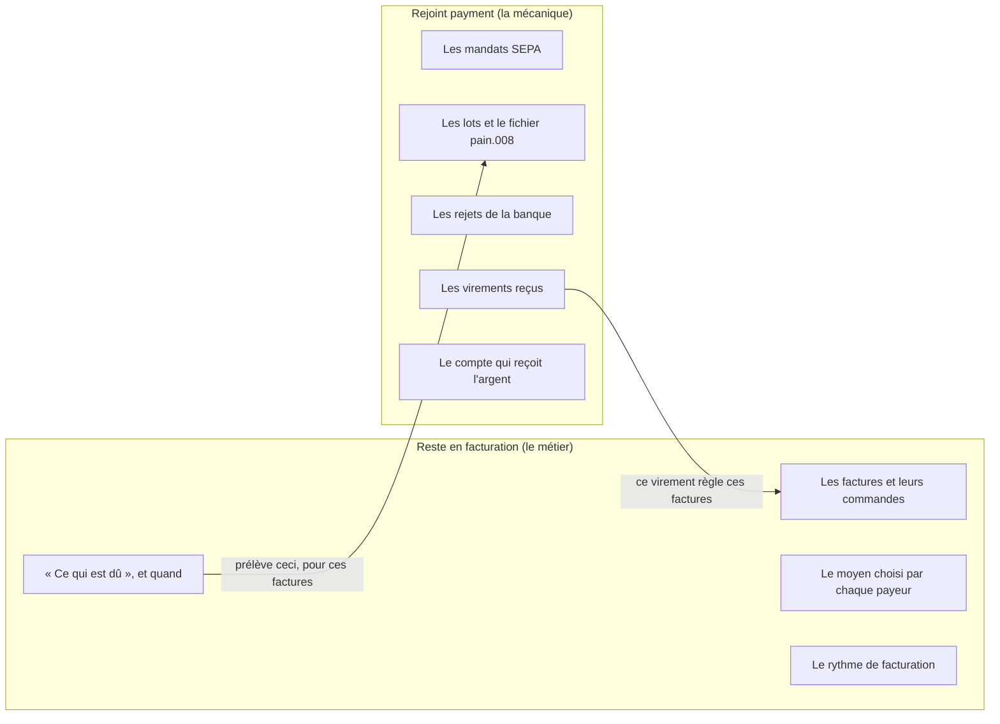
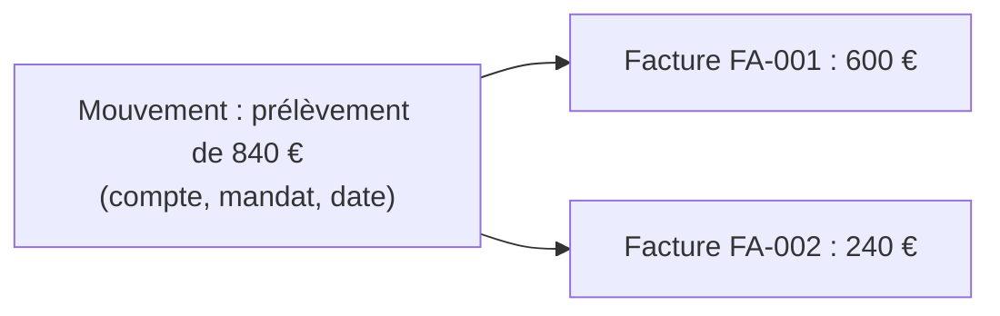

# Le prélèvement et le virement : ce qui devrait rejoindre `payment`

> 📐 **Analyse et proposition**, écrite le 2026-11-22 à la demande de Hugo.
> Rien n'est décidé ni bâti. Relevé de l'existant le même jour, dans
> `apps/lfd-api/src/lafoliecoffee/accounting/` (environ 800 fichiers),
> `apps/lfd-api/src/lafoliecoffee/payments/` et les schémas Prisma de
> `public`. Les docs d'état du prélèvement et du virement restent en
> comptabilité : [`../comptabilite/prelevement/prelevement-sepa.md`](../comptabilite/prelevement/prelevement-sepa.md),
> [`../comptabilite/le-paiement-par-virement.md`](../comptabilite/le-paiement-par-virement.md).

# Partie 1 — L'explication simple

Aujourd'hui, la carte vit dans le bloc `payment`, mais le **prélèvement
SEPA** et le **virement** vivent dans la **facturation** de La Folie Coffee.
Ils y mélangent deux choses de nature différente :

- **le métier** : ce qui est dû, quand, par quel moyen ce client a choisi de
  payer, quelle facture porte quelle commande ;
- **la mécanique bancaire** : un mandat signé, un fichier envoyé à la banque,
  un rejet qui revient, un virement reçu à rapprocher.

La règle de tri est celle du reste du bloc : **le métier dit ce qui est dû et
par quel moyen ; `payment` dit comment l'argent arrive.**



**Pourquoi le faire un jour** : une deuxième application pourrait prélever ses
clients sans recopier les mandats ni le fichier bancaire ; un changement de
banque toucherait le bloc, pas la facturation ; et la facturation
redeviendrait lisible (elle fait aujourd'hui les deux métiers).

**Pourquoi pas maintenant** : c'est le chantier le plus lourd du paiement
(des tables d'argent réel, des mandats signés, des fichiers déjà déposés), et
rien ne le réclame tant qu'une seule application prélève. Il se déclenche
quand une deuxième application doit prélever, ou quand la banque change.

# Partie 2 — La technique

## 1. Le tri, pièce par pièce

### 1.1 Rejoint `payment` — la mécanique bancaire

| Pièce                                                                                                                          | Où aujourd'hui                                                                                                                      | Pourquoi c'est de la mécanique                                            |
| ------------------------------------------------------------------------------------------------------------------------------ | ----------------------------------------------------------------------------------------------------------------------------------- | ------------------------------------------------------------------------- |
| **Le mandat SEPA** : agrégat `PaymentMandate`, la RUM, ses options, sa preuve, ses gestes (frapper, signer, envoyer, révoquer) | `lafoliecoffee/payments/` ; table `public.payment_mandates` (`accounting.prisma`)                                                   | un mandat autorise un débit sur un compte ; il ne sait rien d'une facture |
| **Le compte du débiteur** : `CompanyBankAccount`, l'IBAN et le BIC, leur accès                                                 | `lafoliecoffee/payments/` ; `public.company_bank_accounts`                                                                          | une coordonnée bancaire, scellée, sans métier                             |
| **Le lot de prélèvement** : `CollectionBatch`, ses lignes, son état, sa déposabilité, son attestation                          | `accounting/domain/entities/collection-batch*` ; `public.collection_batch`, `collection_batch_line`, `collection_batch_attestation` | un lot est un **mouvement d'argent** groupé chez une banque               |
| **Le fichier bancaire** `pain.008` et son audit                                                                                | `accounting/domain/services/pain008*.ts`                                                                                            | le format de la banque, propre au prestataire SEPA                        |
| **Le calendrier bancaire** (TARGET2)                                                                                           | `accounting/domain/services/target2-calendar.ts`                                                                                    | les jours ouvrés des banques, pas ceux du fournil                         |
| **Les rejets et retours** (R-transactions) : `CollectionReturn`, ses raisons, leur contrôle                                    | `accounting/domain/entities/collection-return.ts`, `bank-return-check` ; `public.collection_return`, `bank_return_check`            | ce que la banque répond                                                   |
| **Le prélèvement d'essai** : `CollectionTest` et son fichier                                                                   | `public.collection_test`, `collection_test_file`                                                                                    | un essai avec la banque                                                   |
| **Les exports de comptes et de mandats vers la banque**                                                                        | `mandate-bank-export`, `account-bank-export`, `known-bank-account`, `bank-line-correction`                                          | des échanges de fichiers avec la banque                                   |
| **Le virement reçu** : `ReceivedBankTransfer`                                                                                  | `accounting/domain/entities/received-bank-transfer.ts` ; `public.received_bank_transfer`                                            | un mouvement d'argent entrant, constaté sur un relevé                     |
| **Le compte créancier** : l'IBAN de l'entité, l'ICS, la confirmation aux quatre yeux                                           | `LegalEntity` (`accounting.prisma`), `creditor-account`, `pending-creditor-account`                                                 | **le compte qui reçoit l'argent**, l'équivalent SEPA de `CARD_ACCOUNTS`   |

### 1.2 Reste en facturation — le métier

| Pièce                                                                                  | Pourquoi c'est du métier                                                                                                                                                                               |
| -------------------------------------------------------------------------------------- | ------------------------------------------------------------------------------------------------------------------------------------------------------------------------------------------------------ |
| **Les factures**, leurs numéros, leurs mentions, Factur-X, Chorus                      | des documents comptables                                                                                                                                                                               |
| **Le mode et le rythme de facturation** (`billing-mode`, `billing-rhythm`)             | quand on facture un payeur                                                                                                                                                                             |
| **Le moyen d'encaissement d'un payeur** (`payer_collection_means`, `collection-means`) | ce que **ce client** a choisi : prélèvement, virement, demain carte par lien                                                                                                                           |
| **L'état d'encaissement d'une commande** (`order_collection`)                          | la vue du **sujet** sur son règlement : `due`, `collected`, `settled_by_transfer`…                                                                                                                     |
| **Le jugement « prélevable ou non »** (`collection-verdict.ts`)                        | il croise le moyen du payeur, la facture et l'état de la commande ; il **demande** au bloc si le mandat peut débiter, il ne le décide pas                                                              |
| **Les relevés de cycle, les virements en retard**                                      | ce qui est dû et en retard, vu du client                                                                                                                                                               |
| **L'entité émettrice** (raison sociale, préfixe, logo, établissement)                  | qui facture ; seul son **compte créancier** rejoint `payment`                                                                                                                                          |
| **La pré-notification** (`collection_notice`)                                          | ⚖️ **à trancher** : obligation SEPA, donc côté mécanique ; mais son contenu (factures, montants, date) vient du métier. Proposition : le bloc tient l'obligation et la date, la facturation le contenu |

### 1.3 Ce qui se coupe en deux

- **`collection-assembly.ts`** (constituer un lot) : la facturation choisit
  **ce qui** est prélevé (les factures dues, leurs montants) ; le bloc
  **constitue** le lot (regrouper par mandat et par compte, vérifier les
  plafonds `bank-collection-limits`, écrire le fichier).
- **Le rapprochement d'un virement** : le bloc constate le virement
  (montant, date, référence du relevé) ; la facturation dit quelles factures
  il règle, à écart nul.

## 2. Ce que le bloc doit apprendre

La carte paie **un** sujet à la fois. Le prélèvement et le virement règlent
**plusieurs** sujets d'un coup : une ligne de lot porte plusieurs factures
(`collection_batch_line_invoice`), un virement en règle plusieurs
(`received_bank_transfer_invoice`). Le port des sujets d'aujourd'hui
(`payment/channels/subjects/`) ne sait pas le dire.

**Le modèle proposé** : un **mouvement** (un débit SEPA, un virement reçu,
un paiement par carte), et sa **répartition** sur des sujets.



- chaque part est acceptée ou refusée par **son** sujet, comme `onPaid`
  aujourd'hui ;
- un **rejet** de la banque défait toutes les parts du mouvement, et chaque
  sujet redevient dû ;
- la carte devient le cas d'un mouvement à une seule part : rien ne change
  pour elle.

## 3. L'ordre proposé, le jour venu

### 3.1 Le virement d'abord, le prélèvement bien après

Discuté avec Hugo le 2026-11-22 : le virement est **le plus petit morceau**,
et le meilleur candidat pour faire passer la première pièce bancaire dans le
bloc.

|                                | Virement                                                          | Prélèvement SEPA                                               |
| ------------------------------ | ----------------------------------------------------------------- | -------------------------------------------------------------- |
| ce qui circule                 | un **constat** : « reçu 840 € le 3 décembre, référence FA-001 »   | une **demande** : on va chercher l'argent chez le client       |
| les tables à déplacer          | deux (`received_bank_transfer`, `received_bank_transfer_invoice`) | une quinzaine (mandats, comptes, lots, rejets, essai, exports) |
| les engagements juridiques     | aucun : le client vire de lui-même                                | mandats signés, pré-notification, délais légaux de rejet       |
| ce qui est déjà chez la banque | rien : la saisie est faite par le staff                           | des lots déjà déposés                                          |
| ce qui peut mal tourner        | un virement mal rattaché, que le staff corrige                    | un débit en double, un mandat invalide, un fichier refusé      |

Le virement **n'a pas besoin du compte créancier** : la facture continue de
lire l'IBAN de l'entité là où il est. Le compte créancier ne déménage qu'avec
le prélèvement.

**Ce qui déclenche le chantier** : une **lecture automatique des relevés
bancaires** (la banque envoie ses relevés, le bloc rapproche lui-même les
virements, ce qui est aussi le début du rapprochement automatique de la
[feuille de route](feuille-de-route.md)), ou une **deuxième application** qui
encaisse par virement. Avant l'un des deux, le déplacer rapporte peu.

### 3.2 Les lots

| Lot | Contenu                                                                                                                  | Risque                                           |
| --- | ------------------------------------------------------------------------------------------------------------------------ | ------------------------------------------------ |
| D0  | **Le modèle mouvement → parts**, d'abord pour la carte (une part) : aucun changement visible                             | faible                                           |
| D1  | **Le virement reçu** rejoint `payment/transfer/` ; la facturation garde le rapprochement à écart nul                     | moyen : deux tables d'argent réel                |
| D2  | **Le compte créancier** rejoint le bloc ; la facturation le lit par une lecture publiée (pour l'imprimer sur la facture) | moyen : un IBAN scellé, confirmé aux quatre yeux |
| D3  | **Les mandats et le compte du débiteur** rejoignent `payment/sepa-debit/`                                                | élevé : des mandats signés, leurs preuves        |
| D4  | **Les lots, le fichier `pain.008`, le calendrier, les rejets, l'essai**                                                  | élevé : des lots déjà déposés à la banque        |

Chaque lot passe par `vitruve` (argent, migration de données) et par
`lecteur-de-migrations`, et finit au runbook. Les tables déménagent de `public`
vers le schéma `payment` par **renommage**, jamais par copie, comme le lot V.

### 3.3 L'organisation dans le bloc

Un sous-dossier par moyen de paiement, comme `card/` : un nom de dossier ne
ment pas sur ce qu'il contient (la règle du lot zéro).

```
payment/
├── card/        la carte (existant)
├── link/        les liens de paiement (existant)
├── transfer/    les virements reçus (D1)
├── sepa-debit/  le prélèvement (D3, D4)
├── movement/    le mouvement et ses parts, commun à tous (D0)
├── shared/      ce qui sert à tous (le verrou de ligne)
└── channels/    ce que les autres blocs atteignent
```

- **Pourquoi pas dans `card/`** : un virement n'a ni intention, ni webhook, ni
  remboursement par API ; il a un relevé, une date de réception, une
  référence, et un rattachement à des factures. Son cycle de vie est « reçu →
  rattaché », pas « en attente → payé → remboursé ». Son prestataire, à terme,
  est la banque, pas Stripe.
- **Le mouvement** vit à part (`movement/`), parce qu'il sert à tous les
  moyens ; sa partie publique est dans `payment/channels/`.
- **Les tables** prennent le préfixe de leur moyen dans le schéma `payment`,
  comme `card_` : par exemple `transfer_received` et `transfer_allocation`.
- **La doc** du chantier vit dans `documentation/payment/`, un plan, ou un
  sous-dossier `virement/` s'il grossit.

## 4. Les questions ouvertes

| Question                                                                                                                                   | À qui                |
| ------------------------------------------------------------------------------------------------------------------------------------------ | -------------------- |
| Quand le faire : à la deuxième application qui prélève, au changement de banque, ou plus tôt pour alléger la facturation ?                 | Hugo                 |
| La pré-notification : obligation tenue par le bloc, contenu par la facturation (§1.2) ?                                                    | Hugo, puis `vitruve` |
| ~~Le vocabulaire des sous-dossiers~~ : un sous-dossier par moyen, `payment/transfer/` et `payment/sepa-debit/` (Hugo, 2026-11-22, §3.3)    | tranché              |
| Le dossier `lafoliecoffee/payments/` (mandats et demandes libres) : il se vide en D2 ; que deviennent les demandes libres, qui y restent ? | à trancher en D2     |

## 5. 🔁 Piste à revoir : qui possède quoi (Hugo, 2026-11-22)

> Notée à la demande de Hugo comme **piste à revoir** avant D2 : « je pense
> que c'est la bonne découpe ». Elle corrige le §1.1, qui faisait entrer
> dans le bloc tout le « compte créancier » de l'entité.

**L'entité juridique ne rejoint pas `payment`.** Raison sociale, SIREN/SIRET,
TVA, adresse, logo, numérotation : c'est l'identité de qui facture, elle
reste en facturation. Seul son **compte d'encaissement** est de la mécanique.

|               | Possédé par l'application (la facturation)                           | Possédé par `payment`                                                                                                                            |
| ------------- | -------------------------------------------------------------------- | ------------------------------------------------------------------------------------------------------------------------------------------------ |
| Côté émetteur | l'entité juridique, et **quel compte elle utilise** (un identifiant) | le **compte d'encaissement** : IBAN, BIC, ICS, nom du titulaire, confirmation aux quatre yeux — une configuration du bloc, comme `CARD_ACCOUNTS` |
| Côté client   | la société cliente, son moyen choisi, ses factures                   | le **mandat** et l'IBAN du client, dans un coffre, et la vie du mandat (RUM, `FRST`/`RCUR`, modification, caducité)                              |
| La demande    | « prélève 840 € au mandat M, pour FA-001 et FA-002, le 5 »           | le lot, le `pain.008`, le calendrier, les rejets, puis chaque sujet prévenu                                                                      |

**Pourquoi le mandat et l'IBAN du client restent au bloc**, et ne sont pas
renvoyés par l'application à chaque demande : le prélèvement a une mémoire
imposée (séquence, modification signalée à la banque, rejet rattaché au
débit d'origine, caducité). Sans elle dans le bloc, chaque application
réécrirait ces règles. C'est la forme de Stripe, GoCardless ou Adyen : un
coffre de moyens de paiement, et le commerçant n'envoie qu'une référence.

**Conséquences** :

- D2 devient « **le compte d'encaissement** » (et non « le compte
  créancier ») ; la facturation lit l'IBAN à imprimer par une lecture publiée ;
- la colonne `payment.transfer_received.received_into` (lot D1) porte
  aujourd'hui l'identifiant de l'entité : en D2, elle devient l'identifiant
  du compte d'encaissement (0 virement au 2026-11-22, rien à convertir).
