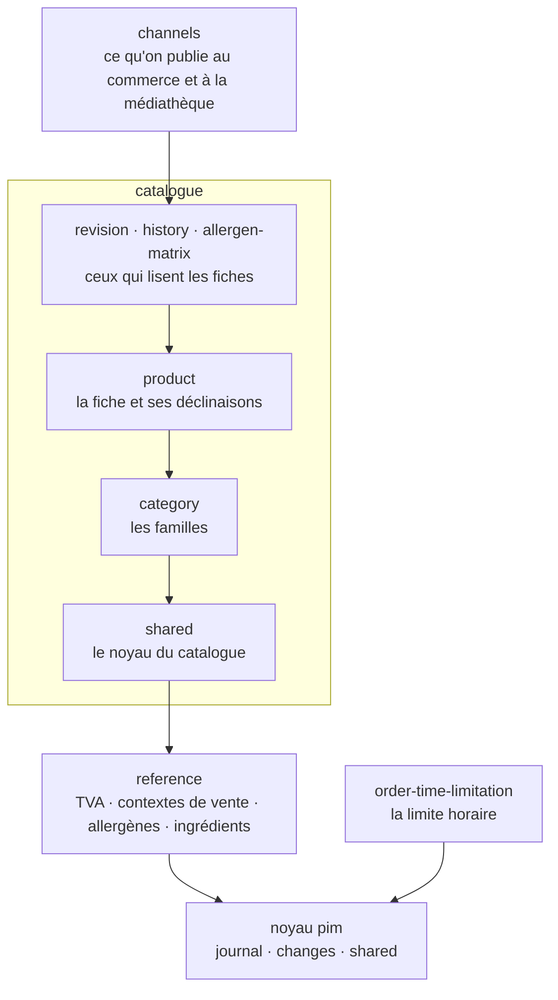

# L'architecture du référentiel

> ✅ Doc d'état (2026-11-19). Elle remplace le plan « le référentiel à neuf »
> (lots L0 à L9, bâtis du 2026-11-18 au 2026-11-19, commits `3d841f9b9` à
> `7609b878f` ; le détail est dans `git log -- apps/lfd-api/src/pim`).

## 1. En simple

Le référentiel (`apps/lfd-api/src/pim/`) est rangé en **sous-contextes**, et
chacun ne parle que de ce qui est à lui.

Trois règles tiennent l'ensemble :

- **On ne lit que vers le bas**, par la surface publique de l'autre :
  son `index.ts`, son `domain/` (ports, erreurs, valeurs), ses faits.
- **On ne lit que ses propres tables.** Celui qui écrit une table publie une
  lecture nommée ; les autres la composent. Quand le sens interdit
  l'import (un référentiel de base ne lit jamais le catalogue), le
  consommateur déclare son besoin et la racine (`appBootstrap/`) y répond.
- **Rien ne se supprime** : référentiels et fiches s'archivent, et une fiche
  archivée refuse toute édition (nom, type, famille, textes, visuels).

## 2. Ce qui le tient

| Porte                   | Ce qu'elle refuse                                                                                   |
| ----------------------- | --------------------------------------------------------------------------------------------------- |
| `lint:pim-subcontexts`  | un import hors du sens admis, entre blocs et entre sous-contextes du catalogue ; aucun cycle        |
| `lint:pim-table-owners` | une lecture Prisma d'une table qu'un autre sous-contexte écrit                                      |
| `lint:pim-file-size`    | un fichier de plus de 300 lignes (liste admise : `journal/pim-journal.ts`, `product.controller.ts`) |

Les trois dettes sont **vides** au 2026-11-19.

## 3. La partie technique

### 3.1 Les agrégats

- **`Product`** garde son statut, ses déclinaisons et ses refus ; il délègue
  à des objets qu'il possède : `ProductLineup` (les gestes adressés à une
  déclinaison), `ProductCommerceOptions`, `VatByContext`,
  `ProductCompleteness`. Les transitions de statut sont des fonctions pures
  (`product-lifecycle.ts`). `Product.requireEditable` est le seul refus
  d'une fiche archivée.
- **`Variant`** délègue à `VariantSale`, `VariantRegulatory`,
  `VariantLifecycle`, `VariantAspect`.
- **`CatalogRevision`** (nommer une révision, une seule fois), la mise en
  vente, `ProductReadiness`, et `ProductComposition` (chez les ingrédients :
  ingrédient inconnu ou archivé refusé).
- **Écritures simples assumées** : aucune ; textes et visuels passent par la
  fiche depuis le 2026-11-19 (décision de Hugo).

### 3.2 Les lectures publiées

- `product` : `AllProductsReader`, `ProductRecordsReader`,
  `EffectiveVatReader`, `ProductPlacementReader`, `ProductTalliesReader`,
  `ProductImageHolders`, `AllergenListingReader`, `AllergenFreshnessReader`,
  et les décomptes d'usage des taux et des contextes.
- `category` : `AllCategoriesReader`, `FamilyVatReader`,
  `CategorySnapshotsReader`, `CategoryChainReader`, `CategoryIdsReader`,
  `CategoryNamesReader`, `CategoryImageHolders`.
- `revision` : `RevisionsHoldingReader`.
- Elles sont rangées dans `catalogue/catalogue-readings.providers.ts`. Les
  assemblages pour les référentiels et la médiathèque vivent à la racine
  (`appBootstrap/pim-catalogue-*.ts`).
- Aucun lecteur hors de son propriétaire ne dépend d'un port d'écriture
  (`listAll` a quitté les dépôts).

### 3.3 L'archive

Taux de TVA, contextes de vente, ingrédients, appellations et limites
horaires portent `archived_at` (migration `20261118170000`). Les verrous
`VatRateLock` et `SalesContextLock` empêchent d'archiver un taux ou un
contexte pendant qu'une pose s'en sert ; l'archive d'un taux encore servi
est refusée.

## 4. Ce qui reste

- Onze fonctions dépassent 40 lignes (la plus longue, `snapshotItems`, 71).
- `product.ts` est à 300 lignes : le prochain geste de la fiche en sort une
  capacité (les réglages de vente d'abord).
- Deux ports d'identifiant cohabitent (`IdGenerator` ULID, `UuidGenerator`
  UUID v7) : les unifier changerait un format.
- Relevé par l'audit à l'aveugle du 2026-11-19 (notes : qualité 7, isolation
  8, SOLID 6, DDD 7) : des listes et lecteurs passent encore par un port qui
  porte `save` (taux, ingrédients, révisions, contextes, limites) ; la règle
  « parent vivant » d'une famille est dans deux handlers ; le verrou de
  publication (`prisma-publication-sequence.ts`) lit les tables du catalogue
  en SQL, que `pim-table-owners` ne lit pas ; `optionalColumn` et la
  mécanique des médias sont écrits deux ou trois fois ; une quarantaine de
  commentaires historiques.
- La question ouverte : `category` et `product` séparés coûtent des
  assemblages à la racine ; les fusionner en « l'arbre du catalogue » est
  à juger sur le prochain audit.
