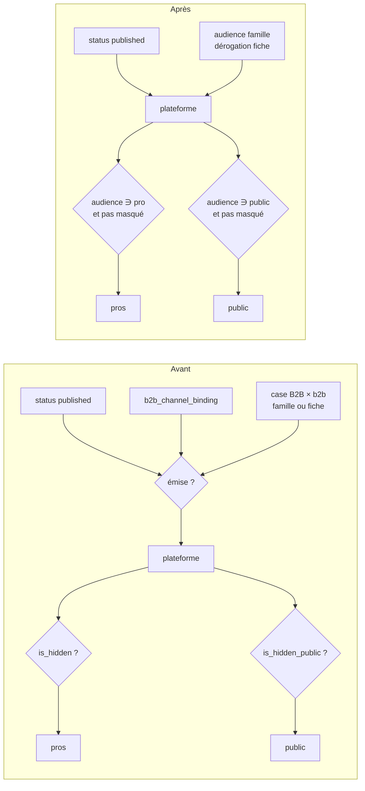

# Plan — l'audience par héritage, à la place des canaux

> 📐 **Doc-first, rien n'est bâti** (rédigé le 2026-10-15). Porte une
> **migration de données** (trois tables ramenées à une colonne) : `vitruve`
> est obligatoire avant Hugo (CLAUDE.md §9 bis). Sa contradiction est en fin
> de document.
>
> Tout ce que le §1 affirme a été ouvert le 2026-10-15. Les comptes viennent
> de la base de **dev** (`lfc_b2b_dev`) ; la production n'a **pas** été
> mesurée.

## 0. La demande (Hugo, 2026-10-15)

> « simplifier la manière dont le pim et le b2b interagissent […] qu'est ce qui
> est obsolète dans le pim par rapport à notre façon de dire b2b b2c sur un
> produit, est-ce que les canaux servent encore » — « les contextes c'est
> important car fiscalité, audience système d'héritage parfait ».

Ce qui est retenu :

- un produit dit **à qui il se vend** : `pro`, `public` ou `both` — le
  vocabulaire que les opérations parlent déjà ;
- l'audience **se pose sur la famille et s'hérite**, une fiche pouvant déroger ;
- les **contextes de vente restent**, réduits à ce qu'ils sont vraiment : des
  régimes de TVA ;
- la matrice des canaux, l'appartenance au canal B2B et le point de vente
  **sortent**.

## 1. Ce qui existe

### 1.1 Cinq leviers pour une seule question

| #   | Où                                                                     | Ce qu'il dit                    | Qui le lit                                                                                                      |
| --- | ---------------------------------------------------------------------- | ------------------------------- | --------------------------------------------------------------------------------------------------------------- |
| 1   | `pim.product.status = published`                                       | la fiche est finie              | **pas le push** — cf. [`plan-publication-par-faits-versionnes.md`](plan-publication-par-faits-versionnes.md) §1 |
| 2   | `pim.b2b_channel_binding`                                              | « vendu aux pros »              | le push part de cette liste (`membership.service.ts`, `publishedProductIds`)                                    |
| 3   | `pim.category_channel` / `product_channel` (point de vente × contexte) | la case « B2B × `b2b` » ouverte | le push écarte sinon, motif `canal_ferme` (`projection.ts:352`)                                                 |
| 4   | `public.catalog_item_overrides.is_hidden`                              | masqué aux pros                 | `hiddenFrom()` (`b2b/catalog/infrastructure/prisma-catalog.reader.ts:237`) — rayon, fiche, commande             |
| 5   | `public.catalog_item_overrides.is_hidden_public`                       | masqué au public                | le même `hiddenFrom()`                                                                                          |

En dev : 95 fiches publiées, 95 liées au canal, 0 publiée sans lien. Les leviers
1 à 3 disent la même chose trois fois.

### 1.2 Le public n'est décidé nulle part dans le référentiel

- La projection n'examine **que** la case `b2b` (`sellsContext(…, B2B_CONTEXT_KEY)`).
  Les cases boutique (Labo, Village × `takeaway`, `eatIn`) ne sont lues par
  **aucun** chemin d'émission ni par la boutique.
- Conséquence : **un produit « public seulement » est impossible aujourd'hui.**
  Ce qui n'est pas coché B2B n'arrive pas sur la plateforme, donc pas non plus
  dans la boutique publique. Et inversement, tout ce qui est coché B2B est en
  vitrine publique, sauf masquage (levier 5).
- Chaque article émis porte une étiquette TTC : sans elle la déclinaison est
  écartée (`variant_sans_prix`, `projection.ts`). Il n'existe donc pas d'article
  émis sans prix public.

### 1.3 Ce qui sert vraiment, et doit rester

- **Les taux par contexte.** `vatByProduct` est résolu indépendamment des canaux
  (`feed-projection.service.ts` : `vatPercents(products)` d'un côté,
  `effectiveChannels(products)` de l'autre). Il produit `publicByContext`
  (`takeaway`, `eatIn`, `b2b`). La boutique publique sert `takeaway`
  (`b2b/catalog/domain/public-context.ts`, `PUBLIC_SALES_CONTEXT`).
- **L'héritage famille → fiche** existe déjà pour les canaux :
  `ProductChannelOverride` — sa présence dit « déroge », son absence « hérite ».
  En dev : 1 fiche déroge.

### 1.4 Ce qui est mort ou doublon

- **Point de vente** : `pim.point_of_sale` « Village », « Labo », « B2B ». Les
  deux boutiques doublonnent `public.pickup_addresses` « Le Village » et
  « Le Labo », sans lien entre elles. La ligne `platform` « B2B » n'existe que
  pour porter la case pro. Sa sortie est déjà proposée par
  [`plan-publication-par-faits-versionnes.md`](plan-publication-par-faits-versionnes.md) P6.
- **Le vocabulaire Shopify** sur `sales_context` (`handle_suffix`,
  `shopify_projected`) : son canal a quitté le dépôt le 2026-09-21. Déjà
  inventorié dans [`todo-le-vocabulaire-shopify-survit-au-canal.md`](todo-le-vocabulaire-shopify-survit-au-canal.md).

### 1.5 Le modèle à copier existe : les opérations

`CatalogOperation.audience` (`pro` | `public` | `both`) vient du référentiel ;
`CatalogOperationOverride.audience` permet à la plateforme de **restreindre**
(`prisma/schema/public/catalog-operations.prisma`). Le contrat est déjà dans
`@lfd/pim-contracts` (`OPERATION_AUDIENCES`).

## 2. Avant / après

## 3. Décisions proposées

### D1 — L'audience, sur la famille, dérogeable par fiche

- `pim.category.audience` : `pro` | `public` | `both`, **obligatoire**. Une
  famille dit toujours à qui elle se vend.
- `pim.product.audience` : même domaine, **nullable**. `NULL` = « cette fiche ne
  se prononce pas, elle hérite » — la sémantique d'`OrderTimeLimit`, écrite dans
  le schéma au même endroit.
- Résolution : `product.audience ?? category.audience`, en **un** endroit du
  domaine (un value object `Audience` et une fonction `effectiveAudience`), lu
  par la projection et par l'écran.
- Pas de valeur « aucune » : une fiche qu'on ne vend à personne est une fiche
  non publiée. Ajouter `none` referait une deuxième porte à côté du statut.
- Deux listes existent déjà : `OPERATION_AUDIENCES`
  (`pim-contracts/src/operation.ts:19`, côté référentiel) et
  `RECEIVED_OPERATION_AUDIENCES` (`contracts/src/catalog-operations.ts:17`,
  côté plateforme, qui connaît en plus `none` pour la restriction locale). Le
  produit réutilise la **première**, sans la renommer : renommer touche les
  deux paquets et le journal pour rien. `none` reste un mot de la plateforme,
  jamais du référentiel.

### D2 — Ce qui part : publiée, point

Est émise une fiche **`published`**, quelle que soit son audience.

⚠️ C'est un changement de source, pas seulement de filtre : aujourd'hui le push
part du **lien** (`membership.service.ts:56-61`) et ne lit jamais `status`
(ni `projection.ts` ni `push.service.ts`). Une fiche liée non publiée cesserait
d'être émise, une fiche publiée non liée commencerait à l'être. En dev les deux
ensembles sont vides (0 et 0, comptés le 2026-10-15) ; le comptage de prod du
lot 1 les mesure, et un ensemble non vide se tranche avant le lot 2 (Q2). L'audience
voyage **dans** le snapshot, sur chaque produit ; la projection n'écarte plus
rien pour raison de canal (`canal_ferme` disparaît).

C'est ce qui rend le public-seulement possible : la fiche part, et la
plateforme ne la montre qu'au public.

Ce plan ne change **pas** le mécanisme d'envoi (push manuel, aperçu, révision).
Il marche avec le push actuel, et avec les faits versionnés si
[`plan-publication-par-faits-versionnes.md`](plan-publication-par-faits-versionnes.md)
est bâti ensuite. Il en simplifie deux points (§5).

### D3 — Côté plateforme : une colonne, la même règle de masquage

- `public.catalog_items.audience`, écrite à l'ingestion depuis le snapshot.
- La règle : _caché si l'audience de l'article ne contient pas celle du
  lecteur, **ou** si le masquage de cette audience est posé_. Elle s'écrit
  **une fois** dans le domaine du catalogue (`servedTo(item, viewer)`), et
  remplace chacune des lectures directes du masquage — elles sont plusieurs,
  pas une (relevé `vitruve`, 2026-10-15) :
  - `hiddenFrom()` — `prisma-catalog.reader.ts:237`, lu l. 93, 109, 131 : rayon,
    fiche, lot de SKU ;
  - l'éditeur de vitrine — `catalog-backed-storefront-catalog.reader.ts:22`
    (`!(isHidden && isHiddenPublic)`) ;
  - le résumé « en vente » — `get-catalog-summary.handler.ts:32-42` ;
  - l'export — `catalog-csv.ts:91`.
  - ⚠️ **Non vérifié** : que la passation de commande passe par
    `findSku` / `listDefaultsByProductSkus` de ce lecteur. À tracer au lot 2,
    et prouver par un e2e (commande pro refusée sur un article `public`).
- Les opérations gardent leur test (`storefront-catalog-operations.ts:40`) :
  elles ont déjà leur audience.
- Les deux masquages (`is_hidden`, `is_hidden_public`) **restent** : ce sont des
  décisions locales et temporaires (« plus de stock cette semaine »), pas des
  décisions de gamme. Ils ne peuvent que **restreindre** — comme l'override
  d'une opération. Montrer aux pros un article que le référentiel dit
  `public` est impossible depuis la plateforme.
- La table « Catalogue actuel en ligne » gagne la lecture : la ligne pro d'un
  article `public` dit « pas vendu aux pros » à la place du prix ; même chose
  pour le public. L'interrupteur de masquage de cette ligne disparaît (il n'y a
  rien à masquer).
- `get-catalog-summary.handler.ts` (« en vente ») compte avec la même règle.

### D4 — Les contextes de vente : des régimes de TVA, rien d'autre

Restent : `key`, `label`, `active`, `position`, et les tables de taux
(`category_context_tva`, `product_context_tva`). Sortent, plus lus ni écrits :
`handle_suffix`, `shopify_projected` (le TODO Shopify est fermé par ce lot),
`categoryChannels`, `productChannels`, `offeredBy`.

Le contexte `b2b` reste : c'est un taux, celui que facture la plateforme. Il
n'ouvre plus rien.

### D5 — Ce qui sort du référentiel

**Lecteurs à reprendre**, relevés par `vitruve` le 2026-10-15 :

- le journal : `pim-journal.ts:101,211` (`product.channels_changed`,
  `product_category.channels_changed`) → un fait `audience_changed` sur la
  fiche et sur la famille, qui **entre dans** `content-facts.ts` et
  `revision/domain/global-causes.ts` à la place de `soldContexts` : changer
  l'audience doit déclencher une révision comme changer la diffusion le faisait ;
- `revisions.prisma:84-123` (`channel` de `CatalogRevisionPublication`) :
  reste, il nomme la destination `b2b`, pas une case ;
- `prisma-point-of-sale-usage.reader.ts`, `prisma-sales-context.repository.ts`,
  `get-product-detail.ts`, les repositories famille et fiche ;
- le contrat : `"canal_ferme"` dans `packages/pim-contracts/src/b2b-channel.ts:89`,
  lu par `b2b-exclusions.ts:37` — retiré de l'union au lot 4 avec ses lecteurs
  (pré-release, §0 : contrat cassable dans un déploiement) ;
- la parité (`check-catalog-parity.service.ts`) et la santé du catalogue ;
- les e2e `pim-channel-matrix`, `pim-points-of-sale`, `pim-shops`,
  `pim-readiness` : réécrits ou retirés au lot 4.

- `pim/channels/b2b-platform/membership/` entier (service, contrôleur), et
  `b2b_channel_binding` cesse d'être lu et écrit.
- `CategoryChannel`, `ProductChannelOverride`, `ProductChannel` : plus lus ni
  écrits ; `sales-channels.ts`, `sellable-channels.ts`, `set-product-channels.ts`
  et `channel-errors.ts` sortent.
- `pim/points-of-sale/` **sauf sa grille de tables** (Q4) — c'est la P6 du
  plan de publication, absorbée ici, **sans** son dédoublonnage : il n'y a plus
  de cellule à dédoublonner.
- Front : la section « Canaux » de la famille (`channels-form.ts`) devient un
  choix d'audience ; la fiche gagne « hérite (_valeur de la famille_) / pro /
  public / les deux » ; l'écran `publication-b2b` (appartenance) et
  `b2b-exclusions.ts` perdent le motif de canal.
- **Les tables restent en base** (CLAUDE.md §0) : plus lues, plus écrites. Leur
  `DROP` attend un ordre explicite.

### D6 — La migration de données

Ce qui doit tenir : **personne ne voit un article disparaître ou apparaître le
jour de la bascule.** Le comportement actuel (§1.2) est « tout ce qui est
coché B2B est vu des pros **et** du public, sauf masquage ». D'où :

| Aujourd'hui                                                       | Audience posée                                  |
| ----------------------------------------------------------------- | ----------------------------------------------- |
| famille avec une case `b2b`                                       | `both`                                          |
| famille sans case `b2b`                                           | **à décider** — Q2                              |
| fiche qui déroge (`product_channel_override`) avec une case `b2b` | `both` si sa famille ne l'est pas, sinon `NULL` |
| fiche qui déroge sans case `b2b`                                  | **à décider** — Q2                              |
| fiche sans dérogation                                             | `NULL` (hérite)                                 |

Les cases boutique ne comptent pas : elles ne décidaient rien. Le masquage pro
d'un article reste posé à l'identique ; la migration ne touche aucune ligne de
`catalog_item_overrides`.

En dev : 5 familles, les 5 ont une case `b2b` → 5 `both`, 0 cas à décider.
**Production non mesurée** : la requête de comptage est le premier geste du lot 1.

**La source de l'existant est le lien ET la case**, pas la case seule :
est servie aujourd'hui une fiche liée (`b2b_channel_binding`) dont la case
`b2b` effective est ouverte. La table ci-dessus ne s'applique qu'à elles.

**Une fiche publiée invisible aujourd'hui** (dérogation sans case `b2b`, ou
non liée) n'a pas de valeur conservatrice, puisque `none` n'existe pas : la
garder invisible demande de la **dépublier**, ce qui est un changement de
statut, pas une audience. C'est Q2. En dev : 0 cas.

Migrations, toutes additives : `category.audience` (avec la valeur calculée,
puis `NOT NULL`), `product.audience` nullable, `catalog_items.audience`.
`catalog_items.audience` est remplie au premier push **accepté** ; tant
qu'elle est `NULL`, la lecture la tient pour `both` — le comportement actuel,
donc rien ne change pour le client tant qu'aucune livraison n'est acceptée.
Le déploiement du lot 2 se termine par un push et son acceptation (geste écrit
dans le runbook).

**La boîte de réception.** `catalog_delivery` garde un snapshot entier en
`pending` jusqu'à acceptation (`catalog.prisma:362-394`), et le fil passe de
la version 12 à 13 (`CATALOG_SNAPSHOT_VERSION`, `z.literal`). Une livraison v12
en attente au déploiement serait refusée à la relecture. Geste : **avant** le
déploiement du lot 2, aucune livraison `pending` — acceptée ou refusée. En dev :
0 en attente. ⚠️ Non vérifié : ce que fait la relecture d'une version inconnue
(`prisma-catalog-delivery.repository.ts:92-97`) ; à lire au lot 2 pour que le
refus nomme le geste.

## 4. Lots

| Lot   | Contenu                                                                                                                                         | Donne                             |
| ----- | ----------------------------------------------------------------------------------------------------------------------------------------------- | --------------------------------- |
| **1** | Comptage en prod ; colonnes et migration de données (D6) ; value object `Audience`, résolution ; `AUDIENCES` dans `@lfd/pim-contracts`          | le référentiel connaît l'audience |
| **2** | Le snapshot porte `audience` (version du fil + 1) ; la projection n'écarte plus par canal ; ingestion → `catalog_items.audience` ; `hiddenFrom` | **le public-seulement existe**    |
| **3** | Écrans : famille, fiche, table « Catalogue actuel en ligne », résumé                                                                            | le staff règle et lit l'audience  |
| **4** | Retraits D5 (appartenance, matrice, point de vente, colonnes Shopify)                                                                           | le référentiel tient en un champ  |

Les lots 1 à 3 ne retirent rien : jusqu'au lot 4, la matrice et le lien
existent encore, mais ne décident plus.

**Réversibilité.** Après le lot 2, la projection ne lit plus ni le lien ni la
case. Revenir en arrière demande de rétablir le filtre **et** de remettre à
jour lien et cases, que l'écran aura cessé d'écrire au lot 3. D'où : le lot 3
**continue d'écrire** le lien et la case `b2b` en miroir de l'audience
(`pro`/`both` ⇒ lié et coché), jusqu'au lot 4. Le retour reste un
redéploiement tant que le lot 4 n'est pas passé.

Le lot 4 ne touche pas la grille de tables à QR (Q4).

## 5. Ce que ça simplifie dans le plan de publication

[`plan-publication-par-faits-versionnes.md`](plan-publication-par-faits-versionnes.md) :

- **P1** — « émise si publiée ET cochée sur la carte `b2b` » devient « émise si
  publiée ». Décocher une carte n'est plus un fait « retirée » : changer
  l'audience est une republication.
- **P6** — absorbée par D5, sans dédoublonnage : plus aucune cellule n'est
  lue. L'objection BLOQUANT n° 3 de `vitruve` est **déplacée**, pas levée : les
  tables restent en base avec leurs doublons, et la question « supprimer des
  lignes » revient le jour où un `DROP` est demandé. Les BLOQUANT n° 1 et 2 du
  plan de publication sont intacts ; ce plan n'en dépend pas — il marche avec
  le push actuel.

## 6. Ce que ce plan ne tranche pas : l'équivalence pro / public

Aujourd'hui le prix se décide à **deux** endroits : le référentiel pose
l'étiquette TTC et dérive le prix pro par un rapport (`pim.accounting_rules` :
9 000 points, méthode `ratio_ttc`), puis la plateforme peut remplacer le prix
pro et le prix public (`catalog_item_overrides.price_millicents`,
`decided_public_ttc_cents`). En dev, 21 articles sur 22 dérogations remplacent
le prix pro. Simplifier ce chemin touche l'argent et demande son propre plan
contredit. Ce document n'y touche pas.

## 7. Risques

- **Un article disparaît de la vitrine** si la migration se trompe de sens.
  Couvert par D6 (`both` par défaut sur l'existant) et par un e2e : après
  migration, l'ensemble des SKU servis aux pros et au public est identique à
  l'avant.
- **Une commande pro sur un article public-seulement.** Couverte par
  `hiddenFrom`, à prouver par un e2e de non-régression (la commande est
  refusée, comme pour un article masqué).
- **Un public-seulement sans taux `takeaway`** n'a pas de prix servi au public.
  Même refus qu'aujourd'hui pour un contexte sans taux (`publicPricesOf`).
- **Le fil change de version.** Le récepteur refuse un snapshot d'une autre
  version (`CATALOG_SNAPSHOT_VERSION`, `packages/catalog-sync/src/snapshot.ts`) :
  émetteur et récepteur se déploient ensemble — même processus, même image.

## 8. Questions à Hugo

1. **Q1** — Une fiche peut-elle **élargir** l'audience de sa famille (famille
   `pro`, fiche `both`), ou seulement la restreindre ? Proposé : les deux, c'est
   un héritage, pas un plafond.
2. **Q2** — Une fiche publiée mais **invisible aujourd'hui** (non liée, ou
   sans case `b2b`) : on la dépublie (proposé : rien ne change pour le client),
   ou on lui donne une audience et elle apparaît le jour de la bascule ? Et une
   fiche liée **non publiée** : on la publie, ou elle sort ? Sans objet si le
   comptage de prod du lot 1 rend zéro partout.
3. **Q3** — Les masquages de la plateforme restent, et ne peuvent que
   restreindre : d'accord ?
4. ~~**Q4**~~ — **Tranché (Hugo, 2026-10-15) : la commande à table viendra
   « un jour », et ce sera une capacité du site** — « presque une capacité de
   site eatIn, l'endroit où définir un plan de table et des QR ».

   Le site (`public.sites`, modèle `Site`, `prisma/schema/public/settings.prisma`)
   a déjà ses capacités, chacune un drapeau : `pickup` (il remet des
   commandes), `deliveryDeparture` (des tournées en partent), `supply`. Une
   capacité « sur place » s'y range à côté, et le plan de tables avec ses QR
   lui appartient. Le mot rejoint le contexte de TVA `eatIn` : servir sur place
   **est** ce qui fait facturer à ce taux.

   Conséquence pour ce plan : le point de vente perd son rôle de canal au
   lot 4, et sa grille de tables (`PointOfSaleTable`, `generate-table-qr`,
   `remove-table-qr`, son écran) **reste telle quelle, non lue**, jusqu'au plan
   de la commande à table, qui la recréera sur le site. Ce jour-là, le point de
   vente sort entier du référentiel.

## Contradiction de `vitruve` (2026-10-15) — intégrée

Trois BLOQUANT, tous corrigés dans le corps :

1. `hiddenFrom` n'était pas le seul lecteur du masquage → D3 liste les quatre
   sites et pose une règle unique ; la passation reste **non vérifiée**.
2. D6 ignorait que le push part du lien et non du statut → D2 et D6 le disent,
   comptent les deux bords en dev (0 et 0), et renvoient l'invisible-publié à Q2.
3. La version du fil et la boîte `catalog_delivery` → aucune livraison en
   attente avant le lot 2, push accepté à la fin du déploiement.

Sérieux intégrés : lecteurs manquants de D5 (journal, révisions, contrat,
parité, e2e), les deux listes d'audience (on ne renomme plus), §5 reformulé
(objection déplacée, pas levée), réversibilité par écriture en miroir.
Mineur : Q4 rattachée au lot 4.

Restent **non vérifiés** : le chemin de la passation, la relecture d'une
version de fil inconnue, et tous les comptes de production.
